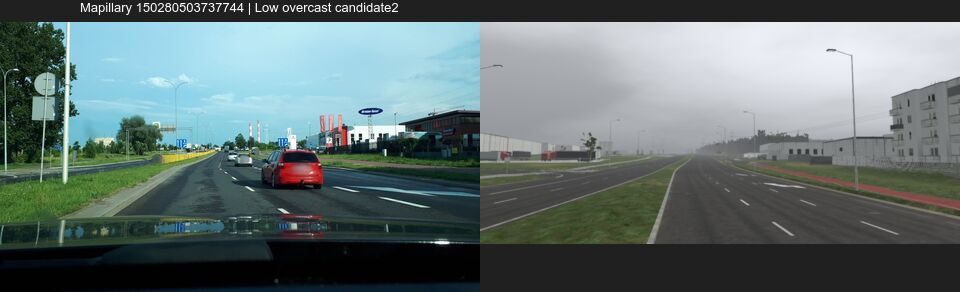
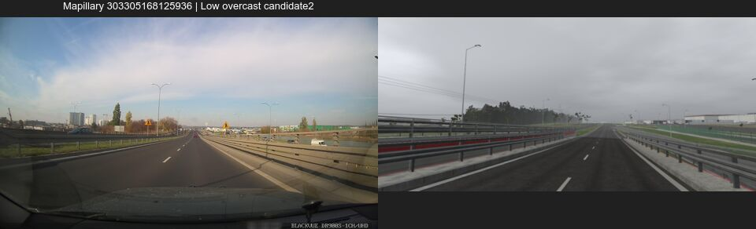
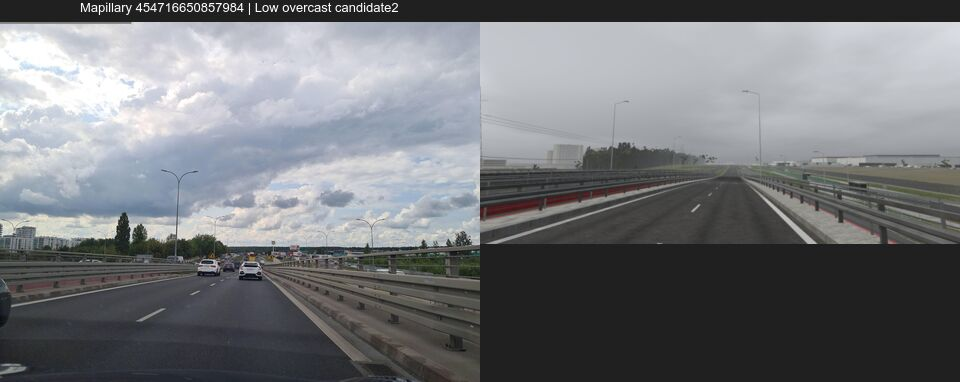

# Runda 1 — asfalt jako materiał

Korekta pomiaru z 2026-11-12: proporcje kontrastu renderu i maski projekcyjne zostały wycofane z powodu błędnego wyznaczenia początku regionu przy automatycznym reseatingu kamery. Szczegóły: CORRECTION-2026-11-12.md i MEASUREMENT-STATUS.json. Ocena wizualna pozostaje warunkowa.

Gałąź: gpt-asphalt-r1. Stan: runda zakończona, ocena wizualna warunkowa, bez pełnego PASS. Wybrany wariant: candidate2. SHA kodu produktu: 53e403c964cbb62e028c27eabd6d78ec1c27e3f5. Punkt drzewa przed końcowym raportem: ccfb4ab6c366650181c7a91ff5290f92ea1e2b2e. Data raportu: 2026-11-12T00:43:35.1640595+01:00. Nie scalono do main, niczego nie pushowano i nie używano telefonu.

Przygotowano wymagany worktree i zasoby, włączono gałąź `gpt-surface-wear`, a następnie wykonano baseline i dwa warianty. Każda pełna seria ma 78 kamer w Low i High, clear i overcast, czyli 312 obrazów. Własne kamery bliskich łat służą kontroli materiału, nie są pozami odtworzonymi ze zdjęcia. Audyt runtime-state-audit.json potwierdza 78 stanów dla każdego warunku, bez brakujących kamer. Low: global detail false, cel renderowania 1755 × 810 i PNG po przeskalowaniu do 2340 × 1080; High: global detail true, 2340 × 1080. To dotychczasowe profile, takie same w baseline i candidate2. Wszystkie odczytane maski były ASTC 8×8. Macierze i stany z momentu renderowania zachowano w candidate2/*/runtime-cameras.

Na Low stary asfalt może teraz korzystać z istniejących masek spękań i foto-albedo bez dodatkowej normalnej tych warstw. W danych materiału ustawiono ton 0,90 i dodatkowe przyciemnienie śladów kół 0,45. Są to WORKING_VALUE. Istniejące naprawy dostały szew 25 mm oraz odmienny ton zależny od wieku. UV0 całych łat jest normalizowane przed cięciem na chunki, bez zmiany ich położeń i trójkątów.

Ukryty mnożnik 0,5 przetarcia farby w importerze został usunięty. Intensywność 0,85 pochodzi teraz bezpośrednio z danych. Wariant r1a zbyt mocno niszczył farbę na nowym asfalcie. Wariant r1b rozpoznaje jednoznaczne podparcie nową nawierzchnią na odpowiedniej wysokości i koduje je w istniejącym UV1. Oznaczono 89 części, 367 wierzchołków; 3216 części pozostało starych lub nieznanych. To poprawiło część pasów, ale cała kontrola nowej drogi nadal nie otrzymała wizualnego PASS. Wartości nie są ekstrapolowane przez niejednoznaczne nakładanie starej i nowej powierzchni.

Olej źródeł ruchu `oil:` ma skalę krycia 1,15 zapisaną w dotychczas nieużywanym UV1.x. Generator zmodyfikował 817 części. Nie jest to liczba niezależnych plam ani liczba plam widocznych na obrazach. Prywatne źródła placów, bram i przystanku zachowują swoje dane.

Liczba napraw nie została zwiększona. Licznik producenta podaje 316 prób. Inwentaryzacja GLB znajduje 315 unikalnych grup wiek/seed, 320 części po cięciu i 315 poprawnie znormalizowanych UV, bez nieprawidłowych UV. Długość osi 429 łańcuchów w regionie wynosi 34,9849 km: 9,0039 grup napraw na kilometr osi. To gęstość źródłowa całego regionu, nie lane-km ani dowód widoczności na trasie. Rozbieżność 316/315 pozostaje jawna.

Pomiar fotografii Mapillary 150280503737744: mediany luminancji obrazu 58,89 i 59,03 dla śladów wobec 88,07 pomiędzy nimi, proporcje 0,669 i 0,670. Autor: picturehoover, CC BY-SA 4.0, 2020-06-27. To pomiar obrazu z pól w references/wheel-contrast-boxes.jpg, nie albedo fizycznego. Część pomiaru renderu w wheel-contrast-candidate2.json/csv jest WYCOFANA: narzędzie użyło wejściowej wysokości kamery do odtworzenia początku regionu mimo seat=road. Maski były przesunięte o około 0,80 m w pionie. Stare liczby są zachowane wyłącznie jako nieważny zapis diagnostyczny; nie należy ich używać do oceny kontrastu. Aktualny kod wymaga rzeczywistej rootToWorld, bez zgadywania. Brak ponownego pomiaru na zgodnym wariancie świata oznacza UNVERIFIED.

Wariant r1a miał identyczne liczniki we wszystkich 312 porównaniach kamer: zmiana obiektów, estymowanych draws, shadow draws, trisK, draws instancji, liczby instancji i instance trisK wynosiła zero. Końcowe porównanie candidate2 również obejmuje 312 wierszy, 78 kamer i cztery warunki: wszystkie wymienione liczniki mają delta 0. Dane są w counters-candidate2.csv i comparison-candidate2.json. Obejrzano wszystkie 28 contact sheets tego porównania; szczegółowa ocena małych faktur pochodzi z większych wybranych par i wycinków natywnych. Raporty importera baseline i candidate2 mają identyczne bajty geometrii we wszystkich 22 kategoriach, tekstury ASTC 40 667 737 bajtów, 126 992 instancje i 2674 kolidery propsów. Szczegóły są w import-budget-comparison.json. To dowód rozmiaru alokacji, nie identyczności danych wierzchołków ani czasów GPU. Liczniki CPU oraz zaokrąglone tysiące trójkątów nie dowodzą kosztu GPU. Low dostaje dodatkowe próbki istniejących tekstur, więc A16 pozostaje UNVERIFIED mimo braku nowego przebiegu. Telefon jest poza zakresem sesji.

Testy końcowe: pełny GIS pod heavy — 521 passed, 1 xfailed w 623,55 s, exit 0. Po zakończeniu przywrócono metadane producenta; audyt 196 odwołań plik/SHA ma 0 rozbieżności. Wyniki: candidate2-final-gis.log, candidate2-final-gis.xml, candidate2-final-post-gis-manifest-audit.log i end-round-checks.json. Testy kierunkowe: 4 testy UV napraw, 8 testów yard_wear i 6 testów klasyfikacji farby/oleju przeszły pod heavy. EditMode: 275 total, 275 passed, 0 failed, 0 skipped. Fidelity zakończyło się kodem 0; odświeżony raport jest w generated/fidelity_qa.json i candidate2-fidelity/fidelity_summary.json. Physics/gate3: 47 passed, 1 failed w 305,45 s. Jedyna porażka to wskazany w instrukcji test_generator_reproduces_committed_scenarios: generator kończy się 0, ale top_speed_flat_comb.json różni się od zapisanego scenariusza. Drzewo tests/physics, tests/gate3 i game/Assets/_Project/Vehicle/Physics jest identyczne jak w bazie 4e019d64; dowód w physics-gate3-source-proof.json. Nie naprawiano cudzej dziedziny ani nie osłabiano progów.

Obejrzane pary zdjęcie | render, szerokość do 960 px: `review-candidate2-960/{Low,High}-ref-150280503737744.jpg`, `-ref-303305168125936.jpg`, `-ref-454716650857984.jpg`. Pary baseline | candidate2 dla starej drogi, nowej drogi i dwóch łat są w tym samym katalogu. Pełne uwagi: `SELF-REVIEW.md` i `VISUAL-CRITIC.md`.

Niezależny krytyk obejrzał 14 arkuszy. Ocena jest warunkowa, bez pełnego PASS materiału. Ślady są czytelniejsze, ale bardziej regularne niż na zdjęciu; na wiadukcie mogą być za mocne. Łaty są widoczne, ale stare naprawy wyglądają jak równe płachty z obrysem. Część pasów nowej drogi nadal ma ciemne ubytki. Drobny falisty wzór przy krawężniku nie został usunięty próbami wyłączania warstw. Nie ustalono jego przyczyny i nie deklarujemy naprawy. Niedopasowane światło i pozy ograniczają porównanie ze zdjęciami.

Zmiany wspólne są sterowane dodatkowymi danymi `_AsphaltWear`, `_PatchSeam`, `_PaintFreshWear`, flagą podłoża farby i dodatnim UV1.x oleju. Zachowano kontrakt `_Tile`, liniowy `_Tint`, weather/runoff. Możliwe konflikty przy integracji: `WorldPBR.shader`, `WorldPbrMaterials.cs`, końcowe wpisy `materials.py`, `yard_wear.py` i wygenerowane metadane. Geometria dróg, oznakowania, krawężników, budynki i pliki Claude nie były edytowane. Editor-only `AsphaltQaStateProbe` zapisuje stan materiału i macierze kamer wyłącznie po jawnym ustawieniu zmiennej środowiska; w playerze go nie ma.

Runda 1 kończy się oceną warunkową. Nie zgłaszamy gotowości do bezwarunkowej integracji. Przekazanie artefaktów robocopy do main potwierdza DELIVERED.json, publikowane razem z tym raportem po weryfikacji kopii. Następna runda bez oczekiwania na lidera: gpt-asphalt-r2, materiał krawężników i kostki.

Próba diagnostyczna podczas oczekiwania na heavy: w jednym kadrze Low overcast zwiększono siłę śladów z 0,45 do 0,80 wyłącznie w wygenerowanym materiale, a po renderze przywrócono go bajt w bajt. Stan w czasie renderowania potwierdził 0,80. Ślady są mocniejsze, ale bardziej regularne, a falisty wzór przy krawężniku wyraźniejszy. Próba nie została wybrana; candidate2 i źródła pozostają przy 0,45. Sama globalna siła nie wystarcza do zgodności z referencją. Artefakt: probe-strength-comparison-960.jpg. Unity zapisało poprawny 1/1 PNG, po czym wystąpił znany błąd wyjścia mono cleanup -1073741819 zaakceptowany przez istniejący skrypt według ADR 0083; nie przedstawiamy go jako czystego wyjścia natywnego.

Dodatkowa diagnostyka wzoru przy krawężniku: przy tej samej próbnej sile 0,80 pozostawiono 44 MeshRenderery zawierające asfalt, a 608 pozostałych przełączono na ShadowsOnly. Instancje pośrednie pozostały bez zmian; całe renderery z wieloma podmateriałami jezdni również zostały. Wzór nadal jest widoczny. Próba nie potwierdza prostej hipotezy nakładania oddzielnego renderera terenu, lecz nie wyklucza nakładania w zachowanej grupie ani problemu shadera. Nie ustalono przyczyny. Tymczasowy kod w _Generated został usunięty w finally, materiał przywrócony do 0,45; wybrany candidate2 i źródła produktu są bez zmian. Dowód: isolation-comparison-960.jpg oraz runtime-cameras w isolate-y080.

