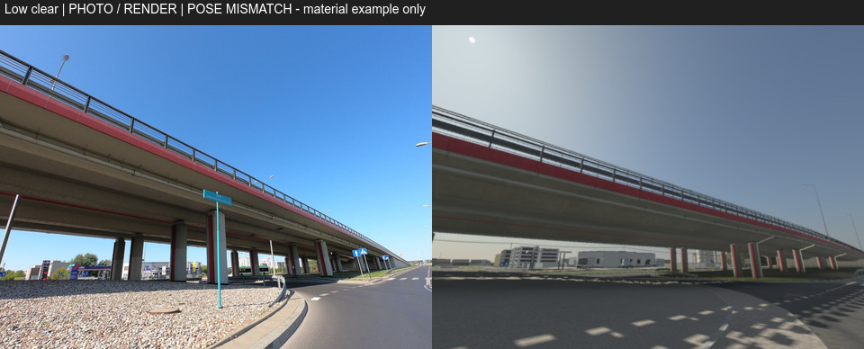
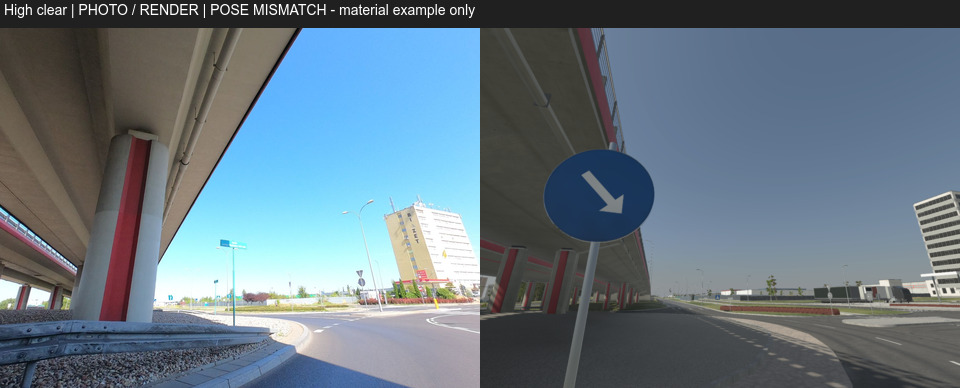
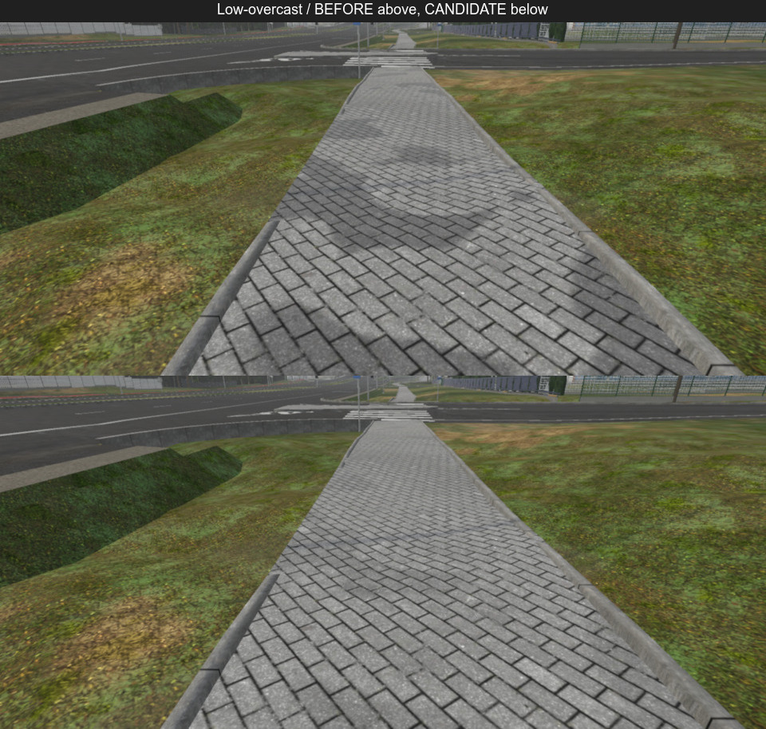
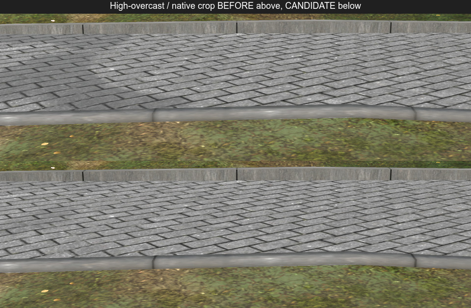

# Runda 2 — krawężniki i kostka jako materiał

Runda jest zakończona. Wybrano candidate2: niezależna ocena ograniczonej poprawy materiału jest pozytywna, geometria i zapisane liczniki pozostają identyczne. Pełna sekwencja nie jest zielona: physics/gate3 ma jedną znaną porażkę, opisaną poniżej. Koszt GPU A16 pozostaje UNVERIFIED.

Praca odbywa się na gpt-asphalt-r2 w stałym worktree gpt-asphalt. Bazą jest merge main 4992c434c65bd87648e0b528e4b331fa13d8ca84. Wybrany wariant to candidate2; ostatni commit obejmujący kod produktu i jego sondy QA to 6832f50b. Późniejsze checkpointy zawierają audyty, raporty i wyniki. Nie scalano do main ani nie pushowano gałęzi.

Krawężnik otrzymał opcjonalny blok kerb_wear: brud spoin 0,35, mineralny nalot 0,16 i próg nalotu 0,55. Shader wykorzystuje już pobrane Mask.B i makro. Sprawdzenie źródłowych PNG wykazało, że dla tego zestawu Mask.B jest dokładnie dopełnieniem maski spoin Var.B. Nie przeniesiono tego założenia na kostkę, gdzie ono nie zachodzi.

Chodnik ma opcjonalny ground_grime. Przyciemnienie wilgotnych plam zmniejszono z 0,42 do 0,18, próg plam podniesiono z 0,62 do 0,65, ich połysk zmniejszono z 0,50 do 0,15. Siła brudu fug pozostaje 0,45. Są to WORKING_VALUE ocenione na obrazach, nie pomiary fizycznego albedo. Chodnik zachowuje istniejącą próbkę Var.B, kruszywo i różnice poszczególnych kostek. Nie dodano tekstur, próbek tekstur Low, normalnych, przebiegów, wariantów słów kluczowych ani kanałów UV. Geometria nie została zmieniona. Zachowano kontrakty _Tile, liniowego _Tint i weather/runoff.

Kontrola źródeł ujawniła użycie wspólnego sidewalk_paving także na wysepce bramy Kwadrat. Dlatego candidate1 nie został wybrany do przekazania. Candidate2 wyłącza nowe zużycie na całym konserwatywnym obszarze Kwadrat: lokalne E 400–850 m i N −700 do −250 m. W środku krawężnik ma zerowy udział nowego efektu, a kostka oryginalne współczynniki grime. Przejście o szerokości 8 m leży na zewnątrz tego obszaru. Granice są zakresem własności, nie pomiarem geodezyjnym. Użyto lokalnej przestrzeni mesha, zgodnej z rzeczywistym importerem; test GPU rzeczywistego bloku HLSL sprawdził zachowanie po przesunięciu obiektu odpowiadającym floating origin. Nie edytowano override, geometrii ani assetów Kwadrat. Źródła i ich SHA są w ownership-scope.json i ownership-source-audit.json.

Baseline i candidate2 obejmują po 82 kamery w Low/High i clear/overcast, razem 328 par PNG. Sprawdzono wszystkie 328 snapshotów: te same pozycje, view, projection, FOV, aspect, rootToWorld i rozmiary render targetów. Każdy snapshot potwierdza rzeczywiste parametry materiałów oraz bazowy grime wewnątrz wyłączenia. Native PNG ma 2340 × 1080 pikseli. Render target Low odziedziczony z main ma 1755 × 810, High 2340 × 1080; przed i po są takie same. Sesja nie obniżała skali ani nie zmieniała profili jakości. D50 zabrania obniżania Low do 70 procent.

Wszystkie 2952 zapisane liczniki mają deltę zero: obiekty, drawsEst, shadowDrawsEst i trisK oraz osobno draws, liczba instancji, trisK, komórki i komórki forest HLOD instancji. Pełne dane wszystkich kamer znajdują się w counters-candidate2.csv i counter-audit-candidate2.csv. To estymacje CPU widoczności/LOD, a nie pomiar rzeczywistych wywołań ani czasu GPU. Dodatkowo audyt 128 GLB i 7315 prymitywów wykazał dokładnie identyczne wartości, typy, kształty atrybutów oraz hierarchię sceny. Audyt nie obejmuje plików instancji ani kosztu GPU.

Import nie zmienił żadnej z 22 kategorii bajtów geometrii. Tekstury ASTC nadal zajmują 40 910 657 B, liczba instancji wynosi 126 992, a colliderów props 2674. Deklaracja stałych WorldPBR wzrosła o trzy float4, czyli 48 B przed wyrównaniem. Dochodzi kontrola zakresu i ALU aktywnych efektów. Tego nie obejmuje raport bajtów geometrii/tekstur. Koszt GPU A16 pozostaje UNVERIFIED, ponieważ sesja nie używa telefonów.

W widoku kwadrat-park-gate kandydat bez wyłączenia zmieniał ponad 2 poziomy RGB w 9996/9240/8820/8828 pikselach (Low overcast/clear, High overcast/clear). Candidate2 ma odpowiednio 0/7/4/6 takich pikseli na 2 527 200. Nie twierdzimy, że pliki są identyczne, ani nie przypisujemy przyczyny pozostałym pojedynczym różnicom bez dowodu. Są to pomiary całego obrazu, który może zawierać publiczne tło poza wyłączeniem. Nie są pomiarem kontrastu materiału ani realizmu. Szczegóły są w scope-image-comparison.json.

Obejrzałem wszystkie 28 kontaktów obejmujących 328 par, 16 większych par materiałowych, 12 par kontekstu Kwadrat i cztery zestawienia zdjęcie/render. Razem 60 arkuszy, z SHA w SELF-INSPECTED-CANDIDATE2.json. Nie zauważyłem nowej dużej regresji układu ani palety w kamerach trasy. Na publicznej kostce osłabły duże mokro wyglądające plamy, a spoiny i kruszywo pozostały. Obrzeże ma czytelniejsze podziały. Low jest bardziej miękki, High nadal ma intensywne jasne punkty. Pozostają regularność kostek i dość gładka przednia listwa. Statyczne arkusze nie dowodzą stabilności w ruchu.

Niezależny visual-critic dał PASS ograniczonego przyrostu materiałowego candidate2 po obejrzeniu 16 par materiałowych, czterech par bramy, dodatkowych widoków kabinowego/doków i czterech zestawień referencyjnych. W otoczeniu bramy nie zauważył zmiany lokalnego materiału ani nowego szwu. Kadry nie pokazują szczegółowo całego obwodu wyłączenia. To nie jest zatwierdzenie pełnego realizmu, zachowania w ruchu ani Gate3; według D51 drobny materiał nie blokuje rozpoznawalności trasy.

Poniższe zestawienia mają najwyżej 960 px szerokości. Zdjęcia Mapillary autorstwa richlv, 2020-08-15, CC BY-SA 4.0, pokazują przykład materiału. Obecne pozy SBS mają widoczną rozbieżność z modelem: między innymi brak zgodnego pierwszego planu krawężnika i duży znak w drugiej parze. Zestawienia zachowano jako ograniczenie dowodu. Nie kalibrowano na nich jasności. Atrybucje, SHA i pliki źródłowe są w REFERENCES.json i candidate2-reference-960/crops.json.

Materiał publicznego chodnika przed zmianą jest u góry, candidate2 u dołu. Pozostałe trzy warunki oraz natywne wycinki są w material-review-candidate2-960.

Testy GPU zakresu i ówczesny pełny EditMode: 312/312 passed, zero failed i skipped (candidate2-editmode.xml). World candidate2 zakończył się poprawnie w 442,3 s, bez fallback=True, import i cztery serie capture exit 0, audyt odwołań przed importem exit 0. Końcowy GIS zakończył się exit 0: 604 passed, 1 oczekiwany xfailed, zero failures/errors, 1224,78 s według podsumowania pytest. Przywrócono metadane producenta, a audyt 196 odwołań i SHA nie wykazał rozbieżności. Physics/gate3: 47 passed, 1 failed, exit 1, 297,11 s. Jedyna porażka test_generator_reproduces_committed_scenarios dotyczy top_speed_flat_comb.json i jest wymieniona jako znana w protokole. Testy physics/gate3 oraz dims.json nie zmieniły się względem bazy4992c434; szczegóły w physics-result.json i pełnym logu. Nie raportujemy całej sekwencji jako zielonej. Końcowy EditMode: 312 total, 312 passed, zero failed, skipped i inconclusive; rzeczywisty XML candidate2-final-editmode.xml, próba z 12:21:38. Fidelity exit 0, raport zapisano po 229,3 s. Na trasie oś względem OSM p95 0,04 m, wykryte wiarygodne krawędzie względem ortofoto p95 2,304 m; 25 segmentów pasów zgodnych i cztery niezweryfikowane. Raport nadal wskazuje 16 wysp ortofoto brakujących w generatorze i 102 drivable ways OSM poza grafem całego regionu. IoU jedenastu miejsc trasy wynosi 0,667–0,843. To ustalenia narzędzia geometrii, nie wizualne zatwierdzenie Gate3. W wygenerowanym fidelity_qa zmieniło się tylko 17 ścieżek do nowych nakładek; metryki pozostały bez zmian. Końcowy audyt manifestów po wszystkich etapach: 196 odwołań/SHA, zero rozbieżności. Ustawienia Unity zostały przywrócone, oba własne sloty zwolnione.

Nie naprawiano geometrii krawężników, oznakowania, dróg, budynków, trawy, świateł ani materiałów hali/placu/bramy Kwadrat. Na kostce nie udawano brudu przy brzegu na podstawie UV1 (0,50), które w wybranej próbce nie daje użytecznej informacji o brzegu. Pozostają stare ograniczenia r1: regularne prostokątne naprawy i problemy przetarcia części świeżej farby. Historyczne proporcje kontrastu renderu r1 zostały wycofane po błędzie odtwarzania anchor z reseatowanej kamery; korekta została przekazana i zweryfikowana SHA w main/artifacts/asphalt-r1. Nie odtwarzano tych pomiarów z obecnych GLB.

Przewidywane konflikty: addytywne pola i bloki WorldPBR, WorldPbrMaterials oraz dopisane definicje materiałów w streetscape/materials.py. Przy integracji trzeba zachować nowsze bazowe wartości tych wspólnych materiałów i flagi innych sesji. Dane generated/world_manifest wymagają regeneracji według protokołu. Nie scalano kodu do main. Kolejna runda: gałąź gpt-asphalt-r3, merge aktualnego main, place przemysłowe poza Kwadratem.

Ciągłość pracy i pomiarów: host narzędzi był niedostępny około 03:44–09:04; nie przedstawiamy tej przerwy jako ciągłej pracy. Po odzyskaniu wznowiono brakujące testy, bez ponownego renderowania ukończonych par. Długie oczekiwanie fidelity zakończyło się dopiero po przejściu na nowy mechanizm FIFO w skrypcie main. W dwóch świadomych przeplanowaniach zatrzymano wyłącznie własne oczekujące procesy PowerShell, po sprawdzeniu braku Pythona i własnego slotu; żaden ciężki test ani producent nie został przerwany. GIS i physics/gate3 wykonano w końcowej sekwencji tylko raz. Szczegóły i instrukcja odzyskania są w STATUS.md oraz RECOVERY.md.

Narzędzie przyszłego pomiaru kontrastu śladów kół ma dodatkowe zabezpieczenia zgodności macierzy, obrazów i ledgerów geometrii. Sprawdzono wyłącznie składnię; nie wykonano nowego pomiaru i nie przywrócono wyników r1. WHEEL-TOOL-STATUS.md wyjaśnia ograniczenia. Przygotowane fotografie i obserwacje PCRT w backlog-r3-references są wyłącznie materiałem do następnej rundy: kształt kostki jest zazębiający, lecz obecny materialID placu, dokładna poza i zasięg wymagają sprawdzenia po merge aktualnego main. Nie zmieniono z tego powodu produktu r2.
