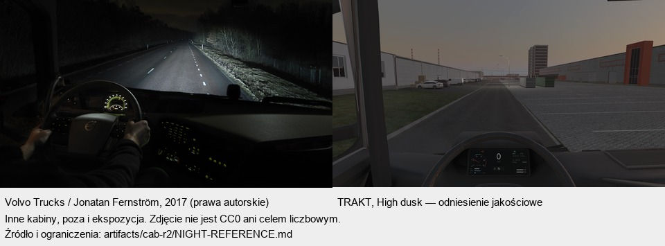
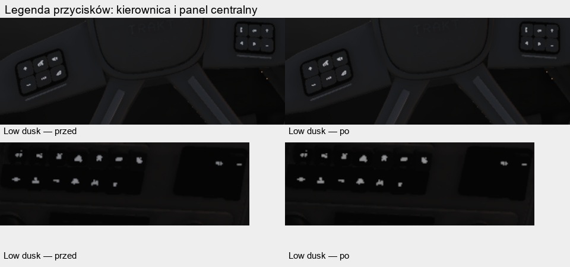
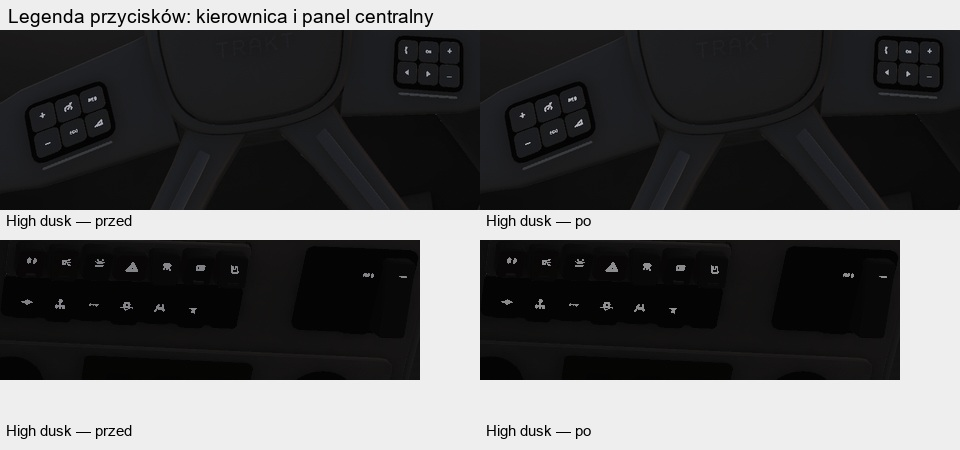

# Kabina r3 — podświetlenie legend przycisków

Gałąź `gpt-cab-r3`, od r2 `d04feba0`, następnie merge main `745efd35`. Wariant night1: checkpointy kodu `3c7a9ae` i `7971f36f`; ostatnia pełna walidacja Unity obejmuje również odczytowy helper okluzji. Runda pozostaje otwarta do wyniku końcowego GIS. Nie scalano do main, nie pushowano i nie używano telefonów.

Dodano sterowane plikiem `art-source/truck/interior/cab_backlight.json` podświetlenie istniejących legend przycisków. Lokalny keyword `_KAMION_CAB_BACKLIGHT` działa tylko na paśmie ikon Decal (UV v < 0,5). Korpusy, kratki i szwy pozostają poza emisją. Nie dodano tekstury, próbek tekstur, materiału, geometrii, światła ani przebiegu. Nocne palety zegarów i nawigacji istniały wcześniej i pozostają zachowane. Shaderów szyb i zewnętrza ani QualityProfile nie zmieniano.

Parametry: 8 cd/m², limit 0,06 w exposed linear, ciepła biel, przejście wysokości słońca 6→0 stopni. Są to WORKING_VALUE, nie pomiar fotometrii panelu. CabInteriorLighting przekazuje rzeczywistą wysokość słońca, ekspozycję i ważność środowiska; brak modelu oraz OnDisable zerują stan. Emisja jest dodawana po lokalnym rozjaśnianiu kabiny, przed istniejącym toe i fog. Wyłączenie flagi oraz ponowny BuildBatch usuwa keyword i zeruje luminancję.

Baseline i night1 obejmują po 42 kadry: Low/High × clear/overcast/dusk × siedem kamer, oraz po 36 natywnych RT lusterek. Dodatkowo porównano pełne 78 kamer trasy Low/Gate3. `comparison-0112-night1.json`: PASS; identyfikatory wnętrza w sześciu lustrach dają zero pikseli. Maksymalne przyrosty regular draws, instanced draws, regular triangles i instanced triangles wynoszą 0 na całej macierzy. Optyka i cadence bez zmian. Są to estymaty widoczności CPU edytora; koszt GPU A16 pozostaje UNVERIFIED i należy do pomiaru lidera.

Trzy testy celowane zaliczone: brak środowiska usuwa nieaktualny stan, przejście clear→dusk działa bez MainCamera, a test rzeczywistego renderu rozdziela ikony od szwów. Test GPU daje nocną ikonę 0,05882, szwy 0, dzień/off 0, a duża ekspozycja nadal 0,05882. Pierwsze próby prawidłowo odrzuciły czarny obraz: fixture miała wyzerowany knee shadow-lift, niezgodny z kabiną. Ustawienie 0,004 przy sile 0 naprawiło fixture; ścieżki lift gry nie zmieniano. Tymczasowe sondy usunięto, pozytywna kontrola URP/Unlit pozostała. Pełne EditMode po ostatniej zmianie helpera: **301/301**, XML/log `validation/editmode-20261112-033834.*`.

Obejrzano wszystkie 15 arkuszy do 960 px: 12 macierzy przed/po, dwa detale i parę zdjęcie–render. Ocena w `VISUAL-REVIEW.md`, hashe w `reviewed-sheets.json`. Wybrano night1: efekt miejscowy i subtelny, bez zauważalnej regresji dnia na arkuszach. Low nadal ma miękkie drobne napisy. Nie wszystkie kadry dnia mają identyczne hashe, więc nie zgłaszamy zgodności wszystkich pikseli. W jednej parze Low dusk ROI przycisków kierownicy ma średnią luminancję kodową 27,025→27,280, 418 zmienionych pikseli, maksimum delty 9,852/255; kontrolny fragment deski bez zmian. W jednej parze Low overcast: 14 zmienionych pikseli przycisków, max delta luma 0,0722/255, kontrolne fragmenty deski i zegarów bez zmian. To ograniczone pomiary obrazu 8-bit, nie fotometria.

Referencja nocna: Volvo Trucks Magazine, Jonatan Fernström, 2017; źródło i ograniczenia w `artifacts/cab-r2/NIGHT-REFERENCE.md`. Inny pojazd, poza i ekspozycja, pełniejsza noc niż nasz dusk: porównanie jakościowe, bez celu RGB/cd/m². Zdjęcie ma prawa autorskie, służy prywatnemu QA i nie trafia do materiałów gry. Nie kopiowano brandingu.

World zakończony exit 0 w 436,8 s, kontrola logu potwierdza brak `fallback=True`. Snapshot manifestu zachowany w `world-cli/`. Pełne Fidelity, bez pomijania kafla i bez pobierania, zakończyło się exit 0 w około 261,8 s (10:41:07–10:45:29); raport i podsumowanie w `fidelity/`. Przed GIS wszystkie 23 hashe wejść raportu były zgodne, a manifest Data bitowo identyczny ze snapshotem CLI. To potwierdza stan wejścia, nie zastępuje testu determinizmu. Końcowy pełny GIS rozpoczął się 11:18:10 pod heavy; wynik jeszcze oczekiwany. Nie zmieniano kodu świata ani testów.

Przerwa narzędzi po restarcie PC o 03:44 jest jawna: dawne oczekiwanie nie wytworzyło wyników i nie stanowi ciągłej pracy. Po potwierdzeniu braku procesu wznowiono pojedyncze Fidelity. Późniejsze długie oczekiwanie anulowano celowo dopiero po sprawdzeniu, że istnieją wyłącznie wrapper i acquire, bez Pythona; polling zmieniono 5→1 s. Nie używano Priority, nie zmieniano limitu 3 i nie usuwano cudzych slotów. Trwałe receipts i STATUS zachowują przebieg.

W czasie kolejki wykonano dodatkową odczytową kontrolę prawego szerokokątnego. Z DriverEyePoint front-face raycast: 127/2400 trafień przy brzegach, centralnie 0/1944; wśród brzegów 101 CAB_Body/Trim, 14 DOOR_R/Trim, 12 CAB_Interior/Rubber. Dwustronne trafienia nie są równoważne obrazowi przy Cull Back. Maska GPU szkła pokrywa też szeroki ciemny obszar normalnego odbicia: w tej pozycji jest to zawartość RT, nie szeroka okluzja kanałem drzwi. Nie przesuwano oka, kanału lub optyki. Low exit 0; dodatkowy High ma komplet ośmiu świeżych PNG i marker OK, ale zamknął się kodem -1073741819, więc nie zgłaszamy czystego sukcesu tego procesu. Zakres i ograniczenia: `OCCLUSION-PREFLIGHT.md`, `OCCLUSION-GPU-PREFLIGHT.md`. Nie jest to procent okluzji ani dowód dla wszystkich pozycji oka.

Po niezależnej recenzji s12 batch B uzupełniono `docs/LICENSES.md` o Brown Leather Roba Tuytela / Poly Haven, CC0 1.0, cztery MD5 i przetwarzanie. Lokalne oryginały mają zgodne rozmiary i MD5 4/4 (`license-source-verification.json`). Plastic nadal jest pochodną tłoczenia skóry, nie skanem tworzywa deski. Recenzja wskazuje zbyt duże fale normalnych, brak nowego zużycia kontaktowego i pasmo wypieku deski; przechodzą do r4. Wcześniejsze porażki GIS powtarzały się w linii cab, co nie dowodzi wyniku czystego main. Bieżący GIS poda wynik świeżego stanu; osobny czysty main pozostaje po stronie lidera.

Nie dodano odbić paneli na szybach, nowego światła świata ani zużycia kontaktowego. Pasmo deski pozostaje otwarte. Ubogi detal zewnętrznego przodu w Front leży poza własnością cab. Przewidywane konflikty: addytywne fragmenty TruckAssetBuilder i rejestru LICENSES; zachować zmiany pozostałych dziedzin. Produkty świata zostaną cofnięte dopiero po terminalnym GIS. Dotychczasowe kopie do main są robocze; pełna kopia i zamknięcie rundy nastąpią po wyniku.
