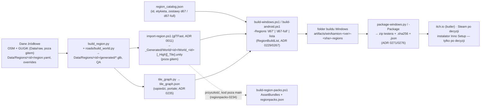

# 10 — Architektura aplikacji, repo i DLC

> **D73 / ADR 0260 (15.11.2026):** platforma główna = **Windows Standalone x64** (ten sam projekt Unity 6000.3 URP);
> Android (potem iOS) = wersja późniejsza, lżejsza. Architektura się nie zmienia — zmienia się kolejność platform,
> domyślny cel buildów i bramek (`docs/03`, ADR 0266) oraz pytania o dystrybucję (§3a). Bez zmiany silnika.
>
> **s23 (16.11.2026):** model treści = build z regionami (`-Regions`) + streaming kafli w buildzie + zip testera; Addressables
> wycofane, paczki regionów tylko jako kontrakt w teście (§3).

## 1. Struktura repo (propozycja — dopracuj w ADR w Etapie 0)
```
truck-sim/
├── CLAUDE.md  README.md  PROMPT_STARTOWY.md
├── .claude/ agents/ skills/ settings.json      .mcp.json
├── docs/ 01…11, adr/, plan/, reports/, STATUS.md, ROADMAP.md, LICENSES.md,
│        ENVIRONMENT_AUDIT.md, DEVICE_MATRIX.md, PERFORMANCE_BUDGETS.md,
│        VEHICLE_REFERENCE_DATA.md, PHYSICS_VALIDATION.md, ART_BIBLE.md, map-decisions.md
├── game/                         # projekt Unity
│   └── Assets/_Project/
│       ├── Core/ (bootstrap, serwisy, settings, save, lokalizacja)
│       ├── Vehicle/Physics/ (czysty C#)  Vehicle/Runtime/ (adaptery Unity)
│       ├── World/ (Geo, Roads, Terrain, Streaming, FloatingOrigin, Import)
│       ├── Rendering/  Environment/  Traffic/  Gameplay/  UI/  Input/  Camera/  Audio/
│       ├── Platform/ (Windows/desktop, Android, iOS, haptyka, uprawnienia, sklep — abstrakcje)
│       ├── Content/ (RegionPackageManager, manifesty, entitlement adapter)
│       ├── Telemetry/  Editor/ (buildery, importery, generatory)  Tests/
│       └── Art/ Truck/ World/ Shared/
├── art-source/ truck/ world/     # .blend i źródła (LFS)
├── tools/ worldgen/ blender/ telemetry/ physics-runner/ audio/ asset-validation/ .venv
├── data/ raw/ (poza gitem)  Data/ SourceManifests/ Schemas/ Samples/
├── scripts/ setup-windows.ps1 doctor.ps1 build-windows.ps1 build-android.ps1 pc-metrics.ps1 device-metrics.ps1 test.ps1 visual-qa.ps1 import-region.ps1
├── tests/ physics/ golden/ gis/
└── artifacts/ (poza gitem: APK, logi, zrzuty, raporty)
```

## 2. Zasady architektury
- Moduły jako asmdef, mało i sensownie; zależności jednokierunkowe (Physics nie zna UI). Prosty composition root, bez ciężkiego frameworka.
- **Autorytatywne definicje danych z wersją schematu i migracjami**: `VehicleDefinition`, `TrailerDefinition`, `CargoDefinition`, `RoadGraph`, `RegionManifest`, `DeliveryJob`, `CompanyDefinition`, `SaveSchema`, `CountryRules` (znaki, przepisy, prędkości, ruch prawo/lewostronny jako dane — nigdy `if (country == "DE")` w kodzie).
- **Zapis gry**: ID regionu + stabilna pozycja globalna (double) + ID drogi/pasa, nie surowy `Transform`. Własny format (JSON/binarny), bez `PlayerPrefs` dla stanu gry.
- Platforma neutralna od dnia 1: zero API Android-only **i Windows-only** w logice; platformowe rzeczy za interfejsami (`IPlatformServices`: na PC `DefaultPlatformServices` — argumenty wiersza poleceń zamiast intent extras, brak czujników baterii/termiki).
- **Wejście za warstwą sterowania** (D56): klawiatura, pad, kierownica z FFB na PC; dotyk/gyro na telefonie — fizyka dostaje te same znormalizowane osie (skręt, gaz, hamulec, sprzęgło, bieg), nigdy surowe urządzenie.
- **Tiery jakości jako dane** (`QualityProfile`): PC dokłada treść na High/Ultra; dane bazowe regionów muszą nadal mieścić się w budżecie mobilnym (🔒 zabezpieczenie, `docs/03`), żeby wersja telefonowa nie wymagała osobnego pipeline'u świata.
- Offline: po pobraniu treści gra działa bez internetu.

## 3. Treść i DLC — model „build z regionami” (stan s23, 2026-11-16)
> **Zmiana s23:** wcześniejszy szkic „Core + Region Packs przez **Addressables** (katalog per region)” jest
> **wycofany**. Addressables nie ma w projekcie (`game/Packages/manifest.json` nie zawiera `com.unity.addressables`) i nie są
> planowane: tam, gdzie potrzebna będzie treść doinstalowywana, kontrakt opiera się na czystych AssetBundles (ADR 0234).
> Każda wzmianka o Addressables w `docs/` = historia albo opcja odrzucona, chyba że ten paragraf zostanie zmieniony.

Legenda: **[DECYZJA]** — przyjęte w ADR scalonym do main albo w `docs/11`; **[DECYZJA po #157]** — ADR na gałęzi
`streaming-pc-s23` (PR #157), obowiązuje po scaleniu tego PR; **[PROPOZYCJA]** — do decyzji właściciela, nic nie wdrożone.

### 3.1 Przepływ treści

(ASCII w skrócie: `Data/raw` → `build_region.py` → `build_world.py` → `import-region.ps1` → `build-windows.ps1 -Regions …` →
`package-windows.py` → zip → itch.io; paczki AssetBundle = gałąź boczna, poza procesem wydania.)

### 3.2 Region w buildzie — jednostka treści dziś [DECYZJA: ADR 0229, 0267, 0261]
- Region = sceny `World_<id>` (Low/Medium) i opcjonalnie `World_<id>_High` (`RegionScenes`; region C = `WorldC`) z importu,
  poza gitem (ADR 0011). Jedno źródło nazw i etykiet: `game/Assets/_Project/Gameplay/Resources/Regions/region_catalog.json`
  (21 regionów; odświeżanie `python scripts/export-region-catalog.py`, `--check`).
- Build dostaje listę regionów argumentem: `-Regions '<tokeny>'` albo `-RegionsFile Data/build_regions.json`. Tokeny: id,
  alias (`c`), id bez `bialystok-`, zestaw, `all`, zakres `a..b`. Zestawy: **`d67`** = korytarz C → DK65 → Knyszyn,
  17 regionów (trasa główna); **`d67-full`** = `d67` + Dojlidy, Knyszyn-W, Mońki, Tykocin = 21 (D71, ADR 0267). Region
  wymieniony, a niezaimportowany = błąd buildu (chyba że `-RegionsAllowMissing`); pusta lista po rozwinięciu = błąd.
  Bez `-Regions` build ma tylko Boot, DrivingLab, WorldC. `EditorBuildSettings.asset` się nie zmienia.
- Menu startowe wybiera region z katalogu; region, którego sceny nie ma w buildzie, jest wyszarzony. Start = `SetRegion(id, s)`
  na trasie startowej regionu (ADR 0229 pkt 6).
- Rozmiar (zmierzony, ADR 0261): build Windows z 21 regionami = folder **4 923 MB**, wobec celu dysku gry bazowej ≤ 25 GB
  (D74, WORKING_VALUE). Na PC rozmiar nie wymusza dzielenia treści.
- Region niedostępny w danej instalacji = szew zamknięty (bariera + zamknięcie 60 m przed krawędzią, ADR 0169) — zawsze
  bezpieczny fallback, nigdy dziura.

### 3.3 Streaming kafli w buildzie [DECYZJA po #157: ADR 0235, 0273 §10]
- Jeden runtime: ciągły addytywny streaming scen kafla `World_<id>[_High]_Tile` wokół pojazdu (floating origin, przypięty
  kafel odrodzenia, budżety pamięci świata per tier — ADR 0273 pkt 6, WORKING_VALUE). Jedyne źródło kafli w grze:
  `BuildTileSource` (sceny `_Tile` regionów z `-Regions`). Wymaga reimportu regionów (sceny `_Tile`).
- **Dziś opt-in:** launch argument `stream=1` (Windows `-stream 1`). Bez niego gra działa jak w §3.2 (region z menu, szwy
  zamknięte).
- **Domyślny — po kryterium** [DECYZJA, ADR 0273 pkt 7; przełącza lider z logów]: przejazd C → Knyszyn autopilotem 90 km/h
  w playerze Windows: 0 resetów safety net, 0 kafli gotowych za późno (`scripts/stream-report.py --gate`), ≤ 12 klatek
  > 33,3 ms przy celu 60 fps, szczyt working set ≤ 4 GB (Low) / ≤ 6 GB (High) — progi WORKING_VALUE. Stan 16.11:
  **niezmierzone**. Do czasu pomiaru streaming nie jest domyślny na żadnej platformie.
- Regiony spinają się przez **portale grafu kafli** (`tile_graph.json`, wspólna krawędź + wyjście trasy A ≡ wejście B,
  ADR 0235 pkt 1), a nie przez pole `entryPoints` w manifeście — dodanie sąsiedniego regionu do buildu otwiera szew bez
  zmian w kodzie.

### 3.4 Dystrybucja PC: zip testera [DECYZJA: ADR 0271, 0276, `docs/12`]
- `pwsh scripts/build-windows.ps1 -Slot -Regions 'd67-full' -Package` (albo osobno
  `uv run --no-project python scripts/package-windows.py artifacts/win/kamion-<ver>-<sha>-regions`) →
  `artifacts/dist/kamion-<ver>-<sha>[-low][-regions][-dev][-dirty]-<dane>-win64.zip` + `.sha256` + `.json`.
  W zipie: build bez symboli i metadanych, `THIRD_PARTY_NOTICES.txt`, `README.txt`, `SHA256SUMS.txt`, `build-id.json`,
  `Zbierz-logi.cmd`, `Kamion-okno.cmd` i skróty `Kamion-<region>.cmd` tylko regionów obecnych w buildzie.
- Kanał: itch.io (butler, łatki delta robi kanał) najpierw; Steam po decyzji właściciela. Instalator (`dist/windows/kamion.iss`)
  nie jest domyślny. `--release` zablokowany do zamknięcia R-P0-2 (ODbL §4.6) — dziś paczka = tylko testerzy.
- **Paczek regionów nie ma w procesie wydania PC** (ADR 0273 §10 pkt 1): `package-windows.py` pakuje sam build.

### 3.5 Kontrakt paczek regionów — tylko w teście, format na przyszłość [DECYZJA po #157: ADR 0234 §9, 0273 §10]
- W grze: interfejs `Game.World.Streaming.ITileSceneSource` (`IsAvailable`, `Acquire` z dokładnie jednym `done`, `Release`,
  `FromPack`) i jedna implementacja z buildu. `TileSceneSourceContractTests` (EditMode) sprawdza kontrakt na buildzie i na
  dublerze paczki: nazwy scen, dzierżawy liczone referencjami (menu + streamer), odmowa bez dzierżawy, scena z buildu nigdy
  z paczki.
- Poza main (gałąź `regionpacks-0234`, PR #112 do zamknięcia jako wchłonięty): runtime `Game.World.Packs`, budowa
  AssetBundles `RegionPackCommands` / `build-region-packs.ps1 -Target Win64|Android`, `RegionPackTests`.
- Format na przyszłość (ADR 0234 §3): manifest `regionpacks.json`, schema `truck-sim-pl/region-packs/1` — `packSetVersion`,
  `unityVersion`, `buildTarget`, `minAppVersionCode`/`maxAppVersionCode`, `gitSha`, `packs[]` (`id`, `region`, `tier`,
  `file`, `sizeBytes`, `sha256`, `scenes[]` = pełna scena + scena kafla, `dependencies[]`, wspólne `common`). Ograniczenia
  wynikające z AssetBundles: zgodność tylko z **tą samą wersją Unity** i tym samym targetem; jeden zestaw = jeden przebieg
  budowy; zmiana `common` (ciężarówka, PBR, shadery) lub aktualizacja silnika = przebudowa i ponowne wydanie wszystkich paczek.
- Warunek powrotu (ADR 0234 §9): odpowiedź właściciela na §3a pkt 2–3 (model DLC, regiony doinstalowywane) albo start
  wersji telefonowej (Etap 9+). Wtedy cherry-pick z `regionpacks-0234` + implementacja `ITileSceneSource` przechodząca
  kontrakt + test „ścieżka nie zgniła” (1 region Win64 `-InstallLocal` na rundę integracji).
- Pola manifestu regionu ze starego szkicu (`compatibleGameVersions`, `checksums`, `licensesManifest`, `entitlementId`)
  przechodzą do tego formatu jako `min/maxAppVersionCode`, `sha256` paczek i — przy decyzji o DLC — `entitlementId`;
  `addressablesCatalog` usunięte. Atrybucje danych zostają w `UI/Resources/About/attributions.txt` (ADR 0230, 0271).

### 3.6 DLC krajów i kolejne regiony w tym modelu
Wniosek analizy sesji P (`docs/reports/ANALYSIS-2026-11-16-regionpacks-pc.md` §2–3, wariant B): **na PC paczki nie są
potrzebne do dystrybucji, streaming jest**; paczki zostają jako uśpiony kontrakt na płatne DLC i telefon. Do zbudowanego
playera Unity nie da się dołożyć sceny bez AssetBundle — bez paczek każdy nowy region = nowy pełny build.

| sposób dodania kraju / regionu | co to znaczy | koszt / ryzyko | status |
|---|---|---|---|
| **A. nowe regiony w tym samym buildzie** | import regionów kraju + dopisanie do katalogu i do listy `-Regions` (nowy zestaw), nowa wersja gry; gracz dostaje różnicę przez kanał (butler / depoty) | najtańszy, jedna ścieżka kodu; rozmiar delty po zmianie regionu `UNVERIFIED`; każdy gracz pobiera wszystkie kraje | **[DECYZJA — domyślnie teraz]** dla kolejnych regionów PL (ADR 0273 §10, analiza §5) |
| A2. jak A, ale kraj odblokowany uprawnieniem (`entitlementId`) | treść w buildzie, dostęp za zakupem/kluczem | wymaga modelu biznesowego i abstrakcji uprawnień; dane na dysku u każdego gracza; zgodność z zasadami sklepu `UNVERIFIED` | **[PROPOZYCJA]** do decyzji właściciela (§3a pkt 2) |
| B. osobny build (edycja kraju) | ten sam kod, inna lista `-Regions` (np. tylko DE) jako osobny produkt / kanał | brak przejazdu przez granicę z PL w jednej instalacji; dwa wydania do utrzymania | **[PROPOZYCJA]** — raczej odrzucić: kraj ma przedłużać jedną mapę (`docs/01` pkt 6: Litwa przez Budzisko) |
| C. paczka regionu (AssetBundle) doinstalowywana | powrót kodu z `regionpacks-0234`; kraj jako osobny plik/depot DLC, streaming bierze kafle z paczki przez `ITileSceneSource` | najwięcej ruchomych części (§3.5: ta sama wersja Unity, przebudowa przy zmianie `common`, macierz testów niżej, ryzyko brakujących wariantów shaderów `UNVERIFIED`) | **[PROPOZYCJA]** — gdy właściciel wybierze płatne DLC pobierane osobno albo przyjdzie telefon |

Propozycja lidera dla właściciela: A teraz (Podlasie, Polska); wybór między A2 a C przy pierwszym kraju spoza PL, razem
z odpowiedzią na §3a pkt 1–3. Reguły kraju (znaki, przepisy, ruch) i tak są danymi `CountryRules` (§2), niezależnie od wariantu.

### 3.7 Telefon (🔒 wersja późniejsza, D73)
- APK z regionami przez ten sam `-Regions` (`build-android.ps1`); limit APK 10 GB (D72), pojedynczy APK > ~4 GB wątpliwy
  (ZIP32, `UNVERIFIED`). Powyżej — paczki Low z §3.5 (AssetBundles, `adb push`).
- Google Play: AAB + Play Asset Delivery dopiero przy publikacji w sklepie; ADR 0234 §8 opisuje wariant
  „Addressables + PAD” jako **nie wdrożoną propozycję** — przed powrotem do niej nowa decyzja (dwa pakiety, pipeline AAB).
  PAD i paczki to dane/assety, nie kod wykonywalny. iOS — mechanizmy zgodne z Apple (sprawdzić przy porcie).
- Abstrakcja uprawnień (entitlements) bez implementacji płatności, dopóki właściciel nie zdecyduje o modelu biznesowym.

### 3a. Wpływ D73 na DLC i dystrybucję — pytania do właściciela (bez decyzji sklepowych)
Nic z poniższego nie jest zdecydowane; do tego czasu kod ma tylko abstrakcję uprawnień (`entitlementId`), bez płatności.
1. **Kanał dystrybucji na PC** — sklep z platformą (który?), własna strona, kilka naraz? Od tego zależą: format aktualizacji,
   mechanizm DLC (osobne „depoty”/paczki vs pobieranie z własnego serwera), DRM, osiągnięcia, chmura zapisów.
2. **Model DLC na PC** — czy regiony/kraje mają być płatnymi DLC, darmowymi aktualizacjami, czy jedną pełną grą z dodatkami?
   Czy zakup na PC ma przenosić się na telefon (cross-buy) — to wymaga własnego konta gracza albo wspólnej platformy.
3. **Rozmiar instalacji** — PC zniesie wielokrotność limitu z D72, ale czy jest górna granica (np. dla klasy „min” z małym SSD)?
   Czy regiony mają być doinstalowywane na żądanie?
4. **Wersja telefonowa** — kiedy (po której bramce PC) i czy ma mieć tę samą mapę (lżejsze tiery), czy podzbiór regionów?
5. **Wymagania prawne/licencyjne dla PC** — atrybucje danych (OSM/GUGiK, ADR 0230) w menu „Informacje” zostają; czy kanał
   PC wymaga dodatkowych dokumentów (EULA, polityka prywatności, klasyfikacja wiekowa)?
6. **Kierownice** — czy wsparcie FFB (D56) jest wymogiem na premierę PC, czy aktualizacją?
7. **Mody** — na PC gracze oczekują modów; w `docs/01` są poza zakresem — czy to się zmienia?

Konsekwencje techniczne niezależne od odpowiedzi (stan s23): gra bazowa = build z regionami (§3.2), dystrybucja = zip
z buildu (§3.4); jeśli odpowiedź na pkt 2–3 wybierze treść doinstalowywaną (§3.6 C) — AssetBundles per platforma (osobny build
treści Win64/Android) wg formatu z §3.5; bez Addressables.

Testy systemu treści **dziś** (build z regionami): region spoza buildu wyszarzony w menu, `scene=<id>` regionu spoza buildu,
pusta / błędna lista `-Regions` = błąd buildu (`RegionSelectTests`), region niedostępny = szew zamknięty, kontrakt
`ITileSceneSource` (`TileSceneSourceContractTests`, po #157), przejazd przez granicę regionów ze streamingiem (`stream=1`, §3.3).
Testy systemu paczek (**dopiero przy wariancie §3.6 C**, najpierw na PC): brak paczki, uszkodzona paczka, niezgodny manifest, przerwane pobieranie, brak miejsca, zapis w usuniętym regionie (bezpieczny fallback do bazy), nieposiadana paczka, przejazd przez granicę regionów, aktualizacja paczki z migracją zapisu.

## 4. Poziomy jakości mapy Polski (docelowo)
- **Tier A — handcrafted/verified**: Białystok, kluczowe miasta i trasy.
- **Tier B — procedural + QA**: większość dróg krajowych/wojewódzkich i miejscowości.
- **Tier C — data-only**: istnieje w grafie planowania, niedostępne do jazdy — gra nigdy nie udaje, że jest.
Nie ogłaszaj „całej Polski”, gdy zbudowane są fragmenty.
