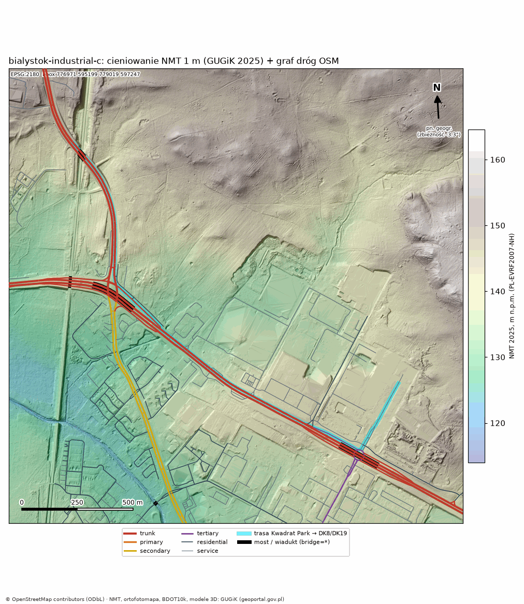
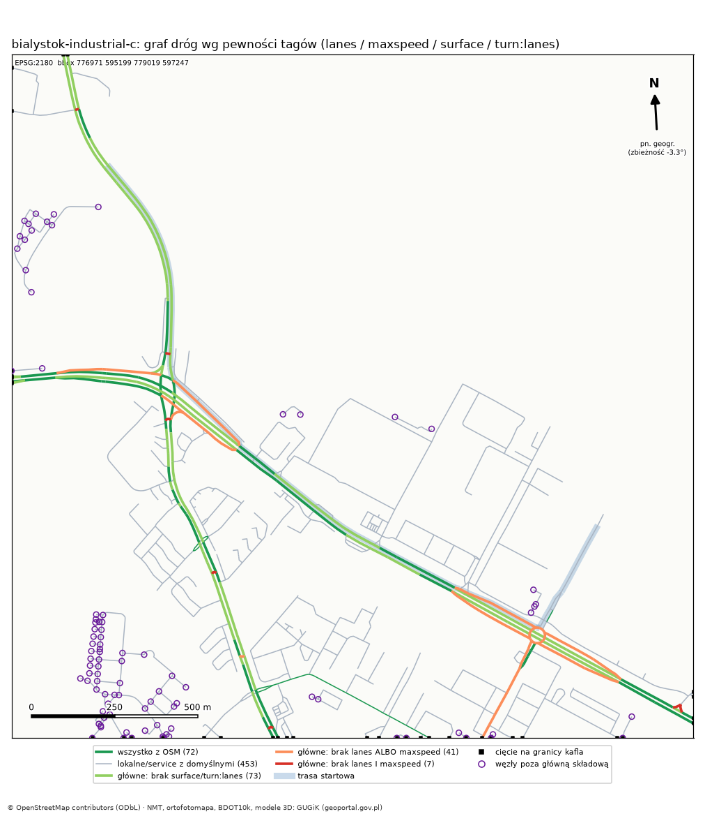
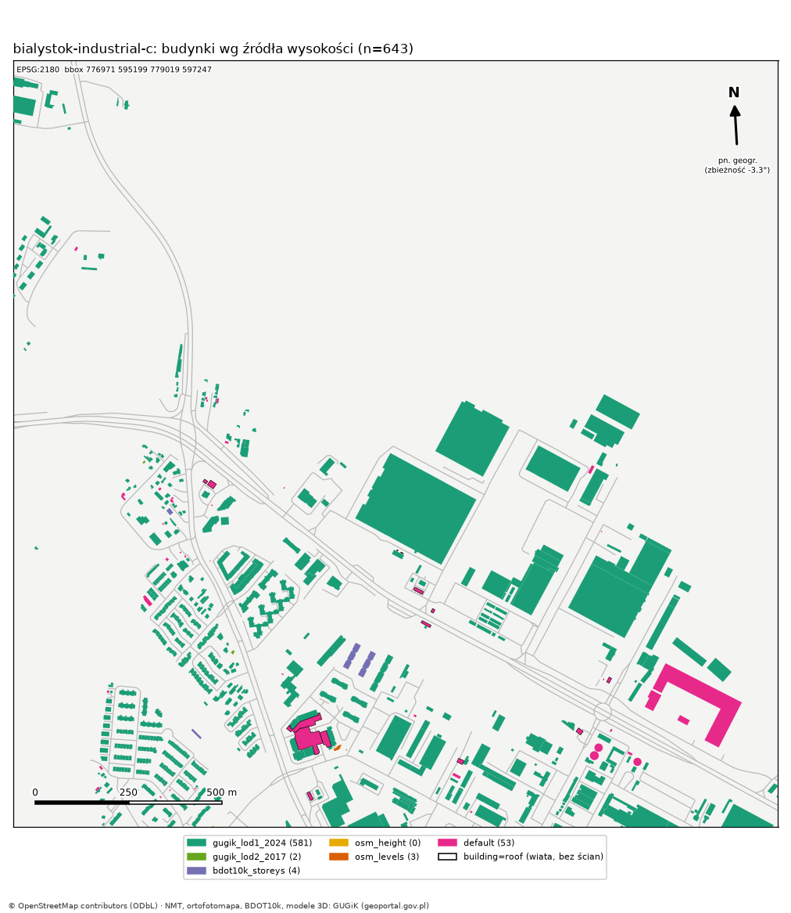
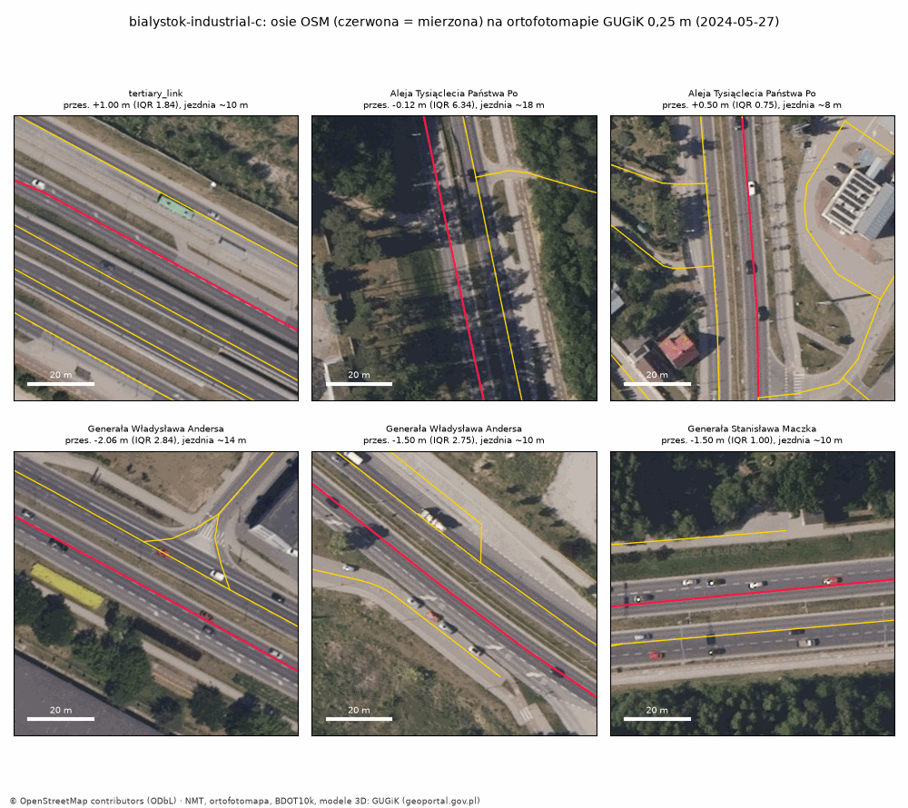

# DATA QA — dane mapy

Raport jakości danych dla kafli regionów. Liczby pochodzą z `docs/reports/map/<region>_qa.json`, który generuje `tools/worldgen/qa_report.py`. Wszystkie rendery powstały z naszych własnych danych OSM i GUGiK. Nie użyto Google ani żadnych podkładów kafelkowych.

---

## Region `bialystok-industrial-c` (kandydat C, robocze założenie lidera)

**Status obszaru:** to **robocze założenie lidera** na czas nieobecności właściciela, a nie decyzja D4 (`docs/map-decisions.md`). Region jest zdefiniowany w `tools/worldgen/regions.py`. Przejście na A lub B wymaga dopisania jednego wpisu i ponownego uruchomienia `ingest.py` oraz `build_region.py`.

**Odtworzenie (z katalogu repo):**
```
uv run --project tools/worldgen tools/worldgen/ingest.py       --region bialystok-industrial-c
uv run --project tools/worldgen tools/worldgen/build_region.py --region bialystok-industrial-c
uv run --project tools/worldgen tools/worldgen/qa_report.py    --region bialystok-industrial-c
uv run --project tools/worldgen pytest tests/gis -q
```

### 1. Kafel
| | |
|---|---|
| bbox EPSG:2180 | 776971, 595199 – 779019, 597247 (2048 × 2048 m) |
| Jak wyznaczony | kwadrat 2048 m wyśrodkowany na obwiedni trasy C (Kwadrat Park → DK8/DK19). Obwiednia trasy: 777258.6, 595528.7 – 778732.0, 596917.3 |
| Margines wokół trasy | W 287,6 m · E 287,0 m · S 329,7 m · N 329,7 m. Zadanie prosiło o ~300 m; 287 m to koszt kafla 2^n, który akceptuję, bo heightmapa ma wtedy 2049 próbek = natywna rozdzielczość terenu Unity |
| Kotwica floating origin | 777995, 596223 (środek kafla), z = 131,14 m (NMT, EVRF2007) |
| CRS | poziomy EPSG:2180, pionowy PL-EVRF2007-NH = EPSG:9651. W EPSG **nie ma** jednego kodu złożonego dla CS92 + EVRF2007. Używamy `EPSG:2180+9651` (sprawdzone w bazie PROJ, test `test_crs.py`) |

### 2. Teren (NMT 2025, 1 m)
- 4 arkusze ARC/INFO ASCII, aktualność 2025-04-18, źródło: skaning laserowy. Błąd średni według skorowidza GUGiK: wysokość 0,09 m, sytuacja 0,15 m.
- Węzły siatki NMT leżą w pełnych metrach (`xllcenter` całkowite). Heightmapa 2049 × 2049 jest więc **dokładnym próbkowaniem** źródła, bez interpolacji. Brakujące próbki: **0**. Na zakładkach arkuszy wartości się zgadzają (skrypt ostrzega przy różnicy > 5 cm; tu nie ostrzegł).
- Zakres wysokości 121,50–163,34 m, średnia 139,49 m. Spadek: mediana 2,99°, p99 29,75° (skarpy nasypów i wykopów).
- Wzdłuż trasy grunt ma od 130,05 do 145,79 m. Na wiaduktach NMT pokazuje grunt **pod** obiektem, a nie jezdnię. W grafie jest to opisane w `notes`, a krawędzie mają atrybuty `bridge` i `layer`.
- Kodowanie: uint16, `z = 120.0 + v * 0.000687` (krok 0,69 mm). Plik RAW (8,4 MB) nie trafia do gita, jego SHA256 jest w `terrain.json`.
- Podgląd: 
  Obejrzałem: rzeźba terenu wygląda spójnie. Widać nasypy Andersa i węzła przy Rondzie Putry oraz nasyp kolejowy N–S. Na zachodzie jest dolina rzeki (najniższe ~121 m), na NE i E wzgórza. Na E przy starcie widać plac budowy (nierówny teren w miejscu „Centrum Handlowe (w budowie)” z OSM). W pierwszej wersji legenda zasłaniała start trasy, więc przeniosłem ją pod mapę.

### 3. Graf dróg (OSM + BDOT10k)
- 550 węzłów, 646 krawędzi, 36,71 km. Według długości: service 15,2 km, trunk 7,0 km, living_street 5,3 km, residential 3,3 km, trunk_link 2,3 km, secondary 2,2 km, reszta < 1 km.
- **Trasa startowa przejezdna** z uwzględnieniem `oneway`, w obie strony: 2401,3 m, 29 krawędzi. To ta sama długość, co w analizie D4 na nieprzyciętym grafie. Kolejność: service (Kwadrat Park) → Rondo Pamięci Bieżeństwa → tertiary_link → trunk_link → Andersa (trunk) → trunk_link → Al. Tysiąclecia (trunk, DK8/DK19). Sprawdza to test `test_route_connectivity.py`.
- Pokrycie tagami z OSM (wg długości):

  | | lanes | maxspeed | surface | turn:lanes |
  |---|---|---|---|---|
  | drogi główne w kaflu (12,3 km) | 96,3% | 81,2% | 99,2% | 42,9% |
  | trasa startowa | 86,3% | 72,7% | 85,2% | 36,2% |

- Wartości domyślne są zawsze jawne (`src: default`, `conf: low`, lista `low_confidence`). Liczba krawędzi z danym polem domyślnym: lanes 454, maxspeed 379, surface 104, turn:lanes 97 (to ostatnie liczę tylko dla dróg głównych). Większość to drogi service i residential, gdzie domyślne wartości są dopuszczalne.
- **BDOT10k** (OT_SKJZ_L i OT_SKDR_L, wersja 2024-09). Do 518 z 646 krawędzi dopasowałem jezdnię BDOT10k (najbliższa linia ≤ 8 m, różnica kierunku ≤ 25°). OSM **nie ma tagu `width` na żadnej krawędzi**. Szerokość wziąłem z BDOT10k `SZEROKOSCNAWIERZCHNI` dla 425 krawędzi (`src: bdot10k`, `conf: medium`), a nawierzchnię z BDOT10k tam, gdzie OSM jej nie podaje (232 krawędzie). Na drogach głównych szerokość BDOT podzielona przez `lanes` z OSM daje p10 2,67 · p50 4,00 · p90 5,00 m na pas (n = 157). Wartości < 3 m albo > 4,5 m wskazują, że BDOT podaje szerokość jednej jezdni przy `lanes` liczonym dla całej drogi albo odwrotnie. **Szerokości pasów trzeba potwierdzić pomiarem na ortofoto lub zdjęciach przed budową przekroju.**
- Topologia: 14 składowych słabo spójnych. Główna ma 460 węzłów, a silnie spójna 411. Mniejsze składowe to krótkie drogi service przecięte na granicy kafla albo osierocone po odrzuceniu `service=parking_aisle`. Wszystkie są w SW (osiedle), na zachodniej krawędzi i przy placach. Na trasie nie ma żadnej. 37 węzłów to cięcia na granicy kafla, 101 to ślepe końce (głównie wjazdy). Krawędzie o zerowej długości: 0. Ostre załamania > 100° wewnątrz krawędzi: 0. 13 krawędzi to mosty i wszystkie mają `layer`.
- 
  Obejrzałem: na drogach głównych brakuje `maxspeed` lub `lanes` (pomarańczowe) na łącznicach przy Rondzie Bieżeństwa, na jezdni Andersa SE od ronda i na łącznicy Maczka↔Al. Tysiąclecia. To zgadza się z D4 („łącznice i Rondo Bieżeństwa nie mają maxspeed”). Czerwone (brak obu tagów) są tylko krótkie odcinki: 7 krawędzi.

### 4. Budynki
- 643 budynki: 589 obrysów z BDOT10k (OT_BUBD_A, 2024-09) i 54 tylko z OSM (mniej niż 30% powierzchni pokrywa się z BDOT10k).
- Źródła wysokości (`height_source`):

  | źródło | liczba | pewność |
  |---|---|---|
  | `gugik_lod1_2024` (measuredHeight) | 581 | high |
  | `gugik_lod2_2017` (max z dachu − z gruntu) | 2 | medium |
  | `bdot10k_storeys` (kondygnacje × 3,0 + 1,0 m, `WORKING_VALUE`) | 4 | medium |
  | `osm_levels` | 3 | low |
  | `default` 6,0 m (`WORKING_VALUE`) | 53 | low |

  51 z 53 `default` to budynki tylko z OSM. Wśród nich jest 14 `building=roof` (wiaty stacji paliw i zadaszenia, oznaczone `is_roof_only`, więc importer nie może z nich robić brył) oraz duży obiekt „Centrum Handlowe (w budowie)” o powierzchni 1,44 ha, ok. 230 m na S od bramy Kwadrat Parku. Do tego OSM-owe Biedronka i McDonald's, których nie ma w BDOT10k 2024 (budynki nowsze).
- Złączenie z modelami 3D idzie po identyfikatorze: BDOT10k `LOKALNYID` = CityGML `buildingId`. 581 z 589 obrysów BDOT ma LoD1 2024, a 450 ma też LoD2 2017.
- **LoD1 2024 vs LoD2 2017** (450 par): różnica wysokości LoD1 − LoD2 wynosi p10 −3,28 · p50 −1,52 · p90 −0,28 m. LoD1 `measuredHeight` jest systematycznie niższe od kalenicy z LoD2, czyli najpewniej odpowiada średniej wysokości dachu, a nie kalenicy. Dlatego kształt dachu (`roof_type_lod2`, `lod2_eave_rel_m`) bierzemy z LoD2, a LoD1 traktujemy jako wysokość bryły. **Nie zgadujemy:** obie wartości są w `buildings.geojson`.
- **Układ wysokościowy modeli 3D** (odczytany z `srsName` w plikach): LoD1 2024 to `EPSG::2180 + EPSG::9651` (EVRF2007), LoD2 2017 to `EPSG::2180 + PL-KRON86-NH`. Porównałem z_gruntu modelu z medianą NMT 2025 na pierścieniu 2 m wokół obrysu: LoD1 daje p50 −0,13 m (n = 592), LoD2 daje p50 −0,47 m (n = 489). Różnica ~0,34 m jest zgodna z inną datą i układem LoD2. Absolutnych z z LoD2 nie używamy nigdzie (tylko wysokości względne).
- 
  Obejrzałem: hale Kwadrat Parku i parku logistycznego mają wysokości z LoD1. Różowe (default) są głównie wiaty i drobne obiekty z OSM oraz plac budowy na SE od startu.

### 5. Ortofotomapa i zgodność osi dróg
- Ortofoto RGB 0,25 m, PL-1992, aktualność **2024-05-27** (4 arkusze, seria 81427). Przycięty mozaik 8192 × 8192 px (JPEG-in-TIFF, 17,8 MB) jest w `Data/raw/derived/` i nie trafia do gita. **Służy tylko jako referencja**, nigdy jako tekstura w grze.
- Są też nowsze zdjęcia 5 cm: 2025-04-18 (PL-1992) i 2024-03-30 (PL-2000 strefa 8). Mają po ~1 GB na arkusz, więc nie pobrałem ich domyślnie.
- **Metoda 1 (ortofoto, automatyczna, zgrubna):** na 7 prostych odcinkach dróg głównych (≥ 60 m) co 4 m biorę profil 40 m prostopadły do osi OSM. Klasyfikuję piksele „asfalt” (nasycenie ≤ 22, jasność 45–150), łączę przerwy ≤ 0,75 m (linie, auta), a offset liczę jako odległość osi OSM od środka pasa asfaltu, w którym leży oś. Progi skalibrowałem tak, żeby szerokość wykrytej jezdni zgadzała się z BDOT10k (np. 10,0 vs 10,5 m, 7,8 vs 8,0 m). Przy pierwszych progach wykrywane pasy miały 15–37 m, bo sklejały obie jezdnie z chodnikami, i odrzuciłem je.

  | odcinek | próbek | offset mediana | IQR | jezdnia ortofoto | BDOT10k |
  |---|---|---|---|---|---|
  | tertiary_link (Rondo Bieżeństwa → Andersa) | 50 | +1,00 m | 1,84 | 9,8 m | 8,0 m |
  | Al. Tysiąclecia (trunk, N, w cieniu drzew) | 22 | −0,12 m | 6,34 | 17,8 m | 7,5 m |
  | Al. Tysiąclecia (secondary, S) | 17 | +0,50 m | 0,75 | 7,8 m | 8,0 m |
  | Andersa (trunk, SE skraj) | 28 | −2,06 m | 2,84 | 13,6 m | 10,0 m |
  | Andersa (trunk, przy starcie) | 25 | −1,50 m | 2,75 | 9,8 m | 8,0 m |
  | Maczka (trunk) | 21 | −1,50 m | 1,00 | 10,0 m | 10,5 m |
  | Al. Tysiąclecia (trunk, przy Putry) | 43 | −0,25 m | 4,25 | 10,8 m | 6,5 m |

  **Wynik:** |offset| ≤ 2,1 m na wszystkich odcinkach, mediana |offsetu| po odcinkach wynosi 1,0 m. Na odcinkach z wiarygodną detekcją (IQR ≤ 3 m) offset mieści się w 0,5–2,1 m. Wiersz Al. Tysiąclecia N (IQR 6,3 m) jest niewiarygodny przez cienie drzew. Cel z docs/05 §5 (≤ 1–2 m w mieście) jest **na granicy spełnienia**. Andersa i Maczka mają systematycznie −1,5 do −2 m: oś OSM leży bliżej lewej krawędzi swojej jezdni. Do potwierdzenia przy budowie przekroju.
- **Metoda 2 (BDOT10k, niezależna):** odległość środka krawędzi OSM od dopasowanej osi jezdni BDOT10k na drogach głównych (n = 169) wynosi p50 0,55 m · p90 2,41 m · p99 4,63 m. Dla wszystkich dopasowanych krawędzi (n = 518): p50 0,60 m, p90 2,40 m.
- Wycinki do oceny wzrokowej: 
  Obejrzałem: osie OSM (czerwone) leżą na swoich jezdniach na wszystkich 6 wycinkach. Na Maczka i Andersa oś jest widocznie przesunięta ku lewej krawędzi jezdni, o mniej niż pół pasa. W pierwszej wersji tytuły dolnego rzędu nachodziły na górne wycinki, więc poprawiłem układ.

### 6. Problemy i rzeczy do sprawdzenia (lista dla właściciela / zdjęć)
1. **Plac budowy „Centrum Handlowe (w budowie)”** (OSM, 1,44 ha), ok. 230 m na S od bramy Kwadrat Parku, przy dojeździe do Ronda Bieżeństwa. Ortofoto jest z 2024-05, a NMT z 2025-04, więc stan na dziś jest nieznany. Do sfotografowania.
2. Brak `maxspeed` i `lanes` na łącznicach przy Rondzie Bieżeństwa (to samo, co w D4). Potrzebne są zdjęcia znaków.
3. `turn:lanes` jest tylko na 36% trasy. Pasy na wlotach do Ronda Putry trzeba odtworzyć ze zdjęć.
4. Szerokości z BDOT10k mają dokładność skali 1:10 000 i są zaokrąglone do 0,5 m. Do budowy przekroju trzeba zmierzyć szerokości na ortofoto 5 cm (opcjonalne pobranie) albo na zdjęciach.
5. LoD2 jest z 2017 r. Budynki nowsze niż 2017 mają tylko LoD1 (płaski dach) albo pochodzą z OSM.
6. 53 wysokości domyślne (`default`), głównie wiaty i budynki tylko z OSM.
7. Niezweryfikowane w tej sesji: zgodność położenia BDOT10k z ortofoto (sam BDOT deklaruje źródło geometrii „ortofotomapa” lub „EGiB”) oraz ewentualne przesunięcie ortofoto względem osnowy. Offsety powyżej są względne: OSM względem ortofoto.

### 7. Testy (`tests/gis`, 18)
`uv run --project tools/worldgen pytest tests/gis -q` → **18 passed**:
- CRS: round-trip 2180↔WGS84 < 1 mm na rogach i w środku; złożony CRS 2180+9651; odtwarzalność bbox z obwiedni trasy.
- Przycięcie: wszystkie węzły i wierzchołki leżą w bbox; węzły graniczne leżą na krawędzi kafla; długości krawędzi się zgadzają; każde pole ma provenance i confidence; budynki przecinają kafel.
- Spójność trasy: trasa przejezdna z uwzględnieniem oneway, w obie strony; 2401 m ± 25 m; zaczyna się na service, kończy na trunk DK8/DK19.
- Idempotencja: dwa buildy dają identyczne SHA256 wszystkich plików; downloader pomija plik, którego hash się zgadza; manifest nie jest przepisywany, gdy nic się nie zmieniło.
