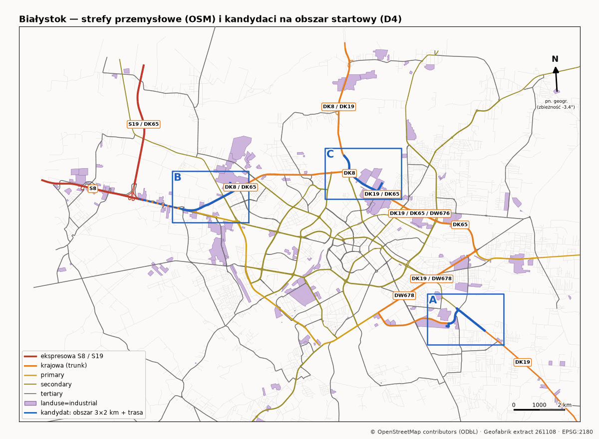

# Decyzje mapowe

## D4 — obszar startowy: strefa przemysłowa + wylot na trasę krajową

Status: **czeka na decyzję właściciela** (propozycja agenta `geo-worldgen`, 2026-11-09).

**Źródło:** wyłącznie OpenStreetMap (wycinek Geofabrik `podlaskie-261108`, ODbL, „© OpenStreetMap contributors”). Nie użyto Google ani żadnych podkładów kafelkowych.
**Odtworzenie:** `uv run tools/worldgen/analyze_candidates.py` (z katalogu repo).
**Wszystkie liczby** pochodzą z `docs/reports/map/candidates.json`. Mapy są w `docs/reports/map/`.

### Jak powstali kandydaci
1. Wszystkie poligony `landuse=industrial` w Białymstoku i okolicy połączyłem w strefy. Największe to: Produkcyjna/Fasty (143 ha), Andersa/EC/ZUOK (115 ha), Elewatorska/Starosielce (93 ha), Transportowa/Składowa (78 ha) oraz Dojlidy/Kuronia (55 ha).
2. Dla każdej strefy sprawdziłem, czy w pobliżu jest droga krajowa (`trunk` z `ref` 8/19/65) albo ekspresowa (S8/S19), czy jest duża hala, rampy, rondo i sygnalizacja.
3. Elewatorska i Transportowa odpadły: nie mają bezpośredniego wylotu na DK/S, tylko drogi wojewódzkie (DW669/676). Panattoni Park II/III przy węźle S8 Choroszcz odpadł, bo leży poza miastem i wokół jest niewiele miasta (0 sygnalizacji).
4. Dla trzech kandydatów wyznaczyłem trasę od bramy bazy do drogi krajowej. To najkrótsza trasa w grafie OSM z uwzględnieniem jednokierunkowości i kary dla bocznych uliczek (ciężarówka 40 t). Ręcznie ustaliłem tylko punkty pośrednie (`CANDIDATES` w skrypcie).

### Porównanie

| | **A — Dojlidy / Kuronia → DK19** | **B — Przędzalniana / Kleeberga → DK8 (→ S8)** | **C — Andersa / Rondo Putry → DK8/DK19** |
|---|---|---|---|
| Mapa | [candidate_A](reports/map/candidate_A_dojlidy_dywizjonu303.png) | [candidate_B](reports/map/candidate_B_przedzalniana_kleeberga.png) | [candidate_C](reports/map/candidate_C_andersa_putry.png) |
| Długość trasy | 2,44 km | 2,83 km (+1,76 km do wjazdu na S8) | 2,40 km |
| Ulice po kolei | dojazd wewn. → Kalicińskiego → Jacka Kuronia → skrzyżowanie z Plażową → ks. Suchowolca → Zabłudowska (DK19) | dojazd wewn. → Przędzalniana → Rondo mjr. Wiszowatego → łącznica → gen. Kleeberga (DK8/DK65) → DK8 bez nazwy w OSM → (S8 Białystok Zachód) | dojazd wewn. → Rondo Pamięci Bieżeństwa 1915 r. (pod wiaduktem) → łącznice → gen. Andersa (DK19/DK65) → łącznica → Rondo Putry → al. Tysiąclecia Państwa Polskiego (DK8/DK19, na północ) |
| Klasy dróg na trasie | trunk 2047 m, secondary 172, unclassified 121, service 94 | trunk 2111 m, unclassified 382, trunk_link 286, service 42 | trunk 1480 m, service 355, trunk_link 326, tertiary_link 230 |
| Skrzyżowania z drogami publicznymi | 10 | 10 | 11 |
| Wjazdy/zjazdy (service) | 8 | 4 | 9 |
| Ronda na trasie | 0 | 1 (Wiszowatego) | 2 (Bieżeństwa, Putry — oba dwupoziomowe) |
| Skrzyżowania/przejścia z sygnalizacją | 1 (Suchowolca × Plażowa × Kuronia) | **0** | 2 (Rondo Putry i okolice) |
| Przejścia dla pieszych (węzły trasy) | 12 | 3 | 7 |
| Odcinki na mostach/wiaduktach | 0 m | 304 m | 38 m |
| Baza / magazyn przy starcie | **Biawar** (`building=industrial`, 30 092 m²), **4 rampy zmapowane** (`amenity=loading_dock`); w pobliżu Browar Dojlidy, Bison, Bieldruk | „Arsenal – hurt cukierniczy” (`building=yes`, 19 560 m²) + 2 hale bez nazwy (20 519 i 14 130 m²); ramp brak w OSM | **Kwadrat Park** (`building=warehouse`, 34 112 m²); ramp brak w OSM |
| Obszar 3×2 km: ronda / sygnalizacje (węzły) / budynki | 1 / 5 / 1468 | 10 / 14 / 1320 | 6 / 19 / 943 |
| Obszar: `landuse=industrial` | 53,5 ha | 66,1 ha | 72,6 ha |
| Obszar: numery dróg | DK19 | DK8/DK65, DW669, DW676 | DK8, DK19, DK65, DW675 |
| Trasa: pokrycie `lanes` / `maxspeed` / `turn:lanes` / `surface` (wg długości) | 73% / 72% / 16% / 67% | 90% / 98% / 31% / 90% | 86% / 73% / 36% / 85% |
| Główne drogi w obszarze: `lanes` / `maxspeed` / `turn:lanes` | 69% / 77% / 16% | 99% / 82% / 25% | 97% / 85% / **42%** |
| Otoczenie | strefa SSE z halami, osiedle domów jednorodzinnych Dojlidy Górne, wylot podmiejski DK19 | hale, centra handlowe (Fasty), blokowisko Leśna Dolina, potem otwarty teren przy S8 | hale i park logistyczny, elektrociepłownia (komin jako punkt orientacyjny), blokowiska, duży węzeł miejski |

### Jakość danych (`low_confidence` = brak tagu → przy budowie trzeba użyć wartości domyślnej i oznaczyć ją jako `default`)
- **A:** na DK19 (ks. Suchowolca) 4 odcinki trunk nie mają `maxspeed`. Kalicińskiego nie ma ani `lanes`, ani `maxspeed`, a Zabłudowska nie ma `lanes`. `turn:lanes` jest tylko na 16% trasy, więc pasy na skrzyżowaniu z sygnalizacją trzeba będzie odtworzyć ze zdjęć. Plus: rampy na Biawarze są zmapowane.
- **B:** 55% długości trasy to odcinki DK8 i łącznice bez `name`. Same tagi pasów i prędkości są jednak najlepsze z całej trójki. Na trasie nie ma żadnej sygnalizacji. Hale są oznaczone ogólnym `building=yes`, a ramp nie ma w danych. Odcinek do S8 może wychodzić poza powiat grodzki (węzeł Białystok Zachód leży przy granicy miasta), więc dane GUGiK byłyby z dwóch powiatów.
- **C:** łącznice i Rondo Bieżeństwa nie mają `maxspeed` (6 odcinków). **Topologia jest do sprawdzenia w terenie:** gdy wymusiłem wjazd z Ronda Bieżeństwa bezpośrednio na Andersa w kierunku północno-zachodnim, router zawrócił przez Rondo Chodakowskiego. Albo takiego wjazdu naprawdę nie ma, albo w OSM brakuje połączenia (koniec `tertiary_link` 177861600 leży ok. 13 m od jezdni Andersa). Trasa w tabeli jedzie przez `tertiary_link` + `trunk_link`. Ramp nie ma w danych.
- **Wszystkie trzy:** `sidewalk` i `lit` praktycznie nie są otagowane. Chodniki i oświetlenie trzeba będzie wziąć z BDOT10k lub ze zdjęć.

### Dane GUGiK potrzebne dla obszaru startowego
Wszyscy trzej kandydaci leżą w powiecie m. Białystok (TERYT 2061). Wyjątek to końcówka przedłużenia B do S8, która może leżeć w powiecie białostockim. W tej sesji **nic z GUGiK nie zostało pobrane**.

| Zbiór | Do czego | Dostępność dla obszaru | Status |
|---|---|---|---|
| NMT (siatka 1 m, z LiDAR) | teren, niweleta, nasypy przy wiaduktach (C, B) | GUGiK prowadzi NMT dla całego kraju | `UNVERIFIED`: nie sprawdziłem arkuszy, daty ani układu wysokościowego (spodziewany PL-EVRF2007-NH, do potwierdzenia przy pobraniu) |
| BDOT10k | klasy dróg, chodniki, ogrodzenia, funkcje budynków, pokrycie terenu | zbiór ogólnokrajowy, bezpłatny | `UNVERIFIED`: dla powiatu 2061 nie pobrany |
| Modele 3D budynków LoD1 | bryły | według geoportal.gov.pl cały kraj, warstwy 2019–2024; wyszukiwarka wskazuje aktualizację LoD1 m.in. dla podlaskiego | `UNVERIFIED` (nie pobrane) |
| Modele 3D budynków **LoD2** (CityGML 2.0) | kształty dachów hal i bloków | geoportal: „236 powiatów obejmujących obszar 10 województw”, stan na 2017 r. Lista powiatów jest tylko na mapie zasięgu (obrazek), której nie dało się odczytać automatycznie | **`UNVERIFIED`**: czy Białystok jest w zasięgu LoD2, trzeba sprawdzić w module „Pobierz dane” (Topografia → Modele 3D budynków) |
| Modele 3D drzew (CityGML LoD1) | rozmieszczenie i wysokość drzew | strona geoportalu nie podaje listy; wynik wyszukiwania sugeruje, że Białystok był w jednym z komunikatów o kolejnych powiatach | `UNVERIFIED` |
| Ortofotomapa | tylko referencja dla człowieka | cały kraj | sprawdzić warunki przy pobraniu |

Licencja: geoportal deklaruje, że modele 3D budynków są „dostępne bezpłatnie i możliwe do dowolnego wykorzystania”, a modele drzew „nieodpłatnie i do powszechnego wykorzystania”. Każdy zbiór dostanie manifest z SHA256 przy pobraniu (`docs/LICENSES.md`).

### Rekomendacja: **C — Andersa / Rondo Putry → DK8/DK19**

Dlaczego:
1. **Spełnia wszystkie punkty z docs/05 §2 w obrębie samej trasy:** prawdziwy magazyn (Kwadrat Park, jedyny w trójce otagowany `building=warehouse`, 3,4 ha), rondo, duże skrzyżowanie z sygnalizacją (Rondo Putry), wylot na DK8/DK19 w stronę Augustowa i Sokółki. A nie ma ronda na trasie, a B nie ma żadnej sygnalizacji.
2. **Najlepsze dane do pasów:** na głównych drogach w obszarze `turn:lanes` 42%, `lanes` 97%, `maxspeed` 85%. To najwięcej z trójki, a dla ciężarówki na skrzyżowaniach właśnie pasy ruchu mają największe znaczenie.
3. **Najbogatszy węzeł drogowy:** cztery numery dróg krajowych (DK8, DK19, DK65) i DW675 w jednym obszarze, 19 sygnalizacji, 6 rond. Z jednego fragmentu mapy wychodzą później naturalne kierunki rozbudowy: północ (DK8/19), zachód (Maczka → Kleeberga → S8, czyli kandydat B), wschód (Sulika DK65).
4. **Zróżnicowane otoczenie** w 2 km: hale, elektrociepłownia z charakterystycznym kominem, bloki, domy. Daje to dobry materiał do kontroli wizualnej.

Ryzyka C, które właściciel powinien znać:
- **Dwa węzły dwupoziomowe** (Andersa nad Rondem Bieżeństwa i nad Rondem Putry). To trudniejsze niż płaski teren: wiadukty, rampy, warstwy kolizji i nasypy z NMT. Na pierwszy wycinek to więcej pracy niż przy A.
- Połączenie Rondo Bieżeństwa → Andersa (kierunek NW) jest niepewne w danych. Do sprawdzenia na miejscu.
- Rampy Kwadrat Parku nie są w OSM. Ich układ trzeba wziąć ze zdjęć.

**Wariant zapasowy: A.** Jest najprostszy w budowie: płaski teren, zero wiaduktów, jedno skrzyżowanie z sygnalizacją, a rampy Biawaru są zmapowane. Wybrałbym go, gdyby właścicielowi zależało na jak najszybszym pierwszym grywalnym wycinku kosztem uboższego układu drogowego.
**B** ma jedyną bezpośrednią drogę na ekspresówkę (S8, +1,76 km), ale brakuje mu sygnalizacji i nazwanego magazynu. Lepiej nadaje się na drugi etap rozbudowy z C na zachód (Maczka → Kleeberga).

### Sesja zdjęciowa (dla wybranego obszaru; lista dla C, w nawiasach zmiany dla A/B)
Zasady: zdjęcia własne, bez twarzy i czytelnych tablic rejestracyjnych (albo do zamazania), w dzień przy rozproszonym świetle i dodatkowo kilka w słońcu. Przy każdym ujęciu zapisz GPS lub opis miejsca. Nie fotografuj logo firm z bliska, bo w grze i tak będą fikcyjne marki.

1. **Brama i plac Kwadrat Parku** (A: Biawar od Karpińskiego; B: Arsenal / Przędzalniana): wjazd, szlaban lub portiernia, ogrodzenie, nawierzchnia placu, rampy z doszczelnieniami, odbojniki, oznakowanie poziome na placu, oświetlenie placu.
2. **Elewacje hal**: 2–3 ujęcia każdej z większych hal (materiał: blacha, płyta warstwowa, cegła; kolory; rytm okien i bram).
3. **Rondo Pamięci Bieżeństwa pod wiaduktem**: wloty z 4 stron, wiadukt Andersa od spodu (podpory, przyczółki), znaki przed wlotami, krawężniki wyspy. Sprawdź i sfotografuj, **czy da się z ronda wjechać bezpośrednio na Andersa w stronę centrum/Rondo Putry**.
4. **Andersa**: przekrój jezdni (pasy, pas dzielący, bariery, ekrany akustyczne, jeśli są), co ok. 300 m, w obu kierunkach. Przystanki.
5. **Rondo Putry**: każdy wlot z 4 stron (sygnalizatory, linie zatrzymania, strzałki na jezdni, tablice kierunkowe z nazwami miast), wiadukt Andersa–Maczka z boku i od spodu.
6. **Al. Tysiąclecia na północ** od ronda: pierwsze 500 m (pasy, pobocze lub chodnik, latarnie, pierwsza tablica kierunkowa DK8/DK19).
7. **Detale z bliska** (po 3–5 ujęć): asfalt na jezdni głównej, asfalt na placu bazy, kostka na chodnikach, krawężniki (wysoki i obniżony), studzienki, oznakowanie poziome (linia ciągła, przerywana, przejście „zebra”), latarnie (cały słup i oprawa), słupki U-12/U-1, ogrodzenia zakładów, zieleń przy drodze (gatunki drzew, trawniki, żywopłoty), pobocza i rowy.
8. **Panorama otoczenia**: komin elektrociepłowni, bloki przy Al. Tysiąclecia, domy przy Stefana Batorego. Wystarczy po jednym szerokim ujęciu z kilku punktów trasy.
9. (A: skrzyżowanie Kuronia × Suchowolca × Plażowa z 4 stron, wylot Zabłudowskiej za miasto. B: Rondo Wiszowatego z 4 stron, Kleeberga, węzeł S8 Białystok Zachód z bezpiecznego miejsca.)
10. Nagranie wideo z przejazdu całej trasy w obu kierunkach (z kamery na desce rozdzielczej), jeśli to możliwe. Bardzo pomaga przy odtwarzaniu pasów i znaków.

### Punkty kontrolne (docs/05 §5)
Uzupełnimy po wyborze obszaru i budowie (render z gry kontra zdjęcie: „zgodne / niepewne / odstępstwo + powód”).
