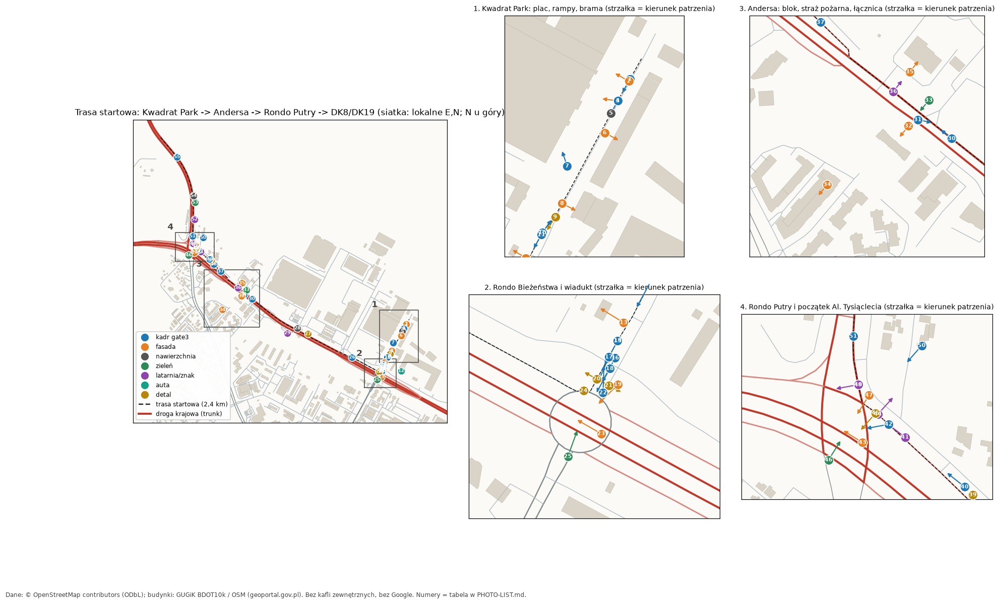

# Lista ujęć zdjęciowych — trasa startowa (D41)

Trasa: **Kwadrat Park → ul. gen. Andersa → Rondo Putry → Al. Tysiąclecia (DK8/DK19)**, kandydat C, ok. 2,4 km.
Lista jest wygenerowana z danych projektu (pozycje kamer gate3/photo_match, geometria trasy, OSM, BDOT10k) skryptem
`tools/worldgen/photolist/build_photo_list.py`. **55 ujęć** w kolejności trasy + Załącznik A (wszystkie pozy kamer).
Mapa z numerami: 

Źródło mapy i tła: © OpenStreetMap contributors (ODbL), budynki GUGiK BDOT10k. Linki prowadzą do openstreetmap.org i mapillary.com. **Nie używamy Google (Maps, Street View, Earth) w żadnej formie** — także jako ściąga na miejscu.

## 1. Najkrócej

1. Wybierz dzień **pochmurny** (rozproszone światło, brak ostrych cieni), najlepiej 10:00-14:00. Pora roku: listopad-luty, słońce nisko cały dzień, więc nawet przy słońcu dobre są poranki i popołudnia — ale **do tekstur tylko pochmurno**.
2. Jedna osoba lub dwie: kierowca + pasażer robi **wideo i kadry z fotela pasażera** na Andersa (to trasa szybkiego ruchu, nie wolno się zatrzymywać na jezdni).
3. Drugi termin: **zmierzch** (ok. 20-40 min po zachodzie słońca, niebo jeszcze niebieskie) — tylko ujęcia oznaczone `Z` (latarnie, oświetlone rondo).
4. Telefon: **główny obiektyw 1×, bez zoomu**, aparat poziomo, rozdzielczość maksymalna, format JPEG/HEIC lub RAW (RAW/oryginał zachowaj). Wyłącz HDR „agresywny”/tryb portretowy/upiększanie/filtr.
5. Zdjęcia wrzuć do `Data/raw/photos/owner/` (poza gitem), nazwy wg sekcji 4. Daj znać liderowi — dopisze manifest i licencję.

## 2. Zasady fotografowania (ważne)

- **Tekstury fasad i nawierzchni — PROSTOPADLE**: aparat równolegle do ściany/ziemi, ściana wypełnia kadr, pion bez przechyłu. Nie „szeroki kąt z ukosa”.
- **Bez ostrych cieni**: pochmurno albo cień budynku na całej powierzchni. Nie fotografuj połowy ściany w słońcu i połowy w cieniu.
- **Skala i kolor**: w kadrze (w rogu) kartka białego papieru A4 (297 × 210 mm) lub linijka/miarka zwijana; jeśli masz kartę szarości (18%), zrób jedno zdjęcie karty w tym samym świetle co serię. Kartka jest też wzorcem bieli.
- **Seria zamiast jednego**: dla każdej fasady/nawierzchni: 1× całość, 2-3× zbliżenia (materiał, spoina, detal), 1× z nieco inną ostrością. Mało kadrów = nie da się zrobić tekstury.
- **Bez ludzi, bez tablic rejestracyjnych, bez twarzy.** Poczekaj lub zrób kadr od innej strony. Tablice: nie fotografuj, albo zakryj/odwróć kadr. Niczego nie pokazuj ze zbliżenia, co identyfikuje firmę (logo), bo w grze marki są fikcyjne.
- **Prywatność i bezpieczeństwo**: nie wchodź na jezdnię; na Andersa i Al. Tysiąclecia (drogi krajowe, 3 pasy, wiadukty) wyłącznie z chodnika, bezpiecznej zatoki lub jako pasażer. Teren Kwadrat Parku jest **prywatny** — zdjęcia tylko z drogi publicznej albo za zgodą zarządcy (oznaczone `[PRYWATNE]`). Nie fotografuj z drona (przepisy i zasady projektu). Jeśli coś jest niebezpieczne — pomiń, lista jest zapasowa.
- **Ogniskowa**: 1× (ok. 24-26 mm w przeliczeniu na pełną klatkę). Kamery gate3 w grze mają pionowe FOV 55-65° (to szerszy kadr niż 1× w telefonie); dla ujęć „kadr gate3” zrób 1× oraz, jeśli telefon ma, jeden kadr 0,5× z tego samego miejsca. Nie używaj zoomu, bo zmienia perspektywę.
- **Wysokość**: standardowo **1,5 m** (oczy pieszego, telefon trzymany przy oczach). Gra ma kamerę kierowcy na 2,5 m; jeśli masz dostęp do kabiny ciężarówki, dodatkowo jedno ujęcie z 2,5 m (opcjonalnie, nie wchodź na dach ani na przyczepę). Pod nogi/pionowo w dół: ok. 1,3 m nad ziemią.
- **Orientacja**: zapisz kierunek (kompas telefonu w aplikacji, pokaż azymut), albo zrób zdjęcie ekranu mapy ze swoją pozycją. Włącz zapis lokalizacji w EXIF (GPS).

Kody w tabeli: **Typ** = kadr gate3 (zgodność z kamerą w grze), fasada, nawierzchnia, zieleń, latarnia/znak, auta, detal. **Pora**: `S` = pochmurno w dzień, `Z+S` = zmierzch (oraz wersja dzienna). **Pri**: P1 = konieczne, P2 = ważne, P3 = opcjonalne. **[PRYWATNE]** = teren prywatny. **[RUCH]** = droga o dużym ruchu, tylko z chodnika/zatoki/pasażera.
Współrzędne „authored” (fasady, nawierzchnie, zieleń itd.) są orientacyjne (± 10 m, WORKING_VALUE): wybierz najbliższe dobre miejsce. Współrzędne kamer gate3 są dokładne (poza zniekształceniem: wysokość 2,5 m w grze vs 1,5 m).

## 3. Mapillary (D42) — co fotografować najpierw

Mapillary (CC BY-SA 4.0) wolno używać jako referencji ulicznej z atrybucją. API `graph.mapillary.com` wymaga tokenu (konta), więc **pokrycia nie sprawdzono automatycznie**. W każdym wierszu jest link `Mapillary` (zoom 17) do ręcznego sprawdzenia, zielone/niebieskie linie na mapie = pokrycie.

Jak decydować: jeśli w miejscu jest **świeże (ostatnie 2-3 lata) i ostre** zdjęcie z właściwego kierunku → ujęcie zdobędziemy z Mapillary, Ty zrób je ostatnie (traktuj jako P2). **Brak pokrycia lub stare/rozmyte** → fotografuj najpierw. Mapillary zwykle **nie nadaje się do tekstur** (fasady z ukosa, kompresja, dziwne kąty), więc fasady i nawierzchnie fotografuj niezależnie od pokrycia. Własne zdjęcia nie wymagają atrybucji, zdjęcia Mapillary — tak (lider dopisze w `docs/LICENSES.md`). Google nadal zakazany.

Kolumnę `Mapillary?` możesz uzupełnić w manifeście (sekcja 4): `tak-swieze / tak-stare / brak / nie-sprawdzono`.

## 4. Gdzie wrzucić pliki i jak nazwać

Folder (poza gitem, jest już w `.gitignore`): **`Data/raw/photos/owner/`**. Jeden folder, bez podfolderów (lub jeden podfolder na dzień: `2026-11-12/`).

Nazwa pliku: `NR_TYP_krotki-opis_RRRRMMDD_GGMM[_wariant].jpg`, gdzie NR = numer ujęcia z tabeli (2 cyfry), TYP = K/F/N/Z/L/P/D.
Przykłady: `06_F_hala-rampy-sciana_20261112_1120.jpg`, `06_F_hala-rampy-sciana_20261112_1121_zblizenie2.jpg`, `48_N_zebra-putry_20261112_1305_gora.jpg`. Zdjęcia dodatkowe bez numeru: `X_TYP_opis_data.jpg`. Oryginały (HEIC/RAW) zostaw z tą samą nazwą bazową. Wideo: `V_andersa-pasazer_20261112_1210.mp4` (kierunek, data).

Manifest: plik **`Data/raw/photos/owner/manifest.csv`** — jedna linia na zdjęcie (lider/agent uzupełni, jeśli Ci łatwiej, możesz zostawić puste):
`plik, nr, data_czas, pogoda(pochmurno/slonce/zmierzch), wysokosc_m, azymut_deg, ogniskowa(1x/0.5x), mapillary(tak-swieze/tak-stare/brak/nie-sprawdzono), sa_ludzie_lub_tablice(nie/zakryte), uwagi`.
Agent doda SHA256 i wpis do `Data/SourceManifests/` (źródło: własne zdjęcia właściciela, licencja: własność autora, użycie komercyjne dozwolone przez autora). Dla `docs/LICENSES.md`: „zdjęcia własne właściciela, Białystok 2026”.

## 5. Kolejność i szacowany czas (WORKING_VALUE)

Trasa ma 2,4 km. Szacunek przy 2 osobach i samochodzie: **ok. 5-6 h łącznie w dwóch terminach** (dzień pochmurny ok. 4-5 h; zmierzch ok. 1 h).

| Etap | Co | Dojazd | Czas |
|---|---|---|---|
| A | Kwadrat Park + droga dojazdowa (jeśli jest zgoda) lub tylko z drogi publicznej | auto/spacer | 1,0-1,5 h |
| B | Rondo Bieżeństwa, wiadukt, zieleń wyspy, auta z parkingu | spacer 400 m | 1,0 h |
| C | Andersa: seria wideo z auta + chodnik przy bloku, strażą pożarną, przystankiem | auto + 3 przystanki | 1,0-1,5 h |
| D | Rondo Putry: kadry, wiadukt, zebra, zieleń | spacer wokół ronda | 1,0-1,5 h |
| E | Al. Tysiąclecia: wylot DK8/DK19, znak, zieleń | auto | 0,5 h |
| Zmierzch | Latarnie (nr oznaczone `Z+S`) na Andersa i Putry | auto | ok. 1 h |

Kolejność jazdy: od A do E (jak numery), wideo z Andersa po drodze. Przerwa na zdjęcia nawierzchni/kostki/studzienek w miejscach, gdzie akurat jesteś.

## 6. Tabele ujęć
Wiersze są posortowane wzdłuż trasy. `s` = odległość wzdłuż trasy startowej od początku (m). Link OSM pokazuje punkt na mapie openstreetmap.org.

### Etap A. Kwadrat Park i droga dojazdowa (s 0-290 m) — teren prywatny

| Nr | Typ | Miejsce i współrzędne WGS84 | Kierunek patrzenia | Wys. | Pora | Cel / co ma być na zdjęciu | Mapy | Pri |
|---|---|---|---|---|---|---|---|---|
| 1 | kadr gate3 **[PRYWATNE]** | Kwadrat Park, plac przy rampach, start trasy (s = 30 m) `53.154483, 23.170276` (s=30 m) | wzdłuż placu w głąb bazy; rampy z prawej, hala z lewej (azymut 209° SW) | 1,5 m (opcj. 2,5 m z kabiny) | S | Dopasowanie kadru gate3 (g3a_eye_s0012 = stretch_01). Całość: rampy, nawierzchnia placu, oznakowanie poziome, oświetlenie. Kamery: `g3a_eye_s0012`, `stretch_01`. | [OSM](https://www.openstreetmap.org/?mlat=53.154483&mlon=23.170276#map=19/53.154483/23.170276) · [Mapillary](https://www.mapillary.com/app/?lat=53.154483&lng=23.170276&z=17) | P1 |
| 2 | fasada **[PRYWATNE]** | Hala wysoka (ok. 4400 m², wys. ok. 14 m) po zachodniej stronie startu `53.154460, 23.170251` (s=33 m) | na ścianę szczytową/boczną (azymut 299° NW) | 1,5 m | S | Tekstura fasady wysokiej hali (blacha trapezowa / płyta). Prostopadle. | [OSM](https://www.openstreetmap.org/?mlat=53.154460&mlon=23.170251#map=19/53.154460/23.170251) · [Mapillary](https://www.mapillary.com/app/?lat=53.154460&lng=23.170251&z=17) | P2 |
| 3 | fasada **[PRYWATNE]** | Największa hala Kwadrat Parku (ok. 21 000 m², wys. ok. 10 m) — widok z dystansu ok. 130 m `53.154241, 23.170017` (s=62 m) | na elewację hali (kąt skośny 20-30° dopuszczalny, bryła + dach) (azymut 277° W) | 1,5 m | S | Bryła i proporcje hali, rytm bram i okien, kolory. Dodatkowo jedno ujęcie prostopadłe, jeśli da się podejść. | [OSM](https://www.openstreetmap.org/?mlat=53.154241&mlon=23.170017#map=19/53.154241/23.170017) · [Mapillary](https://www.mapillary.com/app/?lat=53.154241&lng=23.170017&z=17) | P2 |
| 4 | kadr gate3 **[PRYWATNE]** | Droga dojazdowa bazy: seria co 50 m (s = 62, 112, 162, 212 m) — dopasowanie kadrów gate3 `53.154241, 23.170017` (s=62 m) | wzdłuż drogi dojazdowej w stronę bramy (azymut 208° SW) | 1,5 m | S | Seria 4 kadrów wg załącznika A (współrzędne dla każdego). Alternatywa: wideo z auta (patrz niżej). Kamery: `g3a_eye_s0062`, `g3a_eye_s0112`, `g3a_eye_s0162`, `g3a_eye_s0212`. | [OSM](https://www.openstreetmap.org/?mlat=53.154241&mlon=23.170017#map=19/53.154241/23.170017) · [Mapillary](https://www.mapillary.com/app/?lat=53.154241&lng=23.170017&z=17) | P1 |
| 5 | nawierzchnia **[PRYWATNE]** | Plac bazy — asfalt przy rampach `53.154103, 23.169876` (s=80 m) | PIONOWO W DÓŁ (obiektyw równolegle do ziemi) (azymut 208° SW, pod stopami: kierunek trasy) | ok. 1,3 m nad ziemią | S | NAWIERZCHNIA z góry: asfalt placu (ziarno, spękania, plamy oleju). Kartka A4 jako skala. 2 ujęcia: czysty fragment + z linią/oznakowaniem. | [OSM](https://www.openstreetmap.org/?mlat=53.154103&mlon=23.169876#map=19/53.154103/23.169876) · [Mapillary](https://www.mapillary.com/app/?lat=53.154103&lng=23.169876&z=17) | P1 |
| 6 | fasada **[PRYWATNE]** | Hala z rampami (magazyn ok. 2400 m², wys. ok. 5,7 m wg LoD1) — ściana od strony placu `53.153881, 23.169733` (s=106 m) | prostopadle na środek ściany (azymut 118° SE) | 1,5 m | S | TEKSTURA FASADY prostopadle: cała ściana + 2 zbliżenia (blacha/płyta warstwowa, cokół, rynna). Karta szarości/biała kartka w kadrze. | [OSM](https://www.openstreetmap.org/?mlat=53.153881&mlon=23.169733#map=19/53.153881/23.169733) · [Mapillary](https://www.mapillary.com/app/?lat=53.153881&lng=23.169733&z=17) | P1 |
| 7 | kadr gate3 **[PRYWATNE]** | Kwadrat Park, rampy załadunkowe (11 bram), widok z placu `53.153523, 23.168977` (s=166 m) | na rampy — bramy segmentowe, odbojniki, doszczelnienia (azymut 341° N) | 1,5 m | S | Dopasowanie kadru stretch_05_docks. Potem 3 zbliżenia: brama, odbojnik, doszczelnienie (bez logo firm). Kamery: `stretch_05_docks`. | [OSM](https://www.openstreetmap.org/?mlat=53.153523&mlon=23.168977#map=19/53.153523/23.168977) · [Mapillary](https://www.mapillary.com/app/?lat=53.153523&lng=23.168977&z=17) | P1 |
| 8 | fasada **[PRYWATNE]** | Magazyn przy bramie bazy (ok. 1600 m², wys. ok. 5,6 m) `53.153095, 23.168838` (s=212 m) | na ścianę od strony drogi dojazdowej (azymut 117° SE) | 1,5 m | S | Tekstura fasady prostopadle + detal bramy i drzwi. | [OSM](https://www.openstreetmap.org/?mlat=53.153095&mlon=23.168838#map=19/53.153095/23.168838) · [Mapillary](https://www.mapillary.com/app/?lat=53.153095&lng=23.168838&z=17) | P2 |
| 9 | detal **[PRYWATNE]** | Brama bazy: szlaban/portiernia, ogrodzenie `53.152944, 23.168690` (s=232 m) | na wjazd (od środka) — szlaban, słupki, słup oświetleniowy (azymut 211° SW) | 1,5 m | S | DETAL: ogrodzenie (typ siatki/paneli, słupki), szlaban, portiernia. Z bliska sam materiał, bez logo i tablic. | [OSM](https://www.openstreetmap.org/?mlat=53.152944&mlon=23.168690#map=19/53.152944/23.168690) · [Mapillary](https://www.mapillary.com/app/?lat=53.152944&lng=23.168690&z=17) | P1 |
| 10 | kadr gate3 | Z drogi publicznej wstecz na wjazd do Kwadrat Parku `53.152772, 23.168427` (s=258 m) | na wjazd/bramę bazy (wstecz trasy) (azymut 35° NE) | 1,5 m | S | Dopasowanie kadru kwadrat_park_gate: układ wjazdu, krawężniki, studzienki, oznakowanie przed bramą. Kamery: `kwadrat_park_gate`. | [OSM](https://www.openstreetmap.org/?mlat=53.152772&mlon=23.168427#map=19/53.152772/23.168427) · [Mapillary](https://www.mapillary.com/app/?lat=53.152772&lng=23.168427&z=17) | P1 |
| 11 | kadr gate3 **[PRYWATNE]** | Brama bazy od środka — wyjazd na drogę publiczną `53.152749, 23.168404` (s=261 m) | na wyjazd i dalej drogą w stronę ronda (azymut 209° SW) | 1,5 m (opcj. 2,5 m z kabiny) | S | Dopasowanie kadru gate3 (g3a_eye_s0262 = stretch_03). Kamery: `g3a_eye_s0262`, `stretch_03`. | [OSM](https://www.openstreetmap.org/?mlat=53.152749&mlon=23.168404#map=19/53.152749/23.168404) · [Mapillary](https://www.mapillary.com/app/?lat=53.152749&lng=23.168404&z=17) | P1 |
| 12 | auta | Parking przy sklepie na wschód od Ronda Bieżeństwa `53.152002, 23.169556` (s=289 m) | rząd zaparkowanych aut z boku i 3/4 (azymut 300° NW) | 1,5 m | S | TYPOWE AUTA zaparkowane (osobówki, dostawczaki, kombi): z boku prostopadle, z przodu i tyłu 3/4. BEZ tablic (zasłoń/odwróć kadr), bez ludzi i bez logo sklepu w kadrze. | [OSM](https://www.openstreetmap.org/?mlat=53.152002&mlon=23.169556#map=19/53.152002/23.169556) · [Mapillary](https://www.mapillary.com/app/?lat=53.152002&lng=23.169556&z=17) | P2 |

### Etap B. Rondo Pamięci Bieżeństwa i wiadukt (s 295-480 m)

| Nr | Typ | Miejsce i współrzędne WGS84 | Kierunek patrzenia | Wys. | Pora | Cel / co ma być na zdjęciu | Mapy | Pri |
|---|---|---|---|---|---|---|---|---|
| 13 | fasada | Stacja paliw przy drodze dojazdowej (wiata) `53.152491, 23.168082` (s=297 m) | na wiatę i dystrybutory z boku (azymut 302° NW) | 1,5 m | S | Konstrukcja wiaty, wysokość, posadzka. BEZ zbliżeń logo i cen; fikcyjne marki w grze. | [OSM](https://www.openstreetmap.org/?mlat=53.152491&mlon=23.168082#map=19/53.152491/23.168082) · [Mapillary](https://www.mapillary.com/app/?lat=53.152491&lng=23.168082&z=17) | P2 |
| 14 | nawierzchnia | Chodnik (kostka/płyty) — dowolne miejsce przy ul. dojazdowej/rondzie, najlepiej koło przejścia `53.152372, 23.168005` (s=311 m) | PIONOWO W DÓŁ (azymut 301° NW, pod stopami: kierunek trasy) | ok. 1,3 m | S | NAWIERZCHNIA: kostka brukowa i płyty chodnikowe — 3 ujęcia z góry (czysty fragment, spoina/fuga, zużycie), skala A4/linijka. Zapisz, czy kostka (np. szara/czerwona) — opis w nazwie. | [OSM](https://www.openstreetmap.org/?mlat=53.152372&mlon=23.168005#map=19/53.152372/23.168005) · [Mapillary](https://www.mapillary.com/app/?lat=53.152372&lng=23.168005&z=17) | P1 |
| 15 | kadr gate3 | Dojazd do Ronda Bieżeństwa spod wiaduktu (s = 312 m i 360 m) `53.152371, 23.168002` (s=311 m) | na wlot ronda i wiadukt Andersa (azymut 208° SW) | 1,5 m | S | Dopasowanie kadrów g3a_eye_s0312 i stretch_04 (podobne pozy). Kamery: `g3a_eye_s0312`, `stretch_04`. | [OSM](https://www.openstreetmap.org/?mlat=53.152371&mlon=23.168002#map=19/53.152371/23.168002) · [Mapillary](https://www.mapillary.com/app/?lat=53.152371&lng=23.168002&z=17) | P1 |
| 16 | kadr gate3 | Rondo Bieżeństwa — widok z góry ukośnie (gra: 45 m nad ziemią) `53.152254, 23.167963` (s=323 m) | na rondo z góry (azymut 209° SW) | ok. 12-45 m: tylko jeśli jest dostęp (kładka/nasyp) | S | OPCJONALNIE: z nasypu, kładki lub z chodnika wiaduktu (tylko jeśli legalne i bezpieczne). Dron: NIE (przepisy i zasady projektu). Kamery: `g3a_rondo_bie_above`, `biezenstwa_above`. | [OSM](https://www.openstreetmap.org/?mlat=53.152254&mlon=23.167963#map=19/53.152254/23.167963) · [Mapillary](https://www.mapillary.com/app/?lat=53.152254&lng=23.167963&z=17) | P3 |
| 17 | kadr gate3 | 30 m przed wlotem na Rondo Bieżeństwa `53.152263, 23.167893` (s=325 m) | na środek ronda (wyspa, wiadukt) (azymut 204° SW) | 1,5 m | S | Dopasowanie kadru g3a_rondo_bie_approach (FOV 65°; użyj 1× i ew. 0,5×). Kamery: `g3a_rondo_bie_approach`, `g3a_eye_s0362`, `g3a_eye_s0412`. | [OSM](https://www.openstreetmap.org/?mlat=53.152263&mlon=23.167893#map=19/53.152263/23.167893) · [Mapillary](https://www.mapillary.com/app/?lat=53.152263&lng=23.167893&z=17) | P1 |
| 18 | kadr gate3 | Rondo Pamięci Bieżeństwa 1915 r. — widok z nasypu/chodnika (photo match z CC0 20201102_152339) `53.152185, 23.167896` (s=332 m) | na wiadukt Andersa nad rondem (azymut 209° SW) | 1,5 m | S | DOPASOWANIE KADRU (photo_match): ten sam punkt widzenia co referencja CC0. Rób z chodnika. Kamery: `photo_biezenstwa_ground`. | [OSM](https://www.openstreetmap.org/?mlat=53.152185&mlon=23.167896#map=19/53.152185/23.167896) · [Mapillary](https://www.mapillary.com/app/?lat=53.152185&lng=23.167896&z=17) | P1 |
| 19 | fasada | Wiadukt Andersa nad Rondem Bieżeństwa — widok z boku `53.152073, 23.167976` (s=340 m) | prostopadle na bok konstrukcji wiaduktu (azymut 225° SW) | 1,5 m | S | TEKSTURA/KSZTAŁT: dźwigary, balustrada/ekran, przyczółki (beton), skarpa pod wiaduktem. | [OSM](https://www.openstreetmap.org/?mlat=53.152073&mlon=23.167976#map=19/53.152073/23.167976) · [Mapillary](https://www.mapillary.com/app/?lat=53.152073&lng=23.167976&z=17) | P1 |
| 20 | detal | Przejście przy wlocie Ronda Bieżeństwa (przejścia oznaczone w OSM) `53.152120, 23.167741` (s=344 m) | PIONOWO W DÓŁ na krawężnik i pasy; potem z boku (azymut 118° SE) | 1,3 m w dół + 1,5 m z boku | S | DETAL: krawężnik obniżony i wysoki, studzienka, linia zatrzymania, pasy zebry. Skala: linijka/A4. | [OSM](https://www.openstreetmap.org/?mlat=53.152120&mlon=23.167741#map=19/53.152120/23.167741) · [Mapillary](https://www.mapillary.com/app/?lat=53.152120&lng=23.167741&z=17) | P1 |
| 21 | detal | Słupek prowadzący/blokujący i znak pionowy przy rondzie (stan i mocowanie) `53.152070, 23.167871` (s=344 m) | na słupek i na znak (przód + tył) (azymut 298° NW) | 1,5 m | S | DETAL: słupek (kolor, odblask, wysokość), tył znaku i obejma, wysokość montażu. Nie zbliżaj logo/tablic rej. | [OSM](https://www.openstreetmap.org/?mlat=53.152070&mlon=23.167871#map=19/53.152070/23.167871) · [Mapillary](https://www.mapillary.com/app/?lat=53.152070&lng=23.167871&z=17) | P2 |
| 22 | kadr gate3 | Ujęcia 3/4 „z boku auta” (tła pod widok zewnętrzny): przy rondzie, bramie, placu `53.152022, 23.167803` (s=351 m) | wg załącznika A (azymut 2° N) | 1,5 m | S | Dopasowanie kadrów ext34 (gra: 3 m nad ziemią obok kabiny). Pieszo 1,5 m z tego samego miejsca. Tylko, jeśli czas pozwala. Kamery: `g3a_ext34_s0338`, `g3a_ext34_s0214`, `g3a_ext34_s0040`. | [OSM](https://www.openstreetmap.org/?mlat=53.152022&mlon=23.167803#map=19/53.152022/23.167803) · [Mapillary](https://www.mapillary.com/app/?lat=53.152022&lng=23.167803&z=17) | P3 |
| 23 | fasada | Spód wiaduktu Andersa nad Rondem Bieżeństwa `53.151746, 23.167754` (s=355 m) | w górę i wzdłuż osi wiaduktu pod pomostem (azymut 300° NW) | 1,5 m, lekko w górę | S | Spód pomostu, podpory, przyczółki, oświetlenie pod wiaduktem. Zdjęcie pionowo w górę jako drugie. | [OSM](https://www.openstreetmap.org/?mlat=53.151746&mlon=23.167754#map=19/53.151746/23.167754) · [Mapillary](https://www.mapillary.com/app/?lat=53.151746&lng=23.167754&z=17) | P1 |
| 24 | detal | Studzienka kanalizacyjna i wpust uliczny (dowolna, w chodniku/poboczu) `53.152044, 23.167584` (s=360 m) | PIONOWO W DÓŁ + 1 z ukosa (azymut 188° S, pod stopami: kierunek trasy) | ok. 1,3 m | S | DETAL: studzienka (pokrywa, wzór, ramka), wpust uliczny (kratka). Skala: moneta/linijka. | [OSM](https://www.openstreetmap.org/?mlat=53.152044&mlon=23.167584#map=19/53.152044/23.167584) · [Mapillary](https://www.mapillary.com/app/?lat=53.152044&lng=23.167584&z=17) | P2 |
| 25 | zieleń | Wyspa środkowa Ronda Bieżeństwa — zieleń `53.151603, 23.167363` (s=365 m) | na wyspę (trawa, krzewy, drzewa) (azymut 20° N) | 1,5 m | S | ZIELEŃ: gatunki, wysokość krzewów, obrzeże/krawężnik wyspy. Zbliżenie: liść/kora. | [OSM](https://www.openstreetmap.org/?mlat=53.151603&mlon=23.167363#map=19/53.151603/23.167363) · [Mapillary](https://www.mapillary.com/app/?lat=53.151603&lng=23.167363&z=17) | P1 |

### Etap C. Łącznica i Andersa (s 480-1540 m) — trasa szybkiego ruchu

| Nr | Typ | Miejsce i współrzędne WGS84 | Kierunek patrzenia | Wys. | Pora | Cel / co ma być na zdjęciu | Mapy | Pri |
|---|---|---|---|---|---|---|---|---|
| 26 | kadr gate3 **[RUCH]** | Wjazd na Andersa (łącznica obok rampy zachodniej) `53.152871, 23.165283` (s=540 m) | wzdłuż łącznicy na zachód (azymut 291° W) | 1,5 m | S | Dopasowanie kadru route_onramp_andersa (r4 blocker): nasyp, bariery, linie. Tylko z auta/pasażera lub z bezpiecznego pobocza. Kamery: `route_onramp_andersa`, `route_onramp_andersa_above`. | [OSM](https://www.openstreetmap.org/?mlat=53.152871&mlon=23.165283#map=19/53.152871/23.165283) · [Mapillary](https://www.mapillary.com/app/?lat=53.152871&lng=23.165283&z=17) | P1 |
| 27 | detal **[RUCH]** | Przystanek na Andersa (zatoka autobusowa, ok. s = 837 m) `53.154255, 23.161511` (s=837 m) | na wiatę, ławkę, słupek przystankowy (bez rozkładu z czytelnym tekstem) (azymut 208° SW) | 1,5 m | S | DETAL: wiata, słupek, krawężnik zatoki, asfalt zatoki z góry. Tylko z chodnika/zatoki, nigdy z jezdni. | [OSM](https://www.openstreetmap.org/?mlat=53.154255&mlon=23.161511#map=19/53.154255/23.161511) · [Mapillary](https://www.mapillary.com/app/?lat=53.154255&lng=23.161511&z=17) | P2 |
| 28 | nawierzchnia **[RUCH]** | Przejście/zatoka przy Andersa (s ok. 900 m) — asfalt jezdni zużyty `53.154593, 23.160601` (s=908 m) | PIONOWO W DÓŁ (azymut 208° SW, pod stopami: kierunek trasy) | ok. 1,3 m | S | NAWIERZCHNIA: asfalt zużyty droga główna (ziarno, łaty, linia krawędziowa). Skala: A4. Tylko z chodnika/zatoki. | [OSM](https://www.openstreetmap.org/?mlat=53.154593&mlon=23.160601#map=19/53.154593/23.160601) · [Mapillary](https://www.mapillary.com/app/?lat=53.154593&lng=23.160601&z=17) | P1 |
| 29 | latarnia/znak **[RUCH]** | Andersa przy przystanku (s ok. 947 m) — latarnie `53.154364, 23.159681` (s=947 m) | na słup i oprawę (cała latarnia + zbliżenie oprawy) (azymut 208° SW) | 1,5 m | Z+S | LATARNIA: cały słup (stopa, wysokość, wysięgnik), oprawa. ZMIERZCH (żarzy się, niebo jeszcze niebieskie) + wersja dzienna. | [OSM](https://www.openstreetmap.org/?mlat=53.154364&mlon=23.159681#map=19/53.154364/23.159681) · [Mapillary](https://www.mapillary.com/app/?lat=53.154364&lng=23.159681&z=17) | P1 |
| 30 | kadr gate3 **[RUCH]** | Andersa (3 pasy, trasa szybkiego ruchu): seria G3-B co 50 m (s = 1232…1682 m) `53.156291, 23.156729` (s=1231 m) | wzdłuż Andersa w stronę Ronda Putry (azymut 309° NW) | 2,5 m z kabiny / ok. 1,4 m z fotela pasażera | S | NIE ZATRZYMUJ SIĘ NA JEZDNI. Najlepiej: WIDEO z fotela pasażera przez przednią szybę (czysta szyba, bez wycieraczek) od Ronda Bieżeństwa do Putry; kadry wyciągamy z wideo do współrzędnych z załącznika A. Kamery: `g3b_eye_s1232`, `g3b_eye_s1282`, `g3b_eye_s1332`, `g3b_eye_s1382`, `g3b_eye_s1432`, `g3b_eye_s1482`, `g3b_eye_s1532`, `g3b_eye_s1582`, `g3b_eye_s1632`, `g3b_eye_s1682`. | [OSM](https://www.openstreetmap.org/?mlat=53.156291&mlon=23.156729#map=19/53.156291/23.156729) · [Mapillary](https://www.mapillary.com/app/?lat=53.156291&lng=23.156729&z=17) | P1 |
| 31 | kadr gate3 **[RUCH]** | Ujęcia 3/4 przy Andersa i na łącznicy (współrzędne w załączniku A) `53.156555, 23.156038` (s=1285 m) | wg załącznika A (azymut 102° E) | 1,5 m | S | Tylko jeśli bezpieczne miejsce (zatoka/chodnik). Dopasowanie kadrów g3b_ext34_*. Kamery: `g3b_ext34_s1272`, `g3b_ext34_s1482`, `g3b_ext34_s1658`. | [OSM](https://www.openstreetmap.org/?mlat=53.156555&mlon=23.156038#map=19/53.156555/23.156038) · [Mapillary](https://www.mapillary.com/app/?lat=53.156555&lng=23.156038&z=17) | P3 |
| 32 | fasada | Blok mieszkalny przy Andersa (ok. 660 m², 14 m wg LoD1), od strony ulicy bocznej `53.156482, 23.155835` (s=1289 m) | prostopadle na elewację (azymut 219° SW) | 1,5 m | S | TEKSTURA FASADY: tynk/płytka, okna, balkony, kolory pasów. Całość + zbliżenia. Stań na chodniku/parkingu (nie przy Andersa). Bez ludzi, bez tablic. | [OSM](https://www.openstreetmap.org/?mlat=53.156482&mlon=23.155835#map=19/53.156482/23.155835) · [Mapillary](https://www.mapillary.com/app/?lat=53.156482&lng=23.155835&z=17) | P1 |
| 33 | zieleń **[RUCH]** | Pas zieleni między Andersa a blokami (s ok. 1290 m) `53.156792, 23.156295` (s=1290 m) | na pas zieleni: trawa, krzewy, drzewa (azymut 219° SW) | 1,5 m | S | ZIELEŃ: trawa (zbliżenie z góry), krzewy, drzewa (pień + kora z bliska, korona całości). Z chodnika od strony bloków. | [OSM](https://www.openstreetmap.org/?mlat=53.156792&mlon=23.156295#map=19/53.156792/23.156295) · [Mapillary](https://www.mapillary.com/app/?lat=53.156792&lng=23.156295&z=17) | P2 |
| 34 | fasada | Bloki wielorodzinne na północ od Andersa (ok. 20 m wys.) `53.155803, 23.154060` (s=1326 m) | prostopadle na elewację (3-4 piętra) (azymut 219° SW) | 1,5 m | S | TEKSTURA FASADY: wielka płyta/tynk, klatki schodowe, loggie; kolory (zapisz opisowo, jeśli zdjęcie ma dominantę). | [OSM](https://www.openstreetmap.org/?mlat=53.155803&mlon=23.154060#map=19/53.155803/23.154060) · [Mapillary](https://www.mapillary.com/app/?lat=53.155803&lng=23.154060&z=17) | P2 |
| 35 | fasada | Straż pożarna przy Andersa (ok. 1300 m², 6,5 m wg LoD1) `53.157165, 23.155927` (s=1336 m) | prostopadle na front z bramami garażowymi (azymut 39° NE) | 1,5 m | S | TEKSTURA FASADY: elewacja, bramy garażowe, wieża/suszarnia (jeśli jest). Bez logo/herbu w zbliżeniu, bez pojazdów z numerami. | [OSM](https://www.openstreetmap.org/?mlat=53.157165&mlon=23.155927#map=19/53.157165/23.155927) · [Mapillary](https://www.mapillary.com/app/?lat=53.157165&lng=23.155927&z=17) | P1 |
| 36 | latarnia/znak **[RUCH]** | Sygnalizator awaryjny straży na Andersa (s ok. 1337 m) `53.156929, 23.155558` (s=1337 m) | na sygnalizator i słup/wysięgnik (azymut 39° NE) | 1,5 m | S | LATARNIA/ZNAK: sygnalizator „emergency” — słup, głowice, tablica tła. Z chodnika/zatoki, nie z jezdni. | [OSM](https://www.openstreetmap.org/?mlat=53.156929&mlon=23.155558#map=19/53.156929/23.155558) · [Mapillary](https://www.mapillary.com/app/?lat=53.156929&lng=23.155558&z=17) | P2 |
| 37 | kadr gate3 **[RUCH]** | Zjazd z Andersa na łącznicę do Al. Tysiąclecia (s ok. 1427-1569 m) `53.157856, 23.154116` (s=1481 m) | wzdłuż łącznicy (azymut 314° NW) | 1,5 m | S | Opcja: kadr z wideo przez szybę (patrz seria G3-B). Kamery: `g3b_eye_s1482`. | [OSM](https://www.openstreetmap.org/?mlat=53.157856&mlon=23.154116#map=19/53.157856/23.154116) · [Mapillary](https://www.mapillary.com/app/?lat=53.157856&lng=23.154116&z=17) | P3 |
| 38 | kadr gate3 **[RUCH]** | Podejście Andersa do Ronda Putry (s ok. 1540 m) `53.158254, 23.153533` (s=1540 m) | na rondo i portal z tablicami (wg E-1) (azymut 313° NW) | 1,5 m | S | Dopasowanie kadru route_putry_approach i driver_andersa_to_putry. Pasażer przez szybę lub z bezpiecznego chodnika. Kamery: `route_putry_approach`, `driver_andersa_to_putry`. | [OSM](https://www.openstreetmap.org/?mlat=53.158254&mlon=23.153533#map=19/53.158254/23.153533) · [Mapillary](https://www.mapillary.com/app/?lat=53.158254&lng=23.153533&z=17) | P1 |

### Etap D. Rondo Putry (s 1540-1755 m)

| Nr | Typ | Miejsce i współrzędne WGS84 | Kierunek patrzenia | Wys. | Pora | Cel / co ma być na zdjęciu | Mapy | Pri |
|---|---|---|---|---|---|---|---|---|
| 39 | detal **[RUCH]** | Przystanek przy łączniku Andersa → Putry (s ok. 1567 m) `53.158456, 23.153310` (s=1566 m) | na wiatę/słupek (azymut 224° SW) | 1,5 m | S | DETAL: wiata, słupek, krawężnik. Z chodnika. | [OSM](https://www.openstreetmap.org/?mlat=53.158456&mlon=23.153310#map=19/53.158456/23.153310) · [Mapillary](https://www.mapillary.com/app/?lat=53.158456&lng=23.153310&z=17) | P2 |
| 40 | kadr gate3 | Z pobocza w stronę Ronda Putry — photo match (CC0 7204_May_2021) `53.158525, 23.153206` (s=1577 m) | w górę drogi na portal i wiadukt (azymut 309° NW) | 1,5 m | S | DOPASOWANIE KADRU (photo_match). Wysokość 1,6 m z pobocza wg komentarza w pliku kamer. Właściciel może przesunąć miejsce. Kamery: `g3b_rondo_putry_approach`. | [OSM](https://www.openstreetmap.org/?mlat=53.158525&mlon=23.153206#map=19/53.158525/23.153206) · [Mapillary](https://www.mapillary.com/app/?lat=53.158525&lng=23.153206&z=17) | P1 |
| 41 | latarnia/znak **[RUCH]** | 12 m przed wlotem na Rondo Putry — znaki A-7 + C-12 (+ C-9) `53.158963, 23.152430` (s=1648 m) | na tablice przed wlotem (azymut 307° NW) | 1,5 m | S | ZNAKI: cały zestaw na słupku, tył słupka i mocowanie, wysokość tablicy; potem każda tablica z bliska (stan, odblask). Kamery: `route_putry_entry_signs`. | [OSM](https://www.openstreetmap.org/?mlat=53.158963&mlon=23.152430#map=19/53.158963/23.152430) · [Mapillary](https://www.mapillary.com/app/?lat=53.158963&lng=23.152430&z=17) | P1 |
| 42 | kadr gate3 | 30 m przed wlotem na Rondo Putry `53.159076, 23.152215` (s=1667 m) | na środek ronda (azymut 260° W) | 1,5 m | S | Dopasowanie kadru g3b_rondo_put_approach (FOV 65°). Kamery: `g3b_rondo_put_approach`, `g3b_eye_s1632`. | [OSM](https://www.openstreetmap.org/?mlat=53.159076&mlon=23.152215#map=19/53.159076/23.152215) · [Mapillary](https://www.mapillary.com/app/?lat=53.159076&lng=23.152215&z=17) | P1 |
| 43 | fasada | Spód wiaduktu nad Rondem Putry `53.158938, 23.151845` (s=1673 m) | w górę wzdłuż osi pod pomostem (azymut 302° NW) | 1,5 m, lekko w górę | S | Spód pomostu, podpory, oświetlenie, plamy/zacieki. | [OSM](https://www.openstreetmap.org/?mlat=53.158938&mlon=23.151845#map=19/53.158938/23.151845) · [Mapillary](https://www.mapillary.com/app/?lat=53.158938&lng=23.151845&z=17) | P1 |
| 44 | latarnia/znak **[RUCH]** | Rondo Putry — latarnie nad rondem `53.159165, 23.152076` (s=1681 m) | na latarnię (cały słup) i na oświetlone rondo (azymut 42° NE) | 1,5 m | Z+S | LATARNIA ZMIERZCH: kolor światła (żółte sodowe / białe LED), rozstaw, wysokość. Statyw lub oprzyj telefon; 2-3 ekspozycje. | [OSM](https://www.openstreetmap.org/?mlat=53.159165&mlon=23.152076#map=19/53.159165/23.152076) · [Mapillary](https://www.mapillary.com/app/?lat=53.159165&lng=23.152076&z=17) | P1 |
| 45 | detal **[RUCH]** | Krawężnik wyspy dzielącej / wlot Ronda Putry `53.159175, 23.152047` (s=1683 m) | na krawężnik z boku i z góry (azymut 221° SW) | 1,5 m | S | DETAL: krawężnik (kamień/beton, wysokość), studzienka/wpust, szczelina, ubytki, nawierzchnia przy krawężniku. | [OSM](https://www.openstreetmap.org/?mlat=53.159175&mlon=23.152047#map=19/53.159175/23.152047) · [Mapillary](https://www.mapillary.com/app/?lat=53.159175&lng=23.152047&z=17) | P1 |
| 46 | zieleń | Wyspa środkowa i pasy zieleni Ronda Putry `53.158812, 23.151366` (s=1693 m) | na wyspę (azymut 32° NE) | 1,5 m | S | ZIELEŃ: berberys i żywopłoty (przycięta forma, kolor liści listopad/jesień), trawa, drzewa: pień + kora z bliska, korona całości. Zbliżenie liści na tle białej kartki (opcj.). | [OSM](https://www.openstreetmap.org/?mlat=53.158812&mlon=23.151366#map=19/53.158812/23.151366) · [Mapillary](https://www.mapillary.com/app/?lat=53.158812&lng=23.151366&z=17) | P1 |
| 47 | fasada | Wiadukt Andersa/Maczka nad Rondem Putry — widok z boku `53.159325, 23.151971` (s=1703 m) | prostopadle na bok wiaduktu (azymut 212° SW) | 1,5 m | S | Dźwigary, balustrada/ekran, przyczółki, skarpa. Kolory betonu i stali. | [OSM](https://www.openstreetmap.org/?mlat=53.159325&mlon=23.151971#map=19/53.159325/23.151971) · [Mapillary](https://www.mapillary.com/app/?lat=53.159325&lng=23.151971&z=17) | P1 |
| 48 | nawierzchnia **[RUCH]** | Zebra / przejście sygnalizowane przy Rondzie Putry (Al. Tysiąclecia, s ok. 1715 m) `53.159416, 23.151831` (s=1715 m) | PIONOWO W DÓŁ na pasy; potem z boku wzdłuż pasów (azymut 260° W, pod stopami: kierunek trasy) | 1,3 m w dół + 1,5 m z boku | S | NAWIERZCHNIA: zebra (szerokość i odstęp pasów, wytarcie farby), linia zatrzymania, strzałki. Skala: linijka. Tylko, gdy ruch stoi lub z chodnika. | [OSM](https://www.openstreetmap.org/?mlat=53.159416&mlon=23.151831#map=19/53.159416/23.151831) · [Mapillary](https://www.mapillary.com/app/?lat=53.159416&lng=23.151831&z=17) | P1 |
| 49 | latarnia/znak **[RUCH]** | Sygnalizator przy zebrze Rondo Putry `53.159416, 23.151831` (s=1715 m) | na słup sygnalizatora i głowice (azymut 260° W) | 1,5 m | S | ZNAK/LATARNIA: słup, głowice, osłony, przycisk dla pieszych (bez ludzi). Z chodnika. | [OSM](https://www.openstreetmap.org/?mlat=53.159416&mlon=23.151831#map=19/53.159416/23.151831) · [Mapillary](https://www.mapillary.com/app/?lat=53.159416&lng=23.151831&z=17) | P2 |
| 50 | kadr gate3 **[RUCH]** | Rondo Putry z góry (dwupoziomowe: Andersa nad pierścieniem) `53.159709, 23.152730` (s=1751 m) | na rondo z góry (azymut 221° SW) | ok. 12-45 m: tylko jeśli jest dostęp | S | OPCJONALNIE z kładki/wiaduktu (chodnik) lub zaplecza budynku — tylko legalnie. Dron NIE. Kamery: `putry_above`, `g3b_rondo_put_above`. | [OSM](https://www.openstreetmap.org/?mlat=53.159709&mlon=23.152730#map=19/53.159709/23.152730) · [Mapillary](https://www.mapillary.com/app/?lat=53.159709&lng=23.152730&z=17) | P3 |

### Etap E. Al. Tysiąclecia → DK8/DK19 (s 1755-2400 m)

| Nr | Typ | Miejsce i współrzędne WGS84 | Kierunek patrzenia | Wys. | Pora | Cel / co ma być na zdjęciu | Mapy | Pri |
|---|---|---|---|---|---|---|---|---|
| 51 | kadr gate3 **[RUCH]** | Al. Tysiąclecia Państwa Polskiego tuż za Rondem Putry (s ok. 1760 m) `53.159818, 23.151801` (s=1760 m) | na północ wzdłuż al. Tysiąclecia (azymut 1° N) | 1,5 m | S | Pasy, pobocze/chodnik, latarnie, pierwszy znak/tablica DK8/DK19. Z fotela pasażera lub chodnika. | [OSM](https://www.openstreetmap.org/?mlat=53.159818&mlon=23.151801#map=19/53.159818/23.151801) · [Mapillary](https://www.mapillary.com/app/?lat=53.159818&lng=23.151801&z=17) | P2 |
| 52 | latarnia/znak **[RUCH]** | Al. Tysiąclecia: tablica kierunkowa DK8/DK19 (jeśli stoi w pierwszych 500 m) `53.160706, 23.152070` (s=1860 m) | na tablicę kierunkową (azymut 91° E) | 1,5 m | S | ZNAK: tablica kierunkowa z nazwami miast — czytelność, kolor tła, krój pisma; tył słupa; wysokość. BEZ aut w kadrze z tablicami. | [OSM](https://www.openstreetmap.org/?mlat=53.160706&mlon=23.152070#map=19/53.160706/23.152070) · [Mapillary](https://www.mapillary.com/app/?lat=53.160706&lng=23.152070&z=17) | P1 |
| 53 | zieleń **[RUCH]** | Pas zieleni przy Al. Tysiąclecia `53.161606, 23.152211` (s=1960 m) | na szpaler drzew (azymut 88° E) | 1,5 m | S | ZIELEŃ: drzewa — pień z bliska (kora) + cała korona + liść; trawnik (z góry), rów/pobocze. | [OSM](https://www.openstreetmap.org/?mlat=53.161606&mlon=23.152211#map=19/53.161606/23.152211) · [Mapillary](https://www.mapillary.com/app/?lat=53.161606&lng=23.152211&z=17) | P2 |
| 54 | nawierzchnia **[RUCH]** | Al. Tysiąclecia: asfalt przy zatoczce/poboczu `53.161972, 23.152112` (s=2000 m) | PIONOWO W DÓŁ (azymut 353° N, pod stopami: kierunek trasy) | ok. 1,3 m | S | NAWIERZCHNIA: asfalt droga krajowa (nowszy), linia krawędziowa ciągła i przerywana. Skala: A4. | [OSM](https://www.openstreetmap.org/?mlat=53.161972&mlon=23.152112#map=19/53.161972/23.152112) · [Mapillary](https://www.mapillary.com/app/?lat=53.161972&lng=23.152112&z=17) | P1 |
| 55 | kadr gate3 **[RUCH]** | Al. Tysiąclecia na północ — wylot z miasta (DK8/DK19, s ok. 2250 m) `53.164083, 23.150837` (s=2251 m) | na północ, wzdłuż trasy (azymut 320° NW) | 1,5 m | S | Dopasowanie kadru dk8_dk19_exit. Z fotela pasażera przez szybę lub z bezpiecznego miejsca. Kamery: `dk8_dk19_exit`. | [OSM](https://www.openstreetmap.org/?mlat=53.164083&mlon=23.150837#map=19/53.164083/23.150837) · [Mapillary](https://www.mapillary.com/app/?lat=53.164083&lng=23.150837&z=17) | P1 |

## Załącznik A. Wszystkie pozy kamer gate3 / photo_match / kontrolnych (te same pozy co w grze)

Wysokość kamery w grze: 2,5 m (oko kierowcy), kamery `*_above` ok. 12-45 m, `ext34` ok. 3 m. Pieszo robisz 1,5 m; różnicę wysokości policzymy przy dopasowaniu. Wartości FOV pionowe wg Unity.

| Id kamery | Nr ujęcia | WGS84 | Azymut | FOV | s [m] | Mapy |
|---|---|---|---|---|---|---|
| `stretch_01` | 1 | `53.154484, 23.170273` | 207° SW | 60° | 30 | [OSM](https://www.openstreetmap.org/?mlat=53.154484&mlon=23.170273#map=19/53.154484/23.170273) · [Mapillary](https://www.mapillary.com/app/?lat=53.154484&lng=23.170273&z=17) |
| `g3a_eye_s0012` | 1 | `53.154483, 23.170276` | 209° SW | 60° | 30 | [OSM](https://www.openstreetmap.org/?mlat=53.154483&mlon=23.170276#map=19/53.154483/23.170276) · [Mapillary](https://www.mapillary.com/app/?lat=53.154483&lng=23.170276&z=17) |
| `g3a_ext34_s0040` | 22 | `53.154258, 23.170195` | 3° N | 50° | 54 | [OSM](https://www.openstreetmap.org/?mlat=53.154258&mlon=23.170195#map=19/53.154258/23.170195) · [Mapillary](https://www.mapillary.com/app/?lat=53.154258&lng=23.170195&z=17) |
| `g3a_eye_s0062` | 4 | `53.154241, 23.170017` | 208° SW | 60° | 62 | [OSM](https://www.openstreetmap.org/?mlat=53.154241&mlon=23.170017#map=19/53.154241/23.170017) · [Mapillary](https://www.mapillary.com/app/?lat=53.154241&lng=23.170017&z=17) |
| `g3a_eye_s0112` | 4 | `53.153859, 23.169624` | 208° SW | 60° | 112 | [OSM](https://www.openstreetmap.org/?mlat=53.153859&mlon=23.169624#map=19/53.153859/23.169624) · [Mapillary](https://www.mapillary.com/app/?lat=53.153859&lng=23.169624&z=17) |
| `stretch_02` | — | `53.153569, 23.169324` | 207° SW | 60° | 150 | [OSM](https://www.openstreetmap.org/?mlat=53.153569&mlon=23.169324#map=19/53.153569/23.169324) · [Mapillary](https://www.mapillary.com/app/?lat=53.153569&lng=23.169324&z=17) |
| `g3a_eye_s0162` | 4 | `53.153475, 23.169234` | 209° SW | 60° | 162 | [OSM](https://www.openstreetmap.org/?mlat=53.153475&mlon=23.169234#map=19/53.153475/23.169234) · [Mapillary](https://www.mapillary.com/app/?lat=53.153475&lng=23.169234&z=17) |
| `stretch_05_docks` | 7 | `53.153523, 23.168977` | 341° N | 60° | 166 | [OSM](https://www.openstreetmap.org/?mlat=53.153523&mlon=23.168977#map=19/53.153523/23.168977) · [Mapillary](https://www.mapillary.com/app/?lat=53.153523&lng=23.168977&z=17) |
| `g3a_eye_s0212` | 4 | `53.153094, 23.168838` | 214° SW | 60° | 212 | [OSM](https://www.openstreetmap.org/?mlat=53.153094&mlon=23.168838#map=19/53.153094/23.168838) · [Mapillary](https://www.mapillary.com/app/?lat=53.153094&lng=23.168838&z=17) |
| `g3a_ext34_s0214` | 22 | `53.152930, 23.168822` | 3° N | 50° | 229 | [OSM](https://www.openstreetmap.org/?mlat=53.152930&mlon=23.168822#map=19/53.152930/23.168822) · [Mapillary](https://www.mapillary.com/app/?lat=53.152930&lng=23.168822&z=17) |
| `stretch_03` | 11 | `53.152791, 23.168450` | 209° SW | 60° | 255 | [OSM](https://www.openstreetmap.org/?mlat=53.152791&mlon=23.168450#map=19/53.152791/23.168450) · [Mapillary](https://www.mapillary.com/app/?lat=53.152791&lng=23.168450&z=17) |
| `kwadrat_park_gate` | 10 | `53.152772, 23.168427` | 35° NE | 60° | 258 | [OSM](https://www.openstreetmap.org/?mlat=53.152772&mlon=23.168427#map=19/53.152772/23.168427) · [Mapillary](https://www.mapillary.com/app/?lat=53.152772&lng=23.168427&z=17) |
| `g3a_eye_s0262` | 11 | `53.152749, 23.168404` | 209° SW | 60° | 261 | [OSM](https://www.openstreetmap.org/?mlat=53.152749&mlon=23.168404#map=19/53.152749/23.168404) · [Mapillary](https://www.mapillary.com/app/?lat=53.152749&lng=23.168404&z=17) |
| `g3a_eye_s0312` | 15 | `53.152371, 23.168002` | 208° SW | 60° | 311 | [OSM](https://www.openstreetmap.org/?mlat=53.152371&mlon=23.168002#map=19/53.152371/23.168002) · [Mapillary](https://www.mapillary.com/app/?lat=53.152371&lng=23.168002&z=17) |
| `g3a_rondo_bie_above` | 16 | `53.152254, 23.167963` | 209° SW | 55° | 323 | [OSM](https://www.openstreetmap.org/?mlat=53.152254&mlon=23.167963#map=19/53.152254/23.167963) · [Mapillary](https://www.mapillary.com/app/?lat=53.152254&lng=23.167963&z=17) |
| `g3a_rondo_bie_approach` | 17 | `53.152263, 23.167893` | 204° SW | 65° | 325 | [OSM](https://www.openstreetmap.org/?mlat=53.152263&mlon=23.167893#map=19/53.152263/23.167893) · [Mapillary](https://www.mapillary.com/app/?lat=53.152263&lng=23.167893&z=17) |
| `photo_biezenstwa_ground` | 18 | `53.152185, 23.167896` | 209° SW | 62° | 332 | [OSM](https://www.openstreetmap.org/?mlat=53.152185&mlon=23.167896#map=19/53.152185/23.167896) · [Mapillary](https://www.mapillary.com/app/?lat=53.152185&lng=23.167896&z=17) |
| `g3a_ext34_s0338` | 22 | `53.152022, 23.167803` | 2° N | 50° | 351 | [OSM](https://www.openstreetmap.org/?mlat=53.152022&mlon=23.167803#map=19/53.152022/23.167803) · [Mapillary](https://www.mapillary.com/app/?lat=53.152022&lng=23.167803&z=17) |
| `stretch_04` | 15 | `53.152055, 23.167586` | 295° NW | 60° | 360 | [OSM](https://www.openstreetmap.org/?mlat=53.152055&mlon=23.167586#map=19/53.152055/23.167586) · [Mapillary](https://www.mapillary.com/app/?lat=53.152055&lng=23.167586&z=17) |
| `g3a_eye_s0362` | 17 | `53.152042, 23.167573` | 295° NW | 60° | 361 | [OSM](https://www.openstreetmap.org/?mlat=53.152042&mlon=23.167573#map=19/53.152042/23.167573) · [Mapillary](https://www.mapillary.com/app/?lat=53.152042&lng=23.167573&z=17) |
| `biezenstwa_above` | 16 | `53.151458, 23.166744` | 48° NE | 55° | 373 | [OSM](https://www.openstreetmap.org/?mlat=53.151458&mlon=23.166744#map=19/53.151458/23.166744) · [Mapillary](https://www.mapillary.com/app/?lat=53.151458&lng=23.166744&z=17) |
| `g3a_eye_s0412` | 17 | `53.152260, 23.166929` | 299° NW | 60° | 411 | [OSM](https://www.openstreetmap.org/?mlat=53.152260&mlon=23.166929#map=19/53.152260/23.166929) · [Mapillary](https://www.mapillary.com/app/?lat=53.152260&lng=23.166929&z=17) |
| `route_onramp_andersa` | 26 | `53.152871, 23.165283` | 291° W | 60° | 540 | [OSM](https://www.openstreetmap.org/?mlat=53.152871&mlon=23.165283#map=19/53.152871/23.165283) · [Mapillary](https://www.mapillary.com/app/?lat=53.152871&lng=23.165283&z=17) |
| `route_onramp_andersa_above` | 26 | `53.152719, 23.164995` | 325° NW | 55° | 550 | [OSM](https://www.openstreetmap.org/?mlat=53.152719&mlon=23.164995#map=19/53.152719/23.164995) · [Mapillary](https://www.mapillary.com/app/?lat=53.152719&lng=23.164995&z=17) |
| `g3b_eye_s1232` | 30 | `53.156291, 23.156729` | 309° NW | 60° | 1231 | [OSM](https://www.openstreetmap.org/?mlat=53.156291&mlon=23.156729#map=19/53.156291/23.156729) · [Mapillary](https://www.mapillary.com/app/?lat=53.156291&lng=23.156729&z=17) |
| `driver_andersa_to_putry` | 38 | `53.156400, 23.156606` | 307° NW | 60° | 1245 | [OSM](https://www.openstreetmap.org/?mlat=53.156400&mlon=23.156606#map=19/53.156400/23.156606) · [Mapillary](https://www.mapillary.com/app/?lat=53.156400&lng=23.156606&z=17) |
| `g3b_eye_s1282` | 30 | `53.156592, 23.156173` | 309° NW | 60° | 1281 | [OSM](https://www.openstreetmap.org/?mlat=53.156592&mlon=23.156173#map=19/53.156592/23.156173) · [Mapillary](https://www.mapillary.com/app/?lat=53.156592&lng=23.156173&z=17) |
| `g3b_ext34_s1272` | 31 | `53.156555, 23.156038` | 102° E | 50° | 1285 | [OSM](https://www.openstreetmap.org/?mlat=53.156555&mlon=23.156038#map=19/53.156555/23.156038) · [Mapillary](https://www.mapillary.com/app/?lat=53.156555&lng=23.156038&z=17) |
| `g3b_eye_s1332` | 30 | `53.156895, 23.155621` | 308° NW | 60° | 1331 | [OSM](https://www.openstreetmap.org/?mlat=53.156895&mlon=23.155621#map=19/53.156895/23.155621) · [Mapillary](https://www.mapillary.com/app/?lat=53.156895&lng=23.155621&z=17) |
| `g3b_eye_s1382` | 30 | `53.157191, 23.155059` | 314° NW | 60° | 1381 | [OSM](https://www.openstreetmap.org/?mlat=53.157191&mlon=23.155059#map=19/53.157191/23.155059) · [Mapillary](https://www.mapillary.com/app/?lat=53.157191&lng=23.155059&z=17) |
| `g3b_eye_s1432` | 30 | `53.157523, 23.154618` | 314° NW | 60° | 1431 | [OSM](https://www.openstreetmap.org/?mlat=53.157523&mlon=23.154618#map=19/53.157523/23.154618) · [Mapillary](https://www.mapillary.com/app/?lat=53.157523&lng=23.154618&z=17) |
| `g3b_eye_s1482` | 30, 37 | `53.157856, 23.154116` | 314° NW | 60° | 1481 | [OSM](https://www.openstreetmap.org/?mlat=53.157856&mlon=23.154116#map=19/53.157856/23.154116) · [Mapillary](https://www.mapillary.com/app/?lat=53.157856&lng=23.154116&z=17) |
| `g3b_ext34_s1482` | 31 | `53.157895, 23.153876` | 108° E | 50° | 1495 | [OSM](https://www.openstreetmap.org/?mlat=53.157895&mlon=23.153876#map=19/53.157895/23.153876) · [Mapillary](https://www.mapillary.com/app/?lat=53.157895&lng=23.153876&z=17) |
| `g3b_eye_s1532` | 30 | `53.158185, 23.153607` | 314° NW | 60° | 1531 | [OSM](https://www.openstreetmap.org/?mlat=53.158185&mlon=23.153607#map=19/53.158185/23.153607) · [Mapillary](https://www.mapillary.com/app/?lat=53.158185&lng=23.153607&z=17) |
| `route_putry_approach` | 38 | `53.158254, 23.153533` | 313° NW | 60° | 1540 | [OSM](https://www.openstreetmap.org/?mlat=53.158254&mlon=23.153533#map=19/53.158254/23.153533) · [Mapillary](https://www.mapillary.com/app/?lat=53.158254&lng=23.153533&z=17) |
| `g3b_rondo_putry_approach` | 40 | `53.158525, 23.153206` | 309° NW | 60° | 1577 | [OSM](https://www.openstreetmap.org/?mlat=53.158525&mlon=23.153206#map=19/53.158525/23.153206) · [Mapillary](https://www.mapillary.com/app/?lat=53.158525&lng=23.153206&z=17) |
| `g3b_eye_s1582` | 30 | `53.158515, 23.153099` | 314° NW | 60° | 1581 | [OSM](https://www.openstreetmap.org/?mlat=53.158515&mlon=23.153099#map=19/53.158515/23.153099) · [Mapillary](https://www.mapillary.com/app/?lat=53.158515&lng=23.153099&z=17) |
| `g3b_eye_s1632` | 30, 42 | `53.158843, 23.152588` | 313° NW | 60° | 1631 | [OSM](https://www.openstreetmap.org/?mlat=53.158843&mlon=23.152588#map=19/53.158843/23.152588) · [Mapillary](https://www.mapillary.com/app/?lat=53.158843&lng=23.152588&z=17) |
| `g3b_rondo_put_above` | 50 | `53.158724, 23.152269` | 305° NW | 55° | 1636 | [OSM](https://www.openstreetmap.org/?mlat=53.158724&mlon=23.152269#map=19/53.158724/23.152269) · [Mapillary](https://www.mapillary.com/app/?lat=53.158724&lng=23.152269&z=17) |
| `route_putry_entry_signs` | 41 | `53.158963, 23.152430` | 307° NW | 60° | 1648 | [OSM](https://www.openstreetmap.org/?mlat=53.158963&mlon=23.152430#map=19/53.158963/23.152430) · [Mapillary](https://www.mapillary.com/app/?lat=53.158963&lng=23.152430&z=17) |
| `g3b_rondo_put_approach` | 42 | `53.159076, 23.152215` | 260° W | 65° | 1667 | [OSM](https://www.openstreetmap.org/?mlat=53.159076&mlon=23.152215#map=19/53.159076/23.152215) · [Mapillary](https://www.mapillary.com/app/?lat=53.159076&lng=23.152215&z=17) |
| `g3b_ext34_s1658` | 31 | `53.159046, 23.152077` | 106° E | 50° | 1671 | [OSM](https://www.openstreetmap.org/?mlat=53.159046&mlon=23.152077#map=19/53.159046/23.152077) · [Mapillary](https://www.mapillary.com/app/?lat=53.159046&lng=23.152077&z=17) |
| `g3b_eye_s1682` | 30 | `53.159167, 23.152070` | 330° NW | 60° | 1681 | [OSM](https://www.openstreetmap.org/?mlat=53.159167&mlon=23.152070#map=19/53.159167/23.152070) · [Mapillary](https://www.mapillary.com/app/?lat=53.159167&lng=23.152070&z=17) |
| `putry_above` | 50 | `53.159709, 23.152730` | 221° SW | 55° | 1751 | [OSM](https://www.openstreetmap.org/?mlat=53.159709&mlon=23.152730#map=19/53.159709/23.152730) · [Mapillary](https://www.mapillary.com/app/?lat=53.159709&lng=23.152730&z=17) |
| `dk8_dk19_exit` | 55 | `53.164083, 23.150837` | 320° NW | 60° | 2251 | [OSM](https://www.openstreetmap.org/?mlat=53.164083&mlon=23.150837#map=19/53.164083/23.150837) · [Mapillary](https://www.mapillary.com/app/?lat=53.164083&lng=23.150837&z=17) |

## Załącznik B. Lista kontrolna przed wyjściem

- Telefon naładowany, miejsce w pamięci (min. 10 GB), lokalizacja włączona, obiektyw przetarty.
- Kartka białego papieru A4 (kilka), linijka/miarka 1 m, opcjonalnie karta szarości, moneta 5 zł (24 mm) jako dodatkowa skala.
- Kamizelka odblaskowa (bezpieczeństwo), czerwona/odblaskowa opaska przy pracy przy drodze.
- Zgoda zarządcy Kwadrat Parku (jeśli chcesz wejść na plac) — bez zgody fotografuj tylko z drogi publicznej.
- Pogoda: pochmurno (zaciągnięte niebo), bez deszczu na obiektywie; deszcz = zdjęcia mokrej nawierzchni jako **osobna** seria (opcja).
- Po powrocie: skopiuj wszystko do `Data/raw/photos/owner/`, zrób kopię zapasową, napisz do lidera.

## Załącznik C. Co zrobi z tego lider (skrót)

Fasady → tekstury i typologia zabudowy (kolory, materiały, rytm okien), nawierzchnie → tekstury asfaltu/kostki/płyt i ich zużycie, zieleń → dobór gatunków i paleta, latarnie/znaki → modele i rozstaw, kadry gate3 → zgodność wizualna render vs zdjęcie (raport „zgodne / niepewne / odstępstwo”). Zdjęcia z Mapillary (jeśli użyte): atrybucja CC BY-SA 4.0 wg `docs/LICENSES.md`.
