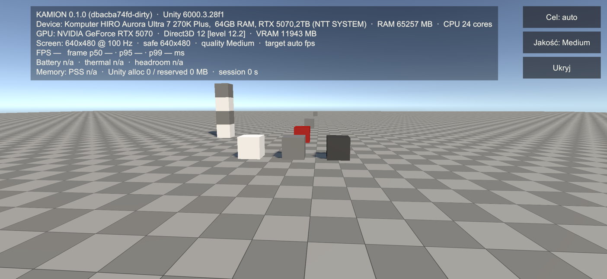
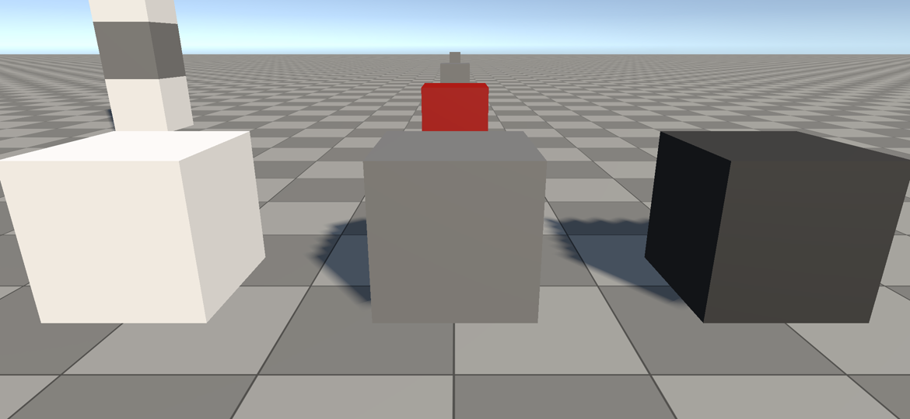

# Bramka 0 — Fundament (raport dla właściciela)

Data: 2026-11-09 · Autor: build-qa · Commit: `68f0064` (main) · Unity 6000.3.28f1 · Telefon: Samsung Galaxy A16 (SM-A165F, serial RFGL34SJYDZ)

## Werdykt: CZĘŚCIOWO ZALICZONA — brakuje pomiaru na telefonie

Cały zakres techniczny Etapu 0 jest zrobiony, zbudowany i zainstalowany na A16. **Pomiar FPS/pamięci/temperatury i zrzut ekranu z telefonu nie zostały wykonane**, bo telefon przez cały czas pracy (≈ 1 h) był zablokowany ekranem blokady z PIN-em. Gdy na ekranie jest blokada, Android od razu wstrzymuje grę (logcat: `APP_CMD_PAUSE`, `APP_CMD_STOP`), więc każdy „pomiar” byłby fałszywy. Skrypty nie wpisują PIN-u (i nie mogą). **Potrzebne: odblokuj telefon na ~2 minuty** i uruchom (albo poproś agenta o uruchomienie):

```
pwsh scripts/build-android.ps1 -SkipBuild -Install -Run -LogcatSeconds 20
pwsh scripts/device-metrics.ps1 -Launch -DurationSeconds 75
```
Telefon ma włączone „nie wygaszaj przy ładowaniu”, więc po odblokowaniu wystarczy go zostawić podłączonego.

## Kryteria bramki (docs/03, Etap 0)

| Kryterium | Stan | Dowód |
|---|---|---|
| APK zbudowany jedną komendą, poprawny exit code, log, SHA256 | ✅ | `scripts/build-android.ps1` → `kamion-0.1.0-aac0faa005.apk` 33,8 MB, `BUILD_RESULT: Succeeded errors=0 warnings=0` |
| Build odtwarzalny z czystego klonu | ✅ | świeży `git clone` z GitHuba → ta sama komenda → APK 33,7 MB w 167 s (z importem od zera). Uwaga: klonuj do krótkiej ścieżki (np. `C:\k\`) — w bardzo długim katalogu tymczasowym import pakietu ShaderGraph zgłasza błędy MAX_PATH (APK i tak powstał) |
| APK zainstalowany na Samsungu A | ✅ | `adb install` → `Success` (buildy `dbacba7`, `aac0faa`) |
| APK uruchomiony, logcat bez wyjątków | ⚠️ | Gra startuje (Unity: `ApplicationInfo 'com.woogitsugames.kamion' … Min API 29, Target API 36`, `Device Model 'samsung SM-A165F', OS 'Android OS 16 (API 36)'`, IL2CPP ARM64), brak wyjątków/crashy w logcacie — ale natychmiast pauzuje przez blokadę ekranu, więc scena Boot nie zdążyła wystartować |
| Pusta scena: zmierzone FPS / frame time na telefonie | ❌ | zablokowany telefon (patrz wyżej) |
| Zrzut ekranu z telefonu | ❌ | zrzut przy blokadzie jest czarny (Android chroni ekran blokady) |
| PNG z harnessu visual QA obejrzany | ✅ | 4 kamery kontrolne, obejrzane; poprawiony 1 błąd (patrz niżej) |
| `doctor` zielony | ✅ | `pwsh scripts/doctor.ps1` → `all required checks green` (ostrzeżenia: brak .NET SDK, ImageMagick, scrcpy — opcjonalne) |
| Testy | ✅ | EditMode 9/9, PlayMode 1/1 (`scripts/test.ps1`) |
| Kod fizyki i audio z innych gałęzi kompiluje się w Unity | ✅ | `Game.Vehicle.Physics` (bez referencji do silnika) i szkielet audio: 0 błędów, 0 ostrzeżeń; wygenerowane `.meta` zacommitowane; audio dostało własny asmdef `Game.Audio` |

## Co zostało zrobione
- **Porządek projektu:** usunięte materiały z szablonu (TutorialInfo, Readme, SampleScene, zasoby URP „PC”); struktura `Assets/_Project/{Core, Vehicle/Runtime, World, Rendering, Environment, Traffic, Gameplay, UI, Input, Camera, Audio, Platform, Content, Telemetry, Editor, Tests, Art}`; Force Text + widoczne `.meta`.
- **Moduły (asmdef, zależności w jedną stronę):** `Game.Core` ← `Game.Platform` ← `Game.Telemetry`; `Game.Rendering`; `Game.UI`; `Game.Gameplay` (composition root); `Game.Editor`; testy; plus `Game.Vehicle.Physics` (od agenta fizyki) i `Game.Audio`.
- **Ustawienia Androida jako kod** (`scripts/setup-project.ps1`, ADR 0006): „Kamion” / woogitsugames / `com.woogitsugames.kamion`, IL2CPP, tylko ARM64, Vulkan → GLES3, kolor liniowy, min API 29, **target API 36** (wymóg Google Play dla nowych aplikacji od 31.08.2026, sprawdzony dziś na developer.android.com), tylko poziomo, Swappy. Cztery profile jakości Low/Medium/High/Ultra, każdy z własnym assetem URP (Android domyślnie Medium).
- **Scena Boot** generowana kodem: płaszczyzna 200 m w szachownicę 1 m, sześciany 1 m (biały 80 %, szary 18 %, czarny 4 % albedo, czerwony), słup 4 m, słońce, niebo. **Ekran diagnostyczny:** wersja + SHA gita (wpisywane przy buildzie), Unity, API grafiki, GPU, model, RAM, rozdzielczość, profil jakości, FPS i czas klatki p50/p95/p99 z okna 600 klatek, temperatura baterii, status termiczny, pamięć (PSS). Przyciski: 30/60 FPS, zmiana profilu, ukryj. Co 2 s zapis `frametimes.csv` i `summary.json` w pamięci aplikacji (pobierane przez `adb`).
- **Pipeline:** `BuildCommands.BuildAndroidApk`, `VisualQaRunner.RenderControlCameras`, `ProjectSetup.ApplyAll`; skrypty `build-android.ps1`, `device-metrics.ps1`, `test.ps1`, `visual-qa.ps1`, `setup-project.ps1`, `doctor.ps1`. Skrypty adresują telefony po serialu, obsługują `-AllDevices`, pomijają brakujące, odmawiają pomiaru na zablokowanym telefonie.

## Visual QA (render w edytorze — NIE z telefonu)
Ekran diagnostyczny w kadrze głównej kamery, z symulowanym wycięciem aparatu A16 z lewej strony (4 % szerokości):



Wzorce albedo z bliska:



Co widzę: tekst czytelny (30 px przy wysokości 1080), panel nie wchodzi w obszar wycięcia, przyciski po prawej w zasięgu kciuka; biel/szarość/czerń wyraźnie rozróżnialne, szachownica daje skalę 1 m. Znalezione i naprawione: pierwszy render po otwarciu sceny w batchmode rysował wszystkie obiekty materiałem podłoża (nieaktualne dane SRP Batchera) — dodany „rozgrzewający” render. Znane: cienie w profilu Medium są schodkowe (mapa 1024 px na 50 m) — do strojenia przez rendering-perf.

## Liczby z telefonu
Brak — patrz werdykt. `docs/PERFORMANCE_BUDGETS.md` ma cele robocze (A16 / Medium: 30 FPS, p95 ≤ 34 ms, p99 ≤ 40 ms, PSS ≤ 1,2 GB), sekcja „Measured” czeka na pomiar.

## Znane braki i ryzyka
1. **Pomiar na A16 i zrzut z telefonu** — wymaga odblokowania telefonu (Twoja akcja, 2 minuty).
2. **Licencja Unity a aplikacje ze Sklepu Windows:** Unity Hub, Claude i PowerShell 7 ze Sklepu mają osobne, „wirtualne” `AppData`; licencja zapisana przez Hub jest niewidoczna dla Unity uruchamianego z `pwsh` (kod wyjścia 198). Skrypty same kopiują plik licencji tego komputera tam, gdzie jest potrzebny (z ostrzeżeniem w logu). Trwale: zainstaluj PowerShell 7 z instalatora MSI, nie ze Sklepu.
3. Brak **.NET SDK** (jest tylko runtime) — potrzebne do testów fizyki poza Unity (`tools/physics-runner`).
4. Pomiar z pierwszej minuty to tylko punkt odniesienia; test termiczny 30 min jest w Etapie 8 / bramce 5.
5. Galaxy S24+ nie był podłączony — profile High/Ultra niezweryfikowane na urządzeniu.
6. Kod audio używa przestrzeni nazw `TruckSim.Audio` (reszta: `Game.*`) — do ujednolicenia przez agenta audio.

## Decyzje dla Ciebie
- Brak nowych. (Otwarte z wcześniej: repo publiczne vs prywatne, D11.)
