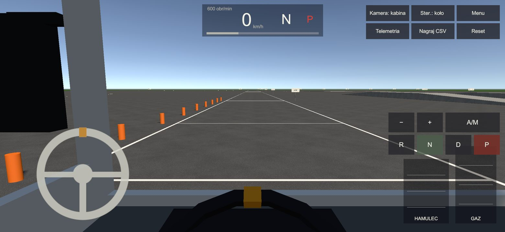
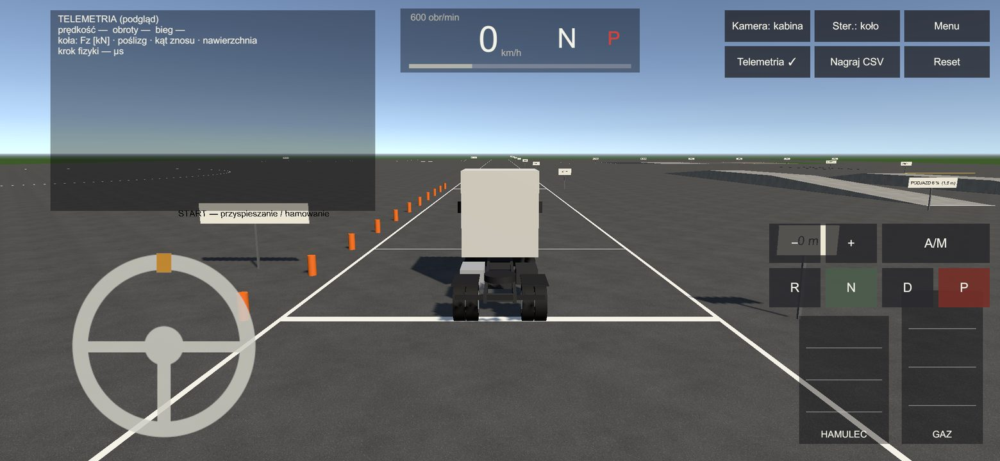
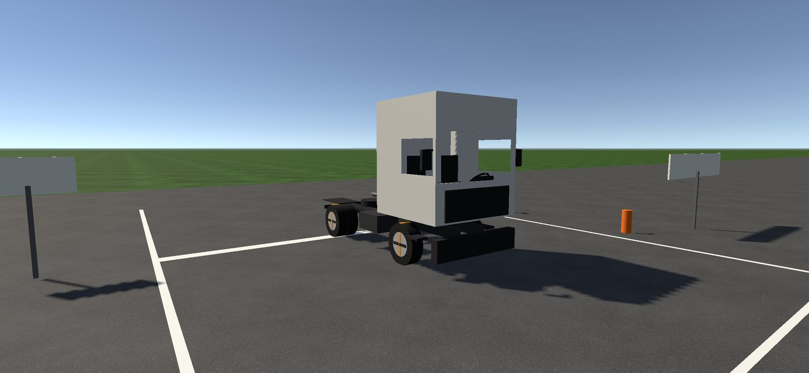
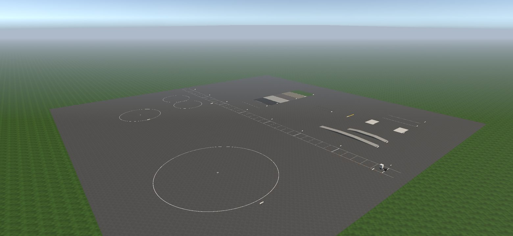
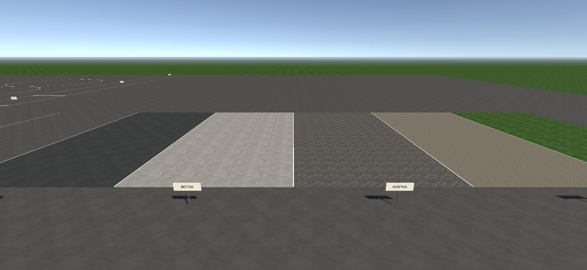
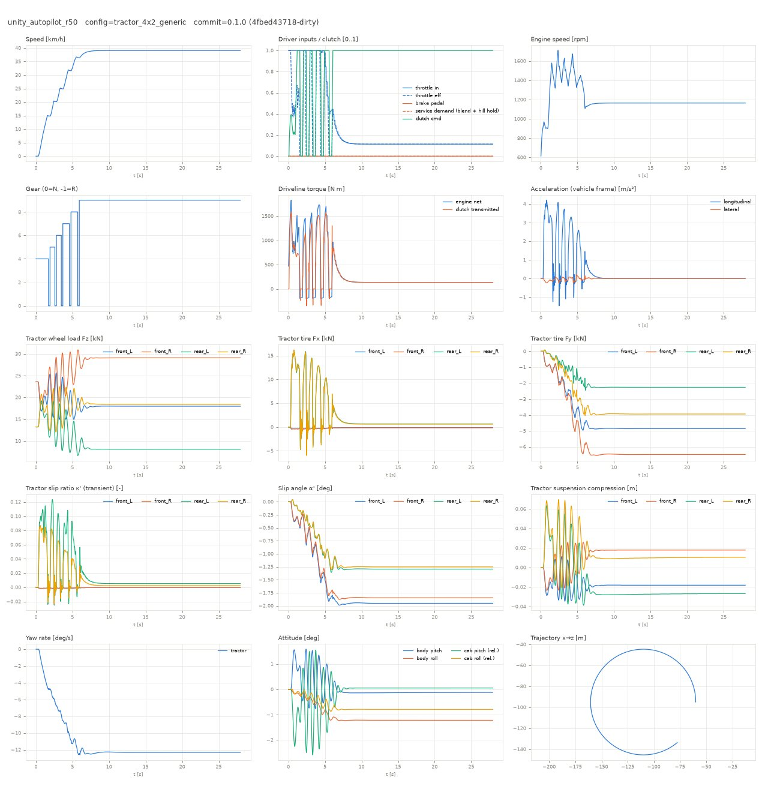

# Bramka 1 — Laboratorium jazdy (szkic raportu dla właściciela)

Data: 2026-11-09 · Commit APK: `72402a4` · Unity 6000.3.28f1 · Telefon: Samsung Galaxy A16 (SM-A165F, RFGL34SJYDZ)

## Werdykt: SZKIC — wszystko poza telefonem gotowe, telefonu nie dało się użyć

Plac testowy, ciężarówka (graybox), sterowanie, kamery, telemetria i testy działają w edytorze, a APK z placem buduje się bez błędów. **Na telefonie nic jeszcze nie zostało uruchomione ani zmierzone.** Przez całą pracę telefon był zablokowany PIN-em (`isKeyguardShowing=true` przy każdym sprawdzeniu). Na zablokowanym telefonie Android od razu wstrzymuje grę. Bramka 1 wymaga liczb z telefonu i Twojego testu „w dłoniach”, więc jeszcze nie jest zaliczona.

## Co jest gotowe

- **Plac testowy „Plac testowy — jazda”** (wejście przyciskiem na ekranie startowym). Asfaltowy plac 400 × 400 m, na nim:
  - pas przyspieszania z liniami co 10 m i tablicami co 50 m;
  - okręgi R = 25 m i R = 50 m oraz ósemka;
  - podjazdy 6 % i 12 % (1,5 m w górę, płaski szczyt 20 m);
  - platformy z krawężnikiem 8 cm i 15 cm oraz długie krawężniki boczne;
  - próg zwalniający 8 cm i koleiny 4 cm;
  - pola z różną nawierzchnią: asfalt suchy, asfalt mokry, beton, kostka, żwir, trawa. Każde pole ma inną przyczepność w fizyce.
- **Ciągnik 4×2 (graybox)** w prawdziwych wymiarach z `art-source/truck/dims.json`: rozstaw osi 3,70 m, wysokość 3,95 m, kabina 2,49 m, oczy kierowcy 2,50 m nad ziemią.
  - Koła skręcają, kręcą się (pomarańczowe znaczniki) i pracują na zawieszeniu.
  - Kabina buja się na własnym zawieszeniu, a kierownica w kabinie obraca się razem z kołami.
  - To bryła robocza, nie docelowy model (ten powstaje w torze A).
- **Fizyka:** nowy rdzeń z Etapu 2 (pneumatyka, skrzynia z trybem ręcznym). Ciężarówka startuje na zaciągniętym hamulcu postojowym.
- **Sterowanie dotykowe v0:**
  - Lewy kciuk: kierownica na ekranie. Kręcisz jak prawdziwą, można przekładać ręce. Zakres przełączasz przyciskiem „Ster.”: koło 270° → koło 900° → gyro. Puszczona kierownica wraca do środka tym szybciej, im szybciej jedziesz; na postoju zostaje tam, gdzie ją zostawiłeś.
  - Prawy kciuk: pedały **HAMULEC** i **GAZ**. Im wyżej trzymasz palec na pedale, tym mocniej; można przesuwać palcem bez odrywania.
  - Nad pedałami: **R N D**, **P** (hamulec postojowy) oraz **A/M** i **− / +** (tryb ręczny skrzyni).
- **Gyro v0:** przechylasz telefon jak kierownicę. Przycisk „Kalibruj” zapamiętuje pozycję neutralną. Po pauzie albo obróceniu telefonu gyro samo się zeruje.
- **Kamery** (przycisk „Kamera”):
  - kabina — z miejsca oczu kierowcy, z lekkim ruchem głowy przy hamowaniu i w zakrętach; przeciągnięcie palcem po pustym ekranie pozwala się rozejrzeć;
  - za ciężarówką;
  - orbita (podgląd z boku).
- **Telemetria:**
  - Przycisk „Telemetria” pokazuje prędkość, obroty, bieg, pedały, kąt kierownicy, ciśnienie powietrza, a dla każdego koła nacisk, poślizg i nawierzchnię, plus czas kroku fizyki i czasy klatek.
  - „Nagraj CSV” zapisuje plik z 100 pomiarami na sekundę. Wykresy robi z niego to samo narzędzie, którego używa agent fizyki.

## Liczby (z edytora na komputerze, NIE z telefonu)

| Test | Wynik | Granica |
|---|---|---|
| 0–60 km/h na płaskim | **9,84 s** | ±10 % od symulatora fizyki (9,68 s) → +1,7 % ✅ |
| Postój na 12 % na hamulcu postojowym, 60 s | przesunięcie 2–5 mm | < 1 cm ✅ |
| Wjazd na krawężnik 15 cm przy 8 km/h | największa zmiana prędkości w kroku 0,09 m/s, brak „teleportacji” | < 0,35 m/s ✅ |
| Kierunek skrętu: klawiatura, koło, gyro, autopilot | wszystkie w prawo = koła w prawo = skręt w prawo | ✅ |
| Śmieci w pamięci (GC) na krok fizyki | 0 | 0 ✅ |
| Autopilot na okręgu R50 przy 40 km/h | 39 km/h, zejście z linii ≤ 0,5 m | ✅ |

Testy automatyczne: 18/18 (logika) i 10/10 (fizyka i scena w Unity).

## Jak to wygląda (render z edytora, nie zrzut z telefonu)

Widok z kabiny ze sterowaniem dotykowym (wycięcie aparatu A16 zasymulowane z lewej strony):



Kamera za ciężarówką z panelem telemetrii (tu w trybie podglądu, bez danych):



Ciężarówka i plac:





Telemetria z przejazdu autopilota po okręgu R50 (z edytora):



Znalezione w przeglądzie renderów i poprawione:
- napisy na tablicach były widoczne przez kabinę i od tyłu w lustrzanym odbiciu;
- z kabiny nie było widać deski rozdzielczej;
- za trawą na horyzoncie był brązowy pas;
- mokry asfalt był czarny.

Znane: cienie w profilu Medium są schodkowe (do strojenia).

## Co zrobić na telefonie (ok. 15 minut)

1. **Odblokuj telefon** i zostaw go podłączonego (ekran nie gaśnie przy ładowaniu).
2. Poproś agenta o pomiary albo uruchom je sam:
   ```
   pwsh scripts/build-android.ps1 -SkipBuild -Install -Run -LogcatSeconds 20
   pwsh scripts/device-metrics.ps1 -Launch -DurationSeconds 75
   pwsh scripts/device-metrics.ps1 -Launch -DurationSeconds 90 -Scene DrivingLab -Autopilot circle50 -Speed 40
   ```
   - Pierwsze dwie komendy zamykają Bramkę 0 (pusta scena startowa).
   - Trzecia mierzy FPS p50/p95/p99, pamięć i temperaturę podczas jazdy autopilota po okręgu i robi zrzut ekranu.
3. **Test w dłoniach** — zapisz uwagi do każdego punktu:
   - **Ruszanie:** P (zwolnij), D, gaz. Czy pedał gazu daje się dozować? Czy hamulec da się wyczuć, czy jest „zero-jedynkowy”?
   - **Kierownica 270° vs 900°:** która jest wygodniejsza? Czy powrót do środka jest za szybki, za wolny, czy w sam raz? Czy jest martwa strefa albo opóźnienie?
   - **Gyro:** po „Kalibruj” przechyl telefon w prawo. Ciężarówka **musi skręcić w prawo**. Tego nie dało się sprawdzić bez telefonu.
   - **Okrąg R50 i ósemka:** czy da się jechać równo po linii?
   - **Krawężnik 15 cm, próg, koleiny:** czy wjazd czuć, ale nic nie „skacze”?
   - **Podjazd 12 %:** zatrzymaj się na środku, zaciągnij P, zdejmij nogę z hamulca. Ciężarówka ma stać. Potem ruszanie pod górę.
   - **Kamera w kabinie:** czy ruch głowy nie męczy? Czy widać drogę przed ciężarówką?
   - **Układ przycisków:** czy coś jest za małe albo pod kciukiem w złym miejscu? Czy wycięcie aparatu coś zasłania?
4. Opcjonalnie: przycisk „Nagraj CSV”, przejazd, potem „Stop REC”. Agent pobierze plik i zrobi wykresy.

## Znane braki i ryzyka

1. **Brak liczb z telefonu** (FPS, pamięć, temperatura, koszt fizyki na A16) i brak zrzutu ekranu z telefonu.
2. **Kierunek gyro na prawdziwym telefonie niesprawdzony.** Matematyka jest przetestowana dla obu konwencji czujnika, ale nie na A16.
3. **Przyczepność kostki, żwiru i trawy** to wartości robocze bez źródła. Asfalt suchy i mokry oraz beton pochodzą z modelu fizyki. Poprosiłem agenta fizyki o tabelę nawierzchni ze źródłami.
4. **Bujanie kabiny:** każda zmiana biegu pustego ciągnika lekko nim kołysze (±1,5°). Do oceny w teście w dłoniach; zgłoszone agentowi fizyki.
5. **Naczepy jeszcze nie ma na placu.** Fizyka naczepy jest gotowa (Etap 2), podłączenie jej do sceny to następny krok.
6. Wymóg bramki „3 przejazdy 0–80 km/h powtarzalne ±3 %” trzeba zmierzyć na telefonie. W edytorze wynik jest deterministyczny.

## Decyzje dla Ciebie

- Domyślny zakres kierownicy dotykowej: **270°** (komfort) czy **900°** (symulacja)? Wybierz po teście w dłoniach.
