# Bramka 2 — Naczepa, pneumatyka, pełny układ napędowy (szkic raportu dla właściciela)

Data: 2026-11-09 · Unity 6000.3.28f1 · Telefon: Samsung Galaxy A16 (SM-A165F, RFGL34SJYDZ)

## Werdykt: SZKIC — w edytorze gotowe, telefon nadal zablokowany

Zestaw ciągnik + naczepa jeździ na placu testowym, sprzęga się i odpina, hamuje z ABS, zjeżdża na retarderze i potrafi złożyć się w scyzoryk na mokrym. Testy automatyczne w Unity zgadzają się z symulatorem fizyki (różnice 0,2–2 %). APK buduje się bez błędów. **Na telefonie nic nie zostało uruchomione.** Telefon był zablokowany PIN-em przy każdym sprawdzeniu (`isKeyguardShowing=true`). Bramka 2 wymaga liczb z telefonu i Twojego testu „w dłoniach”, więc nie jest jeszcze zaliczona. Bramki 0 i 1 czekają z tego samego powodu.

## Co jest gotowe

- **Naczepa firankowa 13,6 m (graybox):** 13,6 × 2,55 × 4,0 m, trzy osie, opony 385/65 R22.5, nogi podporowe (ruszają się przy kręceniu), tylne drzwi, lampy, belka przeciwwjazdowa. To bryła robocza, nie docelowy model.
- **Fizyka zestawu w Unity:** dwie bryły (ciągnik i naczepa). Siodło liczy rdzeń fizyki, tak jak w symulatorze. Błąd położenia sworznia w siodle ≤ 0,14 mm.
- **Ładunek:** pusta naczepa (zestaw 14,5 t), 24 t ładunku (38,5 t), zestaw 40 t.
- **Menu „Zestaw…”** (prawy górny róg):
  - start: **Solo** (ciągnik przed zaparkowaną naczepą na placu naczep), **Pusta**, **24 t**, **40 t**;
  - **ABS: USTERKA** — symuluje awarię EBS (bez ABS i bez korektora siły hamowania), do pokazu scyzoryka;
  - **Kamera cofania** — zawsze widoczna albo tylko na biegu R;
  - **Lusterka w kabinie** — okienka z lusterkami albo tylko rozglądanie się.
- **Sprzęganie:** „Siodło” uzbraja szczęki, cofasz powoli pod naczepę i szczęki same się zamykają. Potem „Nogi ↑↓” (kręcenie trwa ok. 10 s) i zwalniasz P. Odpięcie działa tylko z opuszczonymi nogami. Pod przyciskami jest podpowiedź: ile centymetrów sworzeń jest za siodłem, w bok i w pionie.
- **Hamulce zwalniające:** pionowa „dźwignia” obok kierownicy: 0, HS (hamulec silnikowy), R1–R4 (retarder). Przycisk „Zjazd” trzyma stałą prędkość z górki samymi hamulcami zwalniającymi.
- **Kontrolki pod prędkościomierzem:** ABS (świeci przy pracy ABS albo przy usterce), STOP (niskie ciśnienie powietrza), HS, RET, ciśnienie w obu obwodach hamulcowych.
- **Kamera cofania** z tyłu naczepy (bez naczepy: kamera za kabiną, patrzy na siodło). Pojawia się na biegu R.
- **Lusterka:** prawdziwe lusterka na kabinie pokazują obraz (wcześniej były czarnymi pudełkami). W widoku z kabiny dodatkowo dwa okienka z lusterkami przy prędkościomierzu.
- **Nowe miejsca na placu:**
  - **plac naczep** (sprzęganie);
  - **rampa załadunkowa:** 5 doków, wysokość 1,20 m, gumowe odbojniki, żółte linie;
  - **droga 7 %:** 600 m, 42 m w górę, na górze plac do zawracania, po bokach bariery;
  - **mokra płyta** 260 × 220 m z okręgiem R = 100 m.
- **Dźwięk silnika** w grze (do tej pory był tylko w demie):
  - obroty, obciążenie, hamulec silnikowy i turbo idą prosto z fizyki;
  - w kabinie i na zewnątrz słychać inny dźwięk, zależnie od kamery;
  - syk zwalnianego hamulca, hamulec postojowy, przedmuch osuszacza, zmiana biegu, szum opon i wiatru.
- **Interfejs po przeglądzie wizualnym:**
  - przyciski nie nachodzą na siebie (GAZ i D/P);
  - tła są prawie nieprzezroczyste;
  - obroty są czytelne;
  - wszędzie jest font Inter;
  - poprawiony błąd, przez który napis „0 m” z tablicy rysował się na przycisku „−”.

## Liczby (z edytora na komputerze, NIE z telefonu)

| Test | Unity | Symulator fizyki | Granica |
|---|---|---|---|
| Sprzęganie z naczepą 40 t (cofanie na wolnych obrotach) | uderzenie 43 kN, nacisk na siodło 0,97 × statyczny | 62 kN, 0,97 | ≤ 150 kN ✅ |
| Postój 40 t na 12 % na hamulcu postojowym, 60 s | przesunięcie 1,7 mm (pod górę) / 4,6 mm (w dół) | ≤ 0,4 mm | < 1 cm ✅ |
| Ruszanie 40 t pod górę 6 % | cofnięcie 0,1 mm, 0–15 km/h w 4,58 s | 2,3 mm, 4,5 s | < 5 cm, ±10 % ✅ |
| Hamowanie 80→0 na suchym z ABS, pusty zestaw | 38,9 m | 39,0 m | ±10 % ✅ |
| Hamowanie 80→0 na suchym z ABS, 40 t | 40,6 m | 40,5 m | ±10 % ✅ |
| Scyzoryk na mokrym przy awarii EBS (pusty, R120, 60 km/h, pół hamulca) | 80° | 81° | musi być możliwy (≥ 30°) ✅ |
| Zjazd 7 % z 40 t, stała prędkość 30 km/h | średnio 30,0 km/h, hamulec zasadniczy nieużyty | 30,0 km/h | 25–35 km/h ✅ |
| Cofanie z naczepą | prosto: 0°; skręt: płynnie do 42°; kontra: wraca; bez skoków | — | ✅ |
| Cofanie pod rampę | naczepa zatrzymuje się na odbojnikach (0,12 m od ściany) | — | ✅ |
| Śmieci w pamięci na krok fizyki zestawu | 0 | 0 | ✅ |
| Koszt kroku fizyki zestawu (komputer, edytor) | 61 µs | 6 µs (symulator .NET) | **nie dotyczy telefonu** |

Testy automatyczne: 18/18 (logika) i 26/26 (fizyka i scena w Unity). Szczegóły: `docs/plan/STAGE-2.md`.

## Jak to wygląda (render z edytora, nie zrzut z telefonu)

Zestaw w skali (graybox), widok z boku i z przodu:

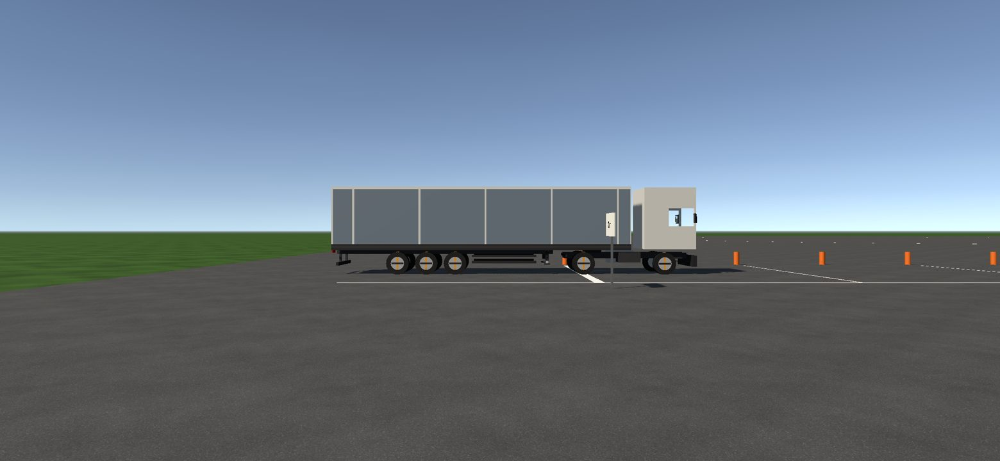
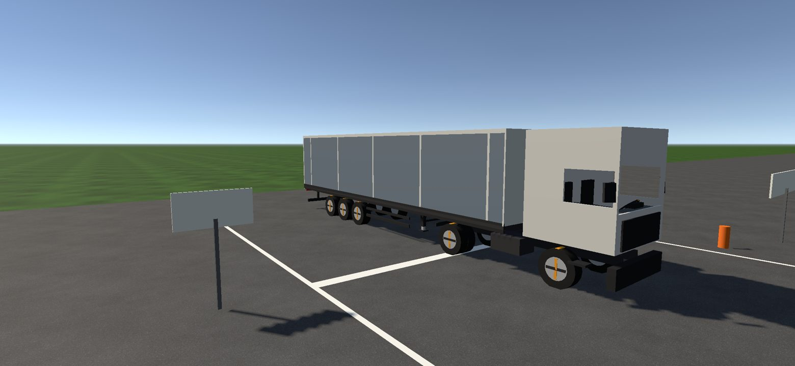

Kabina z okienkami lusterek i nowym interfejsem:

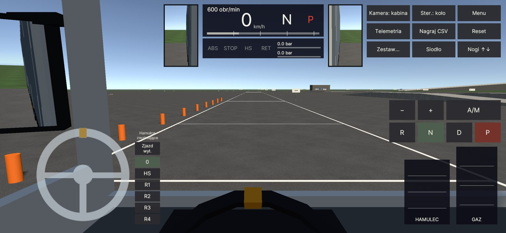

Lewe lusterko w łuku: widać bok naczepy i jej koła:

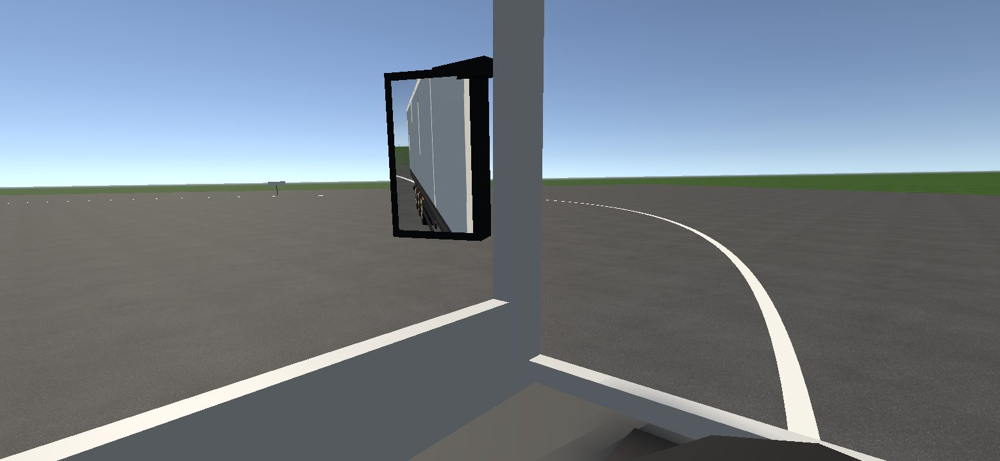

Kamera za zestawem z telemetrią i dźwignią retardera; widok cofania:

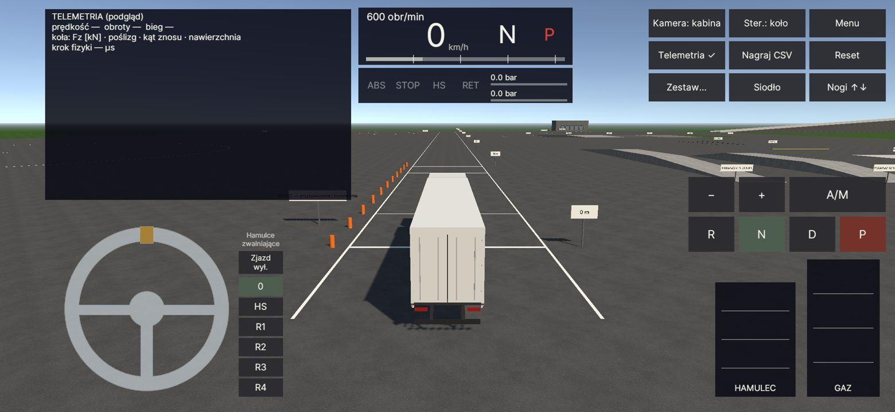
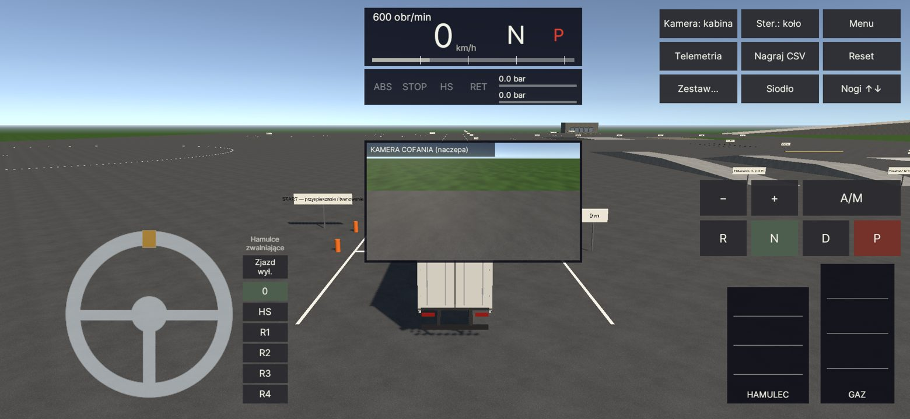

Cofanie pod rampę: podejście, obraz z kamery naczepy, naczepa na odbojnikach doku 3:

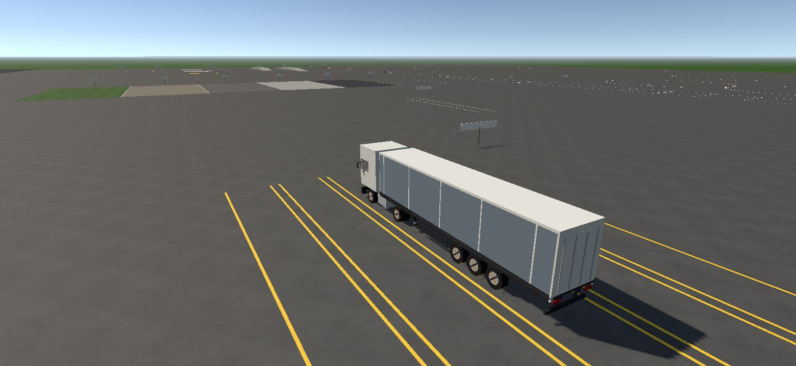
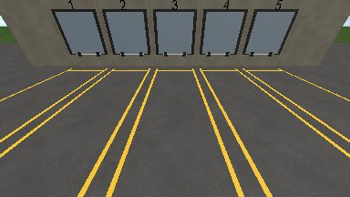
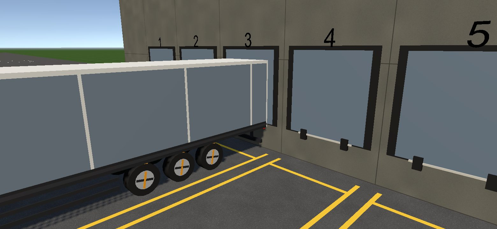

Scyzoryk na mokrej płycie (awaria EBS):

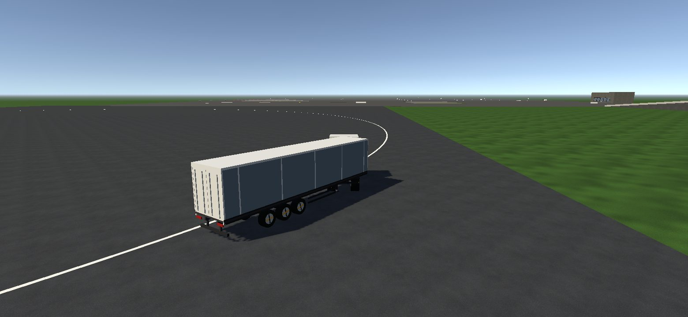

Droga 7 % i mokra płyta:

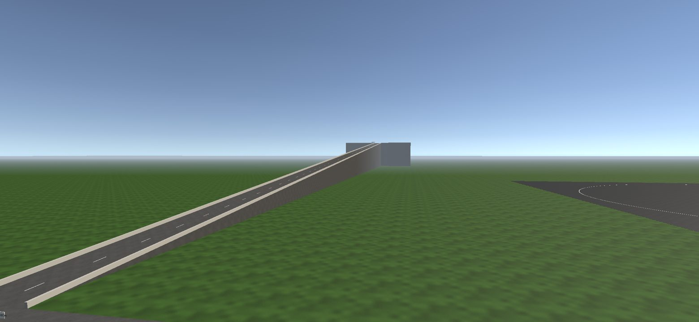
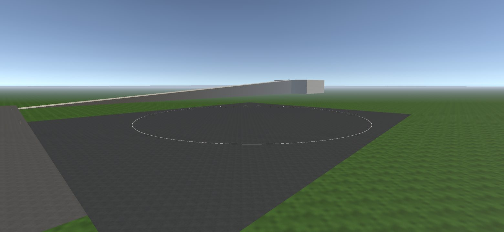

## Co zrobić na telefonie

1. **Odblokuj telefon** i zostaw go podłączonego.
2. Bramka 0 i 1: komendy z `docs/reports/GATE-1-draft.md` (sekcja „Co zrobić na telefonie”).
3. Bramka 2, pomiar z zestawem 40 t:
   ```
   pwsh scripts/build-android.ps1 -Install -Run -LogcatSeconds 20
   pwsh scripts/device-metrics.ps1 -Launch -DurationSeconds 90 -Scene DrivingLab -Autopilot circle50 -Speed 40 -Trailer 40
   ```
4. **Test w dłoniach** (słuchawki i głośnik). Do każdego punktu zapisz: czucie masy, hamowanie, kierownica, zachowanie naczepy, dźwięk.
   - [ ] **Ruszanie pod górę z 40 t** (Zestaw → 40 t, potem droga 7 % na wschodzie placu albo podjazd 12 %): zatrzymaj się, zwolnij hamulec, gaz. Zestaw nie może się cofnąć. Silnik ma brzmieć ciężej pod obciążeniem. Skrzynia nie może skakać po biegach.
   - [ ] **Hamowanie awaryjne z 80 km/h**, pusty i 40 t: nurkowanie kabiny, ABS (lampka), prosty tor. Potem to samo na mokrej płycie.
   - [ ] **Rondo / okrąg R50 przy 30–40 km/h z 40 t:** przechył naczepy, ścinanie zakrętu przez koła naczepy.
   - [ ] **Cofanie pod rampę z kamerą naczepy:** czy obraz z kamery i z lusterek wystarcza? Jak szybko naczepa „ucieka” przy skręcie? Czy da się wycelować w dok?
   - [ ] **Długi zjazd 7 %** z dźwignią retardera (HS, R1–R4) i przyciskiem „Zjazd”: czy prędkość się trzyma? Czy hamulec zasadniczy jest potrzebny?
   - [ ] **Sprzęganie** (Zestaw → Solo): wycofaj powoli z „Siodło”, potem nogi i P. Czy jest lekkie szarpnięcie, ale nie uderzenie? Czy podpowiedź w centymetrach pomaga?
   - [ ] **Scyzoryk:** Zestaw → Pusta, Zestaw… → ABS: USTERKA. Na mokrej płycie w łuku ok. 50 km/h wciśnij mocno hamulec. Naczepa powinna się złożyć. Z działającym ABS nie powinna.
   - [ ] **Lusterka:** okienka czy tylko rozglądanie? Czy okienka coś zasłaniają? Czy obraz jest wystarczająco ostry?
   - [ ] **Dźwięk:** jałowy, ruszanie, hamulec silnikowy (HS) na zjeździe, syk hamulców po zatrzymaniu, przejście kabina ↔ kamera zewnętrzna.

## Znane braki i ryzyka

1. **Brak liczb z telefonu.** Nie zmierzono FPS, pamięci ani temperatury, nie ma zrzutów ekranu. Koszt fizyki zestawu, 152 promieni na krok, dwóch lusterek i kamery cofania na A16 jest **nieznany**.
2. **Sprzęganie wymaga celowania z dokładnością 5 cm w bok.** Tyle daje okno chwytania w rdzeniu fizyki. Prawdziwe siodło ma lejek, który prowadzi sworzeń ok. ±15–20 cm. Poprosiłem agenta fizyki o model lejka (R5). Na razie start „Solo” ustawia ciągnik idealnie w osi naczepy.
3. **Lusterka są stałe.** Nie zmieniają obrazu przy ruchu głową i nie mają regulacji. Rozdzielczość jest niska (288 px wysokości na profilu Medium), żeby oszczędzać telefon.
4. **Dźwięk nieoceniony uchem.** Nie ma jeszcze wycia retardera, kompresora ani rozruchu silnika.
5. **Na postoju na zaciągniętych hamulcach**, po podniesieniu nóg, siodło przenosi tylko ok. 0,67 statycznego nacisku. Po ruszeniu wraca do 0,97. Zgłoszone do sprawdzenia (R6).
6. Plik APK urósł do 48 MB, z czego 13 MB to dźwięk silnika.
7. Pliki WAV nie są w repozytorium. Skrypt budowania sam je generuje (potrzebny `uv`, ok. 30 s).

## Decyzje dla Ciebie

- **Lusterka w kabinie:** okienka przy prędkościomierzu (domyślnie) czy tylko rozglądanie się palcem? Wybierz po teście.
- Zostaje otwarta decyzja z Bramki 1: kierownica 270° czy 900°.
