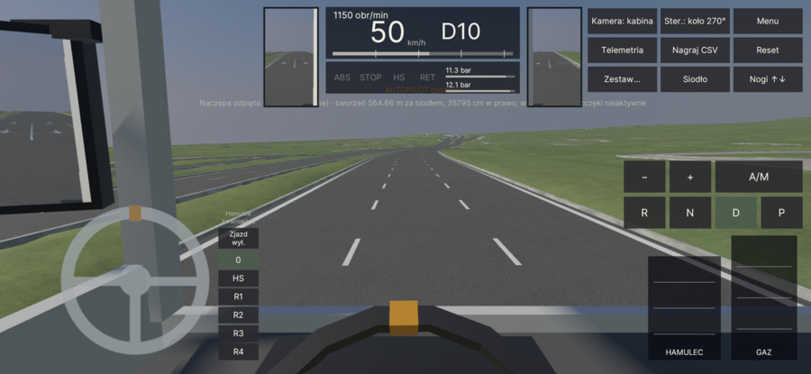
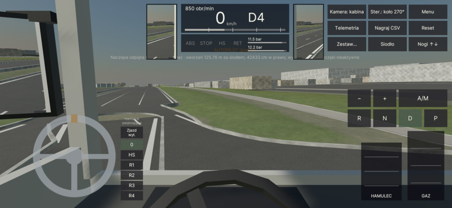
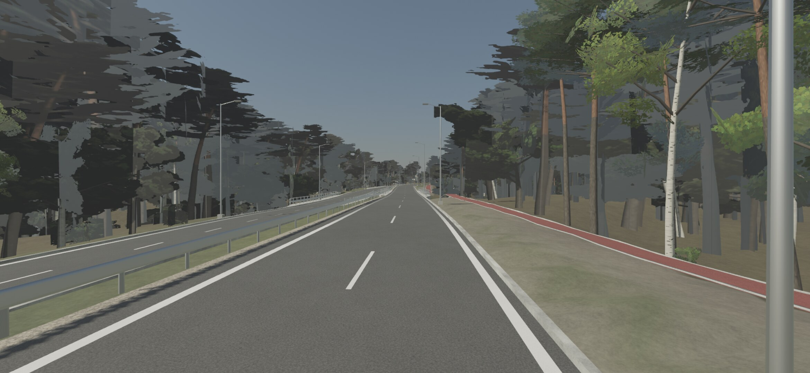
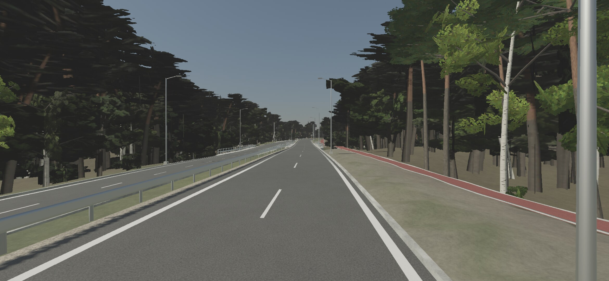
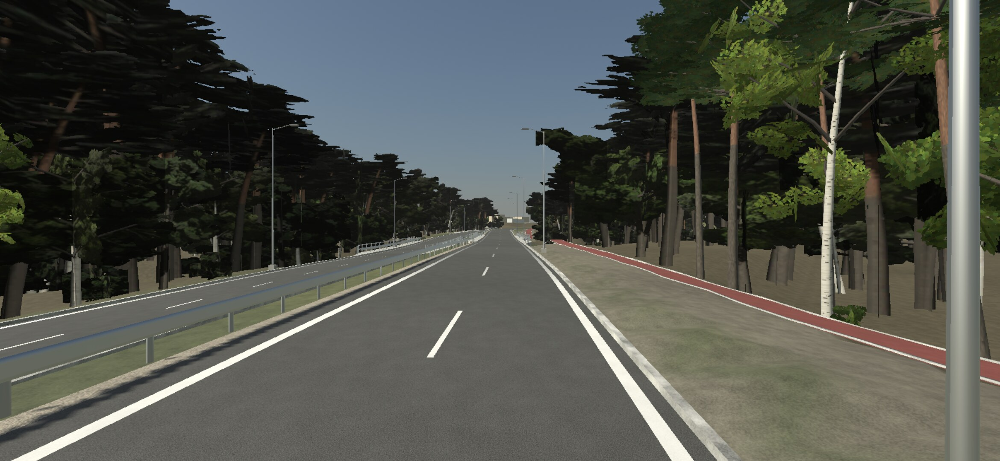
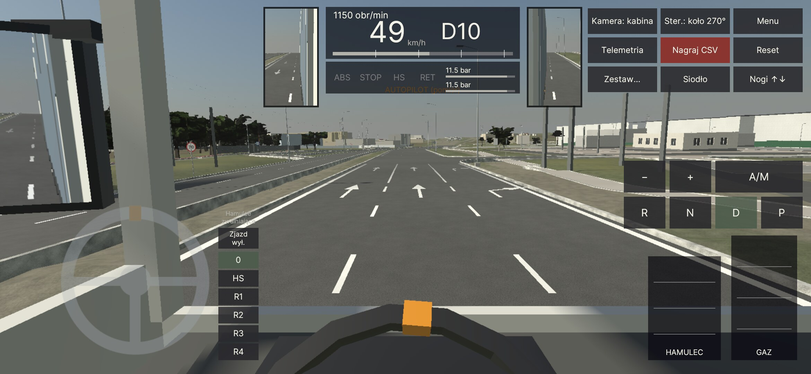

# Pomiary na urządzeniach — 2026-11-09 (pierwsze z telefonu)

Frame cap = 30 FPS (profil docelowy 30). Wszystkie przebiegi: thermal status 0, bez wyjątków w logcat (install run).

| Urządzenie | Scena | Profil | Klatki / czas | mean FPS | p50 / p95 / p99 / max [ms] | PSS | Bateria |
|---|---|---|---|---|---|---|---|
| A16 (Helio G99) | Boot | Medium | 2036 / 67,8 s | 30,01 | 33,33 / 33,47 / 33,57 / 33,66 | ~289 MB | 27,4 °C |
| A16 | DrivingLab, ciągnik solo, autopilot R50 40 km/h | Medium | 2462 / 82 s | 30,01 | 33,33 / 33,46 / 33,53 / 33,66 | — | — |
| A16 | DrivingLab, zestaw 40 t, R50 40 km/h | Medium | 2457 / 81,9 s | 30,01 | 33,33 / 33,45 / 33,54 / 33,66 | 333 MB | 26,7 °C |
| A16 | WorldC (świat v1), trasa, 50 km/h | Medium | 2580 / 86 s | 29,99 | 33,33 / 33,45 / 33,56 / 50,04 | **790 MB** | 26,8 °C |
| S24+ (Exynos 2400) | Boot | High | (brak licznika klatek w przebiegu) | — | — | 498 MB | 30,3 °C |
| S24+ | DrivingLab, 40 t | High | 2441 / 81,4 s | 29,98 | 33,36 / 33,77 / 34,58 / 42,61 | 535 MB | 30,9 °C |
| S24+ | WorldC, trasa | High | 2632 / 87,8 s | 29,98 | 33,36 / 33,56 / 33,98 / 36,51 | 767 MB | 31,9 °C |

APK: A16 — `kamion-0.1.0-5e1bb89e4c-dirty`; S24+ — `kamion-0.1.0-ccad5bedb7-dirty` (nowszy build agenta Unity).

## Wnioski
- Cel 30 FPS trzymany na obu telefonach z zapasem w p99; zapas (headroom) nieznany, bo klatki są limitowane — następny pomiar bez limitu / 60 FPS.
- **Pamięć WorldC na A16: 790 MB** — za dużo dla telefonu 4 GB; trwa odchudzanie (cel świata Low ≤ ~150 MB siatek).
- Problemy widoczne na zrzutach: w WorldC naczepa zostaje odpięta daleko za ciągnikiem (spawn), na S24+ autopilot stanął (0 km/h, D4), tekst diagnostyczny zasłania widok, lusterka-wstawki działają.

## Świat C v2 (rendering-perf, ADR 0012) — APK `kamion-0.1.0-1036492bdd` (Low/Medium, 122 MB) i `…-high` (228 MB, S24+)
Trasa startowa z autopilotem, 50 km/h, zestaw 40 t (domyślny dla `autopilot=route`), 90 s, telefony odblokowane
(`isKeyguardShowing=false` przed każdym przebiegiem). Frame cap 30 FPS, chyba że „bez limitu” (`-Uncapped`, cel 240 FPS →
ogranicza tylko odświeżanie panelu).

| Urządzenie | Scena / profil | Limit | Klatki / czas | mean FPS | p50 / p95 / p99 / max [ms] | PSS | Bateria / thermal |
|---|---|---|---|---|---|---|---|
| A16 | WorldC v2 / Low | 30 | 2468 / 82,3 s | 30,0 | 33,33 / 33,48 / 33,62 / 50,10 | **511 MB** (v1: 790) | 27,6 °C / 0 |
| A16 | WorldC v2 / Medium | 30 | 2476 / 82,6 s | 29,98 | 33,33 / 33,50 / 33,65 / 50,28 | **559 MB** | 27,6 °C / 0 |
| A16 | WorldC v2 / Medium | bez limitu | 3146 / 82,8 s | 38,0 | 33,27 / 33,44 / 33,55 / 50,14 | 560 MB | 27,7 °C / 0 |
| S24+ | WorldC_High / High | 30 | 2524 / 84,2 s | 29,98 | 33,36 / 33,57 / 34,02 / 37,82 | 966 MB | 35,7 °C / 0 |
| S24+ | WorldC_High / High | bez limitu | 5078 / 82,1 s | 61,8 | 16,68 / 25,07 / 33,39 / 50,08 | 976 MB | 39,8 °C / **2** |

Zapas (headroom): A16 Medium bez limitu ma 43 % klatek po 16,7 ms i 56 % po 33,3 ms (Unity na A16 wybiera 60 Hz, klatki
wyrównane do VSync) → realny koszt klatki ≈ 17–25 ms, czyli ~25–45 % zapasu przy celu 30 FPS. S24+ High utrzymuje ~60 FPS
(p50 16,7 ms), ale po 80 s stan termiczny 2 — High/60 to nie jest profil na długą jazdę bez strojenia.
Zrzuty z kamer kontrolnych w natywnej rozdzielczości (A16 2340×1080 Medium, S24+ 3120×1440 High, HUD ukryty, launch arg
`qacam`): `docs/reports/device/2026-11-09_v2_*`.

### Kamery kontrolne na telefonach (statyczne, 18–20 s, limit 30 FPS)
| Kamera | A16 Medium: mean FPS / p50 [ms] | S24+ High | Zrzut A16 | Zrzut S24+ |
|---|---|---|---|---|
| Andersa (kierowca) | 29,3 / 33,3 (p95 49,9) | 30,0 / 33,4 | [A16](2026-11-09_v2_A16_Medium_driver-andersa-to-putry.jpg) | [S24+](2026-11-09_v2_S24_High_driver-andersa-to-putry.jpg) |
| Rondo Putry z 40 m (widok poglądowy, nie z jazdy) | **22,9 / 49,9** | 30,0 / 33,4 | [A16](2026-11-09_v2_A16_Medium_putry-above.jpg) | [S24+](2026-11-09_v2_S24_High_putry-above.jpg) |
| Brama Kwadrat Parku | 30,0 / 33,3 | 30,0 / 33,4 | [A16](2026-11-09_v2_A16_Medium_kwadrat-park-gate.jpg) | [S24+](2026-11-09_v2_S24_High_kwadrat-park-gate.jpg) |
| Rampy | 30,0 / 33,3 | 30,0 / 33,4 | [A16](2026-11-09_v2_A16_Medium_stretch-05-docks.jpg) | [S24+](2026-11-09_v2_S24_High_stretch-05-docks.jpg) |
| **Las przy DK8** | **10,3 / 100** | **14,3 / 66,7** | [A16](2026-11-09_v2_A16_Medium_dk8-dk19-exit.jpg) | [S24+](2026-11-09_v2_S24_High_dk8-dk19-exit.jpg) |

**Las przy DK8 to wąskie gardło** (nakładające się karty liści i impostory z alpha-testem → overdraw na GPU kafelkowym,
plus cienie kart LOD1). Trasa 90 s go nie obejmowała (kończy się ok. 1,2 km). Poprawka w `WorldInstances`: przerzedzanie
drzew z odległością (co 2. od 90 m × LOD bias, co 4. od 225 m), limit impostorów 600 m, cienie tylko z LOD0 na Low/Medium.
Pomiar po poprawce: niżej.

### Las przy DK8 po poprawkach (APK `a5c0cfa`, kamera kontrolna `dk8-dk19-exit`, 18 s)
| Wersja | A16 Low | A16 Medium | S24+ High |
|---|---|---|---|
| przed (v2, LOD drzew skalowany LOD bias) | — | 10,3 FPS | 14,3 FPS |
| + przerzedzanie z odległością, impostory ≤ 600 m, cienie tylko LOD0 | **30,0** | 13,6 | 15,3 |
| + karty liści LOD0/LOD1 nie dalej niż 10/30 m na każdym profilu | — | **16,7** | **26,2** (telefon gorący, thermal 2) |

Pełna trasa A16 Medium 173 s (do wjazdu w las): 29,95 FPS, p95 33,48 ms.
**Wniosek:** na A16 las przy DK8 trzyma 30 FPS tylko na Low. Medium jest tam ograniczony przez GPU (MSAA 4×,
HDR + post, 2 kaskady cieni na alpha-testowanych liściach). Dalsze kroki: HLOD lasu (gotowe „ściany” lasu zamiast
pojedynczych impostorów), alpha-to-coverage tylko na High, Medium na A16 z MSAA 2× w lesie albo Low jako domyślny
profil A16 — do decyzji po pomiarze GPU (Arm Performance Studio).

## r3 — shader liści, MSAA 2× na Medium, auto-Low na A16, szarpnięcie na s≈604 m (rendering-perf, wieczór)
APK `kamion-0.1.0-4eb5901ded-dirty` (treść Low/Medium) i `…-dirty-high` (S24+); kod w commitach `4eb5901`…`2efb0fb`.
Przed każdym przebiegiem `isKeyguardShowing=false`. Wszystkie przebiegi z limitem 30 FPS. GPU/CPU = p50 z `FrameTimingManager` [ms].
Rozgrzewka 15 s. Przebiegi statyczne trwają 20 s; trasa 85 s (kończy się na s ≈ 900 m).

**Zweryfikowane**
- **Auto-tier:** przy pierwszym uruchomieniu A16 loguje `[BOOT] auto tier Low: Galaxy A16 (Helio G99)`, a S24+ `auto tier High`.
- **Kolizje liczone w runtime** (`WorldCollisionCooker`, równoległe `Physics.BakeMesh` w trakcie ładowania sceny):
  - 265 siatek na jedno ładowanie: A16 250–259 ms, S24+ 71–78 ms.
  - Liczenie kończy się przed pierwszą klatką jazdy, więc na trasie nie ma skoków klatki (max na A16 50 ms = jeden pominięty VSync).

### Las DK8 — ablacja GPU na telefonie (A16, kamera `dk8-dk19-exit`)
Przed zmianą (liście URP Lit): Medium 16,4 FPS, GPU 61,3 ms. Bez drzew: 18,4 ms. Skala renderu 0,6: 37,7 ms.

To pokazuje, że koszt to praca fragmentów na kartach liści (pełna tabela w ADR 0013).

| Wariant | A16 Low | A16 Medium |
|---|---|---|
| URP Lit, MSAA wg profilu (Low 2×, Medium 4×) | 28,1 FPS · GPU 35,5 | 16,4 FPS · GPU 61,3 |
| URP Lit, Medium MSAA 2× | — | 19,8 FPS · GPU 50,6 |
| **Kamion/Vegetation** (przebieg głębi + przebieg koloru ZWrite Off), MSAA 4× | — | 15,4 FPS · GPU 64,7 |
| **Kamion/Vegetation + Medium MSAA 2× (nowy domyślny)** | **30,0 FPS · GPU 26,1** (p95 33,4 ms) | **27,0 FPS · GPU 36,9** (p95 50,1 ms) |
| to samo, bez alpha-to-coverage | — | 28,4 FPS · GPU 35,1 |

**Decyzja (ADR 0013)**
- Low i Medium używają `Kamion/Vegetation`.
- Medium ma MSAA 2×, bo 4× kosztuje w lesie na G57 +28 ms.
- A16 domyślnie zostaje na Low.

**Wynik**
- Medium w lesie: 27 FPS. To spełnia warunek briefu ≥ 25 FPS, ale nie daje 30.
- HLOD ścian lasu odkładam, bo Low już trzyma 30.

**Na klatkach**
- Sosny są ciemniejsze niż z Lit, który refleksem sondy nakładał na impostory niebiesko-szary połysk.
- Wygląd wymaga jeszcze oceny visual-critic.

| Przed (Medium, Lit, MSAA 4×) | Po (Medium, Vegetation, 2×) | Po (Low) |
|---|---|---|
|  |  |  |

### Trasa startowa, zestaw 40 t, 50 km/h (`-Autopilot route -Trailer 40 -Extra telemetry=1`)
| Urządzenie / profil | klatki / s | mean FPS | p50 / p95 / p99 / max [ms] | GPU / CPU p50 | PSS | bateria / thermal |
|---|---|---|---|---|---|---|
| A16 Low | 2412 / 80,5 | 29,98 | 33,33 / 33,50 / 33,67 / 50,17 | 16,3 / 19,2 | 534 MB | 30,0 °C / 0 |
| A16 Medium | 2430 / 81,1 | 29,97 | 33,33 / 33,52 / 33,71 / 50,17 | 23,2 / 21,6 | 559 MB | 30,1 °C / 0 |
| **A16 Low, 30 min, las DK8 (najgorszy widok, statyczny)** | 53478 / 1783 | 29,99 | 33,33 / 33,46 / 33,55 / 50,19 (7 klatek > 50 ms) | 26,5 (p95 27,9) / 19,1 | 514 MB | **30,9 °C / 0** po 30 min |

Klatka z kabiny z lusterkami (A16 Low, natywne 2340×1080): . Oba lusterka i wstawki są czytelne.

### Szarpnięcie na s≈604 m — przyczyna (telemetria z telefonu, `tools/telemetry/route_jolt.py`)
Zmiana prędkości nadwozia |dv| na krok: mediana 0,0055 m/s, p99 0,075 m/s. Szczyty:
- A16 Low: 0,586 m/s na s = 605,8 m.
- A16 Medium: 0,711 m/s na s = 605,6 m.

Szczyt wypada w tym samym miejscu w każdym przebiegu. Test PlayMode w edytorze widzi tylko 0,249 m/s (próg 0,8):
autopilot próbkuje wejście w `Update`, więc przy 30 FPS tor jest minimalnie inny, i na telefonie w krawężnik wchodzi też lewe przednie koło.

Przebieg zdarzenia:
1. **s = 598,3 m, (343,9; −589,1):** lewe przednie koło wjeżdża na beton (surface 2 = krawężnik).
   - Ugięcie zawieszenia: 0,060 → 0,108 m w jednym kroku.
   - Fz: 35 → 239 kN w 0,02 s.
2. **s ≈ 600–604 m:** przednia oś odrywa się od ziemi.
   - Oba przednie koła są w pełni wysunięte (−0,09 m), 0 kN przez ~0,4 s.
   - Pochylenie dochodzi do +8°.
3. **s = 604,4 m:** na ten sam krawężnik wjeżdża lewe tylne koło (rear_R wisi).
4. **s = 605,7 m:** przednia oś ląduje (Fz 140 kN). To jest szarpnięcie.

Ciągnik jest wtedy na linii trasy (odchyłka ≈ 0). Krawężnik stoi ~1,3 m na lewo od osi.
Przyczyna to schodek Z przy rozwidleniu jezdni: węzeł 4391371827, `tertiary_link` 2 pasy → `trunk_link` 1 pas obok Andersa.

**Naprawa**
- **Świat (do scalenia):** commit świata v3 `806e89d` „continuous kerb at carriageway splits” usuwa dokładnie ten schodek.
  Jest na gałęzi `worktree-agent-a8cc4186e1bfe4593` i nie został jeszcze scalony z main. Świata tutaj nie regenerowałem.
  - Po scaleniu sprawdzić tą samą procedurą (trasa + `telemetry=1` + `route_jolt.py`).
  - Cel: |dv| < 0,2 m/s w okolicy s = 598–606 m.
- **Fizyka (vehicle-physics):** koło promieniowe nie ma obwiedni opony. Schodek 5–14 cm daje 7× szczyt Fz i oderwanie osi.
  - Propozycja: filtr wysokości kontaktu (obwiednia na długości styku opony) albo kilka promieni na koło.
  - Dodać do `WorldCRouteTests` asercję na czas bez kontaktu przedniej osi.
  - Próg 0,8 m/s w tym teście nie wyłapał uderzenia 0,7 m/s.

### S24+ (High) — przebiegi nieważne
- Telefon przed pomiarem: 43,9 °C, thermal status 2 (nagrzany wcześniejszymi przebiegami). Wyniki tylko do wiadomości:
  - High, Lit: 14,8 FPS, GPU 68,1 ms.
  - `rq_vegshader=1`: 13,1 FPS, 72,2 ms.
  - `rq_vegshader=1 rq_msaa=2`: 21,7 FPS, 42,8 ms.
- Potem wysłałem `KEYCODE_SLEEP`, żeby go schłodzić. **To zablokowało S24+ PIN-em i dalsze pomiary High nie były możliwe.**
  To mój błąd: skrypty nie mogą usypiać ekranu.
- Do ponownego pomiaru, gdy telefon będzie chłodny i odblokowany: las DK8 Lit vs Vegetation, MSAA 4× vs 2×, trasa.
