# Tor A2 — trzy koncepcje sylwetki ciężarówki (do wyboru)

**Co to jest:** szybkie bryły (blockout) w prawdziwej skali 1:1, żeby wybrać **kierunek wyglądu** naszej fikcyjnej ciężarówki. To nie jest jeszcze model do gry — brak detalu, tekstur, wnętrza. Oceniamy proporcje, charakter frontu, światła, sylwetkę z boku.

Wszystkie trzy mają identyczne podwozie i wymiary klasy (rozstaw osi 3,70 m, opony 315/80 R22.5, siodło 1,15 m, wysokość 3,95 m, szerokość nadwozia ≤ 2,55 m). W każdym kadrze: **figura 1,80 m** i **siatka 1 m** (grubsze linie co 5 m). Szary „clay” pokazuje samą bryłę; jeden kadr na koncepcję ma przykładowy lakier.

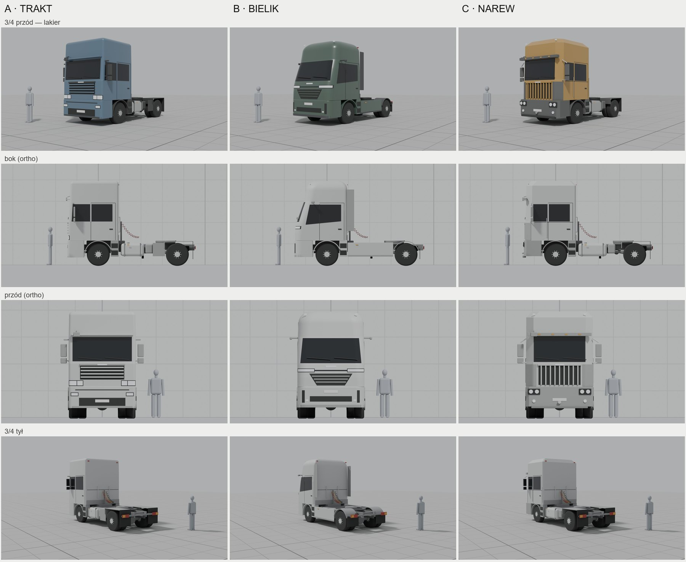

## Trzy koncepcje obok siebie

| | **A · TRAKT** | **B · BIELIK** | **C · NAREW** |
|---|---|---|---|
| Lakier, 3/4 przód | 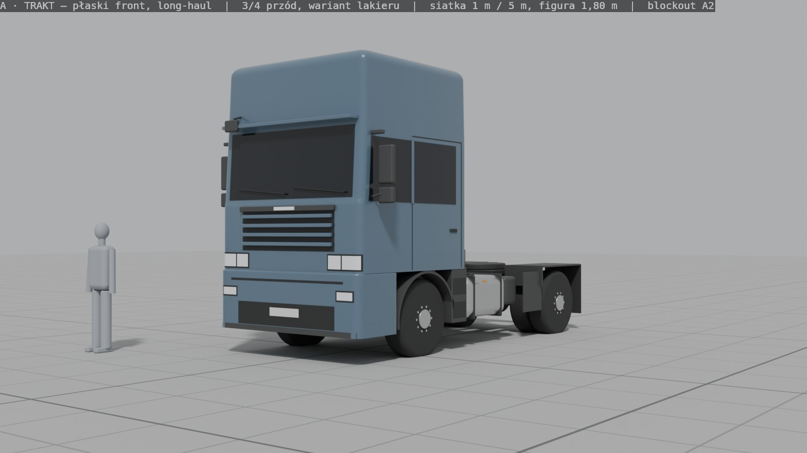 | 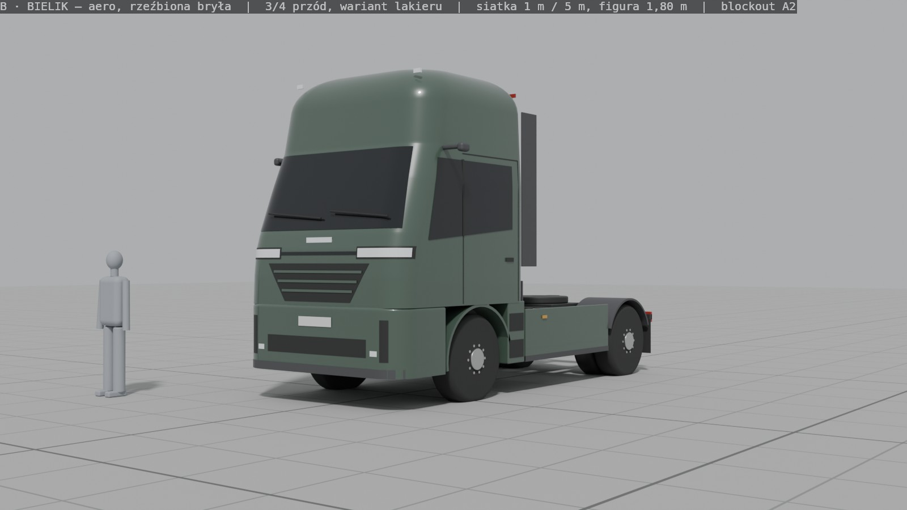 | 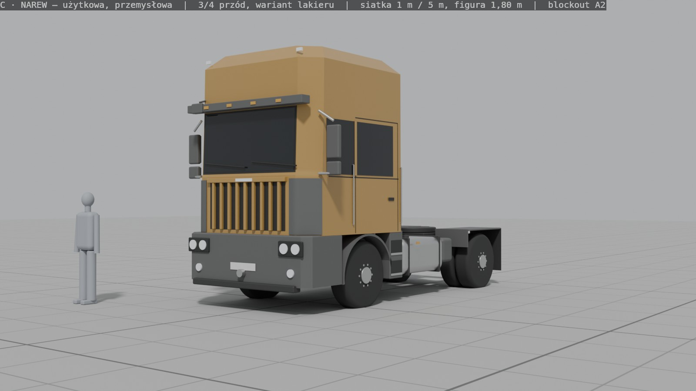 |
| Clay, 3/4 przód | 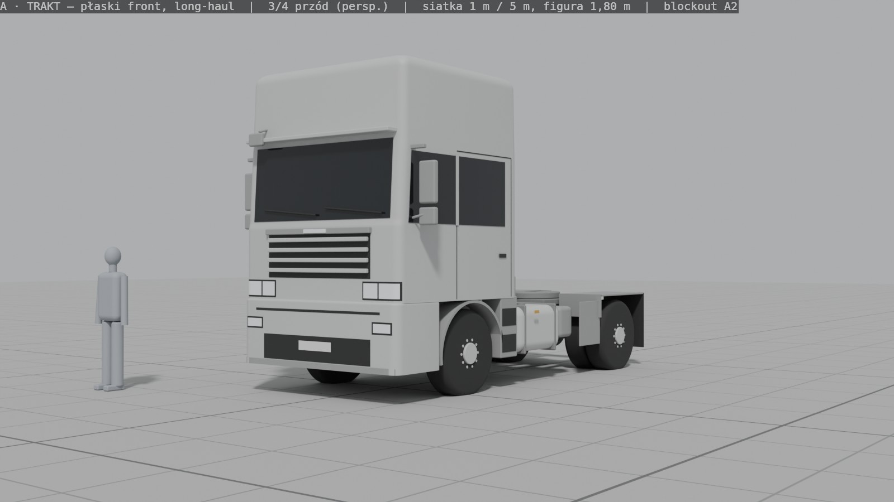 | 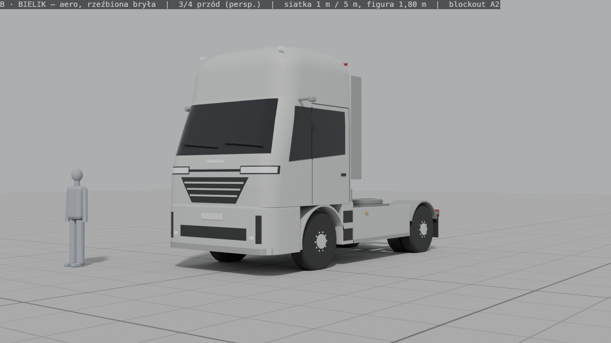 | 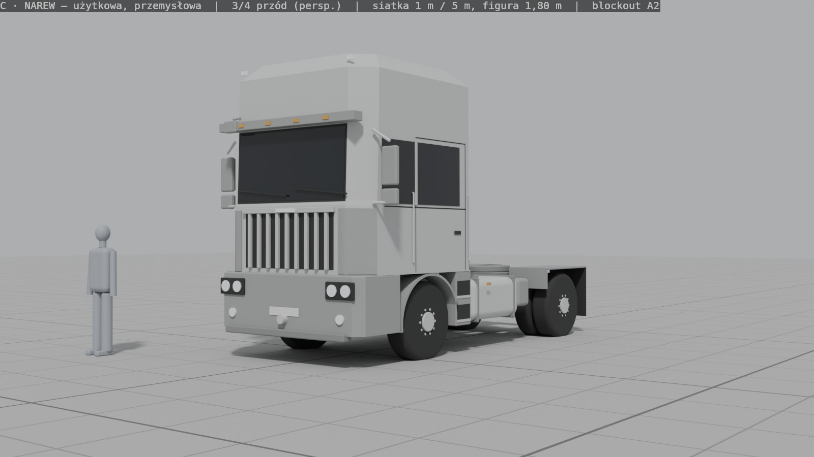 |
| Bok (rzut) |  |  | 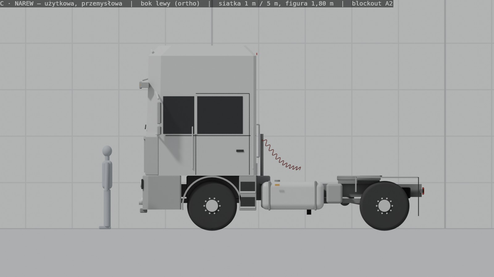 |
| Przód (rzut) | 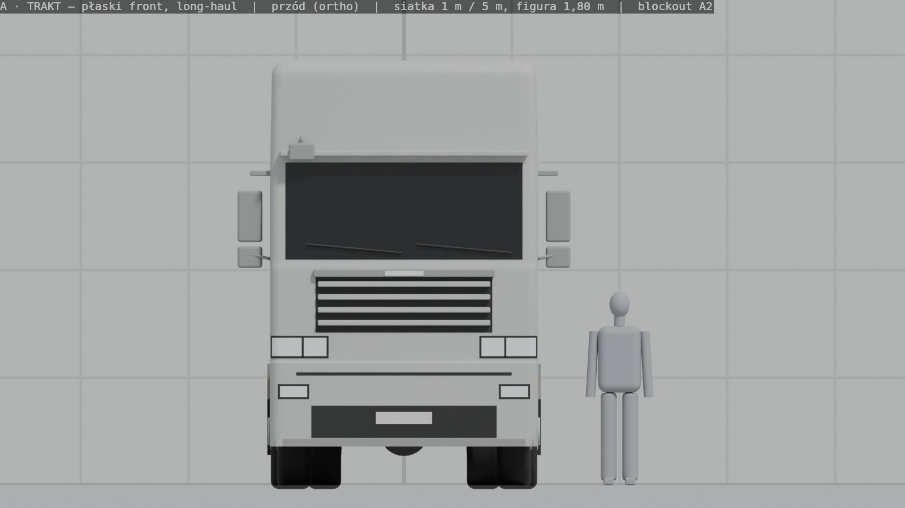 | 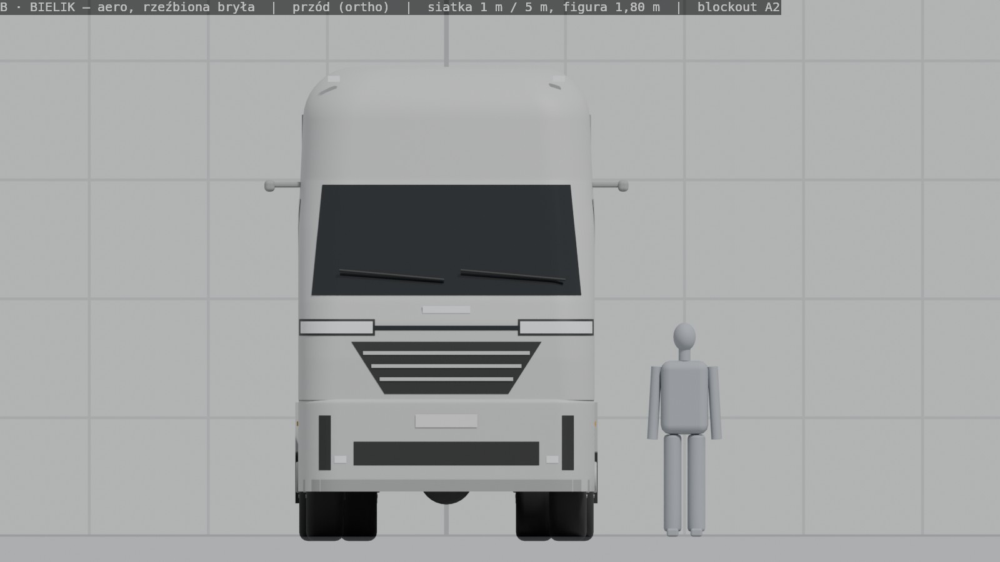 | 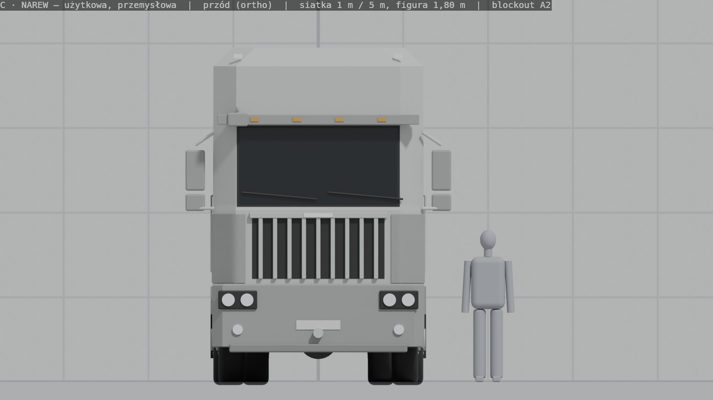 |
| 3/4 tył | 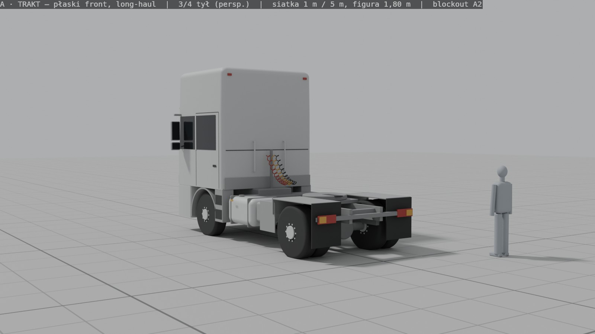 | 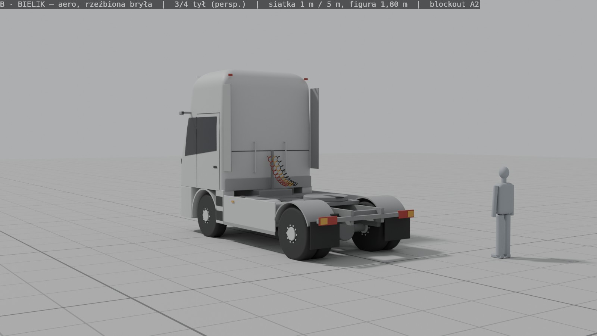 | 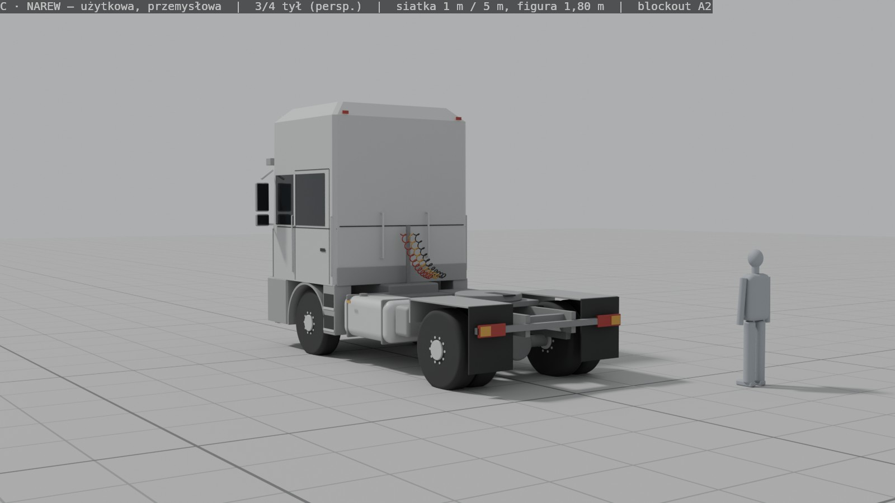 |
| Charakter | klasyczny long-haul, płaski front | nowoczesny, aerodynamiczny | użytkowy, „przemysłowy” |
| Szyba | prawie pionowa (~3°) | mocno pochylona (~19°), zawinięta na boki | pionowa, płaska, w czarnej ramie |
| Front | duży grill z poziomymi listwami, światła wysoko w narożnikach kabiny | zamknięty górny front, trapezowy dolny grill, pas świetlny przez całą szerokość | wysoki grill z pionowymi prętami, czarne panele narożne, lampy okrągłe w stalowym zderzaku |
| Dach | wysoki, lekko zaokrąglony | mocno zaokrąglony, zwężony do góry | fazowany (ścięte krawędzie) |
| Lusterka | klasyczne na ramieniu | kamery na krótkich ramionach | klasyczne na rurowych wspornikach |
| Inne | daszek przeciwsłoneczny w kolorze nadwozia, krótkie osłony boczne | pełne osłony boczne, deflektory za kabiną | daszek z lampkami, odsłonięta rama, poręcze przy drzwiach, skrzynka narzędziowa |
| Przykładowy lakier | stalowy niebieski | butelkowa zieleń | ochra |
| Długość (zmierzona) | 6,07 m | 6,08 m | 6,13 m |

Długość jest mierzona automatycznie z bryły, łącznie z lusterkiem przednim i lampami (pliki `koncepcja-*_wymiary.json`). Ma się mieścić w klasie ~5,9–6,1 m; nadwyżka C (3 cm) to wystające lusterko przednie.

## Marki (nazwa + znak) — też do wyboru, niezależnie od sylwetki

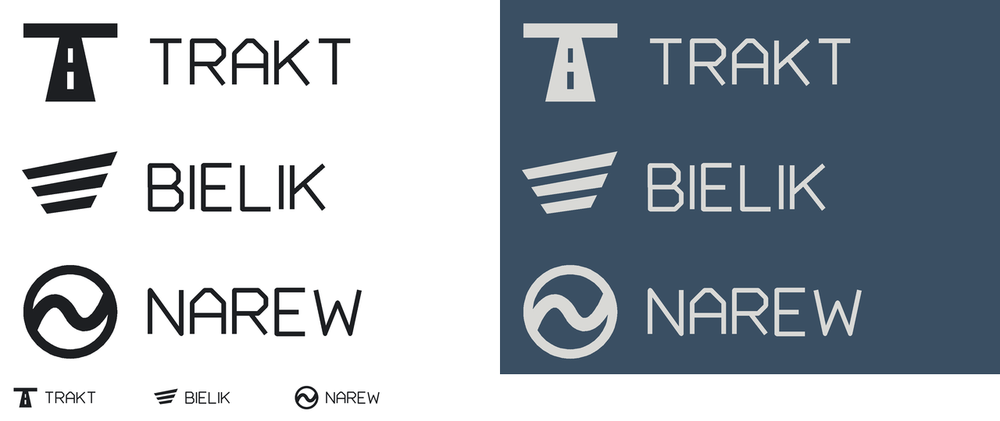

| | Znaczenie | Znak | Uwagi |
|---|---|---|---|
| **TRAKT** | dawne „droga, gościniec” | droga w perspektywie jako litera T | słowo pospolite — sprawdzić rejestry znaków |
| **BIELIK** | orzeł bielik z bagien Podlasia | jedno skrzydło z trzech piór | skojarzenie: samolot M-346 „Bielik” |
| **NAREW** | rzeka obok Białegostoku | pierścień z meandrem rzeki | skojarzenie: program obrony powietrznej „Narew” |

Pliki SVG: `art-source/truck/brand/`. Prawy rząd na obrazku = znak na lakierowanej kabinie, dolny rząd = test czytelności w małym rozmiarze. Przed ostatecznym wyborem trzeba sprawdzić nazwy w bazach znaków towarowych (EUIPO, UPRP) — **jeszcze nie zrobione**.

## Czego potrzebuję od Ciebie
1. **Którą sylwetkę bierzemy: A, B czy C** — albo mieszankę (np. „kabina z B, front z C”). Napisz, co Ci się podoba, a co nie, nawet jednym zdaniem.
2. **Którą markę**: TRAKT, BIELIK, NAREW (albo żadna — wtedy proszę o kierunek, a zaproponuję kolejne).
3. Kiedy będziesz na MOP-ie/parkingu TIR: **zdjęcia referencyjne** z listy w `docs/plan/TRACK-A.md` §4 — najważniejsze są oznaczone ★ (bok prostopadle, okolica koła przedniego ze stopniami, widok z fotela i w lusterkach).

## Co poprawiłem po obejrzeniu renderów (pętla visual QA)
Każdy kadr oglądałem po renderze i porównywałem z proporcjami prawdziwych ciągników.
1. Rzut z boku i z przodu nie dawał skali (podłoga widziana na krawędź) → dodałem siatkę 1 m na ścianie w tle, widoczną tylko w rzutach.
2. Figura w widokach 3/4 stała bliżej kamery niż ciężarówka i optycznie ją zmniejszała, potem zasłaniała przód → figura ma osobną pozycję dla każdego widoku, w tej samej odległości co pojazd.
3. A i C wyglądały prawie tak samo (to samo pudełko z grillem) → A dostała światła w narożnikach kabiny i poziomy grill, C dostała fazowane narożniki i dach, czarne panele narożne, pionowy grill, lampy w zderzaku.
4. Front B nie był wystarczająco „aero” → większe pochylenie szyby (z ~16° na ~19°), trapezowy grill, pas świetlny, pionowe szczeliny w zderzaku, linia okna opadająca do przodu.
5. Klosze świateł zlewały się z szarym clayem → jaśniejsze klosze z ciemną ramką.
6. Lakier B (srebrny) był nie do odróżnienia od claya → przygaszona zieleń.
7. Deflektory za kabiną w B wyglądały jak luźna deska → krótsze, ciemne (tworzywo).
8. **Pomiar bryły wykrył błędy, których nie było widać na obrazie:** daszek przeciwsłoneczny w A i C wystawał 16 cm przed zderzak (długość 6,18 m i 6,29 m), a poręcze w C dawały szerokość 2,61 m, czyli **ponad limit 2,55 m** → płytszy daszek, poręcze bliżej kabiny, węższe lusterka, lampy tylne przy końcu ramy. Teraz: szerokość nadwozia 2,540–2,546 m, długość 6,07–6,13 m.
9. PNG ważyły ~0,9 MB → JPEG ~100 KB.

## Znane braki (świadomie, to etap koncepcji)
- Brak wnętrza kabiny, detalu (uszczelki, śruby, szczeliny poza drzwiami), zużycia i tekstur — to kroki A3–A6.
- Układ drzwi/stopni/fotela względem osi przedniej jest roboczy — potwierdzę na Twoich zdjęciach.
- Tylne błotniki z boku wyglądają jak cienka ramka (płaskie błotniki) — do dopracowania w A3.
- Wszystkie wymiary klasy oprócz przepisów UE i wymiarów opony to `WORKING_VALUE` (lista ze źródłami: `art-source/truck/dims.json`).
- Brak zrzutów z telefonu — nie dotyczy (to rendery z Blendera, nie z gry); pierwsze zrzuty w A7.
- Ocena `visual-critic` jeszcze niezlecona (zleca lider).

## Jak odtworzyć
Skrypty: `tools/blender/truck/concepts.py` (bryły + rendery + pomiar), `contact_sheet.py` (arkusz porównawczy), `make_logos.py` (znaki). Komendy w `docs/plan/TRACK-A.md` §6.
