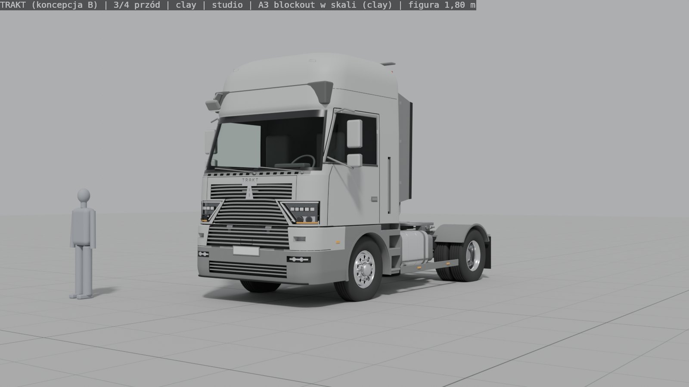
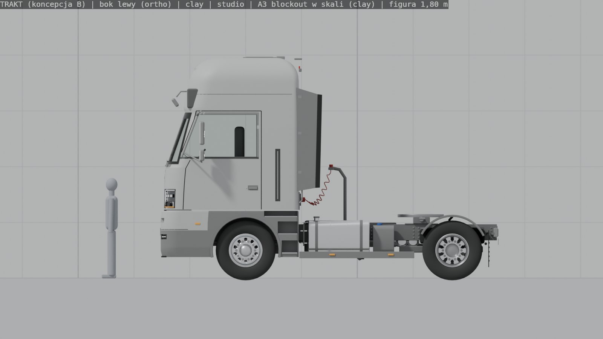
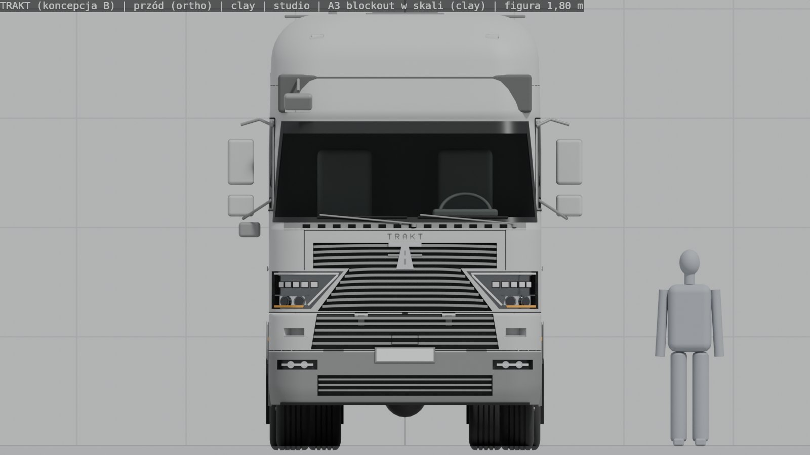
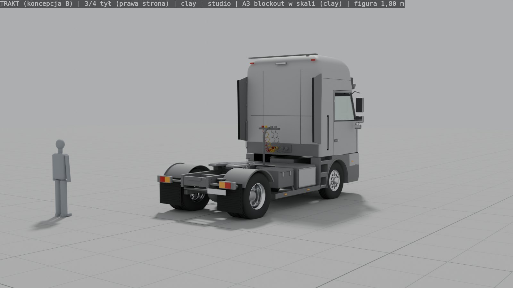
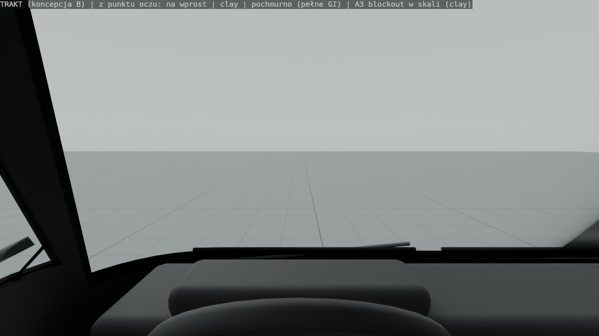
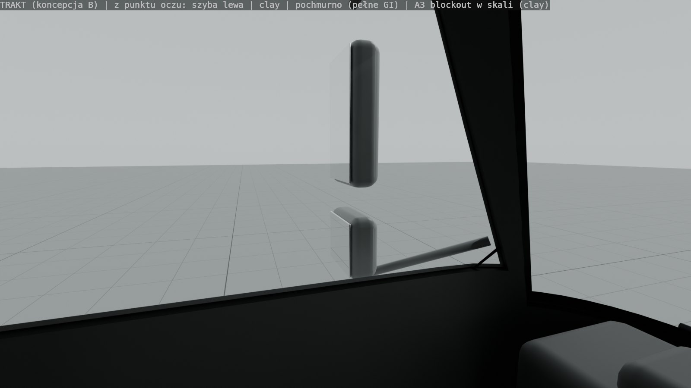
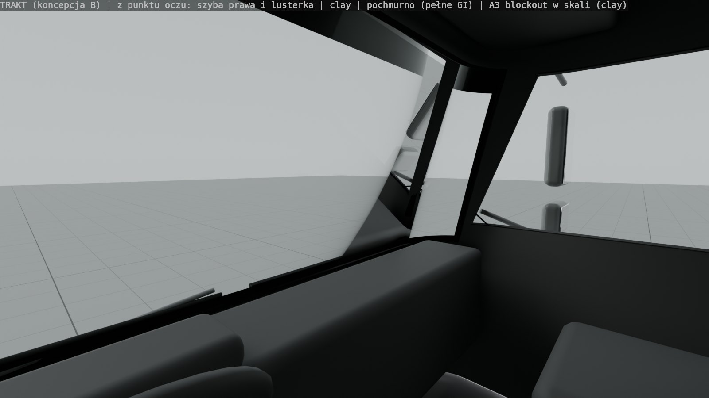
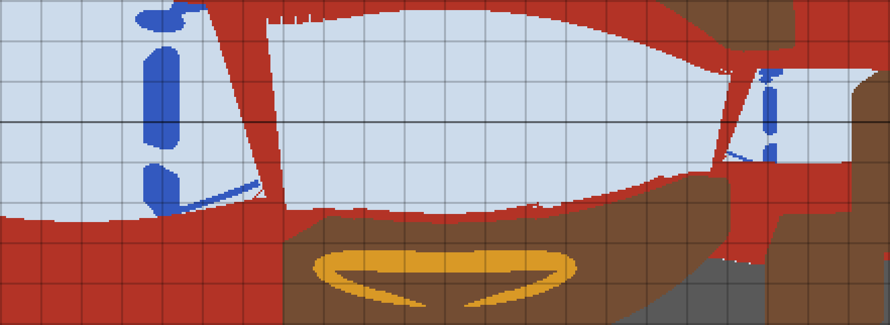
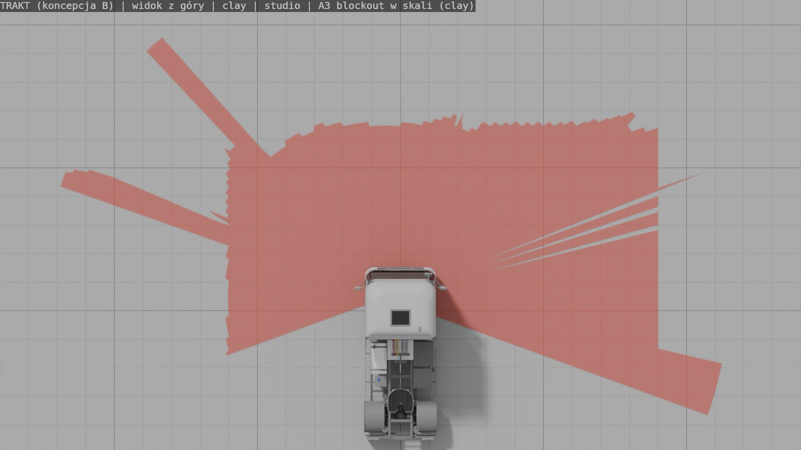
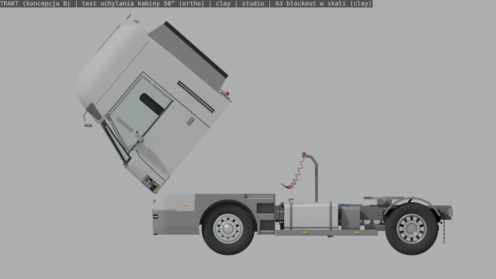

# Tor A3 — blockout w skali: TRAKT (koncepcja B), punkt oczu, widoczność, uchylanie kabiny

**Decyzja właściciela (2026-11-09):** sylwetka **B** jako baza, marka **TRAKT** (sprawdzenie w rejestrach znaków towarowych nadal do zrobienia). Ten blockout to ta sama bryła co A4 (jeden generator), pokazana w szarym „clay”, żeby oceniać proporcje i ergonomię, a nie lakier.

Wszystko generuje skrypt `tools/blender/truck/exterior/build.py --mode a3` (komenda na dole). Siatka 1 m (grubsze co 5 m), figura 1,80 m.

## Bryła w skali

| 3/4 przód | bok (rzut) |
|---|---|
|  |  |
| **przód (rzut)** | **3/4 tył** |
|  |  |

Wymiary zmierzone automatycznie z bryły (`wymiary.json`):

| | zmierzone | limit / cel |
|---|---|---|
| Szerokość nadwozia (bez lusterek) | **2,548 m** | ≤ 2,55 m (96/53/WE) ✔ |
| Wysokość całkowita | 3,98 m | ≤ 4,00 m ✔ (cel 3,95 + właz dachowy i lampy) |
| Długość | 6,06 m | klasa 5,9–6,1 m ✔ |
| Zwis przedni / tylny | 1,53 / 0,83 m | WORKING_VALUE |
| Rozstaw osi | 3,70 m | dims.json |
| Wysokość siodła | 1,15 m | dims.json ✔ |
| Lusterko do lusterka | 3,24 m | lusterka poza limitem 2,55 |

## Widoczność z punktu oczu kierowcy

Oczy: (−0,55; 0,45; 2,50) m z `art-source/truck/dims.json` (R-point + 635 mm wg UNECE R46). Deska, kierownica i fotele to **proste bryły zastępcze** dopasowane do wymiarów wnętrza A5 (górna krawędź deski ~2,09 m, kierownica Ø 470 mm, 38°) — pełne wnętrze to zadanie A5.

| na wprost | szyba lewa (lusterka kierowcy) | szyba prawa (lusterka pasażera) |
|---|---|---|
|  |  |  |

**Mapa widoczności** (`widocznosc_mapa.png`, promienie z punktu oczu co 0,5°; poziomo: kąt od +110° lewo do −110° prawo, pionowo: od −50° do +30°, siatka co 10°, linia horyzontu):
jasnoniebieski = widać (przez szybę), czerwony = słupek / nadwozie, niebieski = lusterko, pomarańczowy = kierownica, brązowy = deska (zastępcza), szary = inne części.



Liczby (`widocznosc.json`):
- **Słupek A lewy** zasłania **8°** na wysokości oczu (42°–50° w lewo), **prawy 3,5°** (68,5°–72° w prawo). Pierwsza wersja miała 17,5° — poprawione szerszym zawinięciem szyby, węższym czarnym rantem (frit) i przesunięciem szyby bocznej do przodu.
- **Ziemię na wprost** kierowca widzi od **~5,0 m przed zderzakiem** (ogranicza dolna krawędź szyby i deska). To typowe dla wysokiej kabiny nad silnikiem — stąd lusterko przednie klasy VI.
- **Przed prawym przednim narożnikiem** ziemia widoczna dopiero od **~9 m**, a po stronie pasażera bezpośrednio przez szybę dopiero ~12 m od kabiny — ta strefa musi być pokryta lusterkami klasy V/VI (są w modelu). Wartości porównawcze z prawdziwymi kabinami: do potwierdzenia Twoim zdjęciem „widok z fotela”.

**Martwa strefa na ziemi z góry** (czerwone = nie widać bezpośrednio, obcięte na 12 m; „szczeliny” po prawej to widok między głowicami lusterek):



## Test uchylania kabiny

Kabina obrócona o 50° wokół osi zawiasu na przedłużeniach ramy (punkt `cab_tilt_pivot` = (0; 1,44; 1,19) m). Kabina przechodzi nad zderzakiem i obudową kół — zderzak, stopnie i nadkola są **na ramie** (linia podziału = linia uchylania na wysokości 1,22 m), więc nie kolidują.



## Ustalenia do koordynacji (dla lidera i agenta wnętrza)

1. **Drzwi a stopnie.** Przy punkcie oczu 0,45 m przed osią i otworze drzwi A5 y ∈ [−0,24; 1,13] m koło przednie leży **pod drzwiami**, więc stopnie mogą być tylko za kołem (y ≤ −0,33 m). Zrobiłem schodki „po skosie” (0,45 / 0,79 / 1,10 m, każdy kolejny dalej do przodu, najwyższy aż do −0,33 m) i dwa uchwyty. W prawdziwych kabinach tej klasy kierowca siedzi zwykle mniej więcej nad osią, a tylna krawędź drzwi jest nad stopniami. **Propozycja:** po zdjęciach właściciela rozważyć przesunięcie punktu oczu i otworu drzwi ~0,3 m do tyłu (dotyczy `dims.json` i wnętrza A5) — nie zmieniałem tego sam.
2. **Znak pochylenia szyby we wnętrzu.** W `tools/blender/truck/interior/build_interior.py` `ws_y(z) = WS_Y0 + (z − WS_Z0)·tan(RAKE)` — przy `--rake 19` górna krawędź szyby idzie **do przodu** zamiast do tyłu. Na zewnątrz szyba B ma 19° do tyłu (dół y = 1,405 m przy z = 2,04, góra 1,08 m przy z = 2,98). Do poprawy przez agenta wnętrza.
3. **Dolna krawędź drzwi.** Wnętrze schodzi skórą drzwi do z = 1,15 m; na zewnątrz kabina kończy się na linii uchylania z = 1,225 m (niżej jest osłona na ramie). Do uzgodnienia przy łączeniu w A6/A7.

## Jak odtworzyć
```
blender -b --factory-startup --python tools/blender/truck/exterior/build.py -- --mode a3 --out docs/reports/visual/truck-A3 --samples 128
```
~2 min na RTX 5070 (OptiX), 1600×900. Opcja `--no-analysis` pomija widoki z oczu, mapę i test uchylania.
