# Tor A5 — wnętrze kabiny (neutralne markowo)

> **Uwaga (A6):** po recenzji `visual-critic` wnętrze zostało poprawione i przygotowane do importu — aktualny raport: [`../truck-A6/README.md`](../truck-A6/README.md). Ten plik zostaje jako stan „przed”.

**Co to jest:** pierwsza pełna wersja wnętrza kabiny naszej ciężarówki — to, co gracz widzi najczęściej (kamera w kabinie na telefonie). Wnętrze pasuje do każdej z koncepcji A/B/C: bryła kabiny jest wspólna, a od marki zależą tylko **znak na piaście kierownicy** i **kolor wstawek**. Wszystko powstaje ze skryptów (Blender, bez ręcznego klikania), w prawdziwej skali, z punktem oczu kierowcy z `art-source/truck/dims.json`.

To są rendery z Blendera (Cycles, path tracing), a nie zrzuty z gry. W grze (Unity URP, telefon) światło będzie liczone prościej — dlatego razem z modelem powstała też mapa AO do „wypalenia” cieni kontaktowych (niżej).

## Rendery kontrolne (1600×900)

Pochmurny dzień (typowe niebo Podlasia):

| | |
|---|---|
| 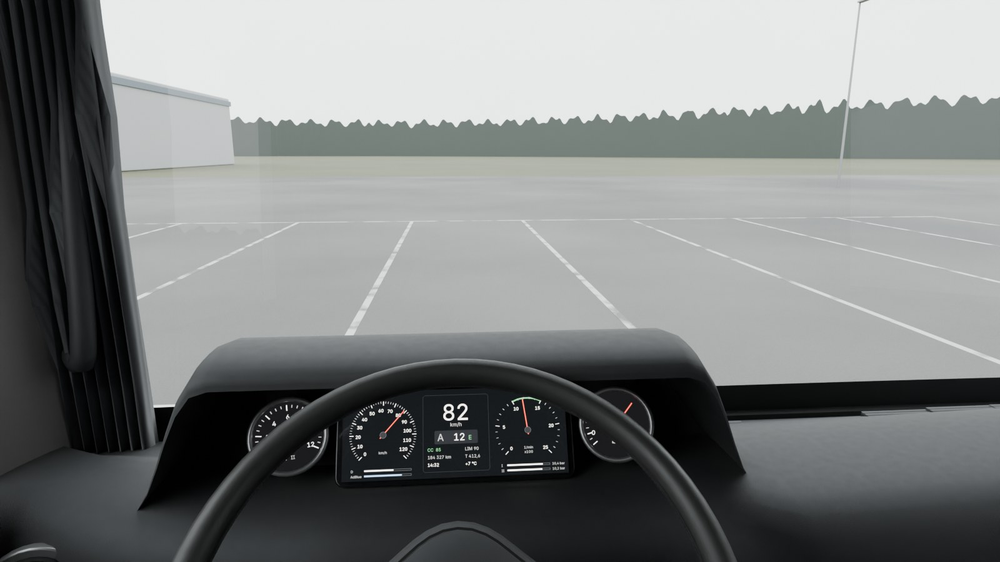 **Oczy kierowcy, na wprost** (kąt widzenia 80° w poziomie ≈ kamera kabinowa na telefonie poziomo) | 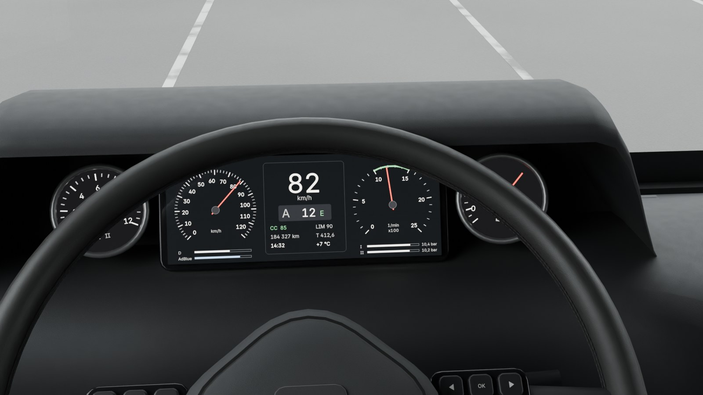 **Kierowca patrzy na zegary** |
| 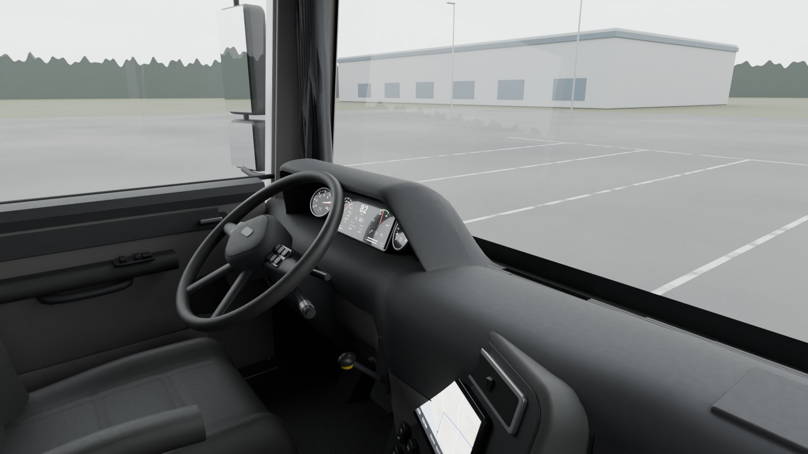 **Z fotela pasażera** | 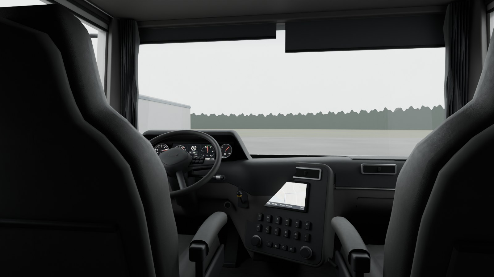 **Z leżanki w stronę szyby** |
| 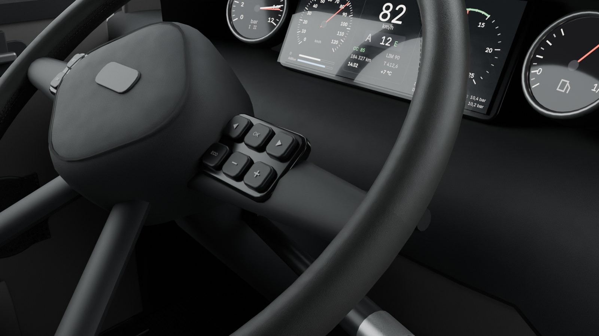 **Kierownica, przyciski, dźwignie** | 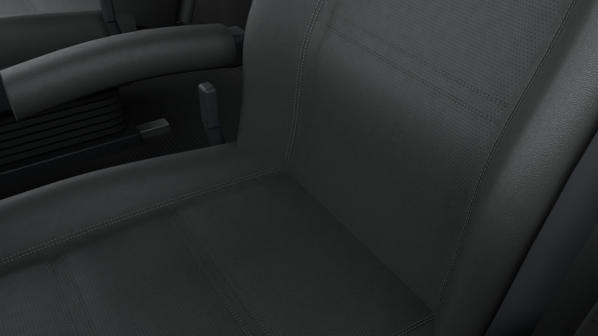 **Fotel kierowcy: szwy, perforacja, mieszek zawieszenia** |

Nisko stojące słońce (~9° nad horyzontem, z przodu z lewej):

| | |
|---|---|
| 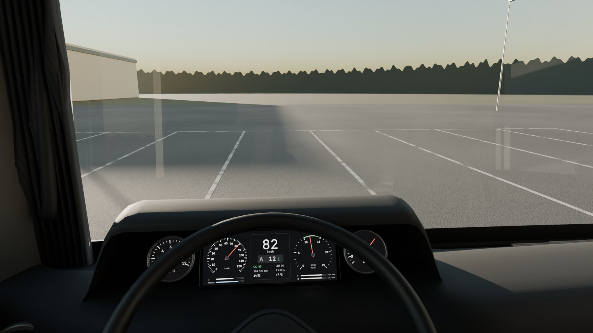 | 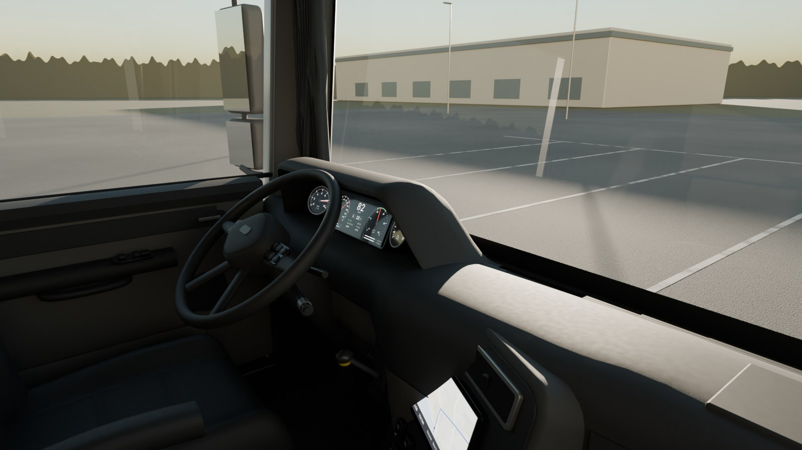 |

Warianty (do Twojej decyzji):

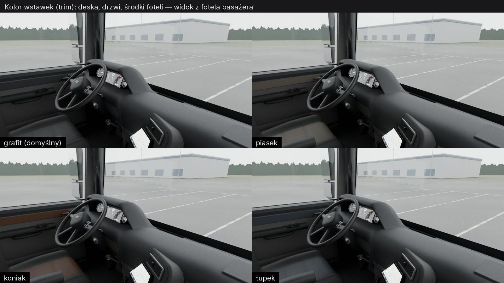
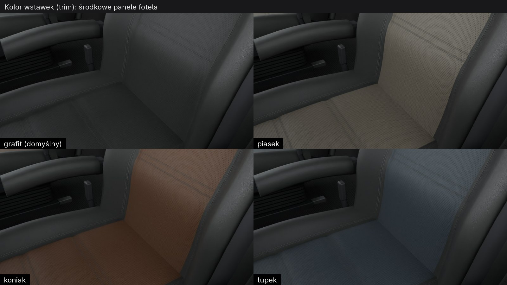
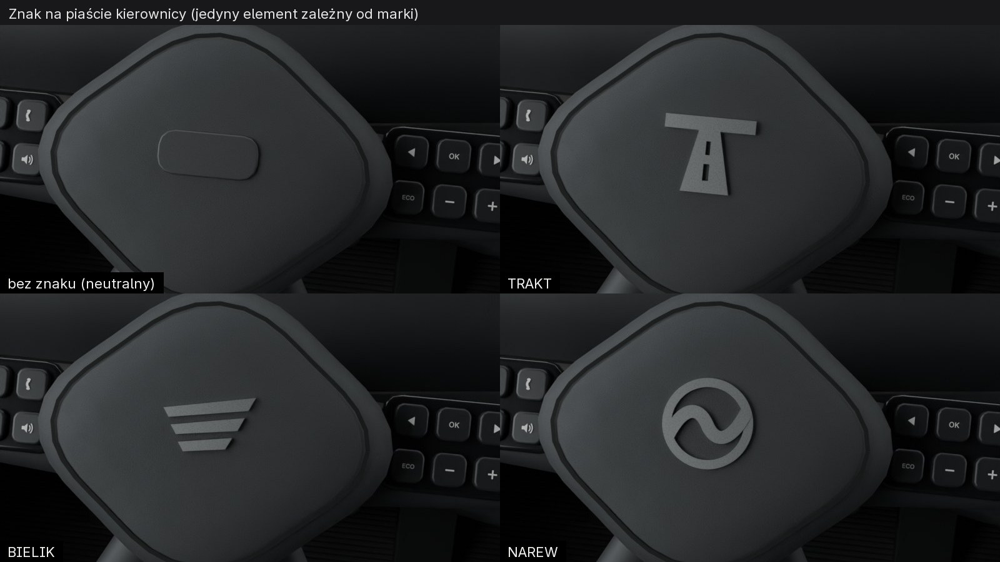

Kontrola wypalonego AO (mapa cieni kontaktowych, ta sama, która trafi do gry) — wnętrze pokazane wyłącznie przez tę mapę:

| | |
|---|---|
| 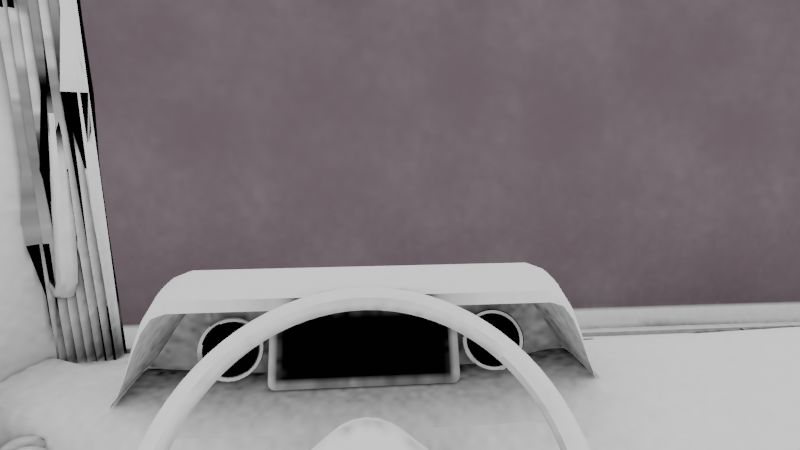 | 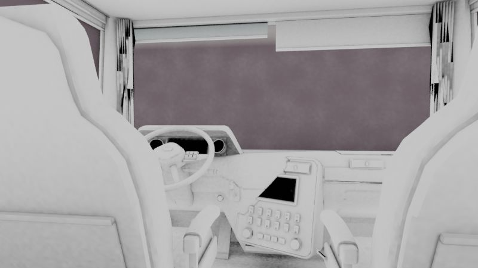 |

## Wymiary i ergonomia (wszystko w metrach, układ jak w A2: Z w górę, przód +Y, kierowca −X)

Statusy jak w `dims.json`: **SOURCED** = z przepisu/normy, **DERIVED** = policzone, **WORKING_VALUE** = wartość klasowa przyjęta przeze mnie, do potwierdzenia Twoimi zdjęciami / pomiarem.

| Parametr | Wartość | Status / źródło |
|---|---|---|
| Punkt oczu kierowcy | (−0,55; 0,45; 2,50) | z `dims.json` (WORKING_VALUE) |
| Punkt R/H fotela | 0,635 m pod oczami → z = 1,865 | SOURCED: UNECE R46 (punkty oczne 635 mm nad punktem R) |
| Wysokość punktu H nad podłogą | 0,465 | WORKING_VALUE (fotel pneumatyczny w pozycji środkowej) |
| Podłoga | płaska, z = 1,40 | `dims.json` (WORKING_VALUE) |
| Wysokość stojąca (podłoga → podsufitka) | 2,22 | WORKING_VALUE (klasa wysokich kabin: ok. 2,0–2,2+) |
| Szerokość wewnętrzna | 2,33 (ściana 80 mm) | DERIVED z szerokości kabiny 2,49 |
| Kierownica: średnica / przekrój wieńca | 470 mm / 35 × 29 mm | WORKING_VALUE (klasa 450–500 mm) |
| Kierownica: pochylenie / środek | 38° od poziomu / (−0,55; 0,875; 2,12) | WORKING_VALUE; sprawdzone, że górny łuk nie zasłania zegarów |
| Siedzisko: głębokość / szerokość | 0,53 / 0,53 | WORKING_VALUE |
| Oparcie: pochylenie | 17° | WORKING_VALUE |
| Ekran zegarów | 12,3″ (292 × 112 mm) + 2 zegary „analogowe” Ø 89 mm | WORKING_VALUE |
| Ekran środkowy | 10,1″ (225 × 135 mm), konsola skręcona 22° do kierowcy | WORKING_VALUE |
| Szyba: dół / góra / pochylenie | z = 2,07 / 3,02 / 5° (parametr `--rake`) | WORKING_VALUE (A/C ≈ 3–5°, B ≈ 19°) |
| Pedały | hamulec wiszący 120 × 95 mm, gaz „stojący” 85 × 270 mm pod 48°, bez sprzęgła (AMT) | WORKING_VALUE |
| Hamulec postojowy | dźwignia zaworu pneumatycznego na desce, na prawo od zegarów | WORKING_VALUE (typowe rozwiązanie UE) |
| Leżanka | 2,31 × 0,78 m, materac na wys. 0,60 m nad podłogą | WORKING_VALUE |
| Tachograf + radio | 2 moduły 1DIN (180 × 50 mm) w schowku nad szybą | tachograf wymagany: rozp. (UE) 165/2014; wymiar 1DIN: ISO 7736 |

Najbardziej niepewne wartości: wysokość punktu H nad podłogą, odległość kierownica–fotel, pochylenie kierownicy. Zweryfikuję je na Twoim zdjęciu „widok z fotela kierowcy” (★ w `docs/plan/TRACK-A.md` §4).

## Co jest w modelu
Fotel kierowcy pneumatyczny (mieszek gumowy, szyny, osłony boczne, dźwignie, podłokietnik, zintegrowany pas, klamra), fotel pasażera; deska z „kapturem” nad zegarami, cyfrowe zegary + dwa okrągłe (ciśnienie powietrza w 2 obwodach, paliwo), konsola środkowa (ekran nawigacji, 12 przełączników kołyskowych z symbolami i diodami, klimatyzacja), nawiewy okrągłe i prostokątne, kratki nawiewu na szybę, schowek pasażera z pokrywą, schowek dolny, uchwyty na kubki, gniazda; kierownica 3-ramienna z przyciskami (tempomat, menu, telefon), poduszka z linią podziału, kolumna, dźwignie: lewa (kierunkowskazy/wycieraczki), prawa górna (retarder/hamulec silnikiem), prawa dolna (wybierak AMT z pierścieniem obrotowym); pedały, podnóżek; dźwignia hamulca postojowego, przycisk start/stop, pokrętło świateł; drzwi (podłokietnik, przełączniki szyb i lusterek, uchwyt, klamka, kieszeń, głośnik, uszczelka, listwa progowa); słupki A (osłona, uchwyt do wsiadania, głośnik wysokotonowy); szyba z pasem przeciwsłonecznym i czarnym rantem (frit), lekki brud na szybach; rolety elektryczne nad szybą, zasłony na szynie; schowki nad szybą (4 pokrywy + tachograf/radio), lampki; schowki nad leżanką, okno dachowe z roletą, plafony; leżanka z materacem, poduszka, koc, szuflady (lodówka), złożona górna leżanka z pasami, panel sterowania przy leżance, lampki do czytania; na zewnątrz: lusterka główne i szerokokątne na ramionach, lusterko krawężnikowe i przednie, wycieraczki. Tło: parking z wytartymi liniami, hala, maszty oświetleniowe, ściana lasu (płasko — Podlasie).

## Materiały i tekstury
Wszystkie tekstury są **własne** — wygenerowane skryptem (`make_textures.py`: szum w dziedzinie częstotliwości, komórki Worleya, kształty wektorowe), bez zdjęć z internetu i bez obrazów z generatorów AI. Każdy zestaw kafelkuje się bez szwów i ma 3 mapy: wariacja koloru, normal (OpenGL), ORM (AO / chropowatość / metaliczność).

| Zestaw | Rozdzielczość | Kafel | Gdzie |
|---|---|---|---|
| skóra (ziarno „pebble”) | 1024 | 12 cm (kierownica 5 cm) | fotele, podłokietniki, wieniec |
| tworzywo soft-touch (ziarno) | 1024 | 10 cm | góra deski, kaptur, wstawki |
| guma podłogowa (prążki co 10 mm) | 1024 | 40 cm | dywanik |
| tworzywo twarde | 512 | 8 cm | dół deski, drzwi, schowki |
| dzianina podsufitki | 512 | 5 cm | podsufitka, ściany, zasłony |
| tkanina | 512 | 6 cm | materac, wstawki |
| metal szczotkowany | 512 | 10 cm | listwy, pierścienie, próg |
| + maski: perforacja, szwy (pasy z alfą), kratki głośników, symbole przełączników, brud szyb | 256–1024 | — | — |
| + ekrany: zegary, nawigacja, tachograf/radio, zegary okrągłe | 512–1560 | — | w grze zastąpione żywym obrazem z fizyki |
| + AO całej kabiny (1 atlas, warstwa UV „Bake”) | 2048 | — | cienie kontaktowe w grze |

Zużycie: przetarta lewa (od drzwi) boczna poduszka fotela kierowcy, wytarty wieniec kierownicy „na 10 i 14”, wytarty dywanik pod piętą kierowcy i na drodze wsiadania, zarysowana listwa progowa, kurz w zagłębieniach deski i dywanika, smugi na szybach i odciski na ekranach. Celowo **subtelne** — to zadbana ciężarówka floty, nie wrak.

**Budżet tekstur (pamięć GPU, ASTC + mipmapy):** High ≈ **12,5 MB** (normal ASTC 5×5, reszta 6×6, AO 2048), Medium ≈ **2,7 MB** (zestawy o połowę mniejsze, ASTC 8×8, AO 1024), Low ≈ **0,8 MB** (256 px, AO 512, mniejsze ekrany). Na A16 (4 GB RAM, budżet całej aplikacji ≤ 1,2 GB PSS) to pomijalny ułamek.

## Siatka, budżet trójkątów i plan LOD
Siatka „mid-poly, game-ready”: bez high-poly do wypalania; zaokrąglenia (bevel) tylko tam, gdzie łapie się światło, drobne kształty (ziarno, przeszycia, perforacja, kratki) w teksturach. UV: jedno przejście Smart UV dla całej kabiny → wspólny atlas bez nakładania się (warstwa „Bake”) + kopia przeskalowana do metrów (warstwa „UVMap”) dla kafelkowanych materiałów — **jednolita gęstość tekseli w całej kabinie**.

Zmierzone (`stats.json`, siatka po modyfikatorach): **83 490 trójkątów** łącznie z zamknięciem kabiny, szybami i lusterkami zewnętrznymi — cel High 60–90 tys. ✔. Podział: deska 24,6 tys., fotele 20,3 tys., drzwi 7,1 tys., kierownica 6,8 tys., zasłony 6,6 tys., schowki 5,8 tys., leżanka 3,3 tys., szyby/zewnętrze 3,2 tys., lusterka 2,7 tys., skorupa 2,2 tys., pedały 0,7 tys.

| Profil | Trójkąty kabiny | Co się zmienia |
|---|---|---|
| **High** (S24+) | ~80 tys. | jak na renderach; szwy jako paski z alfą; mapy normalnych wszędzie |
| **Medium** (A16) | ~40 tys. | fotele i wieniec z rzadszej siatki (41×29 → 21×15 pętli, 72 → 48 segmentów), zasłony jako płaskie karty z normalną, przyciski/kratki/szwy wypalone w normalną i kolor zamiast geometrii, materiały scalone do ~6 atlasów (≤ 8 draw calli na kabinę), AO z atlasu 1024 |
| **Low** (A16, oszczędny) | ~20 tys. | wszystko za fotelami (leżanka, tylne schowki, zasłony) jako jedna prosta bryła z wypalonym światłem; bez map normalnych na drobnych zestawach; lusterka: render-texture w niższej rozdzielczości/rzadziej (ale zawsze użyteczne do cofania — `docs/06` §6) |

Obecnie w Blenderze jest 49 materiałów (dla czytelności); scalenie do atlasów to krok A6.

## Pętla visual QA — co poprawiłem po obejrzeniu renderów
Każdą iterację renderowałem ze wszystkich kamer i oglądałem kadr po kadrze, porównując z tym, jak wygląda prawdziwa kabina i z listą „AI slop” z `docs/06`.

1. **Iteracja 1** (pierwszy render): kaptur nad zegarami jak telewizor postawiony na desce; na prawej części szyby duża biała elipsa; las na horyzoncie z prostopadłościanów; całe wnętrze prawie czarne; nawiewy „wiszące” jako pudełka, kratki nawiewu szyby jak klawisze pianina; pusta piasta i przyciski bez symboli; niskie słońce w ogóle nie wpadało do kabiny; kamera z leżanki zasłonięta oparciem.
2. **Iteracja 2:** szyba bez zawinięcia na boki, nowy wyprofilowany kaptur, konsola środkowa z wbudowanymi nawiewami, kratki nawiewu jako perforowana listwa, ekspozycja +1 EV, jaśniejszy dół deski (dwa odcienie jak w prawdziwych kabinach), wypukła poduszka kierownicy z symbolami na przyciskach, las zamiast pudełek, hala i maszty, wytarte linie. **Biała elipsa nie zniknęła** → rendery diagnostyczne z ukrywaniem obiektów wskazały szybę, a przyczyną było odbicie Fresnela liczone od „tylnej” strony pojedynczej tafli (całkowite wewnętrzne odbicie powyżej ~41°).
3. **Iteracja 3:** naprawiony Fresnel (dla tylnej strony 1/1,52), las płaski (bez „gór” — Podlasie jest płaskie), maszty przesunięte z osi widoku, roleta półprzezroczysta, schowek na desce pasażera, kieszeń na oparciu, nowa kamera fotela. Znalezione: cyfry prędkości ucięte krawędzią kaptura, kwadratowe tarcze za okrągłymi zegarami, poszarpana granica materiałów na desce, biały pas lakieru widoczny pod szybą, wycieraczki „lewitujące” nad deską.
4. **Iteracja 4:** granica materiałów po stałym indeksie profilu + szczelina podziału (czysta linia), okrągłe tarcze, czarny rant (frit) szyby, wycieraczki niżej, drobniejsze ziarno skóry kierownicy. Kaptur dalej zasłaniał górę ekranu → **policzyłem linię wzroku oko → górna krawędź ekranu** i okazało się, że kaptur trzeba podnieść, a nie obniżyć.
5. **Iteracja 5:** kaptur nad linią wzroku — cały ekran widoczny; mocniejsze przetarcie lewej poduszki fotela.
6. **Iteracja 6:** skorupa oparcia zgodna z sylwetką fotela (zwęża się przy zagłówku), wygładzona linia lasu, test zgodności z koncepcją B (szyba 19°).
7. **Iteracja 7:** kolor wstawek steruje też środkami foteli; znak na piaście z plików SVG marek (poprawione wypełnienie znaku NAREW); polskie znaki na ekranach i opisach; rendery końcowe 512 próbek.

## Znane braki (świadomie, etap A5)
- **Brak zdjęć referencyjnych** — porównanie „obok zdjęcia” jeszcze niemożliwe; proporcje są klasowe (WORKING_VALUE).
- Ocena `visual-critic` jeszcze niezlecona (zleca lider); brak zrzutów z telefonu (pierwsze w A7, po imporcie do Unity).
- Zewnętrze kabiny w kadrze to tylko zamknięcie bryły (białe), nie karoseria koncepcji — zastąpi je wybrana koncepcja w A3.
- Koncepcja B (szyba 19°): wnętrze się dopasowuje (`--rake 19`), ale słupek A i przednia krawędź szyby bocznej wymagają dopracowania (widoczne trójkątne fragmenty szkła) — do zrobienia w A3 po wyborze.
- W atlasie AO są jeszcze ściany ukryte (spody, ścianki przylegające) — marnują część miejsca; usunięcie ukrytych ścian i ponowne upakowanie w A6.
- Kontrola AO: atlas poprawnie trafia na geometrię (przyciemnienia w zagłębieniach, wokół zegarów, pod kapturem), ale do wypalenia trafiła też szyba (fioletowe tło na podglądzie) i zasłony (czarno-białe plamy na cienkich, przenikających się fałdach) — w A6 szyby wyłączyć z wypalania, zasłony uprościć do kart.
- Kurz w zagłębieniach na renderach liczy węzeł AO Cycles; w grze ta sama informacja przyjdzie z wypalonego atlasu.
- Pasy bezpieczeństwa, mechanizm fotela i górna leżanka są uproszczone; lampki we wnętrzu nie świecą (wariant nocny — później).
- Tekst na ekranach jest renderowany fontem Inter (SIL OFL 1.1) z instalacji Blendera — do wpisania w `docs/LICENSES.md` (plik lidera). Sam plik fontu nie trafia do repo.
- Tło (parking, hala, las) służy tylko renderom — nie jest zasobem gry.

## Pytania do Ciebie
1. **Kolor wstawek** (deska po stronie pasażera, drzwi, środki foteli): grafit (domyślny), piasek, koniak czy łupek? — arkusze wyżej.
2. **Zegary:** zostawić dwa okrągłe „analogowe” zegary obok ekranu (ciśnienie powietrza, paliwo), czy wolisz sam duży ekran?
3. **Deska dwukolorowa** (ciemna góra, ciepła szarość dołu) — pasuje, czy cała ciemna?
4. **Zasłony/rolety** — ciemnoszare jak teraz, czy inny kolor?
5. Przy okazji wizyty na MOP-ie: zdjęcie **z fotela kierowcy na wprost** (oczy w normalnej pozycji) i **deski z bliska** — to najbardziej poprawi wiarygodność.

## Jak odtworzyć
```
uv run --no-project --with pillow --with numpy python tools/blender/truck/interior/make_textures.py
blender -b --factory-startup --python tools/blender/truck/interior/build_interior.py -- --out docs/reports/visual/truck-A5 --samples 512 --stats docs/reports/visual/truck-A5/stats.json
python tools/blender/truck/interior/variants.py --out docs/reports/visual/truck-A5
blender -b --factory-startup --python tools/blender/truck/interior/bake_ao.py
```
Opcje generatora: `--trim grafit|piasek|koniak|lupek`, `--badge none|trakt|bielik|narew`, `--rake <stopnie>`, `--cams`, `--light overcast,lowsun`, `--blend <plik>` (zapis sceny do podglądu, poza gitem). Czas: tekstury ~10 s, scena + 8 renderów ~70 s (RTX 5070, OptiX), warianty ~40 s, wypalanie AO ~4–7 min.
