# Tor A6: zewnętrze TRAKT gotowe do importu do gry

**Co to jest:** zewnętrze ciągnika TRAKT (runda 3 z A4) przerobione na zasób gry: części osobno pod animację, poziomy szczegółów LOD0–LOD2, atlasy tekstur PBR, pliki FBX, manifest dla importu Unity (A7) i plik `glass_interface.json`, do którego dopasowuje się wnętrze. Wszystko generuje skrypt `tools/blender/truck/exterior/a6_export.py` (nic klikanego ręcznie). Oceny nie wystawiam sam — robi to `visual-critic`.

Rendery: Blender Cycles 1600×900, 128 próbek, **materiały gry** (atlasy z eksportu, nie materiały robocze A4). „Jak URP” to nadal emulacja w Cycles, nie kadr z Unity.

## Najważniejsze kadry

| | |
|---|---|
| 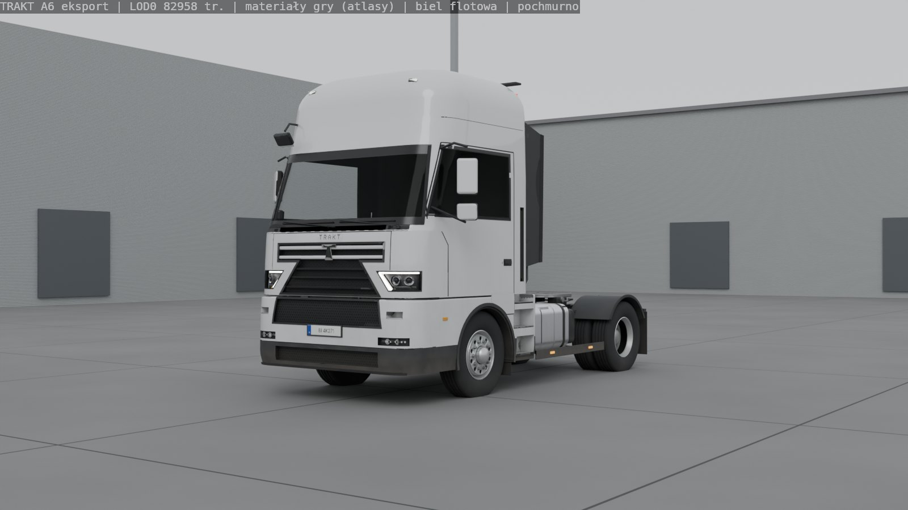 3/4 przód, biel, LOD0 | 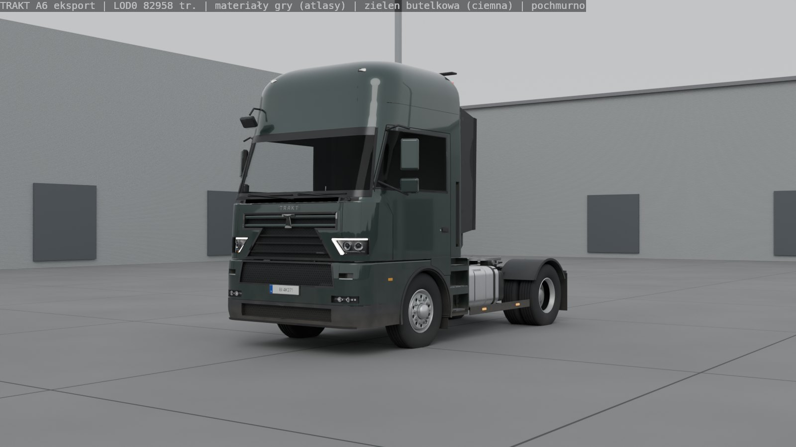 zieleń butelkowa (ten sam atlas, inny `_PaintColor`) |
| 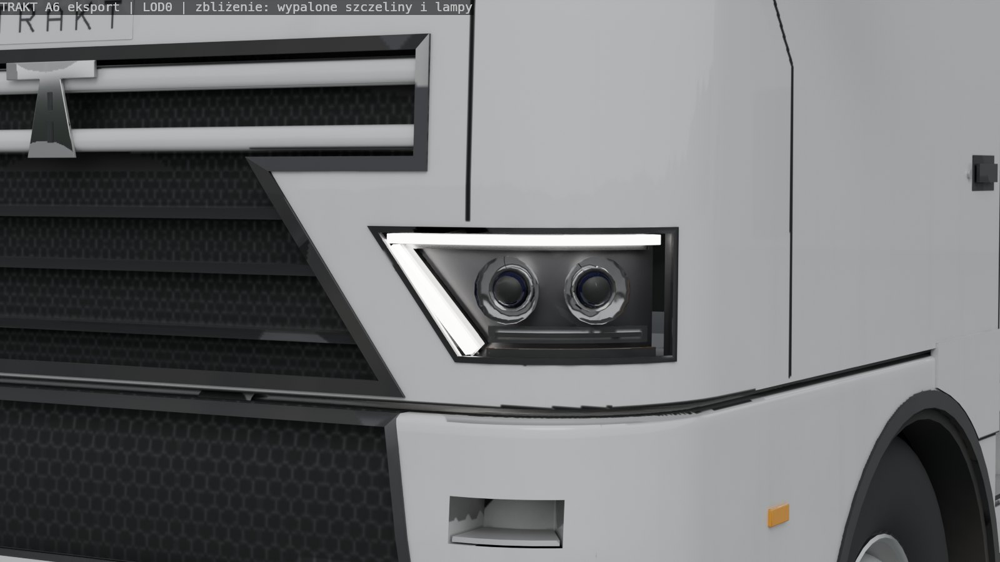 reflektor, szczeliny wypalone | 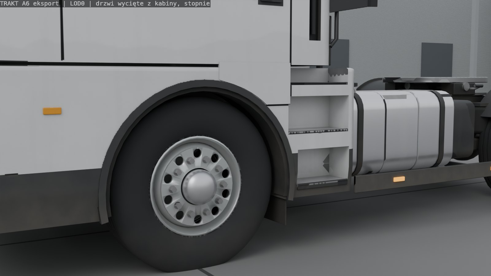 drzwi wycięte z kabiny, stopnie za kołem |
| 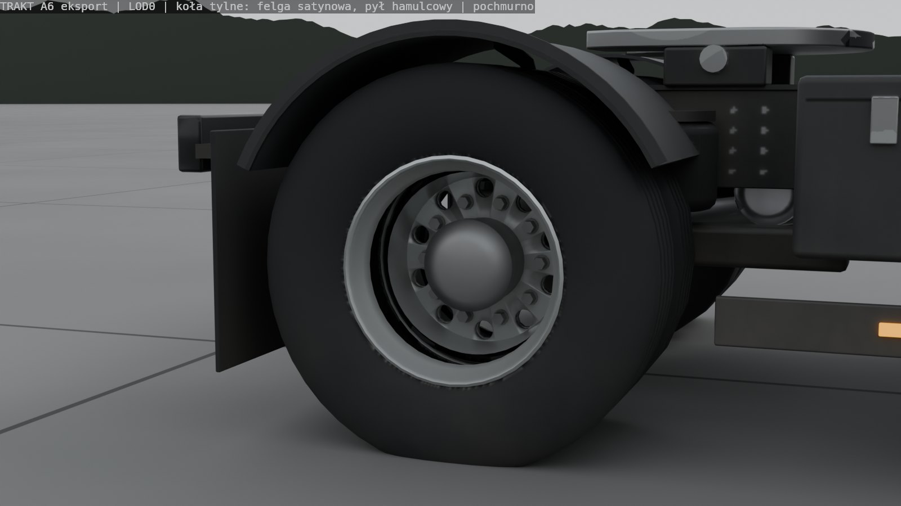 felga satynowa z pyłem hamulcowym | 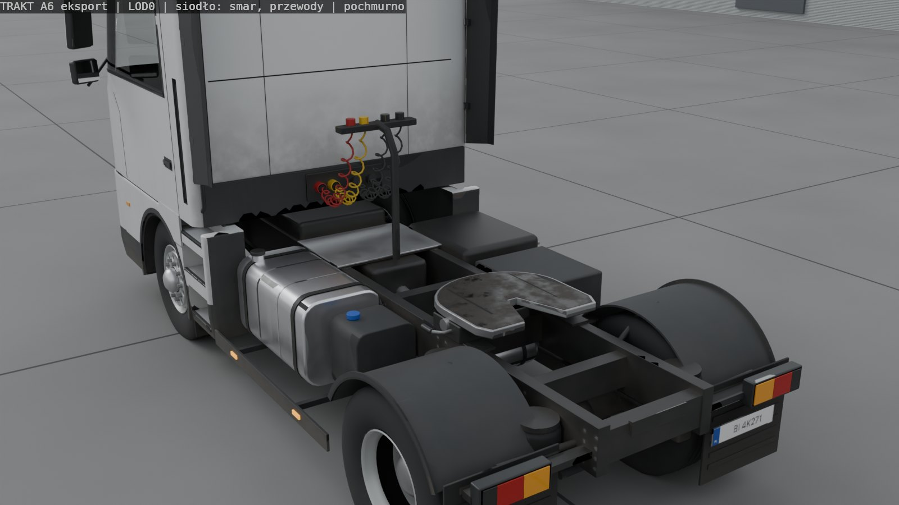 siodło ze smarem, przewody |
| 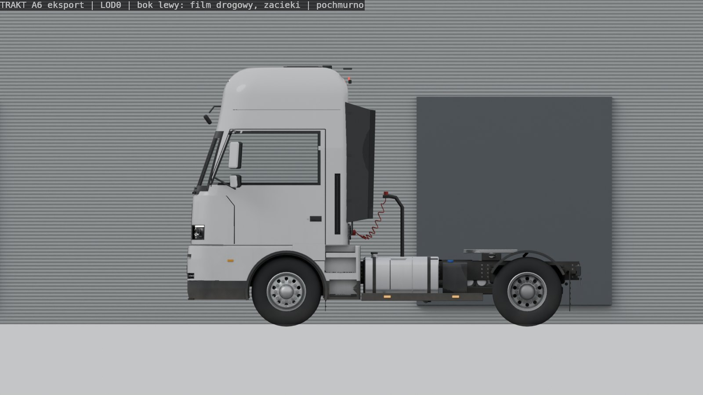 bok: film drogowy | 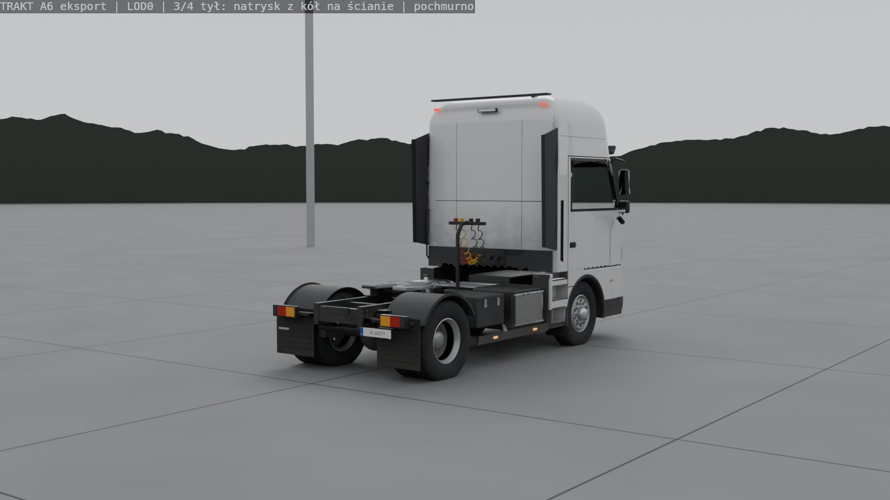 tył: natrysk z kół |
| 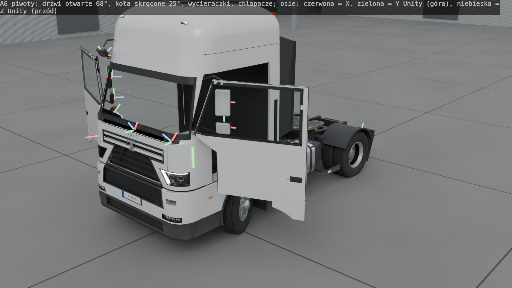 piwoty: drzwi 68°, skręt 25°, wycieraczki, chlapacze | 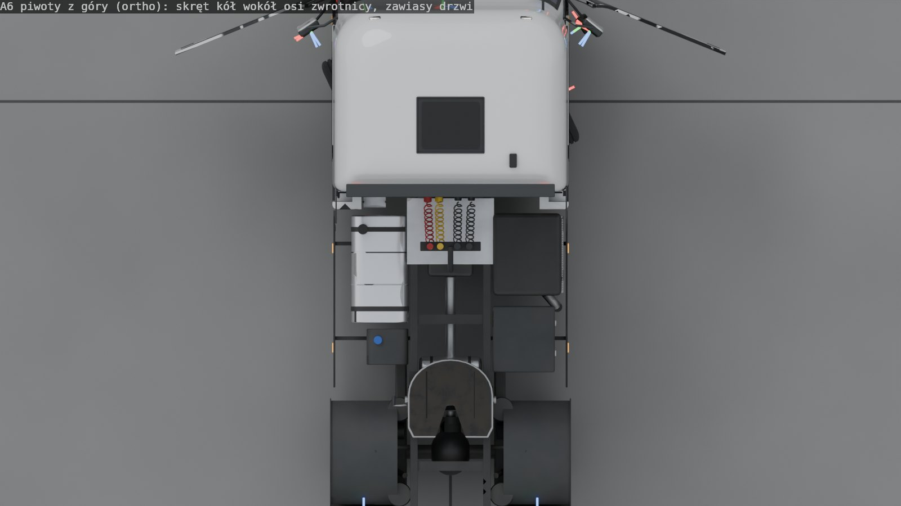 piwoty z góry |
| 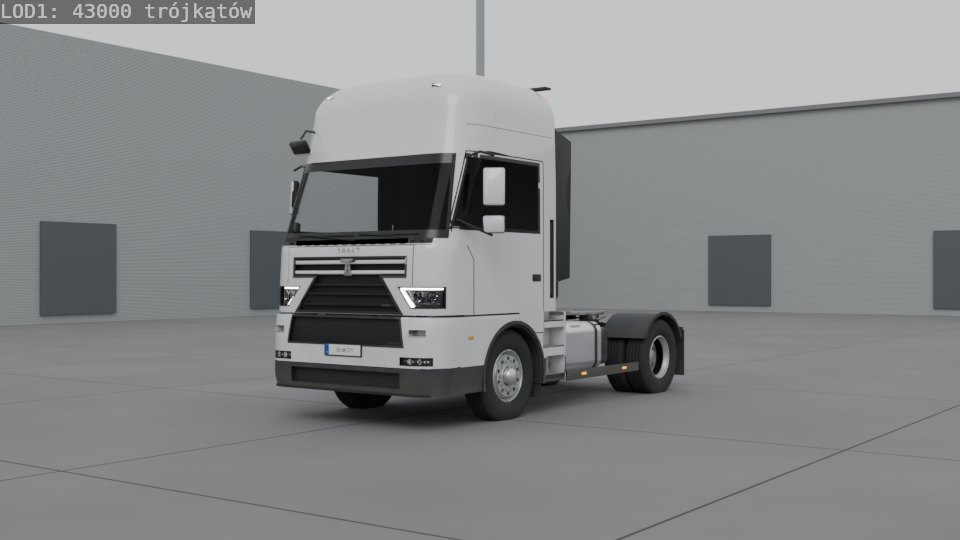 LOD1 | 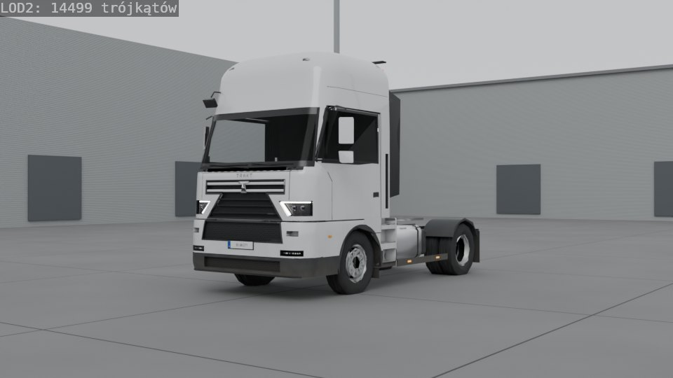 LOD2 |

Dopasowanie do wnętrza (oba FBX razem, materiały w glinie, szkło przezroczyste): `fit_oko_przod.jpg`, `fit_oko_slupek_lewy.jpg`, `fit_oko_slupek_prawy.jpg` (z oczu kierowcy), `fit_zewn_szyba.jpg`, `fit_zewn_drzwi.jpg` (z zewnątrz przez szyby). Jak URP: `34przod_white_lod0_urp.jpg`.

## Co jest w `art-source/truck/exterior/export/`

| | LOD0 | LOD1 | LOD2 |
|---|---|---|---|
| Trójkąty (limit) | **82 958** (≤ 100 tys.) | **43 000** (≤ 45 tys.) | **14 499** (≤ 15,5 tys.) |
| Obiekty | 25 | 25 | 19 (bez lusterek RT) |
| Plik | `SM_TruckExterior_LOD0.fbx` 6,8 MB | `…LOD1.fbx` 4,1 MB | `…LOD2.fbx` 1,5 MB |

- **Części pod rig** (piwot w osi ruchu, osie w manifeście): `CAB_Body` (piwot = `CAB_MOUNT_REF`, ten sam co wnętrze), `DOOR_L/R` (zawias), `GLASS_DoorL/R`, `GLASS_Windscreen`, `WIPER_L/R` (oś wycieraczki), `STEER_FL/FR` (oś zwrotnicy) z `WHEEL_FL/FR`, `WHEEL_RL/RR` (oś piasty), `MUDFLAP_*` (zawias), `MIRROR_*` (kwadraty pod render texture, normalna na oko kierowcy), `CHASSIS`. Gniazda: oko kierowcy, siodło, światła itd. Kolizja: wypukłe `COL_*` (≤ 255 tr.).
- **Hierarchia w FBX jest płaska** (wszystko jest dzieckiem korzenia). Eksporter FBX Blendera z `bake_space_transform` źle zapisuje poziomy głębiej niż pierwszy (sprawdzone parsowaniem surowego FBX: drzwi pod kabiną miały zamienione osie). Docelową hierarchię (drzwi pod kabiną, koło pod zwrotnicą…) opisuje manifest (`rig_parent`, `rig_local_position_unity`). Odbuduje ją generator prefabu A7.
- **Światła** to osobne ściany w slocie `Lights` z numerem grupy w UV2 (`DRL`, mijania, drogowe, kierunki L/P, stop/pozycja, cofanie, obrysowe, przeciwmgielne, robocze). Sterownik świateł ustawia emisję per grupa (kontrakt w manifeście).
- **Materiały (6 slotów):** `MI_Ext_Paint`, `_Trim`, `_Metal`, `_Lights` (atlasy), `_Glass` (przezroczyste, odcień z koloru wierzchołków), `_MirrorRT`.
- **Tekstury w 3 profilach** (High/Medium/Low = 2048/1024/512, `Lights` 1024/512/256), kwadraty potęgi dwójki pod ASTC:
  - kontrakt własnego Shader Graph `Kamion/TruckExterior`: `T_Ext_<Slot>_C` (albedo + chropowatość), `_N` (normalne, OpenGL +Y), `_M` (AO, maska brudu, metaliczność / maska lakieru), `T_Ext_Decal` (napis TRAKT); suwak `_Dirt` 0–1;
  - **zastępczo dla zwykłego URP Lit:** `T_Ext_<Slot>_BaseMap` (albedo z brudem 0,5; lakier osobno dla bieli i zieleni) i `T_Ext_<Slot>_MaskMap` (R metaliczność, G AO, B brud, A gładkość). URP Lit czyta R/A jako Metallic-Smoothness i G jako Occlusion, więc jedna tekstura wystarcza. Traci się suwak brudu, lakier bezbarwny i napis TRAKT.
- **Gęstość tekseli** (High): lakier 303 px/m, metal 473 px/m, światła 813 px/m, tworzywa/rama/opony 130 px/m. W repo nie ma ADR o gęstości tekseli (patrz „Otwarte”).
- **Manifest** `truck_exterior_manifest.json`: pliki, LOD-y, trójkąty, materiały, piwoty i osie w układzie Unity, gniazda, kontrakt shadera, warianty malowania, licencje, porównanie z fizyką.
- **Kontrola eksportu** `tools/blender/truck/exterior/check_export.py`: obiekty, trójkąty, materiały, UV `Atlas`, budżety, tekstury, a piwoty czyta z **surowego FBX** (bez importera Blendera) i porównuje z manifestem. Wynik: **PASS** dla LOD0–2.

## Szyba wspólna z wnętrzem: `art-source/truck/exterior/glass_interface.json`
Zewnętrze jest właścicielem szyby przedniej i szyb drzwi. Plik podaje: otwór 2,06–2,96 m, nachylenie 19°, narożniki, siatkę 5×7 punktów zewnętrznej powierzchni z **prawdziwymi normalnymi** (wcześniejsza wersja pomijała pochylenie szyby), siatkę **13×49 punktów wewnętrznej powierzchni** (szkło 6 mm), krawędź otworu w każdym rzędzie, szerokości nadruku (frit), obrys szyb drzwi i **przekroje powłoki kabiny** (przód, tył, szerokość, promienie naroży co 25 mm wysokości). Wnętrze buduje z tego swoją szybę zastępczą, nadruk i słupki A, a krok `fit_to_exterior` wciąga do środka wszystko, co wystawało poza karoserię. Test `tools/blender/truck/check_fit.py` (oba FBX naraz): **0 wierzchołków wnętrza poza karoserią** (przed dopasowaniem: 302), raport `art-source/truck/exterior/export/fit_check.json`.

## Recenzja r2 §1: co jest zamknięte
Większość punktów zamknęła runda 3 A4 (drzwi/stopnie, przód z lat 2020., koniec ciemnego cokołu, przedni chlapacz, felgi 0,26, brud, lusterka na oko, smar siodła). A6 przenosi to do materiałów gry i dodaje:
- **Nadruk (frit) szyby u dołu 35 → 75 mm** (prawdziwe szyby mają 60–120 mm; zakrywa podszybie i krawędź deski, także od środka: R2 §2 #2).
- **Brud jest dielektrykiem:** w kontrakcie shadera brud zmniejsza metaliczność. Felga z pyłem hamulcowym jest szara i satynowa, a nie ciemny chrom.

## Pętla visual QA (każdą rundę oglądałem w zmniejszeniu do 900 px)
1. **Wypalanie trwało 18 min przy 1/4 rozdzielczości.** Przyczyna: wypalanie „wybrane do aktywnego” uruchamia silnik osobno dla każdego obiektu źródłowego (~800). Złączenie źródła w jeden obiekt skróciło pełne wypalanie do **~40 s**.
2. **Czarne poszarpane plamy** na narożnikach zderzaka i felgach przy 1/4 rozdzielczości zniknęły w pełnej. **Normalne felg były zepsute** (składowa Z ≈ 0, promienie trafiały w sąsiednią powierzchnię). Model gry jest tą samą siatką co źródło, więc mapa normalnych wypala teraz tylko szczegóły „tylko do wypalenia” (szczeliny, śruby, napis), a reszta jest płaska.
3. **LOD2/LOD3: grill zapadał się w czarny trójkąt** (jeden wspólny współczynnik upraszczania). Teraz budżet trójkątów jest liczony według powierzchni części, z wagą ×4 dla opon i felg.
4. **Ciemne malowanie dawało dwukolorową ciężarówkę** (zderzak i stopnie zostały białe). Przyczyna: `Mesh.materials.clear()` w Blenderze 4.x kasuje numery materiałów ścian, więc każda część z kilkoma materiałami wpadała w całości do pierwszego slotu. Po naprawie lakier na osłonie dolnej jest w slocie `Paint`. Ten sam błąd był w eksporcie wnętrza, też naprawiony.
5. **Granice materiałów przy upraszczaniu:** czarne trójkąty tworzywa wjeżdżały na lakier w LOD2. Wierzchołki na granicach slotów są teraz chronione.
6. **Hierarchia FBX** (punkt wyżej): spłaszczona, sprawdzana parsowaniem surowego pliku.

## Otwarte
- **Brak kadru URP i z telefonu** (`docs/06` §5 pkt 2): przyjdzie z importem A7. Bez tego nie może być PASS.
- **LOD3 (ruch uliczny, ~5 tys.)**: wersja robocza, domyślnie nie eksportowana, bo koła i błotniki rozpadają się przy tym budżecie (`--lods 0,1,2,3`).
- **Tworzywa/rama/opony: 130 px/m** to mało do zbliżeń (stopnie, zderzak). Kandydat na drugi atlas Trim albo tekstury kafelkowe detalu. Brak ADR o gęstości tekseli, decyzja lidera / `rendering-perf`.
- **Różnice sztuka–fizyka** (manifest `physics_crosscheck`): rozstaw kół przód 2,04 vs 2,05 m, tył 1,82 vs 1,83 m, siodło 1,15 vs 1,20 m, zaczep kabiny wysokość 1,15 vs 1,50 m, promień opony 0,538 (swobodny) vs 0,51 m (toczny). Do uzgodnienia z `vehicle-physics`.
- Wariant z kamerami zamiast lusterek nie jest eksportowany (tylko klasyczne lusterka).

## Jak odtworzyć
```
blender -b --factory-startup --python tools/blender/truck/exterior/a6_export.py -- [--samples 128] [--no-renders] [--bake-scale 0.25 --ao-samples 16]
blender -b --factory-startup --python-exit-code 1 --python tools/blender/truck/exterior/check_export.py
blender -b --factory-startup --python tools/blender/truck/interior/a6_export.py -- --lods 0,1,2      # wnętrze dopasowane do glass_interface.json
blender -b --factory-startup --python-exit-code 1 --python tools/blender/truck/check_fit.py -- --report art-source/truck/exterior/export/fit_check.json
blender -b --factory-startup --python tools/blender/truck/fit_render.py -- --samples 64
```
Czas (RTX 5070): eksport zewnętrza z wypalaniem i renderami ok. 2,5 min, wnętrze ok. 5 min.
