# Tor A6: wnętrze kabiny po recenzji i gotowe do importu do gry

**Co to jest:** poprawki wnętrza kabiny po recenzji `visual-critic` (`docs/reports/visual/REVIEW-2026-11-09.md`, werdykt A5: „FAIL, blisko”) oraz przygotowanie wnętrza do importu do Unity (A6). Wnętrze ma teraz 3 poziomy szczegółów (LOD), scalone materiały, wypaloną mapę światła otoczenia, pliki FBX i opis importu (manifest) dla agenta Unity (krok A7, robi go lider).

Wszystko nadal powstaje ze skryptów: nic nie było klikane ręcznie w Blenderze.

## Dopasowanie do zewnętrza A6 (2026-11-09, `glass_interface.json`)

Zewnętrze (`docs/reports/visual/truck-A6-exterior/`) jest teraz jedyną karoserią i jedynym szkłem w grze. Wnętrze się do niego dopasowuje:
- **Szyba przednia z zewnętrza:** wnętrze czyta `art-source/truck/exterior/glass_interface.json` (wewnętrzna powierzchnia szyby, siatka 13×49 punktów). Otwór szyby z 2,07–3,02 m na **2,06–2,96 m** (jak w zewnętrzu), płaszczyzna szyby o 39 mm do przodu, nadruk (frit) w tych samych szerokościach co na zewnątrz (dół 75 mm), słupki A cofnięte za zawinięcie szyby w narożach.
- **Nic nie wystaje poza karoserię:** krok `fit_to_exterior` (w eksporcie) przesuwa do środka każdy wierzchołek, który leżał poza powłoką kabiny (powłoka 30 mm) albo przed szybą. LOD0: przesunięto 5095 wierzchołków w 38 obiektach; największe przesunięcia to nadproże nad szybą, przednia krawędź podsufitki i półki nad szybą (do 0,6 m w narożach dachu: zewnętrze ma tam duże zaokrąglenie, wnętrze miało prostokątne pudło).
- **Test:** `tools/blender/truck/check_fit.py` (oba FBX razem, jak w prefabie A7): przed dopasowaniem **302** wierzchołki wnętrza poza karoserią (16 w strefie szyby), teraz **0** (2 „styki” < 10 mm przy uszczelce słupka A). Raport: `art-source/truck/exterior/export/fit_check.json`. Rendery kontrolne w glinie: `fit_oko_*.jpg`, `fit_zewn_*.jpg` w katalogu zewnętrza.
- **Szyby wnętrza** (szyba przednia i drzwiowa) są w osobnym obiekcie `CAB_Glass_Windows` (zastępcze, wyłączyć przy obecnym zewnętrzu). `CAB_Glass` to teraz tylko szybka zegarów.
- **Naprawiony błąd materiałów:** w `consolidate()` `Mesh.materials.clear()` (Blender 4.x) kasował numery materiałów ścian, więc każdy obiekt roboczy trafiał w całości do jednego zestawu. Teraz numery są czytane przed wyczyszczeniem. Kolor i chropowatość są w danych wierzchołków, więc w renderach różnica jest mała, ale mapy detali (skóra, tkanina) trafiają teraz na właściwe ściany.
- Rendery „jak URP” po dopasowaniu: `a6fit_kierowca_overcast_urp.jpg`, `a6fit_pasazer_overcast_urp.jpg`, `a6fit_lezanka_overcast_urp.jpg`. Test linii wzroku zegarów: nadal PASS.

## Dopasowanie do bryły B2 v2 (2026-11-09)
Zewnętrze dostało szybę 1,94–3,12 m pochyloną o 7° i dach 3,75 m (`glass_interface.json`). Wnętrze czyta teraz z tego pliku także **kąt szyby** (`rake_deg_from_vertical`; `--rake` tylko do studiów) i wysokość dachu. Przed/po: `przed_b2/kierowca_*.jpg` vs `kierowca_*_urp.jpg`.
- Deska sięga do nowej, niższej krawędzi szyby (podszybie opada do 1,93 m za fritem 75 mm); czarny górny pas deski znowu w materiale „soft” (podział materiałów liczony od strony lica, bo profil zaczyna się teraz poniżej linii podziału).
- Wycieraczki zastępcze, frit, osłony słupków A, nadproże, kaseta rolet i lusterko przednie liczone od nowych krawędzi szyby.
- Naprawiony błąd: zasłony przy słupkach A (fałdy prawie 180°) z `use_even_offset` wyrzucały pojedyncze wierzchołki 0,5 m w pole widzenia (czarny „kolec” na szybie po przesunięciu zasłony do przodu).
- **Trójkąty:** LOD0 **84 161** (nowy limit 120 tys.), LOD1 **39 537**, LOD2 **21 969**. `check_export` PASS, `check_fit` PASS, linia wzroku PASS (`sightline.json`, rake 7°).
- Nieprzejęte z arkuszy wnętrza właściciela (osobna runda): nowy układ konsoli (nawiewy, 2 rzędy kołyskowych, pakiet zawieszenia, panel klimatyzacji), skórzany pas koniak na desce pasażera, kierownica 4-ramienna ze srebrnymi wstawkami, czarny wewnętrzny daszek z uchwytami osłon.

## Runda 3 (2026-11-09, po recenzji `REVIEW-2026-11-09-r2.md`, sekcja A6 i punkt 8 listy top-12)

Decyzje właściciela wpisane jako domyślne: **wstawki koniak**, **tylko cyfrowe zegary**, **znak TRAKT na piaście**, szyba koncepcji B (19°). Wszystkie rendery kontrolne i eksport (FBX, manifest) powstają teraz z tymi ustawieniami, bez dodatkowych przełączników.

| # | Uwaga (r2) | Co zrobiłem | Dowód |
|---|---|---|---|
| A6 #2 | Biały pas u dołu szyby w URP-like | **Czarny ceramiczny pas (frit)** na wewnętrznej stronie szyby: 75 mm nad dolną krawędzią widocznej szyby, 50 mm u góry, 45 mm po bokach, do tego dwa rzędy kropek, które przechodzą w czystą szybę (jak w prawdziwych szybach). Zrobiony jako geometria 1,5 mm przed szybą, więc działa tak samo w Cycles, w URP-like i w grze (shader szyby nie potrzebuje maski). | `r3_kierowca_overcast_urp.jpg`, `kierowca_overcast_urp.jpg`, `zegary_*` |
| A6 #3 | Rendery w koniaku | Koniak domyślny w `build_interior.py` i w eksporcie. Cały zestaw kontrolny powtórzony. | wszystkie kadry |
| A6 #4 | Lusterka jako białe płyty | Szkło lusterek pokazuje teraz **zastępczy, rozmyty obraz** tego, co lusterko widzi na placu (niebo, linia lasu, hala, asfalt z linią, bok kabiny przy wewnętrznej krawędzi; lusterka krawężnikowe i przednie widzą asfalt). Jasność dobrana do nieba (odbicie ok. 0,55). To tylko zastępstwo do renderów: w grze każdy `MIRROR_*` dostaje obraz z własnej kamery. Przy okazji głowice lusterek stoją tam, gdzie w modelu zewnętrznym (y 0,78 zamiast 1,18) i są ustawione tak, jak ustawiłby je kierowca (kąt między okiem a polem widzenia). | `r3_pasazer_overcast_urp.jpg`, `pasazer_*` |
| A6 #5 | Świecące przeszycia foteli w URP-like | Przyczyna: w podglądzie URP naklejki dostawały światło otoczenia **bez** mapy otoczenia (AO). Teraz dostają je tak samo jak powierzchnia pod spodem. Druga przyczyna: przy przenoszeniu UV1 z powierzchni pod naklejką narożniki jednej ścianki mogły trafić na różne wyspy atlasu (szum na kratce nawiewu, „tunel” na fricie). Teraz w takim przypadku cała ścianka bierze wartość ze środka. Nić jest ciepłoszara (0,34), a nie prawie biała. Kontrakt shadera w manifeście opisuje AO dla naklejek. | `r3_fotel_overcast_urp.jpg`, `fotel_*` |
| A6 #6 | Brak rzędu kontrolek | Pełny rząd 13 kontrolek (ISO 2575, rysowane skryptem): hamulec postojowy, usterka hamulców, niskie ciśnienie I/II, ABS, ABS naczepy, retarder, check engine, świece żarowe, ładowanie, ciśnienie oleju, temperatura płynu, pasy, światła mijania. Zgaszone są ciemnoszare. Świecą 2, zgodnie ze stanem z kadru (jazda 82 km/h): **światła mijania i gotowość retardera** (zielone). Rząd mieści się w polu `telltales_row` testu linii wzroku. | `r3_zegary_overcast_urp.jpg`, `zegary_*` |
| błąd | `ws_y()`: `--rake 19` pochylało szybę do przodu | Zmieniony znak. Szyba pochyla się do tyłu, tak jak w `exterior/body.py`. Domyślnie 19° (koncepcja B). Razem z szybą przesunęły się słupki A, przednia krawędź bocznej szyby, zasłony i schowek nad szybą. | wszystkie kadry, `sightline.json` (`rake_deg: 19`) |
| błąd | Dół skóry drzwi 1,15 m, a krawędź kabiny w modelu zewnętrznym 1,225 m | Zastępcze poszycie (drzwi, boki, przód, tył) kończy się na `bottom_edge_z_m` z interfejsu drzwi (1,225 m). Punkt zaczepienia `CAB_MOUNT_REF` (1,15 m) się nie zmienia. | `stats.json` |
| top-12 #2 | Drzwi ~0,3 m do tyłu (model zewnętrzny) | Wnętrze czyta `art-source/truck/exterior/door_interface.json` (z gałęzi `main`, autor: model zewnętrzny). Otwór drzwi to −0,56…0,76 m przy podłodze; przednia krawędź idzie pionowo za stałym panelem narożnym do 1,90 m, potem skośnie do słupka A (1,14 m na linii okna). Boczna szyba: tył −0,49, przód wzdłuż słupka A, 2,17…2,94 m. Boczek drzwi ma ten sam zarys. Podłokietnik, przełączniki, uchwyt, kieszeń i głośnik zostają tam, gdzie kierowca ich używa (fotel się nie przesunął), i są przycięte do krawędzi otworu. Tylna część boczka (ok. 0,45 m) jest gładka i zamyka się przy końcu leżanki. Leżankę zwęziłem o 90 mm z każdej strony, żeby boczek miał luz. Panel leżanki przeniosłem na ścianę za otworem. Bez pliku interfejsu skrypt wraca do wartości z A6. | `debug` z widoku bocznego (poza zestawem), `pasazer_*`, `r3_pasazer_overcast_urp.jpg` |

**Pętla visual QA, runda 3 (oglądane po zmniejszeniu do 800 px):**
1. Frit i kropki wyglądały dobrze w Cycles. Po poprawce kąta szyby **lusterka schowały się za słupkiem A i zasłoną** (widok z oka kierowcy, kamera pomocnicza). Przeniosłem głowice na pozycję z modelu zewnętrznego i ustawiłem je względem oka. Obraz zastępczy miał horyzont w połowie i za dużo nieba, więc przerobiłem go na widok ustawionego lusterka (horyzont na 1/3 wysokości).
2. URP-like: w paśmie fritu widać było „tunel” (pomniejszony fragment atlasu AO), a kratka nawiewu przy szybie była zaszumiona. Przyczyna: przenoszenie UV1 na naklejki (opis wyżej). W niskim słońcu lusterka świeciły na biało, bo oświetlenie Cycles nadpisywało poziom ustawiony dla URP-like. Poza tym renderer zapisywał kadry URP-like do `C:\docs\…`, bo dostawał ścieżkę względną. Poprawione (`a6_export.py` zamienia ją na bezwzględną).
3. Po wejściu interfejsu drzwi: nowy boczek i zwężona leżanka. Na boku oparcia fotela pojawiły się trójkątne plamy AO: stała wartość na ściankę psuła długie paski, na przykład taśmę pasa. Teraz paski mają płynne UV1, a stała wartość jest tylko tam, gdzie narożniki trafiają na różne wyspy. Ostatni zestaw jest czysty.

**Wyniki kontroli (runda 3):** test linii wzroku **PASS** (LOD0 i LOD2, szyba 19°; dodatkowo PASS przy 5°), `check_export.py` **CHECK PASS** dla LOD0–2. Trójkąty: LOD0 **80 501** (≤ 90 tys.), LOD1 **37 762**, LOD2 **21 514**.

**Nowe rendery i arkusze:** wszystkie `*_overcast*.jpg` i `*_lowsun*.jpg` (Cycles 512 spp i URP-like), `cycles_vs_urp_*.jpg` (odświeżone), `r3_*.jpg` (runda 2 obok rundy 3, URP-like). Arkusze `wariant_*` i `porownanie_*` są z rundy 2 (decyzje już zapadły) i ich nie zmieniałem.

**Nadal otwarte (r3):**
- Niskie słońce w URP-like: wnętrze dalej prawie czarne (A6 #1, decyzja `rendering-perf`: światło kabiny / sonda). Tego w tej rundzie nie ruszałem.
- ~~Wycieraczki, odbicie deski (A6 #7), konsola „jak kalkulator” (A6 #8), kanciasty zagłówek (A6 #9), atlas AO (A6 #10)~~: zrobione w rundzie 3b (niżej). Drzewa w tle (A6 #11) nadal otwarte.
- Szyba wnętrza leży ok. 5 cm za szybą modelu zewnętrznego, a jej górna krawędź jest na 3,02 m (w modelu zewnętrznym 2,96 m). Do uzgodnienia przy składaniu w Unity: w grze potrzebna jest jedna szyba.
- Lusterka i dach zastępczego poszycia (`CAB_ShellPlaceholder`) wystają poza nadwozie TRAKT. Po imporcie modelu zewnętrznego poszycie zastępcze się wyłącza.
- Frit to geometria w grupie `CAB_Interior` (materiał „plastik”, prawie czarny). Jeśli Unity będzie używać szyby z modelu zewnętrznego, ten pas może tam zostać, bo i tak leży po wewnętrznej stronie.

### Runda 3b (2026-11-09, A6.1: reszta uwag r2 do wnętrza)

Koniak, tylko ekran 12,3″ i znak TRAKT zostają domyślne (D19, D20). Nazwy obiektów, zestawy materiałów, punkty obrotu i format manifestu się nie zmieniły (sprawdzone porównaniem manifestu: te same obiekty, materiały i pivoty w LOD0–2), więc generator prefabu A7 działa bez zmian. W manifeście doszły tylko dwa klucze informacyjne: `lods.*.ao_atlas_layout` i `cab_reflection_probe`.

| # (r2) | Uwaga | Co zrobiłem | Dowód |
|---|---|---|---|
| A6 #3 | Zestaw kontrolny w koniaku | Cały zestaw (Cycles 512 spp i URP-like, pochmurno i niskie słońce) wyrenderowany od nowa w koniaku. | wszystkie `*_overcast*.jpg`, `*_lowsun*.jpg` |
| A6 #5 | Przeszycia nie mogą świecić | Sprawdzone na nowych kadrach: przeszycia i pas są zwykłym materiałem (naklejka z kanałem alfa, światło jak powierzchnia pod spodem, mapa AO przeniesiona z niej). Emisji nie ma ani w Cycles, ani w kontrakcie shadera. Nowe przenoszenie AO dla drobnych części (niżej) nie psuje pasa: pierwsza wersja dawała „piłę” na boku oparcia, poprawione przed oddaniem. | `fotel_overcast_urp.jpg`, `pasazer_overcast_urp.jpg` |
| A6 #6 | Rząd kontrolek na ekranie | Rząd 13 kontrolek z rundy 3 jest na miejscu (zgaszone ciemnoszare, świecą światła mijania i gotowość retardera) i mieści się w polu `telltales_row` testu linii wzroku (PASS). | `zegary_overcast_urp.jpg`, `sightline.json` |
| A6 #7 | Odbicie deski w szybie, wycieraczki | **Wycieraczki:** w modelu zewnętrznym pióra leżały na 2,095 m, czyli za czarnym pasem (frit kończy się na 2,135 m), więc z fotela nie było ich widać. Teraz leżą tuż nad pasem (dolna krawędź 2,142 m, końcówka 16 mm wyżej), punkty obrotu bez zmian (`exterior/body.py`, eksport zewnętrza powtórzony, `check_export` zewnętrza PASS). Wnętrze ma te same pióra jako zastępstwo do własnych renderów. **Odbicie:** szyba jest pojedynczą taflą, więc odbija na obu powierzchniach (R = 2F/(1+F), ok. 8 % zamiast 4 %), w Cycles i w URP-like. W URP-like szyba odbija **sondę odbić kabiny** (panorama wnętrza renderowana w modelu oświetlenia gry, rzut na bryłę kabiny), czyli to, co gra może zrobić jedną sondą odbić w kabinie. Propozycja dla `rendering-perf` jest w manifeście (`cab_reflection_probe`). Odbicie jest delikatne: widać je na tle ciemniejszych miejsc i w niskim słońcu, a na jasnym asfalcie prawie znika (tak jak w prawdziwej kabinie). Szybka zegarów dostaje zwykłe szkło bez sondy (inaczej odbijałaby fotel). | `r3b_szyba.jpg`, `kierowca_overcast_urp.jpg`, `kierowca_lowsun_urp.jpg` |
| A6 #8 | Konsola jak kalkulator | Zamiast siatki 2×6 identycznych klawiszy: dwa pakiety przełączników w ciemnych ramkach, moduły różnej szerokości. Rząd 1: duży czerwony przycisk awaryjnych, dwa podwójne kołyskowe (blokada mostu, podnoszenie osi), trzy pojedyncze. Rząd 2: pokrętło ściemniacza, pojedyncze kołyskowe, dwa płaskie podwójne klawisze, jedna zaślepka (w prawdziwych pakietach zawsze są puste miejsca). Kołyskowe są przechylone ±5° (jedna strona wciśnięta), diody tylko przy funkcjach z zatrzaskiem i ciemne, nie białe kropki. Układ (pakiety pod ekranem, nad pokrętłami klimatyzacji) wzięty z proporcji zdjęcia referencyjnego, bez kopiowania kształtów. | `r3b_konsola.jpg`, `lezanka_overcast.jpg` |
| A6 #9 | Kanciasty zagłówek | 31 przekrojów rozłożonych gęściej przy końcach (zamiast 19 równych), zaokrąglenia 6 segmentów, koniec jako superelipsa. Pierwsza próba usunęła schodki, ale na końcach zrobiła płaską „pigułkę” ze szwem cieniowania; superelipsa to usunęła. | `r3b_zaglowek.jpg`, `lezanka_overcast*.jpg` |
| A6 #10 | Atlas AO pusty w 25–30 %, drobne wyspy | Zmierzone: w r3 wyspy zajmowały tylko **ok. 39 %** atlasu (2627 wysp, 1886 mniejszych niż 64 teksele). Teraz: rzutowanie 66°, części mniejsze niż 0,01 m² oraz cienkie uszczelki, rurki i listwy biorą wartość z panelu, na którym leżą (jedna wartość na część, bez smug), drobinki z fazek biorą wartość z sąsiedniej ściany, a wyspy pakuje własny pakowacz (obrót do najmniejszego prostokąta, pakowanie „skyline”, największa skala, która się mieści). Wynik LOD0: **66 % pokrycia UV, 786 wysp**, z marginesem wypalania 85 % tekseli z danymi (LOD1 66 %, LOD2 68 %). Duże panele dostały większe wyspy. | `r3b_ao_atlas.jpg`, `ao_atlas_preview.jpg` (czerwone = puste) |

**Pętla visual QA (3b, oglądane po zmniejszeniu do 960 px):**
1. Pierwszy układ przełączników stał przy lewej krawędzi płyty konsoli; wyśrodkowałem pakiety. Wycieraczki widać od razu w obu modelach światła.
2. Zagłówek: po gęstszych przekrojach zostały „pigułki” na końcach (opis wyżej), poprawione superelipsą.
3. Atlas: po wycięciu drobnych wysp na boku oparcia i taśmie pasa pojawiła się „piła” (każdy trójkąt długiego paska brał inną wartość) i smugi na dźwigni przy fotelu. Teraz przenosimy tylko zwarte drobinki (< 12 tekseli długości), a drobne części dostają jedną wartość na całą część. Sprawdzone na samej mapie AO (`--debug-ao`) z sześciu kamer.
4. Odbicie: pomnożone ×12 do kontroli pokazuje deskę, koniakową listwę pasażera i słupki we właściwych miejscach szyby (rzut na bryłę kabiny działa). W normalnej sile jest słabe, zgodnie z fizyką. Szybka zegarów z sondą pokazywała jasny pas, więc ma zwykłe szkło.

**Wyniki kontroli (3b):** test linii wzroku **PASS**, `check_export.py` **CHECK PASS** (LOD0–2), `check_fit.py` **PASS** (0 wierzchołków poza karoserią), `check_export` zewnętrza **PASS**. Trójkąty: LOD0 **83 117** (budżet ≤ ~85 tys.), LOD1 **38 992**, LOD2 **21 910**.

**Otwarte po 3b:** niskie słońce w URP-like nadal ciemne (A6 #1, `rendering-perf`); drzewa tła (A6 #11); lekki szew AO na górze zagłówka (widać tylko z leżanki, pod światło); odbicie deski w grze zależy od tego, czy `rendering-perf` doda sondę kabiny; brak kadru z prawdziwego URP i z telefonu (A7). Rendery zewnętrza w `truck-A6-exterior/` są sprzed przesunięcia wycieraczek (różnica 5 cm wysokości piór, widoczna tylko z bliska).

## Co zmieniłem w rundzie 2 (punkty recenzji)

| # | Uwaga krytyka | Co zrobiłem | Dowód |
|---|---|---|---|
| 4 | Wieniec kierownicy przecina oba okrągłe zegary (w tym ciśnienie powietrza) | Usunąłem okrągłe zegary. Ciśnienie w obu obwodach, paliwo i AdBlue są teraz na ekranie 12,3″. Na ekranie jest jedna duża prędkość (zamiast dwóch) i obrotomierz z zieloną strefą. Ekran siedzi niżej, w „wannie” deski pod kapturem, cały w górnym oknie kierownicy. Doszedł **automatyczny test linii wzroku** (`sightline_test.py`): sprawdza promieniami z oczu kierowcy (plus ±2 cm ruchu głowy), czy kierownica albo kaptur nie zasłaniają ekranu i jego najważniejszych pól. Jeśli coś zasłania, test kończy się błędem. | `sightline.json`: PASS, 0 % zasłonięcia dla wszystkich pól (LOD0, LOD2, szyba 19° koncepcji B). Przed zmianą: 64 % okrągłych zegarów zasłonięte, rząd kontrolek 51 %. |
| 5 | Wnętrze w grze zrobi się czarną plamą (brak światła odbitego w URP) | Jaśniejsze tworzywa w średnich tonach: dół deski 0,20, słupki A 0,27, boczki drzwi 0,20, ściany 0,165, zasłony 0,10 (góra deski zostaje ciemna, żeby nie odbijała się w szybie). Do tego **drugi zestaw renderów „URP-like”**, który odtwarza model oświetlenia gry: słońce z cieniem, otoczenie z nieba bez odbić, tylko wypalona mapa światła otoczenia, niebo bez HDR. | `*_urp.jpg`, `cycles_vs_urp_*.jpg` |
| 10 | Kierownica jak w autobusie z lat 90. | Szerokie, płaskie ramiona opuszczone o 14°, z wbudowanymi panelami przycisków (klawisze równo ze wspólną ramką, szczeliny ok. 0,8 mm). Twarda poduszka z ostrą krawędzią 2–3 mm i wąską linią rozerwania. Wieniec o przekroju „jajowatym”, z wgłębieniami na palce i podparciem kciuków przy ramionach. | `kierownica_overcast.jpg`, `wariant_znak_piasta.jpg` |
| 11 | Fotele jak klocki | Zaokrąglone siedzisko i oparcie, zawinięte boczki, „wodospad” z przodu siedziska. Zagniecenia od siedzenia: przód siedziska, styk z oparciem, lędźwie, boczek od strony drzwi u kierowcy. Osobny zagłówek na dwóch prętach, widoczny pas (taśma, prowadnica przy ramieniu, klamra). Kieszeń na tyle oparcia, amortyzator zawieszenia z tyłu. | `fotel_overcast.jpg`, `lezanka_overcast.jpg` |
| 12 | Pusta płyta deski po stronie pasażera, kaptur „doklejony”, góra deski biała w niskim słońcu | Dwie półki z gumową matą i rantem (środek i strona pasażera), kratka głośnika w rogu, uchwyt na dokumenty, uchwyt na kubek i USB przy konsoli, linie podziału paneli. Kaptur wyrasta z deski i ma 3 mm szczelinę podziału na styku. Soft-touch jest bardziej matowy i słabiej błyszczy. W ujęciu z niskim słońcem poprawiłem proporcję słońca do nieba (było ok. 20:1, przy niskim słońcu to za dużo). | `pasazer_lowsun.jpg`, `porownanie_pasazer_lowsun.jpg` |
| 15 | Zaszumione AO, szyby i zasłony w wypalaniu, dużo zmarnowanego miejsca, „tekturowe” tło | Nowa mapa otoczenia (szczegóły niżej). Tło renderów to teraz **własny** plac logistyczny: zróżnicowany las sosnowo-brzozowy z kart, hala z doków, łaty i spękania asfaltu, betonowe płyty, naczepy, maszty z oprawami, chmury. Nic nie jest pobrane z internetu. | wszystkie kadry |

## Rendery kontrolne (1600×900, od rundy 3: koniak, TRAKT, szyba 19°)

Cycles (referencja, światło odbite) i URP-like (model oświetlenia gry), te same kamery co w A5:

| | Cycles | URP-like |
|---|---|---|
| Oczy kierowcy, pochmurno | 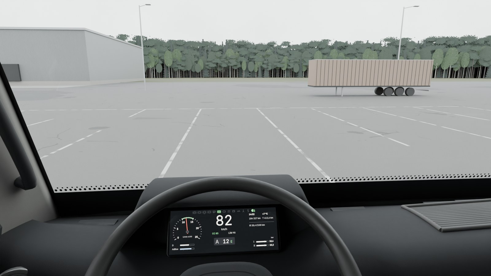 | 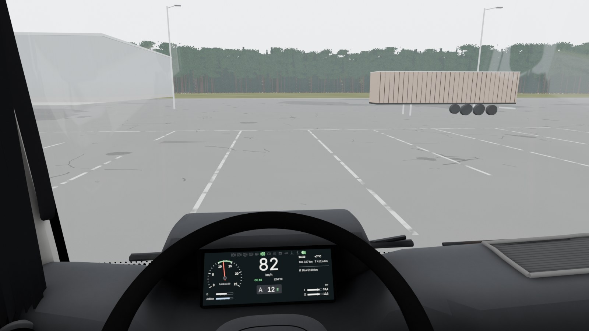 |
| Oczy kierowcy, niskie słońce | 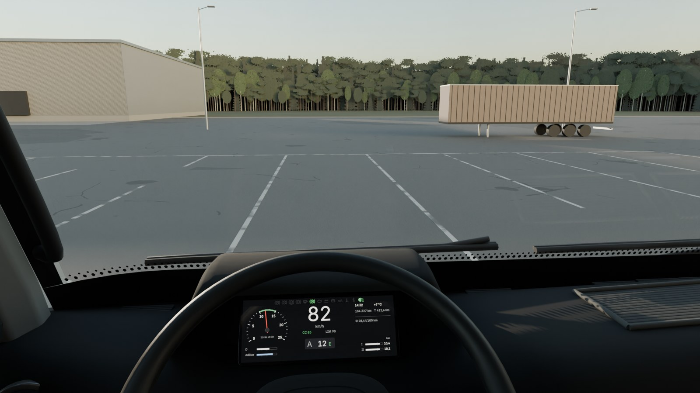 | 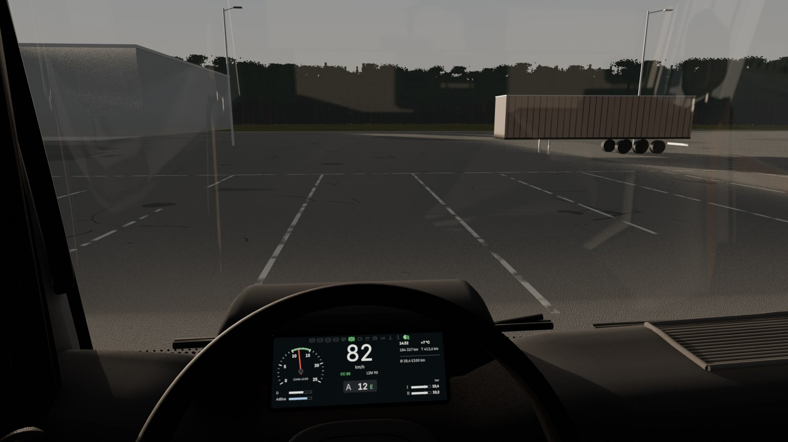 |
| Zegary | 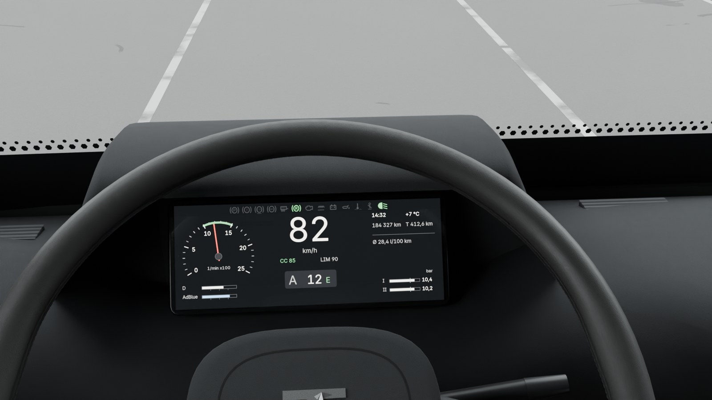 | 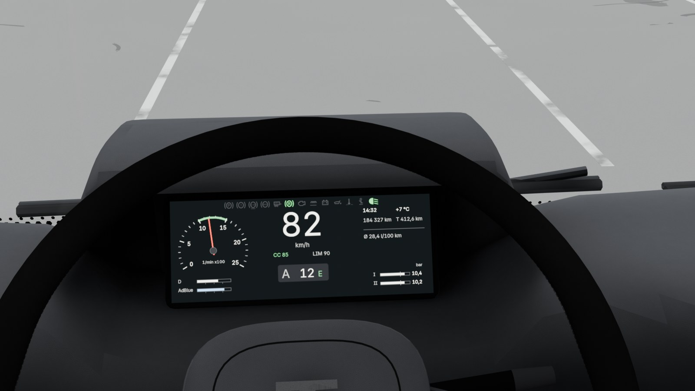 |
| Fotel pasażera, pochmurno | 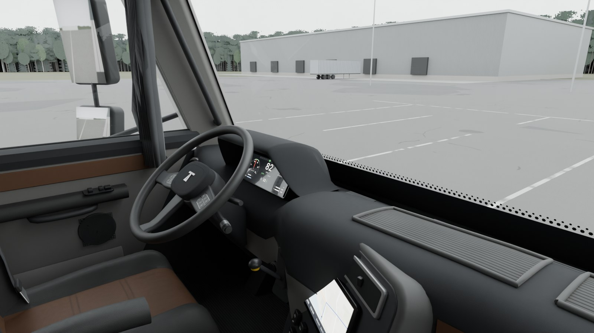 | 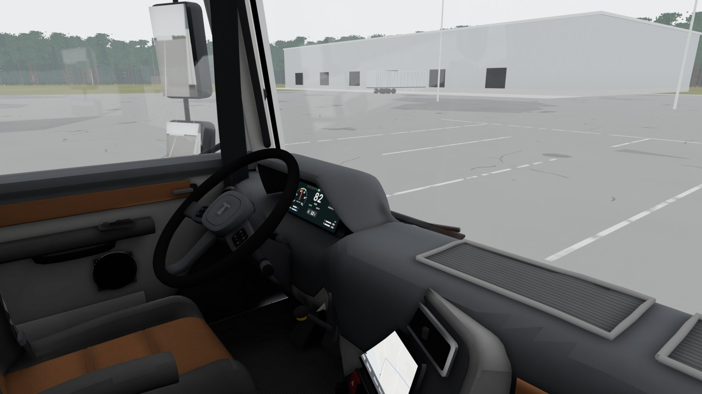 |
| Fotel pasażera, niskie słońce | 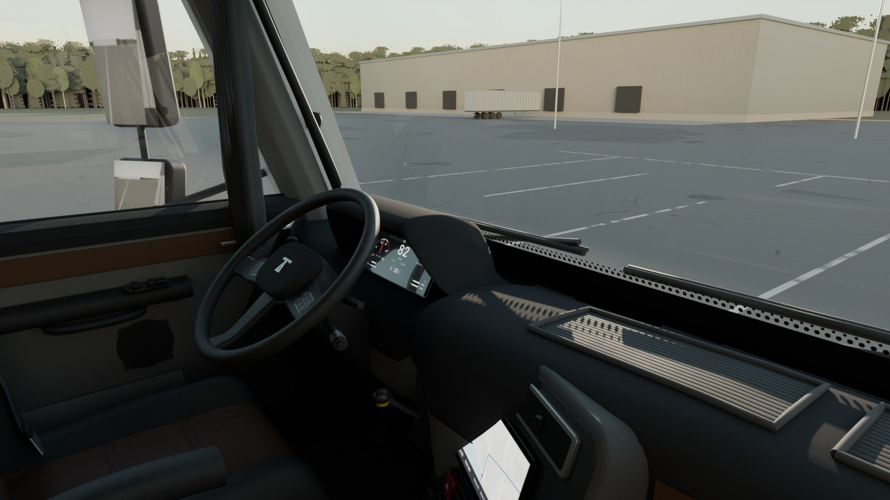 | 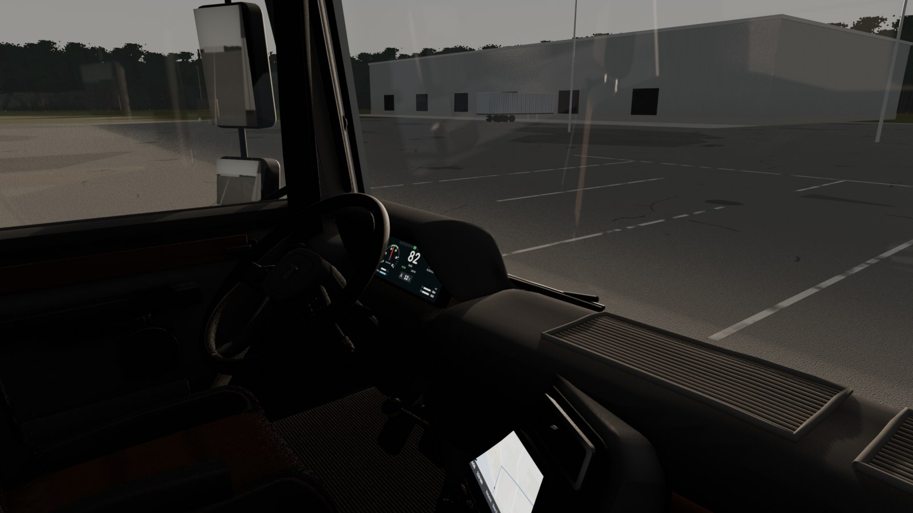 |
| Z leżanki | 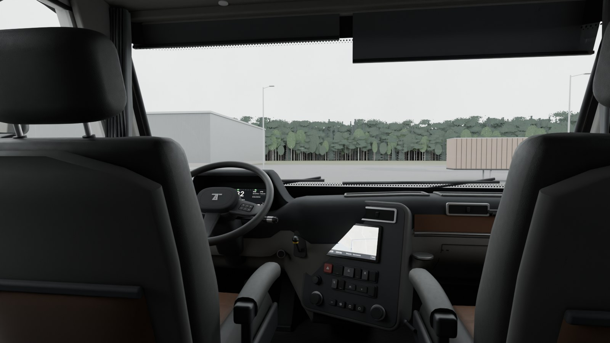 | 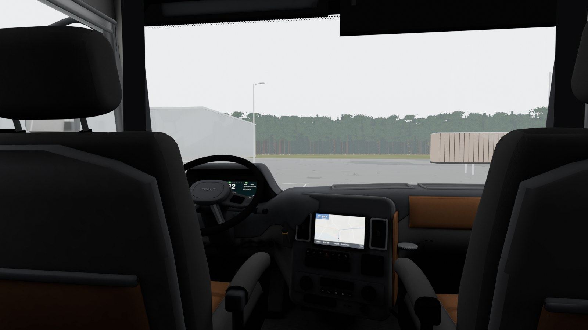 |
| Kierownica | 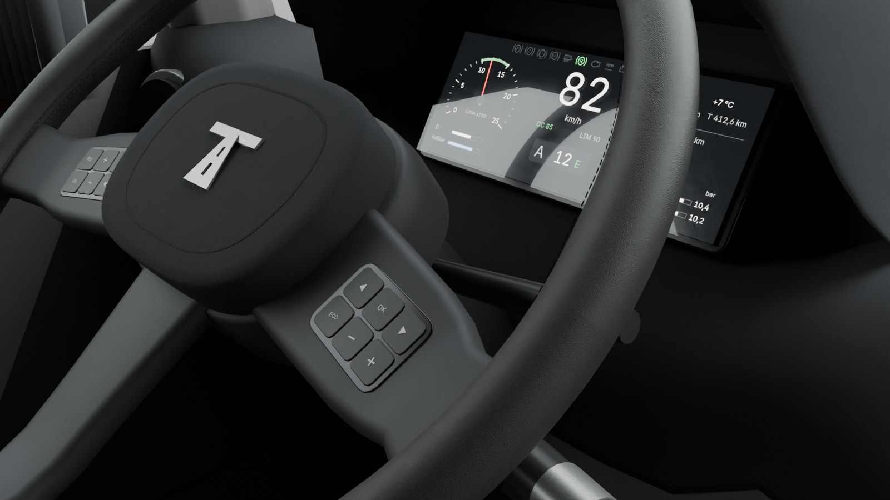 | 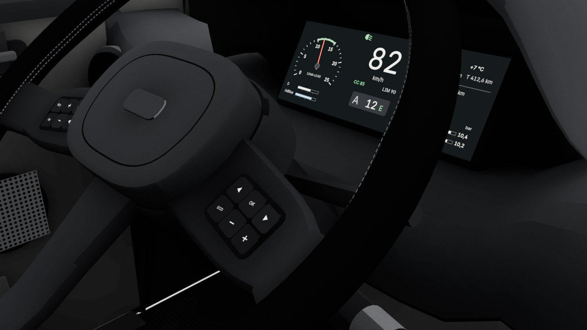 |
| Fotel kierowcy | 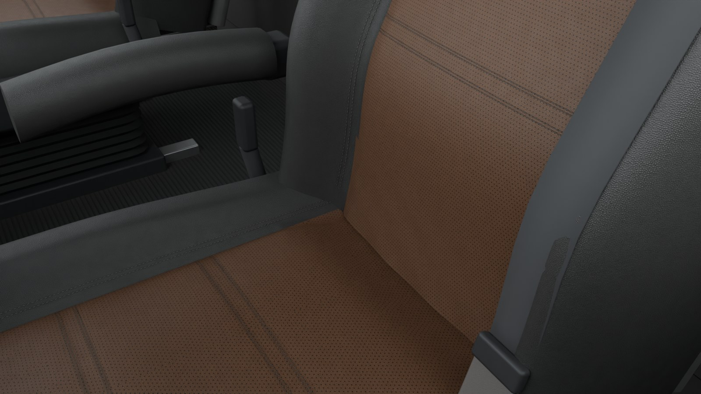 | 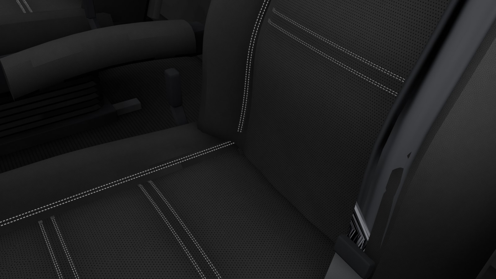 |

Przed i po (A5 → A6): `porownanie_*.jpg`. Cycles obok URP-like: `cycles_vs_urp_*.jpg`. Warianty do Twojej decyzji: `wariant_trim_pasazer.jpg`, `wariant_trim_fotel.jpg`, `wariant_znak_piasta.jpg`. Sama mapa światła otoczenia, bez kolorów: `ao_check_*.jpg`, atlas: `ao_atlas_preview.jpg`.

## Najważniejszy wniosek z renderów URP-like (dla `rendering-perf`)

- **Pochmurny dzień:** w modelu gry wnętrze jest czytelne. Deska, konsola, drzwi i fotele mają rysunek i średnie tony, nie ma czarnej plamy.
- **Niskie słońce (9°, z przodu z boku):** poza miejscami, gdzie wpada słońce, wnętrze robi się prawie czarne (`cycles_vs_urp_pasazer_lowsun.jpg`). Tak wygląda URP bez światła odbitego. Samo rozjaśnienie materiałów tego nie naprawi, bo całe oświetlenie wnętrza pochodzi z nieba. Propozycja do decyzji `rendering-perf`: mapę otoczenia (`T_Cab_AO_*`) traktować jako wypalone światło kabiny i dodać mały, niecieniujący „fill” kabinowy albo własną sondę światła w kabinie, zależną od położenia słońca. Ostateczną odpowiedź da dopiero pierwszy kadr z URP i z telefonu (A7).
- Ważne odkrycie po drodze: zwykłe krótkie AO (0,6 m) w URP daje wnętrze **prześwietlone**, a nie czarne, bo w URP niebo oświetla wnętrze tak, jakby kabina nie miała dachu. Dlatego mapa „AO” w A6 to naprawdę **światło otoczenia kabiny**: Cycles liczy je z równomiernego białego nieba, z odbiciami i z rzeczywistymi kolorami powierzchni. Zawiera i przesłonięcie przez dach, i cienie kontaktowe, i rozjaśnienie od podsufitki. W URP mnoży światło pośrednie (rozproszone i odbicia).

## A6: co jest gotowe do importu (`art-source/truck/interior/export/`)

| | LOD0 (High) | LOD1 (Medium) | LOD2 (Low) |
|---|---|---|---|
| Trójkąty (cel) | **78 381** (≤ 90 tys.) | **37 767** (~40 tys.) | **21 574** (~20 tys.) |
| Przed czyszczeniem | 96 896 | 45 220 | 23 958 |
| Usunięte ukryte ściany | 8 733 | 3 761 | 1 247 |
| Obiekty (≈ wywołania rysowania z podzestawami) | 21 | 21 | 19 |
| Plik | `SM_CabInterior_LOD0.fbx` (8,6 MB, **poza gitem**, generowany) | `…LOD1.fbx` (4,3 MB) | `…LOD2.fbx` (2,4 MB) |

- **LOD-y są odtwarzalne:** ten sam generator z innym zagęszczeniem siatki, plus lista drobiazgów pomijanych w niższych LOD-ach.
- **Ukryte ściany** usuwam ostrożnie. Ścianka znika tylko wtedy, gdy nie widać jej z żadnego z ok. 80 punktów widzenia (głowa kierowcy w zakresie ruchu, pasażer, leżanka, osoba stojąca, podłoga przy pedałach, kamery renderów, kamery zewnętrzne przez szyby) **i** jednocześnie jest czymś zakryta w promieniu 5 cm. Części ruchome nie są czyszczone.
- **Materiały:** 49 materiałów roboczych scaliłem w **5 nieprzezroczystych zestawów** (tworzywo, skóra, tkanina, guma, metal) i **atlas naklejek** (przeszycia, kratki, symbole), czyli 6 atlasów. Do tego szkło, ekrany (obraz z gry) i lusterka (render texture). Różnice między dawnymi materiałami (kolor, chropowatość, zużycie, perforacja, metaliczność) przeszły do danych wierzchołków. Dokładny kontrakt shadera jest w manifeście (`shader_contract`). To przepis na jeden Shader Graph „Kamion/CabInterior” dla agenta Unity.
- **Tekstury w 3 profilach**, kwadraty o bokach będących potęgą dwójki (pod ASTC): High 1024/512, Medium 512/256, Low 256/128. Mapa otoczenia: LOD0 2048, LOD1 1024, LOD2 512 (i mniejsze kopie). Razem ok. 21 MB PNG na dysku. W pamięci GPU po ASTC to ułamek tego.
- **Punkt zaczepienia:** początek kabiny to `CAB_MOUNT_REF`, ten sam punkt co `CabPivot` w obecnej ciężarówce testowej (wysokość dolnej krawędzi kabiny 1,15 m, środek długości kabiny). Wnętrze wstawia się jako dziecko obiektu zawieszenia kabiny, bez przesunięcia.
- **Nazwane obiekty dla gry:** `EYE_POINT` (oczy kierowcy, w Unity (−0,55; 1,35; 0,225) względem zaczepu), `H_POINT`, `WHEEL_CENTRE`. Ruchome części z osiami obrotu: `STEERING_WHEEL` (oś kolumny = lokalne Y), `STALK_Indicator`, `STALK_Retarder`, `STALK_AMT`, `PEDAL_Brake`, `PEDAL_Accel`, `LEVER_ParkBrake`. Ekrany pod obraz z gry: `DISPLAY_Cluster`, `DISPLAY_Infotainment`, `DISPLAY_Tachograph`, `DISPLAY_Radio`, `DISPLAY_BunkPanel`. Lusterka pod render texture: `MIRROR_MainL/R`, `MIRROR_WideL/R`, `MIRROR_Kerb`, `MIRROR_Front`. `CAB_ShellPlaceholder` to tymczasowa karoseria (do wyłączenia po A3).
- **Kontrola eksportu:** `check_export.py` wczytuje FBX z powrotem i porównuje go z manifestem (obiekty, trójkąty, zestawy UV, kolory wierzchołków, materiały, położenia punktów, rozmiary tekstur). Wynik: **CHECK PASS** dla wszystkich LOD-ów.

## Pętla visual QA: iteracje

1. **Iteracja 1** (kierownica i kaptur): test linii wzroku zaliczony, ale klawisze na ramionach wchodziły w piastę, a kaptur zasłaniał rząd kontrolek przy ruchu głowy o 2 cm (test to wyłapał). Poprawiłem spód kaptura i położenie panelu klawiszy.
2. **Iteracja 2** (pierwszy pełny zestaw): zewnętrzna kolumna klawiszy znikała w nachyleniu ramienia; poduszka nadal miękka; kieszeń fotela schowana w skorupie; góra deski beżowa w niskim słońcu; półka pasażera poza kadrem.
3. **Iteracja 3:** ramię płaskie pod panelem, poduszka z ostrą krawędzią, nowe tło. Z diagnozy wyszło, że beżowa deska to nie połysk, tylko zbyt silne słońce względem nieba (ok. 20:1 przy +1,6 EV). Spękania asfaltu wyglądały jak wyschnięte błoto.
4. **Iteracja 4:** zbalansowane niskie słońce, rzadsze i cieńsze spękania, ciemniejszy las. Druga półka na środku deski.
5. **URP-like 1–3:** pierwsza wersja z krótkim AO dała prześwietlone wnętrze (patrz wniosek wyżej), więc zmieniłem wypalanie na światło otoczenia kabiny. Odbicia nieba na ciemnych tworzywach też muszą być przesłonięte, bo URP robi to samo. Na koniec przeszedłem na wierne odtworzenie URP: światło bezpośrednie bez AO, a otoczenie (SH) × mapa.
6. **URP-like 4–7:** ekran zegarów pokazywał teksturę tachografu (błąd nazw, poprawiony). Pas i przeszycia świeciły, bo naklejki brały neutralną wartość mapy; teraz dziedziczą ją z powierzchni pod spodem. Na wieńcu, który się obraca, wypalony wzór obracałby się razem z nim, więc dostaje stałą wartość. Na konsoli brakowało fragmentu płyty, więc usuwanie ukrytych ścian zaostrzyłem do warunku „niewidoczna **i** zakryta”. Metal dostawał „rozproszone” otoczenie i był za jasny, poprawione.

## Znane braki

- **Brak kadru z prawdziwego URP i z telefonu.** Bramka `docs/06` §5 pkt 2 dalej nie jest spełniona; to A7 (Unity i Samsung A).
- Mapa otoczenia: na dużych gładkich panelach (oparcia od tyłu, góra deski przy szybie, siedzisko) widać jeszcze lekkie plamy i szwy między wyspami UV (`ao_check_*.jpg`). Pod ciemnym kolorem prawie ich nie widać, ale do A6.1: osobne, większe wyspy dla dużych paneli i bake w wyższej rozdzielczości dla oparć.
- W URP-like z leżanki górna, zwrócona do nieba powierzchnia konsoli jest jaśniejsza niż w Cycles (otoczenie zależne od kierunku). Do sprawdzenia na pierwszym kadrze URP.
- Niskie słońce w URP: wnętrze bardzo ciemne. To decyzja oświetleniowa (`rendering-perf`), opisana wyżej.
- Wariant koncepcji B (szyba 19°): zegary są widoczne (test PASS), ale słupek A nadal wymaga A3.
- Tło renderów (plac, las, hala) jest własne i służy tylko renderom, nie jest zasobem gry.
- Commit `wip` z przerwania zawiera LOD0 FBX (8,6 MB, LFS). Kolejny commit wyłącza go z gita (jest generowany), ale w historii gałęzi plik zostaje.

## Licencje (do wpisu przez lidera w `docs/LICENSES.md`)
Nowych zasobów zewnętrznych brak. Tło, drzewa i tekstury są generowane skryptem (własne, objęte licencją projektu). Font Inter (OFL 1.1) już jest w `docs/LICENSES.md` (`font-inter`), a jego użycie się nie zmieniło. Proponowany wpis: `truck-interior-a6 | własne, generowane (tools/blender/truck/interior/*.py) | licencja projektu | wnętrze kabiny LOD0–2, tekstury, tło renderów kontrolnych (tylko render)`.

## Pytania do Ciebie
1. Kolor wstawek: grafit, piasek, koniak czy łupek? (`wariant_trim_*.jpg`). Krytyk poleca piasek albo koniak, bo dodają wnętrzu średnich tonów, co pomaga w grze.
2. Czy cyfrowe zegary bez okrągłych tarcz (decyzja wymuszona widocznością) są w porządku?
3. Znak na piaście: TRAKT, BIELIK, NAREW czy bez znaku? (`wariant_znak_piasta.jpg`)

## Jak odtworzyć
```
uv run --no-project --with pillow --with numpy python tools/blender/truck/interior/make_textures.py
blender -b --factory-startup --python tools/blender/truck/interior/build_interior.py -- --out docs/reports/visual/truck-A6 --samples 512 --stats docs/reports/visual/truck-A6/stats.json
blender -b --factory-startup --python-exit-code 1 --python tools/blender/truck/interior/sightline_test.py -- --report docs/reports/visual/truck-A6/sightline.json
blender -b --factory-startup --python tools/blender/truck/exterior/a6_export.py -- --no-renders   # 3b: tylko gdy zmienia się zewnętrze (wycieraczki)
blender -b --factory-startup --python tools/blender/truck/interior/a6_export.py -- --lods 0,1,2 --urp-out docs/reports/visual/truck-A6
blender -b --factory-startup --python-exit-code 1 --python tools/blender/truck/check_fit.py -- --report art-source/truck/exterior/export/fit_check.json
uv run --no-project --with pillow --with numpy python tools/blender/truck/interior/ao_preview.py   # ao_atlas_preview.jpg (czerwone = puste)
# arkusze 3b (r3b_konsola, r3b_zaglowek, r3b_szyba): beforeafter.py z wycinków kadrów r3 i 3b
# arkusze r3: uv run --no-project --with pillow python tools/blender/truck/interior/beforeafter.py OUT.jpg TYTUŁ lewy.jpg etykieta prawy.jpg etykieta
blender -b --factory-startup --python-exit-code 1 --python tools/blender/truck/interior/check_export.py
python tools/blender/truck/interior/variants.py --out docs/reports/visual/truck-A6
```
Czasy (RTX 5070): tekstury ok. 10 s, 8 renderów Cycles 512 spp ok. 2 min, eksport 3 LOD-ów z wypalaniem 4096 spp i 8 renderami URP-like ok. 5 min. Diagnostyka: `a6_export.py … --debug-ao` (sama mapa otoczenia), `--debug-col` (same kolory wierzchołków).
