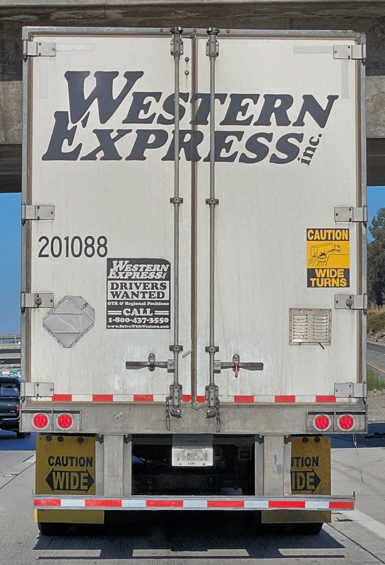
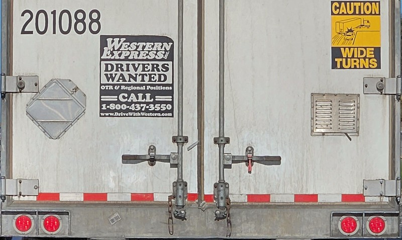

# Eric Polk — obieg 6

Cel: nowe rzeczywiste tyły naczep, z potwierdzonym opisem typu i odróżnialnym lokalnym filmem lub zaciekami. Nie wymagano zabrudzenia całej wysokości. Znane P18-158, Legend i Dot Foods pominięto; nie liczy się pobrania lub wycinka jako nowego zdjęcia.

## Wynik

**1 nowy pozytywny kadr / 1 pojazd** z lokalnym szarym filmem; łącznie obejrzano 3 nowe oryginały i 2 osobne wycinki. 2 kadry odrzucono. Potwierdzone pozytywne zimowe/EU: **0/0**. Akceptacja do ścisłego M61 **PENDING LEADER REVIEW**. Liczniki wynikają z manifest.csv i observation.json, nie stanowią sum całego pakietu.

[Western Express semi-trailer — Eric Polk](https://commons.wikimedia.org/wiki/File:Western_Express_semi-trailer.jpg), **CC BY-SA4.0** ([licencja](https://creativecommons.org/licenses/by-sa/4.0/)): autor wprost opisuje naczepę na I-105 w Downey, California, USA (**SOURCED [ImageDescription Commons]**). **SOURCED [imageinfo] 1522 × 2233 px**, data **SOURCED [Commons] 2023-08-04 17:06:21**. Wysokość samych skrzydeł **ESTIMATED ok.1400–1500 px** (y~150…1590 w oryginale).

Pełny kadr i osobny wycinek dolnej części pokazują cienkie nieregularne szare smugi, plamki i matowy film, najczytelniejsze **ESTIMATED w dolnej1/3** jasnych paneli. Ślady mają przewagę pionową, zmienną długość i niewielkie jasne przerwy; brak ostrej poziomej granicy warstwy. Widać je także między okuciami, a nie wyłącznie jako cień żerdzi. Metalowa belka pod drzwiami ma nieregularny szary film. Napisy są czytelne; to wzorzec lżejszego zabrudzenia niż Flickr4433883530. Pojedyncze rude ślady przy śrubach i zamknięciach odrębne od szarej warstwy, nie należy ich łączyć w mapę brudu. Brak dowodu składu osadu lub zimy (**UNVERIFIED**); brak śniegu w tym kadrze. Przedstawiony kontekst drogowy i opis autora potwierdzają fotografię na trasie, lecz nie dostarczają historii przejazdu ani chwili powstania osadu.

Te dwie pochodne reprezentują **1 fotografię**, nie2. Zmiany: kadrowanie i zmniejszenie; autor Eric Polk; oba pliki CC BY-SA4.0. Maksymalny wymiar≤800px. Generator może wykorzystać rozkład smug, geometrię i warstwę szarości; marek, napisów i cudzych grafik nie odtwarzać.

## Odrzucenia

[Powerloop semi-trailer](https://commons.wikimedia.org/wiki/File:Powerloop_semi-trailer.jpg), Eric Polk, CC BY-SA4.0: **SOURCED [imageinfo] 1620 × 2451 px**. Dwoje jasnych drzwi jest przeważnie jednolite; na dolnych panelach otarcia i resztki oznaczeń. Osobny wycinek pokazuje głównie rude nacieki od krawędzi belki i lamp oraz ogniska korozji. Nie kwalifikowano ich jako szarego osadu drogowego.

[Estes Express Lines semi-trailer](https://commons.wikimedia.org/wiki/File:Estes_Express_Lines_semi-trailer.jpg), Eric Polk, CC BY-SA4.0: **SOURCED [imageinfo] 1341 × 1820 px**. Segmentowa roleta z poziomymi łączeniami i jednym dolnym ryglem — odrzucona po indywidualnym pełnym oglądzie jako brak pary skrzydeł. Nie tworzono zbędnego wycinka.

Pełne metadane wybranych źródeł: selected.json. Oryginały i natywne wycinki wyłącznie w głównym repo `Data/raw/refs/codex-s21/02-brud/creator-round6/`; SHA-256 i ścieżki w manifest.csv. Oryginały pobierano co≥12s, bez429. Repo zawiera miniatury jedynie pozytywnego kadru. Bez edycji ukończonych wcześniejszych zestawów.
