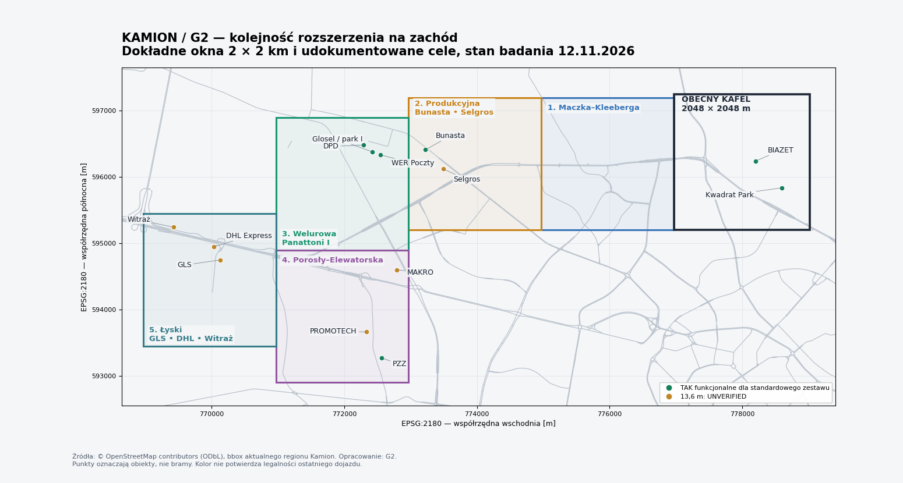

# G2 — next-regions

**Kamion: rzeczywiste cele ruchu ciężarowego w Białymstoku i regionie oraz kolejność rozszerzania mapy.** Stan badania: **12 listopada 2026 r.** Wszystkie materiały opracowano po polsku.

## Rekomendacja

Rozszerzać mapę na zachód w kolejności **Maczka–Kleeberga → Produkcyjna → Welurowa → Porosły–Elewatorska → Łyski**. To pięć stykających się okien po dokładnie 2×2 km. Obejmują **11 celów z katalogu: 5 z oceną TAK funkcjonalne dla standardowego zestawu i 6 z niepotwierdzoną długością 13,6 m**. Pierwsze okno służy połączeniu drogowemu; ma **0 nowych celów** w tej zweryfikowanej bazie. Wyliczenie pochodzi z przecięcia punktów manifestu z granicami G2-T01–G2-T05, a nie z przyjętej z góry oceny atrakcyjności.

Dojlidy/Krywlany są bardzo mocnym następnym skupieniem przemysłu, lecz wymagają doprowadzenia ciągłego korytarza z obecnego kafla. BPN-T nie jest automatycznie centrum dostaw TIR. Liczyć należy konkretne zakłady i ich bramy. [S002](sources.md#s002), [S003](sources.md#s003); [S005](sources.md#s005), [S006](sources.md#s006).

## Cel i zawartość paczki

Zebrano miejsca przydatne do zleceń dostawczych, postojów, tankowania, serwisu oraz modelowania korytarzy kontrolnych i odległych celów trasy. Jest to materiał badawczy do gry w skali 1:1. Sam adres magazynu, tag OSM `industrial` ani symbol ciężarówki nie wystarczały do bezwarunkowego oznaczenia przejazdu 13,6 m.

- **57 rekordów miejsc/obszarów**: 19 przemysłowych i kontekstowych, 15 logistyczno-terminalowych, 20 drogowych/usługowych/granicznych oraz 3 dodatkowe hurtownie/sortownia. Klasyfikacja wynika z prefiksów IC/WL/RS/RT w manifeście.
- Oceny naczepy: **28 TAK**, **1 NIE**, **28 UNVERIFIED**. TAK obejmuje także parkingi i cele regionalne; nie oznacza 28 niezależnych magazynów z gotową trasą.
- **54 miejsca mają WGS84 do 6 miejsc po przecinku; 3 punkty WIM/kontroli nie mają udowodnionego dokładnego położenia. 49 rekordów ma wskazany ID OSM.** Punkt SSSE jest jawnie oszacowaną kotwicą klastra, a nie granicą prawną strefy.
- **81 wierszy manifestu**: 57 miejsc, 9 obrazów, 7 dokumentów, 5 kafli i 3 opracowania pomocnicze. To nie jest liczba miejsc dostaw.
- **216 unikalnych adresów źródeł**, z datą dostępu, autorstwem, warunkami oraz krótkim cytatem albo lokalizatorem.
- **9 kadrów ortofoto GUGiK**, każdy JPG 1600×1600 px, z metadanymi BBOX, datą nalotu, metodą, prawami i SHA256. Są to dowody wizualne i materiały referencyjne, nie gotowe tekstury oznakowanych przedsiębiorstw.

| Element | Zawartość |
|---|---|
| `manifest.csv` | Pełny katalog, adresy, współrzędne, ID OSM, listy ulic od S8, dowody i niepewności każdego pola |
| `sources.md` | Źródła, krótkie cytaty/lokalizatory, prawa i indeks SHA256 wszystkich plików w `files/` |
| `files/G2-A01.jpg`–`G2-A09.jpg` + JSON | Ortofoto przemysłowe i logistyczne, historyczny stan 2025 |
| `files/G2-D01.geojson` + JSON | Wybrane obiekty i drogi OSM; wersje/tagi, źródła pobrania i metadane punktów |
| `files/G2-D02.xlsx` + JSON, `G2-D09.pdf` | Oryginały GPR2025 i wyciąg odpowiednich odcinków |
| `files/G2-D03.xlsx` | Oficjalny wykaz parkingów/MOP, wrzesień 2026 |
| `files/G2-D04.pdf` | Urzędowy PFU systemu preselekcji i ważenia |
| `files/G2-D05.pdf`, `G2-D06.pdf` | Akty ELI dotyczące granic |
| `files/G2-D07.pdf` | Zamówienie Poczty Polskiej potwierdzające WER przy Welurowej 6 |
| `files/G2-T01.geojson`–`G2-T05.geojson` | Dokładne granice proponowanych okien, środek WGS84, lista i licznik celów |
| `files/G2-D08.png`, `G2-Q01.json` | Mapa rekomendacji i pełny raport samokontroli |

## Najważniejsze ustalenia

- **Welurowa daje najbardziej przekonujący zestaw wczesnych zadań logistycznych.** Potwierdzone są DPD przy nr 2, magazyn Glosel z rampami 23–25 przy nr 4 i WER Poczty przy nr 6. Ortofoto pokazuje pełne zestawy. Hala przy nr 4, DPD i WER są trzema celami operacyjnymi w jednym kompleksie; parku nie doliczono jako czwartego celu. [S066](sources.md#s066), [S067](sources.md#s067), G2-A08; [S091](sources.md#s091), [S092](sources.md#s092), G2-A08; [S152](sources.md#s152), [S153](sources.md#s153), G2-A08.
- **Adresy wielu firm wymagają aktualizacji względem dawnych katalogów.** Raben: Żółtki 201. Panattoni III i GEODIS: Żółtki 204. DSV/Schenker: Złotoria 236. BIAWAR: prof. Andrzeja Kalicińskiego 1. SaMASZ: Trawiasta 1, Zabłudów. W katalogu rozdzielono adres biura, zakładu, punkt OSM i bramę. [S079](sources.md#s079), [S080](sources.md#s080), G2-A09; [S074](sources.md#s074), [S075](sources.md#s075); [S086](sources.md#s086), [S087](sources.md#s087); [S028](sources.md#s028), [S029](sources.md#s029); [S041](sources.md#s041), [S042](sources.md#s042).
- **Panattoni III nie powinien być traktowany jako plac budowy na podstawie starej strony oferty.** Komunikat dewelopera z 26.05.2026 potwierdza ukończenie, a Accolade relokację GEODIS. GEODIS jest najemcą tego samego kompleksu; licznik WL05=0 zapobiega podwójnemu naliczeniu obszaru. [S074](sources.md#s074), [S075](sources.md#s075); [S084](sources.md#s084), [S076](sources.md#s076).
- **Istnieje już fizyczny dowód standardowych zestawów w BIAZET, Kwadrat Park, PZZ, browarze, BIAFORM, Rosti i KAN.** Cztery oszacowania rzutu dachu naczepy wyniosły 13,7–13,9 m, heurystycznie ±1 m. To ESTIMATED, bez identyfikacji homologacyjnej pojazdu. Metody, punkty i skala znajdują się w G2-A01–G2-A04 JSON; zdjęcia G2-A05–G2-A07 nie mają niezależnego pomiaru długości.
- **Dojazd ciężarowy na Dojlidy musi uwzględniać zmiany z grudnia 2025.** Tranzyt >3,5 t przeniesiono z odcinka Suchowolca/Dojlidy Fabryczne na Ciołkowskiego–Dywizjonu 303–Kuronia. Fizyczny dowód naczepy w browarze/BIAFORM z kwietnia 2025 poprzedza te zmiany. Lokalny wyjątek dostaw i właściwa brama pozostają UNVERIFIED. [S003](sources.md#s003).
- **S19 nie jest ciągłą obwodnicą Białegostoku.** Otwarcie Krynice–Białystok Zachód 20.10.2026 łączy S19 z S8. Sąsiednie północne odcinki są w budowie, a południowe połączenie Białystok Zachód–Deniski nie jest gotowe. W dojazdach nie narysowano fikcyjnego pełnego pierścienia ekspresowego. [S159](sources.md#s159).
- **Dziesięć opisanych parkingów/MOP ma łącznie 530 stanowisk ciężarowych:** 478 w ośmiu obiektach S8 oraz po 26 w obu Haćkach. To suma wyłącznie wskazanych obiektów, nie liczba wolnych miejsc ani cała pojemność regionu. Jeżewo, Złotoria i Szumowo są w tabeli prywatnymi OOUR, mimo potocznych nazw „MOP”. [S112](sources.md#s112); [S121](sources.md#s121).
- **Kuźnica: NIE dla bieżącego przejazdu towarowego przez granicę.** Bobrowniki obsługują ruch towarowy z ograniczeniami państwa rejestracji. Budzisko pozostaje punktem końcowym S61/A5; jest granicą wewnętrzną UE z czasową kontrolą, a nie zewnętrzną odprawą celną. Wszystkie trzy pozostają wyłącznie celami trasy w projekcie. [S141](sources.md#s141); [S143](sources.md#s143), [S144](sources.md#s144).
- **Dwie wagi WIM i oddzielny plac kontroli mają potwierdzenie dokumentacyjne, ale nie wiarygodny dokładny GPS ani potwierdzenie bieżącej sprawności.** Nie utożsamiono siedziby ITD lub OSKP MPO z rzeczywistym miejscem kontroli drogowej. [S136](sources.md#s136); [S053](sources.md#s053), [S054](sources.md#s054).

## Jak czytać statusy

`status` odnosi się do udokumentowania głównej pozycji: tożsamości/funkcji miejsca lub pochodzenia materiału. Poszczególne pola mają osobne statusy. Dzięki temu potwierdzony adres nie staje się automatycznie potwierdzonym wjazdem.

| Pole / wartość | Znaczenie |
|---|---|
| `SOURCED` | Informacja wprost ze wskazanego źródła; nie gwarancja, że cały teren wygląda identycznie w dniu publikacji gry |
| `ESTIMATED` | Wniosek, pomiar obrazu, centroid albo propozycja autora; metoda podana w kolumnie lub pliku JSON |
| `UNVERIFIED` | Brak dostatecznego potwierdzenia. Nie wolno zamieniać tego na „nie istnieje” albo „wjazd zabroniony” |
| `naczepa_13_6_ok=TAK` | Funkcjonalna realność standardowego zestawu: jawne przeznaczenie dla ciężarówek/pełnych zestawów albo mocny dowód wizualny. Dokładna długość konkretnego pojazdu i obwiednia skrętu nie są automatycznie certyfikowane |
| `naczepa_13_6_ok=NIE` | Potwierdzona przeszkoda dla wskazanej funkcji: w tym katalogu Kuźnica jako przejazd towarowy przez granicę |
| `naczepa_13_6_ok=UNVERIFIED` | Zakład/terminal może istnieć i przyjmować dostawy, ale dowód na standardową naczepę 13,6 m jest za słaby |
| `status_prawnego_wjazdu` | Osobne pole obejmujące ograniczenia drogowe, wyjątki dostaw i regulamin bramy |
| `lat`, `lon` | Punkt obiektu: operatorGPS, centroid OSM albo jawny punkt orientacyjny. Nie używać go automatycznie jako waypointu na bramie |
| `brama_*` | Wydzielone pole bramy, jeśli udało się wskazać ją niezależnie. Rosti ma bramę ESTIMATED; KAN ma bramę OSM, lecz jej funkcja cargo pozostaje UNVERIFIED |

Wynik TAK w browarze i BIAFORM oznacza dowód fizycznego zestawu na terenie zakładu. **Nie oznacza potwierdzenia aktualnego legalnego wjazdu od dowolnej strony.** Podobnie obsługa naczep w serwisie nie daje dowodu parametrów każdego stanowiska ani wymiarów bramy.

## Metoda i dokładność

### Źródła i prawa

Wykorzystano źródła pierwotne: strony operatorów i producentów, dokumenty BIP/ELI/TED, dane GDDKiA, OSM oraz usługi GUGiK WCS/WFS. Wyniki wyszukiwarki służyły odnajdywaniu źródeł; jeśli bezpośredni dostęp nie działał, zaznaczono to w rejestrze. Niektóre strony BIAZET/BIAWAR/SMP/Kwadrat i plik Selgros zwracały przejściowe 502/503/403; nie opisano ich jako bezwarunkowo dostępnych. Próba kontrolna obejmowała świeże otwarcia.

Google Maps, Street View, Earth i 3D Tiles nie były używane do ustaleń ani sprawdzania. Nie korzystano także z Waze. Oferty firmowe i ich zdjęcia bez otwartej licencji pozostają linkami. Jeden odnaleziony załącznik BIP z podkładem satelitarnym o nieustalonej proweniencji został wykluczony z dowodów i paczki. Nie pobierano logo producentów ciężarówek jako zasobów gry.

- **OSM:** ODbL1.0, autorstwo „© OpenStreetMap contributors”. Wyciąg geometrii w paczce zachowuje identyfikatory, wersje, timestamp i tagi. Przy publikacji bazy pochodnej trzeba zachować warunki ODbL; atrybucja producentów danych powinna być widoczna także w odpowiednim miejscu produktu. [S168](sources.md#s168).
- **Ortofoto GUGiK:** oficjalnie dostępne do bezpłatnego pobrania i dowolnego wykorzystania, w tym komercyjnego. To odrębne otwarte dane PZGIK; nie nadano im arbitralnie etykiety CC BY ani art. 4. Podano GUGiK, datę nalotu, datę pobrania i przetworzenie; indywidualny fotograf nie jest wskazany w źródle, więc pozostaje UNVERIFIED. [S155](sources.md#s155); [S156](sources.md#s156).
- **Dokumenty urzędowe:** wykazy i PFU jako materiały urzędowe, art. 4 pkt 2; akty ELI jako akty normatywne, art. 4 pkt 1. Oddzielnych fotografii osób trzecich nie uznano za automatycznie objęte tym wyłączeniem.
- **Gov.pl:** tekst i multimedia mogą mieć różne warunki. Domyślne ograniczenia NC/ND fotografii gov.pl nie zostały przeniesione na urzędowe arkusze/akty; samych fotografii z komunikatów nie dołączono. [S169](sources.md#s169).

### Geometria i data stanu

Dane OSM pobrano z API w wycinkach oraz jako obiekty `way/full` lub `node`. Nominatim służył odnajdywaniu identyfikatorów; ostateczne centroidy liczono z geometrii w EPSG:2180. Punkt dla linii jest środkiem długości, dla zamkniętego obrysu centroidem powierzchni, a dla multipoligonu uwzględniono jego części i otwory. Zapis sześciu miejsc po przecinku jest formatem, nie deklaracją dokładności pomiarowej.

Punkt adresowy może reprezentować biuro zamiast rampy: tak jest w MPO. GPS HoldCargo i Pronar pozostawiono jako orientacyjne punkty operatora, mimo przesunięcia względem budynków OSM. Małe wieloboki nazwane MOP Haćki nie przedstawiają całych parkingów. Wykaz MOP GDDKiA ma pierwszeństwo przy liczbie stanowisk; geometria OSM służy porównaniu położenia.

Kadry GUGiK pobrano przez WCS, jako wycinki i resampling do 1600 px. Daty pochodzą ze skorowidza WFS; zgodność roku bieżącej mozaiki sprawdzono względem archiwalnego WMS. **Osiem kadrów przedstawia 18.04.2025, a kadr Żółtek 25.05.2025.** Data dostępu 2026-11-12 nie jest datą nalotu. Metadane zawierają `akt_data`, `godlo`, `fid`, rozdzielczość źródłową i pełne URL zapytań. Obraz jest widokiem nadir; poziomy azymut patrzenia nie ma zastosowania. Górna krawędź odpowiada północy układu EPSG:2180, nie idealnie północy geograficznej.

Cztery długości rzutu dachu oszacowano z wydzielonej maski jasnego obiektu, jego osi głównej i skali 0,10 m/px. Przyjęto heurystyczny błąd±1 m, obejmujący identyfikację krawędzi, cień i odwzorowanie. Nie wykorzystano silonaczep, wywrotek ani stosów palet jako zamiennika zwykłej naczepy 13,6 m. Pozostałe kadry dają dowód klasy pojazdu, bez liczbowego pomiaru.

### Dojazdy od S8

W `dojazd_od_S8` podano kolejność ulic/ciągów drogowych. Dla części miejskiej sprawdzono ciągłość na danych OSM, kierunki jezdni i wybrane ograniczenia `hgv`, `access`, `maxweight`. Pomocniczy graf preferował drogi wyższych klas. Wynik korygowano dokumentami organizacji ruchu oraz rozróżnieniem adresu i bramy. Ta kontrola nie odtwarza kompletu relacji zakazów skrętów, znaków czasowych, skrajni i wyjątków.

Dlatego trasy mają status **ESTIMATED**. Nieznane końcowe ulice, bramy i skręty nazwano wprost UNVERIFIED. Dla BARTER/ORLEN Sokółka, PERN Narewka i HoldCargo nie dopisano fikcyjnych nazw dróg zakładowych. Dla SMP wskazano połączenie Fieldorfa–Składowa–Magazynowa, ale skrajnia tunelu wymaga osobnego potwierdzenia. Dla Stadler/Hake zachowano informację o lokalnym `maxweight=8` w OSM i nieustalonym wyjątku dostaw.

Dla MOP-ów istotna jest właściwa jezdnia. Podane w tabeli kierunki nie oznaczają przejazdu przez pas rozdziału; zmiana kierunku musi następować na legalnym węźle. Korytarz S8–Podborze–S61 do Budziska jest jednoznacznym połączeniem ekspresowym, bez twierdzenia, że jest najkrótszy z Białegostoku. Odcinki regionalne nadal wymagają osobnego rozpoznania przed budową pełnej trasy.

## Ruch: podstawa kolejności rozbudowy

Poniższe wartości to **SDRR 2025**, pojazdy na dobę w średniej rocznej. Kategoria „ciężarowe z przyczepami” obejmuje również ciągniki z naczepami; nie jest licznikiem wyłącznie naczep 13,6 m. Wartości odnoszą się do wskazanych odcinków GDDKiA, nie do każdego skrzyżowania Kleeberga/Maczka. [S166](sources.md#s166).

| Odcinek / nr GPR | Ogółem / dobę | Ciężarowe z przyczepami/naczepami / dobę | Lokalizator |
|---|---:|---:|---|
| W. TYKOCIN - W. CHOROSZCZ — 50327 | 22 656 | 1 963 | Tab02  wiersz 608 |
| W. CHOROSZCZ - W. POROSŁY /DW676/ — 50302 | 29 483 | 2 041 | Tab02  wiersz 609 |
| W. POROSŁY /DW676/ - BIAŁYSTOK /GR. MIASTA/ — 50303 | 23 732 | 1 542 | Tab02  wiersz 610 |
| BIAŁYSTOK /GR. MIASTA/ - W. JUROWCE /DP 1393B/ — 50317 | 24 401 | 1 968 | Tab02  wiersz 611 |
| W. WASILKÓW - W. BIAŁYSTOK PŁN. /DK8/ — 50311 | 9 772 | 1 171 | Tab02  wiersz 1012 |
| BIAŁYSTOK /GR. MIASTA/ - PROTASY /DP1469B/ — 50318 | 13 309 | 999 | Tab02  wiersz 1013 |
| BIAŁYSTOK /GR. MIASTA/ - ZAŚCIANKI /SZOSA BARANOWICKA/ — 50330 | 16 572 | 443 | Tab02  wiersz 1878 |
| W. SZYPLISZKI /DW662/ - BUDZISKO /GR. PAŃSTWA/ — 50618 | 10 579 | 5 151 | Tab02  wiersz 1786 |

Wyniki 2025 nie obejmują pełnego efektu otwarcia S19 Krynice–Białystok Zachód w październiku 2026. Tabela odcinka Choroszcz–Porosły sama wskazuje budowę węzła i zmiany organizacji ruchu. Ruch przy Bobrownikach w 2025 był dodatkowo obciążony długim zamknięciem granicy; jego niskiej wartości nie użyto do opisania aktualnego popytu na przewozy. GPR uzasadnia wagę korytarzy, a rzeczywiste zlecenia wynikają z osobnych dowodów działalności zakładów. [S166](sources.md#s166); [S159](sources.md#s159); [S141](sources.md#s141).

## Pięć następnych kafli 2×2 km

### Punkt odniesienia

Pobrana konfiguracja robocza `bialystok-industrial-c/region.yaml` ma bbox EPSG:2180 **[776971,595199,779019,597247]**, czyli **2048×2048 m**, i środek **53.158550N,23.159877E**. Podany w zleceniu punkt około 53.152N,23.168E mieści się w tym obszarze. Kafle badawcze poniżej mają dokładnie 2000×2000 m zgodnie z zadaniem. Nie są gotową migracją siatki silnika ani decyzją o zastąpieniu istniejącej konfiguracji. [S164](sources.md#s164).

| Kolejność | Obszar | Środek WGS84 (lat, lon) | Cele katalogowe | Z tego TAK | Dlaczego teraz |
|---|---|---|---:|---:|---|
| 1 — G2-T01 | Maczka–Kleeberga | 53.159388, 23.129655 | 0 | 0 | Zapewnia ciągłość od Putry/Andersa do zachodniego wlotu; wyraźny układ jezdni Maczka/Kleeberga. Cel drogowy bez dopisywania magazynów. |
| 2 — G2-T02 | Produkcyjna–Bunasta–Selgros | 53.160421, 23.099811 | 2 | 1 | Parking Bunasta i hurtownia Selgros; rejon Produkcyjnej i dostęp do Aksamitnej. Łączy obsługę kierowcy z dostawami. |
| 3 — G2-T03 | Welurowa–Panattoni I | 53.158755, 23.069710 | 3 | 3 | Trzy udokumentowane cele operacyjne na Welurowej, doki i place standardowych zestawów; największa wartość krótkoterminowa dla zadań. |
| 4 — G2-T04 | Porosły–Elewatorska | 53.140817, 23.068012 | 3 | 1 | Wlot Porosły i Elewatorska: PZZ, PROMOTECH, MAKRO. Rozpoznawalny układ drogi ekspresowej i zakładów, zróżnicowane ładunki. |
| 5 — G2-T05 | Łyski–Warszawska–Ekranowa | 53.146767, 23.038642 | 3 | 0 | GLS, DHL Express i Witraż przy zachodnim wyjeździe. Naturalny kierunek dalszej rozbudowy ku Choroszczy i Żółtkom. |

Liczby celów są wynikiem geometrycznego filtrowania katalogu, a ocena kolejności jest rekomendacją autora (ESTIMATED). Dowody każdego celu są w odpowiednich rekordach IC/WL/RS/RT. Rozpoznawalność oznacza ocenę charakterystyczności układu dla mapy, bez deklarowania wyników badań użytkowników.

| Kafel | BBOX EPSG:2180: xmin, ymin, xmax, ymax [m] | Połączenie z wcześniejszym obszarem |
|---|---|---|
| G2-T01 | 774971, 595199, 776971, 597199 | wspólna zachodnia/wschodnia krawędź z obecnym kaflem, odcinek 2000 m |
| G2-T02 | 772971, 595199, 774971, 597199 | wspólna krawędź z T01, odcinek 2000 m |
| G2-T03 | 770971, 594899, 772971, 596899 | wspólna krawędź z T02, odcinek 1700 m; przesunięcie 300 m na południe |
| G2-T04 | 770971, 592899, 772971, 594899 | wspólna krawędź z T03, odcinek 2000 m |
| G2-T05 | 768971, 593449, 770971, 595449 | wspólna krawędź z T04, odcinek 1450 m; przesunięcie 550 m na północ |

Kwadraty są metrycznymi oknami badawczymi ze wspólnymi krawędziami, a nie jedną sztywną, równo przesuniętą siatką. Tak dobrano zasięgi, by całe wybrane geometrie OSM PZZ, Witrażu i terminali mieściły się w swoich oknach. Nie oznacza to potwierdzenia kompletności każdego ogrodzenia, placu i drogi prywatnej; OSM często zawiera tylko budynek.

**Przy budżecie na trzy kafle wybrałbym T01–T03.** Daje to ciągły dojazd do pięciu nowych punktów katalogu, w tym czterech z TAK funkcjonalnym, i łączy je z BIAZET/Kwadratem w obecnym obszarze. T04 dodaje przemysł Elewatorskiej, T05 kieruje rozbudowę ku kolejnym terminalom. To kolejność dostarczania gry, nie ranking wielkości firm.

### Następne kierunki po tej piątce

- **Choroszcz–Żółtki:** Panattoni II/III, Raben, GEODIS i dalej DSV Złotoria. Wymaga ciągłego korytarza S8/dróg obsługowych; nie jest jednym kaflem przyległym do obecnego Putry. [S071](sources.md#s071), [S072](sources.md#s072); [S074](sources.md#s074), [S075](sources.md#s075); [S079](sources.md#s079), [S080](sources.md#s080), G2-A09; [S086](sources.md#s086), [S087](sources.md#s087).
- **Dojlidy/Krywlany:** BISON, Rosti, KAN, Masterpress i nowy BIAWAR; dodatkowo browar, BIAFORM, Stadler i rejon BPN-T. Najpierw doprowadzić odpowiedni korytarz miejski i rozstrzygnąć lokalne zakazy. [S015](sources.md#s015), [S003](sources.md#s003); [S017](sources.md#s017), [S003](sources.md#s003), G2-A06; [S021](sources.md#s021), [S003](sources.md#s003), G2-A07; [S025](sources.md#s025), [S026](sources.md#s026); [S028](sources.md#s028), [S029](sources.md#s029).
- **Zaścianki–Kuriany–Zabłudów:** Adampol, PLUS, Hanbud i SaMASZ; ładunki i obsługa zestawów innego typu niż sortownie. [S097](sources.md#s097), [S098](sources.md#s098); [S128](sources.md#s128), [S129](sources.md#s129); [S056](sources.md#s056), [S003](sources.md#s003); [S041](sources.md#s041), [S042](sources.md#s042).
- **Podlasie:** Wasilków, Sokółka/Buchwałowo, Narewka, Haćki i cele graniczne. Bazy paliw i LPG są celami wyspecjalizowanego przewozu, a ich funkcja nie uzasadnia automatycznie zleceń zwykłą kurtyną. [S099](sources.md#s099), [S100](sources.md#s100); [S102](sources.md#s102), [S103](sources.md#s103); [S104](sources.md#s104), [S105](sources.md#s105); [S121](sources.md#s121), [S122](sources.md#s122).

## Katalog miejsc — indeks do manifestu

Poniższe tabele ułatwiają przegląd. **Pełna lista ulic dojazdu, dowód, identyfikator OSM i status każdego pola znajdują się w `manifest.csv`.** W tabelach punkt oznacza obiekt, nie bramę. WGS84 zapisano jako lat,lon. Źródła w ostatniej kolumnie odsyłają do rejestru; obraz dowodowy ma identyfikator A.

### Przemysł i obszary gospodarcze

| ID | Nazwa / adres | WGS84 | 13,6 m | Źródła |
|---|---|---|---|---|
| G2-IC01 | Podstrefa Białystok SSSE — Dojlidy/Krywlany — Białystok, obręby Dojlidy i Krywlany; rejon Kuronia, Myśliwskiej, Karpińskiego i Dywizjonu 303 | 53.104576, 23.194805 | UNVERIFIED | [S002](sources.md#s002), [S003](sources.md#s003) |
| G2-IC02 | Białostocki Park Naukowo-Technologiczny — ul. Żurawia 71, 15-540 Białystok | 53.106875, 23.193276 | UNVERIFIED | [S005](sources.md#s005), [S006](sources.md#s006) |
| G2-IC03 | BIAZET — zakład i magazyn — ul. gen. Władysława Andersa 44, 15-113 Białystok | 53.158612, 23.162973 | TAK | [S008](sources.md#s008), [S009](sources.md#s009), G2-A01 |
| G2-IC04 | AC S.A. — zakład i magazyn dostaw — ul. 42 Pułku Piechoty 50, 15-181 Białystok | 53.141813, 23.214432 | UNVERIFIED | [S013](sources.md#s013), [S014](sources.md#s014) |
| G2-IC05 | BISON — główny zakład, magazyn stali i wyrobów — ul. Myśliwska 13, 15-569 Białystok | 53.103519, 23.197552 | UNVERIFIED | [S015](sources.md#s015), [S003](sources.md#s003) |
| G2-IC06 | Rosti Poland — fabryka i centrum logistyczne Białystok — ul. Myśliwska 18, 15-569 Białystok | 53.103746, 23.193953 | TAK | [S017](sources.md#s017), [S003](sources.md#s003), G2-A06 |
| G2-IC07 | KAN — Centrum Logistyczno-Produkcyjne — ul. Karpińskiego 5, 15-569 Białystok | 53.104351, 23.190790 | TAK | [S021](sources.md#s021), [S003](sources.md#s003), G2-A07 |
| G2-IC08 | Masterpress — zakład opakowań i etykiet — ul. Jacka Kuronia 4, 15-569 Białystok | 53.105610, 23.191145 | UNVERIFIED | [S025](sources.md#s025), [S026](sources.md#s026) |
| G2-IC09 | NIBE-BIAWAR / BIAWAR Produkcja — nowy kompleks — ul. prof. Andrzeja Kalicińskiego 1, 15-569 Białystok | 53.103354, 23.202113 | UNVERIFIED | [S028](sources.md#s028), [S029](sources.md#s029) |
| G2-IC10 | BIAFORM — Zakłady Przemysłu Sklejek — ul. Dojlidy Fabryczne 24, 15-566 Białystok | 53.113602, 23.201396 | TAK | [S031](sources.md#s031), [S032](sources.md#s032), G2-A05 |
| G2-IC11 | Browar Dojlidy i Centrum Dystrybucji Kompanii Piwowarskiej — ul. Dojlidy Fabryczne 28, 15-555 Białystok | 53.106159, 23.203709 | TAK | [S036](sources.md#s036), [S037](sources.md#s037), G2-A04 |
| G2-IC12 | SaMASZ — fabryka Zabłudów — ul. Trawiasta 1, 16-060 Zabłudów | 53.030402, 23.325591 | UNVERIFIED | [S041](sources.md#s041), [S042](sources.md#s042) |
| G2-IC13 | SMP Poland — zakład Białystok — ul. Magazynowa 2, 15-399 Białystok | 53.115047, 23.125031 | UNVERIFIED | [S044](sources.md#s044), [S045](sources.md#s045) |
| G2-IC14 | PROMOTECH — zakład produkcyjny — ul. Elewatorska 23/1, 15-620 Białystok | 53.138518, 23.073250 | UNVERIFIED | [S047](sources.md#s047), [S048](sources.md#s048) |
| G2-IC15 | Podlaskie Zakłady Zbożowe — magazyn/skup Białystok — ul. Elewatorska 14, 15-959 Białystok | 53.134862, 23.076336 | TAK | [S049](sources.md#s049), [S050](sources.md#s050), G2-A03 |
| G2-IC16 | MPO — baza i Okręgowa Stacja Kontroli Pojazdów — ul. 42 Pułku Piechoty 48, 15-950 Białystok | 53.142204, 23.211142 | UNVERIFIED | [S053](sources.md#s053), [S054](sources.md#s054) |
| G2-IC17 | Hanbud — oddział Kuriany — Szosa Zabłudowska 104, 15-588 Kuriany | 53.088382, 23.248777 | UNVERIFIED | [S056](sources.md#s056), [S003](sources.md#s003) |
| G2-IC18 | Stadler Converter — zakład przetwornic — ul. płk. Czesława Hake 11, 15-257 Białystok | 53.105604, 23.168921 | UNVERIFIED | [S058](sources.md#s058), [S059](sources.md#s059) |
| G2-IC19 | Kwadrat Park — Andersa 38 — ul. gen. Władysława Andersa 38, 15-113 Białystok | 53.154773, 23.168501 | TAK | [S061](sources.md#s061), [S062](sources.md#s062), G2-A02 |

### Logistyka, magazyny, bazy i terminale

| ID | Nazwa / adres | WGS84 | 13,6 m | Źródła |
|---|---|---|---|---|
| G2-WL01 | Panattoni / Accolade I — hala Welurowa 4, m.in. magazyn Glosel — ul. Welurowa 4, 15-680 Białystok (adres operacyjny magazynu Glosel); pozostałe budynki kompleksu osobno w OSM | 53.162848, 23.076804 | TAK | [S066](sources.md#s066), [S067](sources.md#s067), G2-A08 |
| G2-WL02 | Panattoni / Accolade Park Białystok II — Żółtki-Kolonia 38 a, 16-070 Choroszcz (adres magazynu 2 Agata w parku) | 53.164782, 22.996301 | UNVERIFIED | [S071](sources.md#s071), [S072](sources.md#s072) |
| G2-WL03 | Panattoni / Accolade Park Białystok III — Żółtki 204, 16-070 Choroszcz | 53.164932, 22.991286 | UNVERIFIED | [S074](sources.md#s074), [S075](sources.md#s075) |
| G2-WL04 | Raben Logistics Polska — oddział Białystok w Żółtkach — Żółtki 201, 16-070 Żółtki / Białystok | 53.162044, 22.994931 | TAK | [S079](sources.md#s079), [S080](sources.md#s080), G2-A09 |
| G2-WL05 | GEODIS Road Network — oddział Białystok — Żółtki 204, 16-070 Choroszcz | 53.164974, 22.991138 | UNVERIFIED | [S084](sources.md#s084), [S076](sources.md#s076) |
| G2-WL06 | DSV — terminal Białystok w Złotorii (dawniej Schenker) — Złotoria 236, 16-070 Choroszcz | 53.162824, 22.930428 | UNVERIFIED | [S086](sources.md#s086), [S087](sources.md#s087) |
| G2-WL07 | DPD Polska — placówka BIA — ul. Welurowa 2, 15-680 Białystok | 53.163814, 23.074930 | TAK | [S091](sources.md#s091), [S092](sources.md#s092), G2-A08 |
| G2-WL08 | GLS — filia 15 Białystok w Łyskach — ul. Kwiatowa 1, Łyski, 16-070 Choroszcz | 53.149376, 23.041274 | UNVERIFIED | [S093](sources.md#s093), [S094](sources.md#s094) |
| G2-WL09 | DHL Express — Service Center Łyski — ul. Ekranowa 1, 16-070 Łyski | 53.151200, 23.039991 | UNVERIFIED | [S095](sources.md#s095), [S096](sources.md#s096) |
| G2-WL10 | Adampol — baza i serwis kompletnych zestawów Zaścianki — ul. Usługowa 3, 15-521 Zaścianki k. Białegostoku | 53.124387, 23.248421 | TAK | [S097](sources.md#s097), [S098](sources.md#s098) |
| G2-WL11 | BARTER — Terminal Przeładunkowy Sokółka — os. Buchwałowo 2, 16-100 Sokółka | 53.409896, 23.536062 | UNVERIFIED | [S099](sources.md#s099), [S100](sources.md#s100) |
| G2-WL12 | ORLEN Paliwa — Terminal Gazu Płynnego Sokółka — os. Buchwałowo 1, 16-100 Sokółka | 53.421509, 23.548528 | UNVERIFIED | [S102](sources.md#s102), [S103](sources.md#s103) |
| G2-WL13 | PERN — Baza Paliw nr 15 Narewka — Baza Paliw nr 15, 17-220 Narewka; brak ulicy/numeru w tabeli operatora | 52.842943, 23.722654 | UNVERIFIED | [S104](sources.md#s104), [S105](sources.md#s105) |
| G2-WL14 | HoldCargo — magazyn Wasilków — ul. Supraślska 16A, 16-010 Wasilków (w treści artykułu także literówka „Supraska”) | 53.203328, 23.218137 | UNVERIFIED | [S106](sources.md#s106), [S107](sources.md#s107) |
| G2-WL15 | Witraż — zakład i magazyny Łyski — Łyski, ul. Warszawska 68, 16-070 Choroszcz | 53.154168, 23.031215 | UNVERIFIED | [S110](sources.md#s110), [S111](sources.md#s111) |

### Parkingi, MOP, paliwa, kontrola i granice

| ID | Nazwa / adres | WGS84 | 13,6 m | Źródła |
|---|---|---|---|---|
| G2-RS01 | Złotoria — prywatny parking przy S8 / OOUR — Złotoria, S8 km 631+150, kierunek Warszawa | 53.164913, 22.935965 | TAK | [S112](sources.md#s112), [S113](sources.md#s113) |
| G2-RS02 | Jeżewo — prywatny parking przy S8 / OOUR — Jeżewo, S8 km 618+260, kierunek Białystok | 53.135688, 22.750355 | TAK | [S112](sources.md#s112), [S113](sources.md#s113) |
| G2-RS03 | MOP Cibory Południe — Cibory, S8, kierunek Białystok; lokalny pikietaż arkusza 8n: 21+000 | 53.109715, 22.587884 | TAK | [S112](sources.md#s112), [S113](sources.md#s113) |
| G2-RS04 | MOP Cibory Północ — Cibory, S8, kierunek Warszawa; lokalny pikietaż arkusza 8n: 21+150 | 53.110246, 22.586114 | TAK | [S112](sources.md#s112), [S113](sources.md#s113) |
| G2-RS05 | MOP Kossaki — Kossaki-Borowe, S8, kierunek Białystok; lokalny pikietaż arkusza 8n: 6+680 | 53.058224, 22.398749 | TAK | [S112](sources.md#s112), [S113](sources.md#s113) |
| G2-RS06 | MOP Kołaki — Gosie Małe, S8, kierunek Warszawa; lokalny pikietaż arkusza 8n: 3+480 | 53.039390, 22.355731 | TAK | [S112](sources.md#s112), [S113](sources.md#s113) |
| G2-RS07 | MOP Ostrożne — Ostrożne, S8 km 573+000, kierunek Białystok | 52.947615, 22.167657 | TAK | [S112](sources.md#s112), [S113](sources.md#s113) |
| G2-RS08 | Szumowo — prywatny parking przy S8 / OOUR — Szumowo, S8 km 566+460, kierunek Warszawa | 52.908332, 22.093181 | TAK | [S112](sources.md#s112), [S113](sources.md#s113) |
| G2-RS09 | MOP Haćki Zachód — Haćki, S19 Deniski–Haćki, km projektowy ok. 4+700; kierunek Bielsk Podlaski | 52.843206, 23.171417 | TAK | [S121](sources.md#s121), [S122](sources.md#s122) |
| G2-RS10 | MOP Haćki Wschód — Haćki, S19 Deniski–Haćki, km projektowy ok. 4+700; kierunek Białystok | 52.843532, 23.174853 | TAK | [S121](sources.md#s121), [S122](sources.md#s122) |
| G2-RS11 | Bunasta — parking TIR — ul. Produkcyjna 105A, 15-680 Białystok | 53.162700, 23.088856 | TAK | [S126](sources.md#s126), [S127](sources.md#s127) |
| G2-RS12 | PLUS — stacja paliw i parking TIR Zaścianki — ul. Szosa Baranowicka 58, 15-521 Białystok–Zaścianki | 53.125340, 23.240154 | TAK | [S128](sources.md#s128), [S129](sources.md#s129) |
| G2-RS13 | Shell WIMEX Białystok — stacja dla TIR — ul. gen. Stanisława Sosabowskiego 25, 15-182 Białystok | 53.142696, 23.194939 | TAK | [S131](sources.md#s131), [S132](sources.md#s132) |
| G2-RS14 | Pronar Wasilków — stacja i parking zalecany kierowcom ciężarówek — ul. ks. W. Rabczyńskiego 1, 16-010 Wasilków | 53.221481, 23.219063 | TAK | [S106](sources.md#s106), [S133](sources.md#s133) |
| G2-RS15 | Waga preselekcyjna WIM — al. 1000-lecia Państwa Polskiego — al. 1000-lecia Państwa Polskiego, wlot od Jurowiec do Białegostoku; historyczny ciąg DK8 | UNVERIFIED | UNVERIFIED | [S136](sources.md#s136), [S137](sources.md#s137) |
| G2-RS16 | Waga preselekcyjna WIM — ul. Zabłudowska — ul. Zabłudowska, DK19, wlot od Zabłudowa w kierunku Białegostoku | UNVERIFIED | UNVERIFIED | [S136](sources.md#s136), [S137](sources.md#s137) |
| G2-RS17 | Stały punkt kontroli i administracyjnego ważenia — ciąg DK19/Zabłudowska — istniejący parking przy DK19 w ciągu ul. Zabłudowskiej, Białystok; numer posesji UNVERIFIED | UNVERIFIED | UNVERIFIED | [S136](sources.md#s136), [S137](sources.md#s137) |
| G2-RS18 | Kuźnica Białostocka–Bruzgi — wyłącznie cel geograficzny trasy — ul. Graniczna 1, 16-123 Kuźnica | 53.521150, 23.659573 | NIE | [S138](sources.md#s138), [S139](sources.md#s139) |
| G2-RS19 | Bobrowniki–Bierestowica — cel trasy ciężarowej — Bobrowniki, gmina Gródek, koniec polskiej DK65; karta SG: 16-040 Bobrowniki | 53.123998, 23.890564 | TAK | [S141](sources.md#s141), [S139](sources.md#s139) |
| G2-RS20 | Budzisko–Kalvarija — cel trasy S61 — S61 / A5, granica Polski i Litwy, rejon Budziska–Podwojponia | 54.308895, 23.120786 | TAK | [S143](sources.md#s143), [S144](sources.md#s144) |

### Dodatkowe hurtownie i sortownia

| ID | Nazwa / adres | WGS84 | 13,6 m | Źródła |
|---|---|---|---|---|
| G2-RT01 | MAKRO — hala hurtowa Białystok — al. Jana Pawła II 92, 15-704 Białystok | 53.146685, 23.080887 | UNVERIFIED | [S146](sources.md#s146), [S147](sources.md#s147) |
| G2-RT02 | Selgros — hala hurtowa Białystok — ul. Produkcyjna 99, 15-680 Białystok | 53.159972, 23.092597 | UNVERIFIED | [S149](sources.md#s149), [S150](sources.md#s150) |
| G2-RT03 | Poczta Polska — WER Białystok, Welurowa — ul. Welurowa 6, 15-900 Białystok | 53.162368, 23.078646 | TAK | [S152](sources.md#s152), [S153](sources.md#s153), G2-A08 |

## Braki i niepewności wymagające rozstrzygnięcia

1. **Dokładne bramy i legalność dojazdu:** nie ma kompletu pomiarów obwiedni dla wszystkich miejsc. W większości rekordów współrzędne nie mogą być użyte wprost jako punkt docelowy na bramie. Pierwsze prace terenowe powinny objąć Selgros/MAKRO, GLS/DHL/Witraż oraz dojazdy do BIAFORM, browaru, Stadler i SMP.
2. **Trzy punkty WIM/kontroli:** PFU potwierdza nazwę korytarza i urządzenia, ale nie rozstrzyga wiarygodnego dokładnego GPS ani stanu pracy. Nie wyznaczono punktu na podstawie niedozwolonego lub nieustalonego podkładu. Zachowano UNVERIFIED zamiast środka ulicy udającego lokalizację wagi. [S136](sources.md#s136).
3. **Dokładnie 13,6 m:** obecność standardowego zestawu jest mocnym dowodem funkcjonalnym, ale samo ortofoto nie ujawnia dowodu rejestracyjnego naczepy. Dla oceny mechaniki skrętu gry potrzebny jest osobny model zestawu i geometrii placu. W pakiecie nie ma symulacji obwiedni.
4. **Historyczność obrazów:** kadry 2025 dowodzą, że pojazdy fizycznie korzystały z miejsca. Nie dowodzą, że każdy wjazd i znak w 2026 jest taki sam. Szczególnie istotne są zmiany na Dojlidach.
5. **Raben:** prawidłowy adres jest potwierdzony przez operatora, natomiast dopasowanie konkretnej hali do zdjęć inwestora i OSM opisano jako ESTIMATED. Napisy BORK na naczepach nie zostały uznane za dowód innego operatora budynku. [S079](sources.md#s079), [S080](sources.md#s080), G2-A09.
6. **Granice i nowe drogi:** stan prawny i operacyjny jest datowany. Przed zamrożeniem świata gry trzeba ponownie sprawdzić komunikaty SG/GDDKiA; nie przenosić bez daty ani zamknięcia Kuźnicy dla towarów, ani tymczasowej kontroli Budziska do świata fikcyjnie „zawsze aktualnego”. [S141](sources.md#s141); [S159](sources.md#s159).
7. **Niekompletność katalogu:**57 pozycji jest sprawdzonym wyborem badawczym, a nie spisem wszystkich przedsiębiorstw, parkingów i punktów kontroli w województwie. Formalne MOP-y odróżniono od prywatnych OOUR i stacji przy DK19/DK65.

## Wynik samokontroli

Losowanie wykonano z ziarnem **20261112**. Zastosowano losowanie warstwowe, by poza miejscami skontrolować także obrazy, dokumenty i propozycje kafli: **18 z 81 pozycji =22,22%**, czyli więcej niż wymagane 20%. Z pełnego katalogu miejsc sprawdzono **12 z 57 =21,05%**. Lista populacji, algorytm, wylosowane identyfikatory, daty/HTTP, sprawdzenie praw, geometrii i korekty są w `files/G2-Q01.json`.

| Warstwa | Populacja | Losowo sprawdzone | Wynik |
|---|---:|---:|---|
| Miejsca |57|12|4 PASS,8 PASS_WITH_LIMITATION; brak otwartych krytycznych FAIL po korektach|
| Ortofoto |9|2|Browar i Żółtki: świeży WCS HTTP200, identyczne SHA256; ponowna kontrola obrazu, BBOX i praw GUGiK|
| Dokumenty |7|2|G2-D03 wykaz MOP i G2-D06 akt ELI: niezależne ponowne pobranie, zgodny SHA256, potwierdzony charakter urzędowy|
| Kafle |5|1|G2-T02:2000×2000 m, właściwy środek, członkostwo Bunasta/Selgros i licznik 2/1|
| Opracowania pomocnicze |3|1|G2-D08: kontrola wizualna mapy, punktów, etykiet i atrybucji|

**Wylosowane miejsca:** IC08,IC14,IC16,RS04,RS06,RS09,RS14,RS20,WL05,WL09,WL14,WL15. Audytorzy sprawdzali cudze podzbiory, a nie własne rekordy. Nie wybierano tylko wygodnych pozycji z działającymi linkami.

Wykryto i poprawiono:

- **RS09/RS10:** dojazd Haćki prowadził przez odcinek Suchowolca nieodpowiedni dla ciężkiego tranzytu. W finalnym rekordzie jest Ciołkowskiego–Dywizjonu 303–Kuronia–Zabłudowska. RS09 miał początkowo FAIL; ponowna kontrola zamknęła uwagę jako PASS_WITH_LIMITATION, ponieważ sama trasa pozostaje ESTIMATED.
- **RS09/RS10:** małego wieloboku z nazwą MOP nie opisuje się już jako obrysu całego terenu. Zachowano rozbieżność 26 stanowisk GDDKiA versus 27 w OSM; przyjęto 26.
- **IC16:** doprecyzowano, że punkt OSM reprezentuje biuro MPO, nie halę OSKP; usunięto nieudokumentowane twierdzenie o dawnym adresie.
- **IC08:** usunięto niepotwierdzoną datę publikacji oferty pracy, zachowując sprawdzony opis logistyki i aktualny adres.
- **RS14/WL14:** GPS operatora oznaczono jako punkt orientacyjny, nie środek stanowiska parkingowego lub biura.
- Na mapie poprawiono nachodzące etykiety; końcową wersję ponownie obejrzano.

Przejściowy błąd 502 komunikatu Haćki nie został zamaskowany: niezależne ponowne pobranie zakończyło się HTTP200 i potwierdziło datę otwarcia oraz liczbę stanowisk. Wszystkie dołączone pliki mają wskazane prawa i autora/publikującego; integralność finalnej paczki sprawdzono osobno względem indeksu SHA256. PASS_WITH_LIMITATION oznacza zgodny, uczciwie opisany rekord z pozostawioną niepewnością — nie bezwarunkowe zatwierdzenie naczepy lub bramy.

## Format danych i wykorzystanie w projekcie

`manifest.csv` jest w UTF-8 z BOM, separatorem przecinkowym i cytowaniem pól według RFC4180. Przecinki dziesiętne nie są stosowane: WGS84 ma kropkę. `UNVERIFIED` jest jawnym tekstowym znacznikiem braku danych; nie należy zamieniać go na 0. ID miejsc pozostają stabilne (`G2-IC…`, `G2-WL…`, `G2-RS…`, `G2-RT…`).

Dla importu do gry filtrować `rodzaj_pozycji=miejsce`; obrazy, dokumenty, kafle i audyt nie są dodatkowymi bazami transportowymi. Licznik celów nie uwzględnia ponownie nadrzędnego parku i najemcy. Geometrie GeoJSON są w WGS84; dokładne metryczne granice propozycji zachowano w `bbox_epsg2180`. Przy transformacji WGS84 stosować kolejność `(lon, lat)` i jawne `always_xy=True`.

W katalogu `research/gptpro/2-next-regions/` na gałęzi `gptpro/2-next-regions` przewidziano wyłącznie zawartość tej paczki. Bieżący `region.yaml` sprawdzono ponownie przed przygotowaniem commitu: jego blob pozostaje `4578c1c605d736557505ad7f67a0687136dd8f18`, zgodny z wykorzystanym źródłem. ZIP i gałąź obejmują te same pliki badawcze.

